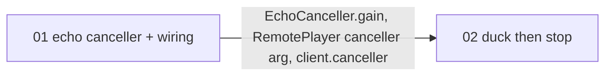

# Plan: stop the Pi speaker's voice reaching the transcript (echo cancellation and duck-then-stop)

**Status:** confirmed 2026-10-23 · **Date:** 2026-10-23

The live test (`docs/LIVE-AGENT.md`) showed the Pi speaker's voice entering the transcript ahead of the user's words: a bare "Stop." was lost, "Stop" in the middle of a transcript was read as a music command, and the assistant once acted on its own words. The offline measurements (`docs/AEC-REMOTE-SPEAKER.md`) show WebRTC's echo canceller, fed the audio we send to the Pi as its reference, removes most of that echo. This plan puts it in the live loop behind `doc_chat --aec`, and adds duck-then-stop (`--duck-db`): the speaker is turned down 15 dB at the first sign of a voice, stops if the 7-of-10 guard fires, and comes back if no barge-in follows. agy builds it from two level-3 tickets; the owner then repeats the interruption session, with the speaker in front of the laptop.

## How does it work?

During a reply, `RemotePlayer` sends 50 ms slices to the Pi (0.25 s ahead of playing). It also hands each slice, as 16 kHz audio, to the `EchoCanceller`. Every 100 ms microphone block passes through the same canceller in `MicHub`, in ten 10 ms frames, with a reference frame (or silence) fed with each, before the guard, pre-roll or speech recogniser see it. The reference starts 50 ms ahead (the best of 0-300 ms on a real recording, because the path delay adds to it). When the user starts talking over the reply, a block louder than the echo bar with two Silero speech windows ducks the Pi 15 dB at once (a `gain` message; the Pi scales what it has not yet played, with a ramp, and the canceller's reference is scaled the same); the 7-of-10 guard then stops the reply as before, or the volume returns after 0.6 s without a voice.

## What changes?

| | Now | After |
|---|---|---|
| Microphone blocks | raw (the assistant's echo included) | through the canceller with `--aec` |
| Barge-in | silent until the 7-of-10 guard fires | speaker ducks 15 dB at the first sign (`--duck-db -15`) |
| `pi_speaker.py` | begin / audio / end / abort | also `{"type": "gain", "db": x}` |

## Already decided (owner, 2026-10-23)

`livekit` added to the laptop group (done, no other package moved); `pi_speaker.py` and `playback.py` copied to the Pi by the assistant after review (not committed there); both features off by default; text-level guards (drop leading echo words, an echo-only interruption is a stop, never act on the bot's own words) are a separate, later ticket.

## What runs, and in what order?

One agy launch, both tickets in order (02 edits the files 01 edits).

## What could go wrong?

- **The first reply after idle arrives about 0.55 s late at the Pi** (the device wakes) → the canceller's lead would then be wrong for that reply; measured, not fixed here (keeping the Pi sink awake would also save 0.55 s of latency).
- **Ducking before cancelling may fire on residual echo** → it needs the level bar and two Silero windows, and `--duck-db` is off by default.
- **Pi copy of `playback.py` must match** → deployed by the assistant before the live test.

## Next action

Launch the agy wave with `fence.sh` (command in the handoff message).

---

## Task detail (for agents)

Executor: agy (`gemini-3.8-flash-high`), level 3, default profile; fence `.scratch/echo-fix/agy_work/fence.sh`. Tickets: `.scratch/echo-fix/tickets/`. Reference code (verified 2026-10-23 in an overlay: ruff, format, mypy strict, tests): `.scratch/echo-fix/skeleton/` and the edit lists `edits_a.py`, `edits_b.py`. Test pass: skip as a separate pass (each ticket carries its tests; the live comparison is the integration check). Documentation pass: required (Claude, after review).
