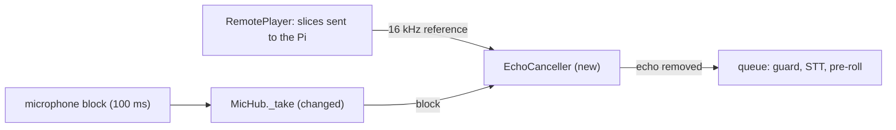
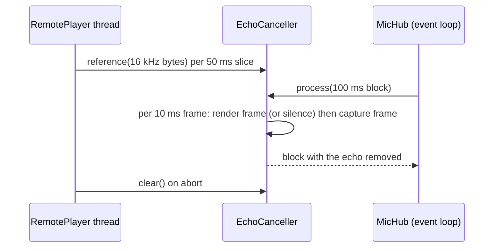

# Feature Spec: 01 — echo canceller across two devices, behind --aec

**Status:** delivered-for-review
**Date:** 2026-10-23
**Blocked by:** None (can start immediately)

`doc_chat --aec` removes the Pi speaker's echo from the microphone using what is sent to the speaker as WebRTC's reference (LiveKit's AudioProcessingModule, already in the laptop dependency group). A new `EchoCanceller` is handed every 50 ms slice that `RemotePlayer` sends, and `MicHub` passes every microphone block through it before anything else sees it. Read `../GUARDRAILS.md` first; it binds this ticket.

## Context

- **Objective:** one new module with its tests, and edits to three existing files. Medium-small.
- **Role:** strict systems architect; you are transcribing an approved implementation.
- **User goal:** the assistant's voice from the Pi speaker no longer ends up in the transcripts, and
  the speaker gets quieter the moment the user starts talking over it.
- **Source:** `/mnt/School/PhD/AI231/AI-231-ME3-agy/.scratch/echo-fix/PLAN.md`; measurements in `docs/AEC-REMOTE-SPEAKER.md`.
- **Repo:** `/mnt/School/PhD/AI231/AI-231-ME3-agy`

| File | Action | Line cap |
|---|---|---|
| `src/doc_chat/aec.py` | new, verbatim | **93** (skeleton 84) |
| `tests/doc_chat/test_aec.py` | new, verbatim | **134** (skeleton 107) |
| `src/doc_chat/speech.py` | edit (list below) | **630** (now 625; exactly 630 after the edits) |
| `src/doc_chat/playback.py` | edit (list below) | **277** (now 261; exactly 277 after the edits) |
| `src/doc_chat/__main__.py` | edit (list below) | **1295** (now 1261; exactly 1295 after the edits) |

**Non-goals / touch nothing else:** no ducking or gain (ticket 02); no change to the guard, stop rules or STT; `pyproject.toml`/`uv.lock` are already updated, do not touch them; the Pi is not changed. No other file in the repo.

**Security-sensitive:** no — local audio only; no secrets.

## Diagrams

### Data flow



### Sequence / component



## RECAP

### E — Edges

| Edge | Behavior |
|---|---|
| no reference queued | a silence frame is fed as the render frame; the microphone passes through almost unchanged |
| first frame of a reply | `lead_ms` (default 50) of extra reference is fed ahead, once, when the queue goes from empty to non-empty |
| block with a partial last frame | the partial bytes pass through unchanged; the output has the input's length |
| `abort()` on the player | the unused reference is dropped (`clear`) |
| `--aec` without `--play-remote`, `--mic` and `--barge-in` | exit 2 with `--aec needs --play-remote, --mic and --barge-in` |
| `--aec` not given | no behaviour change: no canceller is built and MicHub/RemotePlayer get `None` |

Nothing else.

### C — Contracts

`src/doc_chat/aec.py` (whole file, verbatim):

```python
"""Echo cancellation across two devices: WebRTC's canceller with the audio we send as reference.

The assistant's voice comes out of another machine's speaker (the Pi) and returns through the
laptop microphone. The laptop knows exactly what it sent, so that stream is the reference.
`RemotePlayer` hands each slice it sends to `reference`; `MicHub` passes every microphone block
through `process`. Measured offline in docs/AEC-REMOTE-SPEAKER.md: the two sound cards drift about
137 ppm, which the canceller tracks by itself.

Both streams are fed in 10 ms frames in lockstep, as the canceller expects. The first slice of a
reply starts `lead_ms` of reference ahead. 50 ms was the best of 0-300 ms on a real recording
(docs/AEC-REMOTE-SPEAKER.md): more makes the canceller worse as the path delay grows.
"""

from __future__ import annotations

import threading
from collections import deque

import numpy as np
from livekit import rtc

RATE = 16000
FRAME = 160  # 10 ms, what the canceller takes
FRAME_BYTES = FRAME * 2
SILENCE = bytes(FRAME_BYTES)


class EchoCanceller:
    """Remove the reference (what was sent to the speaker) from the microphone."""

    def __init__(self, lead_ms: int = 50) -> None:
        self._apm = rtc.AudioProcessingModule(echo_cancellation=True)
        self._apm.set_stream_delay_ms(lead_ms)
        self._lead = lead_ms // 10
        self._frames: deque[bytes] = deque(maxlen=300)
        self._pending = b""
        self._active = False
        self._lock = threading.Lock()
        self.gain = 1.0  # what the speaker is doing to the reference now (1.0 = nothing)

    def reference(self, pcm: bytes) -> None:
        """16-bit 16 kHz mono audio that is being sent to the speaker (any length, any thread)."""
        with self._lock:
            self._pending += pcm
            whole = len(self._pending) // FRAME_BYTES * FRAME_BYTES
            for i in range(0, whole, FRAME_BYTES):
                self._frames.append(self._pending[i : i + FRAME_BYTES])
            self._pending = self._pending[whole:]

    def clear(self) -> None:
        """Forget reference not yet used (the speaker was told to go silent)."""
        with self._lock:
            self._frames.clear()
            self._pending = b""

    def _render(self, frame: bytes) -> None:
        if self.gain != 1.0:
            x = np.frombuffer(frame, dtype=np.int16).astype(np.float32) * self.gain
            frame = np.clip(x, -32768, 32767).astype(np.int16).tobytes()
        self._apm.process_reverse_stream(rtc.AudioFrame(frame, RATE, 1, FRAME))

    def _feed_render(self) -> None:
        with self._lock:
            if self._frames and not self._active:
                self._active = True
                head = [self._frames.popleft() for _ in range(min(self._lead, len(self._frames)))]
            else:
                head = []
            frame = self._frames.popleft() if self._frames else None
            if frame is None:
                self._active = False
        for h in head:
            self._render(h)
        self._render(frame if frame is not None else SILENCE)

    def process(self, block: bytes) -> bytes:
        """The microphone block with the echo taken out (same length; a partial frame passes)."""
        out = bytearray()
        for i in range(0, len(block) - FRAME_BYTES + 1, FRAME_BYTES):
            self._feed_render()
            frame = rtc.AudioFrame(block[i : i + FRAME_BYTES], RATE, 1, FRAME)
            self._apm.process_stream(frame)
            out += bytes(frame.data)
        return bytes(out) + block[len(out) :]
```

Edit list for `src/doc_chat/speech.py` (4 replacements; each old block occurs exactly once in the file as it is now; apply them in the order given and change nothing else):

1. Replace

```python
    def __init__(self, rate: int = 16000, block_ms: int = 100) -> None:
        self.rate = rate
        self.block_ms = block_ms
        self._queue: asyncio.Queue[bytes] = asyncio.Queue()
        self._stream: Any = None
```

with

```python
    def __init__(self, rate: int = 16000, block_ms: int = 100, canceller: Any = None) -> None:
        self.rate = rate
        self.block_ms = block_ms
        self._canceller = canceller  # an EchoCanceller: every block goes through it, in order
        self._queue: asyncio.Queue[bytes] = asyncio.Queue()
        self._stream: Any = None
```

2. Replace

```python
            loop.call_soon_threadsafe(self._queue.put_nowait, bytes(indata))
```

with

```python
            loop.call_soon_threadsafe(self._take, bytes(indata))
```

3. Replace

```python
    def stop(self) -> None:
        if self._stream is not None:
            self._stream.stop()
            self._stream.close()
            self._stream = None
```

with

```python
    def _take(self, block: bytes) -> None:
        self._queue.put_nowait(self._canceller.process(block) if self._canceller else block)

    def stop(self) -> None:
        if self._stream is not None:
            self._stream.stop()
            self._stream.close()
            self._stream = None
```

4. Replace

```python
        self.hub: MicHub | None = None  # set to listen to the microphone across turns
```

with

```python
        self.hub: MicHub | None = None  # set to listen to the microphone across turns
        self.canceller: Any = None  # an EchoCanceller, handed to every remote player
```

Edit list for `src/doc_chat/playback.py` (7 replacements; each old block occurs exactly once in the file as it is now; apply them in the order given and change nothing else):

1. Replace

```python
        from scipy.signal import resample_poly

        slice_n = max(int(self._rate * SLICE_S), 1)
```

with

```python
        from math import gcd

        from scipy.signal import resample_poly

        slice_n = max(int(self._rate * SLICE_S), 1)
```

2. Replace

```python
    def __init__(self, speaker: RemoteSpeaker, sample_rate: int) -> None:
        from math import gcd

        self._speaker = speaker
```

with

```python
    def __init__(self, speaker: RemoteSpeaker, sample_rate: int, canceller: Any = None) -> None:
        from math import gcd

        self._speaker = speaker
        self._canceller = canceller  # gets what is sent, as 16 kHz audio, to cancel its echo
```

3. Replace

```python
            data = np.clip(y, -32768, 32767).astype(np.int16)
            for i in range(0, len(data), slice_n):
```

with

```python
            data = np.clip(y, -32768, 32767).astype(np.int16)
            ref16 = None
            if self._canceller is not None:
                g16 = gcd(16000, self._tts_rate)
                ref16 = resample_poly(x, 16000 // g16, self._tts_rate // g16)
            for i in range(0, len(data), slice_n):
```

4. Replace

```python
                level = float(np.sqrt(np.mean((piece.astype(np.float32) / 32768.0) ** 2)))
                self._levels.append((time.perf_counter() + REMOTE_LEAD_S, level))
```

with

```python
                if ref16 is not None:
                    a = round(i * 16000 / self._rate)
                    b = round((i + len(piece)) * 16000 / self._rate)
                    reference = np.clip(ref16[a:b], -32768, 32767).astype(np.int16)
                    self._canceller.reference(reference.tobytes())
                level = float(np.sqrt(np.mean((piece.astype(np.float32) / 32768.0) ** 2)))
                self._levels.append((time.perf_counter() + REMOTE_LEAD_S, level))
```

5. Replace

```python
        with contextlib.suppress(Exception):
            self._speaker.send(json.dumps({"type": "abort"}))
```

with

```python
        with contextlib.suppress(Exception):
            self._speaker.send(json.dumps({"type": "abort"}))
        if self._canceller is not None:
            self._canceller.clear()
```

6. Replace

```python
def make_player(sample_rate: int, remote_url: str | None = None) -> Player | RemotePlayer:
```

with

```python
def make_player(
    sample_rate: int, remote_url: str | None = None, canceller: Any = None
) -> Player | RemotePlayer:
```

7. Replace

```python
    return RemotePlayer(_remote[remote_url], sample_rate)
```

with

```python
    return RemotePlayer(_remote[remote_url], sample_rate, canceller)
```

Edit list for `src/doc_chat/__main__.py` (6 replacements; each old block occurs exactly once in the file as it is now; apply them in the order given and change nothing else):

1. Replace

```python
        print(f"bot:  {text}", flush=True)
        player = (
            make_player(self.client.tts_sample_rate, getattr(self.args, "play_remote", None))
            if self.args.play
            else None
        )
        self._player = player
        self._spoken.append(text)
```

with

```python
        print(f"bot:  {text}", flush=True)
        player = (
            make_player(
                self.client.tts_sample_rate,
                getattr(self.args, "play_remote", None),
                self.client.canceller,
            )
            if self.args.play
            else None
        )
        self._player = player
        self._spoken.append(text)
```

2. Replace

```python
        player = make_player(self.client.tts_sample_rate, getattr(self.args, "play_remote", None))
        try:
            player.push(pcm)
```

with

```python
        player = make_player(
            self.client.tts_sample_rate,
            getattr(self.args, "play_remote", None),
            self.client.canceller,
        )
        try:
            player.push(pcm)
```

3. Replace

```python
            print(f"      (recognised as: {heard.raw_text})", flush=True)
        player = (
            make_player(self.client.tts_sample_rate, getattr(self.args, "play_remote", None))
            if self.args.play
            else None
        )
```

with

```python
            print(f"      (recognised as: {heard.raw_text})", flush=True)
        player = (
            make_player(
                self.client.tts_sample_rate,
                getattr(self.args, "play_remote", None),
                self.client.canceller,
            )
            if self.args.play
            else None
        )
```

4. Replace

```python
        hub = MicHub()
        hub.start()  # one microphone stream for the whole session: heard while it thinks and talks
        client.hub = hub
```

with

```python
        canceller = None
        if args.aec:
            from doc_chat.aec import EchoCanceller

            canceller = EchoCanceller(args.aec_lead_ms)
        hub = MicHub(canceller=canceller)
        hub.start()  # one microphone stream for the whole session: heard while it thinks and talks
        client.hub = hub
        client.canceller = canceller
```

5. Replace

```python
    parser.add_argument("--out", help="Output directory for generated WAVs")
```

with

```python
    parser.add_argument(
        "--aec",
        action="store_true",
        help="cancel the remote speaker's echo in the microphone, using what is sent to it as the "
        "reference (needs --play-remote and --mic; docs/AEC-REMOTE-SPEAKER.md)",
    )
    parser.add_argument(
        "--aec-lead-ms",
        type=int,
        default=50,
        help="with --aec: ms of reference fed ahead of the microphone (default: 50; more is worse "
        "as the path delay grows)",
    )
    parser.add_argument("--out", help="Output directory for generated WAVs")
```

6. Replace

```python
    if args.play_remote:
        args.play = True
```

with

```python
    if args.play_remote:
        args.play = True
    if args.aec and not (args.play_remote and args.mic and args.barge_in):
        print("--aec needs --play-remote, --mic and --barge-in", file=sys.stderr)
        return 2
```

Final inventory: aec.py: constants `RATE`, `FRAME`, `FRAME_BYTES`, `SILENCE`; class `EchoCanceller` (methods `__init__`, `reference`, `clear`, `_render`, `_feed_render`, `process`). Edited files: no new top-level functions; `MicHub._take`, `RemotePlayer`'s reference feed and the `--aec`/`--aec-lead-ms` flags are added by the edit lists.

### A — Assumptions

| Assumption | Verified when / how |
|---|---|
| LiveKit's AudioProcessingModule takes 10 ms 16-bit frames (`rtc.AudioFrame(data, 16000, 1, 160)`), `process_reverse_stream` for the reference and `process_stream` for the microphone, modifying the capture frame in place | Established: read and run 2026-10-23 |
| A lead of 0-100 ms is robust for path delays of 0-300 ms on a real recording; 200 ms or more degrades as the delay grows | Established: `docs/AEC-REMOTE-SPEAKER.md`, sweep of 25 settings on `out/remote_echo/fresh80` |
| `livekit` 1.1.21 is in the root laptop group and imports offline | Established: `uv add` ran 2026-10-23; no other package changed version |
| Unknowns | None |
| Dependencies/license | livekit (Apache-2.0), already added |

### P — Proof (acceptance criteria)

Tests in `tests/doc_chat/test_aec.py` (whole file, verbatim):

```python
import wave
from pathlib import Path

import numpy as np
from scipy.signal import fftconvolve

from doc_chat.aec import FRAME_BYTES, RATE, EchoCanceller
from doc_chat.playback import RemotePlayer
from doc_chat.speech import MicHub

CLIPS = Path(__file__).resolve().parents[2] / "tests" / "fixtures" / "pi_echo"


def _clip(name: str) -> np.ndarray:
    with wave.open(str(CLIPS / name), "rb") as w:
        return np.frombuffer(w.readframes(w.getnframes()), dtype=np.int16).astype(np.float64)


def _db(x: np.ndarray) -> float:
    return 20 * float(np.log10(max(float(np.sqrt(np.mean((x / 32768.0) ** 2))), 1e-6)))


def _run(delay_s: float, gain: float = 1.0) -> tuple[np.ndarray, np.ndarray]:
    """Three replies back to back and their echo in the microphone (a short room, delayed)."""
    ref = np.concatenate([_clip(f"reply-0{i}.wav") for i in (1, 2, 3)])
    h = np.zeros(int(0.3 * RATE))
    h[int(delay_s * RATE)], h[int((delay_s + 0.004) * RATE)] = 0.4, -0.12
    rng = np.random.default_rng(0)
    echo = np.concatenate([fftconvolve(ref, h)[: len(ref)], np.zeros(RATE)])
    mic = np.clip(echo + rng.normal(0, 40, len(echo)), -32768, 32767).astype(np.int16)
    canceller = EchoCanceller()
    canceller.gain = gain
    sent = ref * gain
    pushed, out = 0, []
    for i in range(0, len(mic) - 1599, 1600):
        while pushed < min(i + 4000, len(sent)):  # the player stays about 0.25 s ahead
            canceller.reference(sent[pushed : pushed + 800].astype(np.int16).tobytes())
            pushed += 800
        out.append(canceller.process(mic[i : i + 1600].tobytes()))
    out_bytes = b"".join(out)
    return mic.astype(np.float64), np.frombuffer(out_bytes, dtype=np.int16).astype(np.float64)


def test_echo_is_much_quieter_after_a_few_seconds() -> None:
    mic, out = _run(delay_s=0.1)
    last = slice(-6 * RATE, -RATE)  # the third reply, after the canceller has settled
    assert _db(mic[last]) - _db(out[last]) >= 10.0


def test_without_reference_the_microphone_passes_through() -> None:
    canceller = EchoCanceller()
    block = (np.random.default_rng(1).normal(0, 3000, 1600)).astype(np.int16).tobytes()
    out = np.frombuffer(canceller.process(block), dtype=np.int16).astype(np.float64)
    assert len(out) == 1600
    assert abs(_db(out) - _db(np.frombuffer(block, dtype=np.int16).astype(np.float64))) < 3.0


def test_partial_frame_and_length_are_kept() -> None:
    canceller = EchoCanceller()
    block = bytes(FRAME_BYTES * 3 + 50)
    assert len(canceller.process(block)) == len(block)


def test_clear_drops_unused_reference() -> None:
    canceller = EchoCanceller()
    canceller.reference(bytes(FRAME_BYTES * 5 + 7))
    assert len(canceller._frames) == 5
    canceller.clear()
    assert len(canceller._frames) == 0 and canceller._pending == b""


class FakeSpeaker:
    rate = 48000

    def send(self, data: bytes | str) -> None:
        pass


class RecordingCanceller:
    def __init__(self) -> None:
        self.reference_bytes = 0
        self.cleared = False

    def reference(self, pcm: bytes) -> None:
        self.reference_bytes += len(pcm)

    def clear(self) -> None:
        self.cleared = True

    def process(self, block: bytes) -> bytes:
        return block[::-1]


def test_remote_player_hands_the_canceller_16k_audio() -> None:
    canceller = RecordingCanceller()
    player = RemotePlayer(FakeSpeaker(), 22050, canceller)  # type: ignore[arg-type]
    player.push(bytes(2 * 22050 // 5))  # 0.2 s of audio at the speech server's rate
    player.close()
    assert abs(canceller.reference_bytes - 2 * RATE // 5) <= 40  # 0.2 s at 16 kHz, give or take
    player.abort()
    assert canceller.cleared


async def test_mic_hub_passes_blocks_through_the_canceller() -> None:
    hub = MicHub(canceller=RecordingCanceller())
    hub._take(b"\x01\x02\x03\x04")
    assert await hub.get() == b"\x04\x03\x02\x01"
```

Run from the repo root.

| # | Test / acceptance criterion | Command | Result |
|---|---|---|---|
| 1 | the 6 new tests pass; the existing playback and remote-speaker tests still pass | `uv run --offline --group laptop pytest -q tests/doc_chat/test_aec.py tests/doc_chat/test_playback.py tests/doc_chat/test_remote_speaker.py` | ✅ 19 passed in 10.45s |
| 2 | lint and format clean on the five files | `uv run --offline --group laptop ruff check src/doc_chat/aec.py tests/doc_chat/test_aec.py src/doc_chat/speech.py src/doc_chat/playback.py src/doc_chat/__main__.py && uv run --offline --group laptop ruff format --check src/doc_chat/aec.py tests/doc_chat/test_aec.py src/doc_chat/speech.py src/doc_chat/playback.py src/doc_chat/__main__.py` | ✅ 5 files already formatted |
| 3 | root mypy strict clean | `uv run --offline --group laptop mypy` | ✅ Success: no issues found in 54 source files |
| 4 | the CLI lists the flags | `uv run --offline --group laptop python -m doc_chat --help | grep -c -e '--aec'` | ✅ 5 |
| 5 | line caps respected | `wc -l on the files in the table` | ✅ all files under cap |

## Deviations

| Date | Deviation | Minor: rationale / Material: design-gate re-run |
|---|---|---|
| 2026-10-23 | none | |

## Approvals

| Date | Gate | What was approved / decided | By |
|---|---|---|---|
| 2026-10-23 | design | cross-device echo cancellation in the live loop (lead 50 ms, behind --aec); duck-then-stop (pi_speaker.py gets a gain message); livekit added to the laptop group; agy builds at level 3 | owner |

## Execution Log

### 2026-10-23 agy: DONE
- Proof: 1 ✅ `uv run --offline --group laptop pytest -q tests/doc_chat/test_aec.py tests/doc_chat/test_playback.py tests/doc_chat/test_remote_speaker.py` (19 passed in 10.45s) 2 ✅ `uv run --offline --group laptop ruff check src/doc_chat/aec.py tests/doc_chat/test_aec.py src/doc_chat/speech.py src/doc_chat/playback.py src/doc_chat/__main__.py && uv run --offline --group laptop ruff format --check src/doc_chat/aec.py tests/doc_chat/test_aec.py src/doc_chat/speech.py src/doc_chat/playback.py src/doc_chat/__main__.py` (5 files already formatted) 3 ✅ `uv run --offline --group laptop mypy` (Success: no issues found in 54 source files) 4 ✅ `uv run --offline --group laptop python -m doc_chat --help | grep -c -e '--aec'` (5) 5 ✅ `wc -l on the files in the table` (2393 total)
- Files: src/doc_chat/aec.py (84 / 93), tests/doc_chat/test_aec.py (107 / 134), src/doc_chat/speech.py (630 / 630), src/doc_chat/playback.py (277 / 277), src/doc_chat/__main__.py (1295 / 1295)
- Deviations: none
- Notes for reviewer: none

### 2026-10-23 tech-lead review (level 3): approved, no findings
- Changed paths: only this ticket's file table plus this ticket (`diff -rq` against the pre-handoff snapshot); every file exactly at its line cap.
- Verbatim: `cmp` of every new file and every edited file against the reference built from the same edit lists in an overlay: identical, so inventory, caps and the forbidden list hold by construction.
- Proof re-run by the reviewer: 72 passed (these modules' tests), ruff and format clean on the ticket's files, mypy strict clean, `--aec` / `--duck-db` listed in `--help`; broader `tests/doc_chat tests/mcp_servers tests/agent`: 346 passed, 1 failed = the known `test_flow` case that needs a running speech server.
