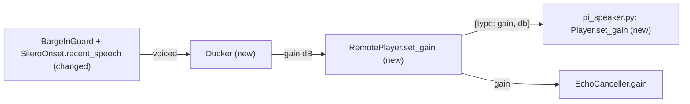
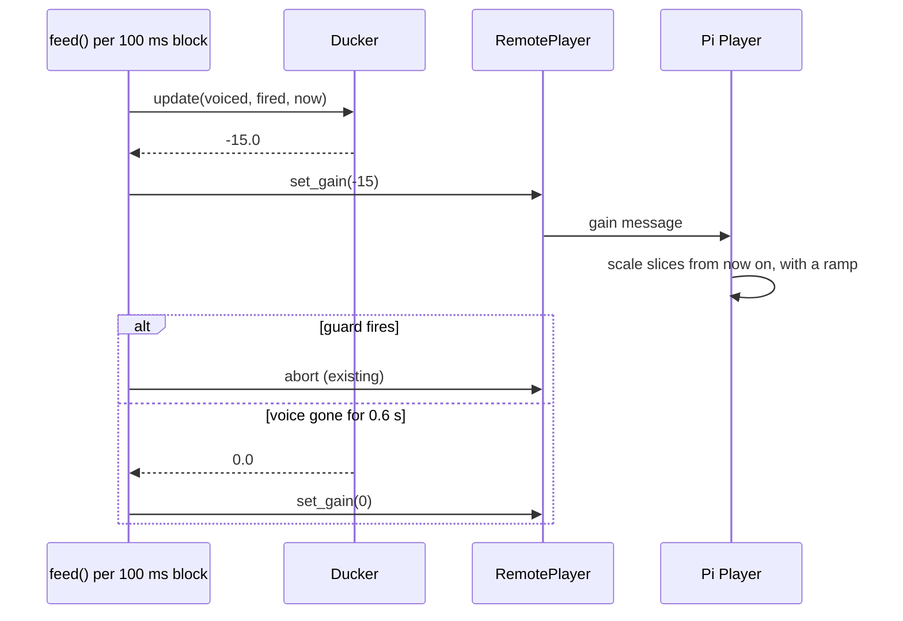

# Feature Spec: 02 — duck, then stop: turn the Pi speaker down at the first sign of a voice

**Status:** delivered-for-review
**Date:** 2026-10-23
**Blocked by:** 01

At the first sign of the user's voice over the answer (a loud-enough block and two Silero speech windows), `doc_chat --duck-db -15` turns the speaker down 15 dB at once; if the 7-of-10 guard then fires the reply stops as before, and if the voice goes away the volume comes back after 0.6 s. The Pi applies the gain to audio it has not yet played (a `gain` message), and the canceller's reference follows. Before any code, confirm ticket 01 landed: `src/doc_chat/aec.py` exists, `RemotePlayer.__init__` takes `canceller`, and `client.canceller` exists. A mismatch means stop. Read `../GUARDRAILS.md` first; it binds this ticket.

## Context

- **Objective:** four edited files and one new test file. Medium-small.
- **Role:** strict systems architect; you are transcribing an approved implementation.
- **User goal:** the assistant's voice from the Pi speaker no longer ends up in the transcripts, and
  the speaker gets quieter the moment the user starts talking over it.
- **Source:** `/mnt/School/PhD/AI231/AI-231-ME3-agy/.scratch/echo-fix/PLAN.md`; measurements in `docs/AEC-REMOTE-SPEAKER.md`.
- **Repo:** `/mnt/School/PhD/AI231/AI-231-ME3-agy`

| File | Action | Line cap |
|---|---|---|
| `tests/doc_chat/test_duck.py` | new, verbatim | **198** (skeleton 158) |
| `src/doc_chat/playback.py` | edit (list below) | **307** (now 261; exactly 307 after the edits) |
| `src/doc_chat/bargein.py` | edit (list below) | **352** (now 321; exactly 352 after the edits) |
| `scripts/pi_speaker.py` | edit (list below) | **109** (now 106; exactly 109 after the edits) |
| `src/doc_chat/__main__.py` | edit (list below) | **1325** (now 1261; exactly 1325 after the edits) |

**Non-goals / touch nothing else:** no change to `aec.py`, `speech.py` or the guard's thresholds; the copy of `pi_speaker.py` on the Pi is deployed by the human, not by you. No other file in the repo.

**Security-sensitive:** no — local audio only; the Pi message carries a number.

## Diagrams

### Data flow



### Sequence / component



## RECAP

### E — Edges

| Edge | Behavior |
|---|---|
| `--duck-db` 0 (the default) | no ducker is built; behaviour is unchanged |
| voiced and not yet ducked | `Ducker.update` returns the duck gain once |
| already ducked and still voiced | None (no repeat) |
| ducked, voice gone for `restore_s` | returns 0.0 and resets |
| ducked and the guard fires | resets without returning a gain (the reply is aborted anyway) |
| a new reply | a new player starts at gain 1.0 (and `RemotePlayer.__init__` sets the canceller's gain to 1.0) |
| `gain` message before the Pi has a player | ignored |

Nothing else.

### C — Contracts

`tests/doc_chat/test_duck.py` is in the Proof section below.

Edit list for `src/doc_chat/playback.py` (7 replacements; each old block occurs exactly once in the file as it is now; apply them in the order given and change nothing else):

1. Replace

```python
class Player:
    """Writes PCM to the speakers```

with

```python
def apply_gain(x: np.ndarray, start: float, end: float) -> np.ndarray:
    """16-bit samples scaled by a gain that moves in a straight line from `start` to `end`."""
    ramp = np.linspace(start, end, len(x), dtype=np.float32)
    scaled: np.ndarray = np.clip(x.astype(np.float32) * ramp, -32768, 32767).astype(np.int16)
    return scaled


class Player:
    """Writes PCM to the speakers```

2. Replace

```python
        self.underruns = 0  # slices the device had to wait for (heard as a stutter)
        self._pushed_s = 0.0  # seconds of audio queued so far: how long `close` may have to wait
        self._stream: Any = sd.RawOutputStream```

with

```python
        self.underruns = 0  # slices the device had to wait for (heard as a stutter)
        self._pushed_s = 0.0  # seconds of audio queued so far: how long `close` may have to wait
        self._gain = 1.0  # 1.0 = as pushed; set_gain ducks it
        self._stream: Any = sd.RawOutputStream```

3. Replace

```python
        stopped = False
        last = 0  # the last sample handed to the device
```

with

```python
        stopped = False
        last = 0  # the last sample handed to the device
        applied = 1.0  # the gain at the end of the previous slice
```

4. Replace

```python
                x = np.frombuffer(piece[: len(piece) // 2 * 2], dtype=np.int16)  # whole samples
                level = (```

with

```python
                x = np.frombuffer(piece[: len(piece) // 2 * 2], dtype=np.int16)  # whole samples
                if self._gain != 1.0 or applied != 1.0:  # ducked, or just let back up
                    x = apply_gain(x, applied, self._gain)
                    applied = self._gain
                    piece = x.tobytes()
                level = (```

5. Replace

```python
    def push(self, pcm: bytes) -> None:
        self._pushed_s += len(pcm) / 2 / self._rate
        self._queue.put(pcm)
```

with

```python
    def set_gain(self, db: float) -> None:
        """Turn the speaker down (negative dB) or back to normal (0), from the next slice on."""
        self._gain = 10 ** (db / 20)

    def push(self, pcm: bytes) -> None:
        self._pushed_s += len(pcm) / 2 / self._rate
        self._queue.put(pcm)
```

6. Replace

```python
        self._canceller = canceller  # gets what is sent, as 16 kHz audio, to cancel its echo
```

with

```python
        self._canceller = canceller  # gets what is sent, as 16 kHz audio, to cancel its echo
        self._gain = 1.0
        if canceller is not None:
            canceller.gain = 1.0
```

7. Replace

```python
        return max((lv for t, lv in list(self._levels) if 0 <= now - t <= window_s), default=0.0)
```

with

```python
        loudest = max((lv for t, lv in list(self._levels) if 0 <= now - t <= window_s), default=0.0)
        return loudest * self._gain

    def set_gain(self, db: float) -> None:
        """Turn the speaker down (negative dB) or back to normal (0), now: the Pi applies it to
        what it has not yet played, and the canceller's reference follows."""
        self._gain = 10 ** (db / 20)
        if self._canceller is not None:
            self._canceller.gain = self._gain
        with contextlib.suppress(Exception):
            self._speaker.send(json.dumps({"type": "gain", "db": db}))
```

Edit list for `scripts/pi_speaker.py` (2 replacements; each old block occurs exactly once in the file as it is now; apply them in the order given and change nothing else):

1. Replace

```python
                kind = json.loads(msg).get("type")
```

with

```python
                data = json.loads(msg)
                kind = data.get("type")
```

2. Replace

```python
                elif kind == "end" and player is not None:
```

with

```python
                elif kind == "gain" and player is not None:
                    player.set_gain(float(data["db"]))
                elif kind == "end" and player is not None:
```

Edit list for `src/doc_chat/bargein.py` (2 replacements; each old block occurs exactly once in the file as it is now; apply them in the order given and change nothing else):

1. Replace

```python
    def _confidence(self, window: object) -> float:
```

with

```python
    @property
    def recent_speech(self) -> int:
        """Speech windows among the last n (needs kofn): a rise is the first sign of a voice."""
        return sum(self._recent)

    def _confidence(self, window: object) -> float:
```

2. Replace

```python
class EchoModel:
```

with

```python
class Ducker:
    """Turn the speaker down at the first sign of a voice, and back up if no barge-in follows."""

    def __init__(self, db: float, restore_s: float = 0.6) -> None:
        self.db = db
        self.restore_s = restore_s
        self._since: float | None = None

    @property
    def ducked(self) -> bool:
        return self._since is not None

    def update(self, voiced: bool, fired: bool, now: float) -> float | None:
        """The gain in dB to set (negative to duck, 0.0 to restore), or None to leave it."""
        if self._since is None:
            if voiced and not fired:
                self._since = now
                return self.db
        elif fired:
            self._since = None
        elif not voiced and now - self._since >= self.restore_s:
            self._since = None
            return 0.0
        return None


class EchoModel:
```

Edit list for `src/doc_chat/__main__.py` (5 replacements; each old block occurs exactly once in the file as it is now; apply them in the order given and change nothing else):

1. Replace

```python
from doc_chat.bargein import BargeInGuard, EchoModel, PreRoll, SileroOnset, looks_like_echo
```

with

```python
from doc_chat.bargein import (
    BargeInGuard,
    Ducker,
    EchoModel,
    PreRoll,
    SileroOnset,
    looks_like_echo,
)
```

2. Replace

```python
        "as the path delay grows)",
    )
```

with

```python
        "as the path delay grows)",
    )
    parser.add_argument(
        "--duck-db",
        type=float,
        default=0.0,
        help="turn the remote speaker down by this many dB (negative, e.g. -15) at the first "
        "sign of your voice over the answer, and back up if you do not interrupt (default: off)",
    )
    parser.add_argument(
        "--duck-k",
        type=int,
        default=2,
        help="with --duck-db: speech windows among the last 10 that count as the first sign",
    )
```

3. Replace

```python
        trace = self._guard_trace

        def feed(block: bytes) -> bool:
```

with

```python
        trace = self._guard_trace
        duck_db = float(getattr(self.args, "duck_db", 0.0))
        duck_k = int(getattr(self.args, "duck_k", 2))
        ducker = Ducker(duck_db) if duck_db < 0.0 else None

        def feed(block: bytes) -> bool:
```

4. Replace

```python
            fired = guard.feed(block, played, answering=answering)
```

with

```python
            fired = guard.feed(block, played, answering=answering)
            set_gain = getattr(self._player, "set_gain", None)
            if ducker is not None and silero is not None and answering and set_gain is not None:
                voiced = guard.last_level > guard.last_bar and silero.recent_speech >= duck_k
                new_gain = ducker.update(voiced, fired, time.perf_counter())
                if new_gain is not None:
                    set_gain(new_gain)
```

5. Replace

```python
                            "fired": fired,
```

with

```python
                            "fired": fired,
                            "ducked": ducker is not None and ducker.ducked,
```

Final inventory: No new top-level functions in edited files except `apply_gain` (playback.py) and class `Ducker` (bargein.py); new methods `Player.set_gain`, `RemotePlayer.set_gain`, `SileroOnset.recent_speech`, `Ducker.__init__`, `Ducker.ducked`, `Ducker.update`; the `--duck-db`, `--duck-k` flags.

### A — Assumptions

| Assumption | Verified when / how |
|---|---|
| Ticket 01's exports as listed above | Must verify: Step 0 |
| `pi_speaker.py` gets `player.set_gain` from `doc_chat.playback.Player`; the Pi's copy of `playback.py` must be updated by the human before `--duck-db` is used | Established: pi_speaker.py imports `Player` from `doc_chat.playback` (read 2026-10-23) |
| `BargeInGuard` exposes `last_level` and `last_bar` | Established: bargein.py, used in the guard trace |
| Unknowns | None |
| Dependencies/license | none new |

### P — Proof (acceptance criteria)

Tests in `tests/doc_chat/test_duck.py` (whole file, verbatim):

```python
import asyncio
import importlib.util
import json
import sys
import threading
import time
import types
from pathlib import Path
from typing import Any

import numpy as np
import pytest

from doc_chat.bargein import Ducker, SileroOnset
from doc_chat.playback import Player, RemotePlayer, RemoteSpeaker, apply_gain

spec = importlib.util.spec_from_file_location(
    "pi_speaker", Path(__file__).resolve().parents[2] / "scripts" / "pi_speaker.py"
)
assert spec and spec.loader
pi_speaker = importlib.util.module_from_spec(spec)
sys.modules["pi_speaker"] = pi_speaker
spec.loader.exec_module(pi_speaker)

PORT = 8792


def test_apply_gain_moves_in_a_straight_line() -> None:
    x = np.full(1000, 10000, dtype=np.int16)
    y = apply_gain(x, 1.0, 0.1)
    assert y[0] == 10000 and abs(int(y[-1]) - 1000) <= 1
    assert np.all(np.diff(y.astype(np.int32)) <= 0)


def test_ducker_ducks_once_and_restores_after_the_voice_stops() -> None:
    d = Ducker(-15.0, restore_s=0.6)
    assert d.update(voiced=False, fired=False, now=0.0) is None
    assert d.update(voiced=True, fired=False, now=1.0) == -15.0 and d.ducked
    assert d.update(voiced=True, fired=False, now=1.1) is None  # already ducked
    assert d.update(voiced=False, fired=False, now=1.3) is None  # too soon to restore
    assert d.update(voiced=False, fired=False, now=1.7) == 0.0 and not d.ducked


def test_ducker_stays_down_when_the_guard_fires() -> None:
    d = Ducker(-15.0)
    d.update(voiced=True, fired=False, now=1.0)
    assert d.update(voiced=False, fired=True, now=1.1) is None and not d.ducked


def test_silero_counts_recent_speech_windows() -> None:
    v = SileroOnset("assets/silero_vad.onnx", confidence=0.5, kofn=(7, 10))
    v._recent.extend([True, False, True])
    assert v.recent_speech == 2


def test_player_scales_what_reaches_the_device(monkeypatch: pytest.MonkeyPatch) -> None:
    chunks: list[bytes] = []

    class Stream:
        def __init__(self, **kw: Any) -> None: ...
        def start(self) -> None: ...
        def stop(self) -> None: ...
        def close(self) -> None: ...
        def abort(self) -> None: ...

        def write(self, data: bytes) -> bool:
            chunks.append(data)
            return False

    mod = types.ModuleType("sounddevice")
    mod.RawOutputStream = Stream  # type: ignore[attr-defined]
    monkeypatch.setitem(sys.modules, "sounddevice", mod)
    player = Player(16000)
    player.set_gain(-20.0)
    player.push(np.full(1600, 10000, dtype=np.int16).tobytes())
    player.close()
    heard = np.frombuffer(b"".join(chunks), dtype=np.int16)
    assert 900 < np.abs(heard[800:]).mean() < 1100  # a tenth of 10000, after the ramp


class FakeSpeaker:
    rate = 48000

    def __init__(self) -> None:
        self.sent: list[Any] = []

    def send(self, data: bytes | str) -> None:
        self.sent.append(data)


class FakeCanceller:
    gain = 1.0

    def reference(self, pcm: bytes) -> None: ...

    def clear(self) -> None: ...


def test_remote_player_set_gain_tells_the_pi_and_the_canceller() -> None:
    speaker, canceller = FakeSpeaker(), FakeCanceller()
    player = RemotePlayer(speaker, 16000, canceller)  # type: ignore[arg-type]
    player._levels.append((time.perf_counter(), 0.5))
    player.set_gain(-15.0)
    messages = [json.loads(m) for m in speaker.sent if isinstance(m, str)]
    assert {"type": "gain", "db": -15.0} in messages
    assert abs(canceller.gain - 10 ** (-15 / 20)) < 1e-9
    assert abs(player.level_recent() - 0.5 * 10 ** (-15 / 20)) < 1e-6
    player.set_gain(0.0)
    assert canceller.gain == 1.0
    player.abort()


class FakePiPlayer:
    instances: list["FakePiPlayer"] = []

    def __init__(self, rate: int) -> None:
        self.bytes = 0
        self.gains: list[float] = []
        FakePiPlayer.instances.append(self)

    def push(self, pcm: bytes) -> None:
        self.bytes += len(pcm)

    def set_gain(self, db: float) -> None:
        self.gains.append(db)

    def abort(self) -> None: ...

    def close(self) -> None: ...


def test_the_pi_applies_a_gain_message_to_the_reply_in_progress() -> None:
    loop = asyncio.new_event_loop()
    ready = threading.Event()

    async def run() -> None:
        evt = asyncio.Event()
        task = asyncio.create_task(
            pi_speaker.serve_speaker("127.0.0.1", PORT, "secret", 48000, FakePiPlayer, evt)
        )
        await evt.wait()
        ready.set()
        await task

    threading.Thread(target=lambda: loop.run_until_complete(run()), daemon=True).start()
    assert ready.wait(5)
    speaker = RemoteSpeaker(f"ws://127.0.0.1:{PORT}", "secret")
    player = RemotePlayer(speaker, 16000)
    player.push(np.zeros(16000, dtype=np.int16).tobytes())
    end = time.time() + 5
    while not (FakePiPlayer.instances and FakePiPlayer.instances[0].bytes) and time.time() < end:
        time.sleep(0.02)
    player.set_gain(-15.0)
    while not FakePiPlayer.instances[0].gains and time.time() < end:
        time.sleep(0.02)
    assert FakePiPlayer.instances[0].gains == [-15.0]
    player.abort()
    speaker.close()
```

Run from the repo root.

| # | Test / acceptance criterion | Command | Result |
|---|---|---|---|
| 1 | the 7 new tests and the earlier tests of these modules pass | `uv run --offline --group laptop pytest -q tests/doc_chat/test_duck.py tests/doc_chat/test_aec.py tests/doc_chat/test_playback.py tests/doc_chat/test_remote_speaker.py tests/doc_chat/test_bargein.py` | ✅ 72 passed in 11.98s |
| 2 | lint and format clean on the five files | `uv run --offline --group laptop ruff check tests/doc_chat/test_duck.py src/doc_chat/playback.py src/doc_chat/bargein.py scripts/pi_speaker.py src/doc_chat/__main__.py && uv run --offline --group laptop ruff format --check tests/doc_chat/test_duck.py src/doc_chat/playback.py src/doc_chat/bargein.py scripts/pi_speaker.py src/doc_chat/__main__.py` | ✅ 5 files already formatted |
| 3 | root mypy strict clean | `uv run --offline --group laptop mypy` | ✅ Success: no issues found in 54 source files |
| 4 | the CLI lists the flags | `uv run --offline --group laptop python -m doc_chat --help | grep -c -e '--duck-db'` | ✅ 3 |
| 5 | line caps respected | `wc -l on the files in the table` | ✅ all files under cap |

## Deviations

| Date | Deviation | Minor: rationale / Material: design-gate re-run |
|---|---|---|
| 2026-10-23 | none | |

## Approvals

| Date | Gate | What was approved / decided | By |
|---|---|---|---|
| 2026-10-23 | design | cross-device echo cancellation in the live loop (lead 50 ms, behind --aec); duck-then-stop (pi_speaker.py gets a gain message); livekit added to the laptop group; agy builds at level 3 | owner |

## Execution Log

### 2026-10-23 agy: DONE
- Step 0: verified ticket 01 landed: src/doc_chat/aec.py exists, RemotePlayer.__init__ takes canceller, client.canceller exists; all confirmed
- Proof: 1 ✅ `uv run --offline --group laptop pytest -q tests/doc_chat/test_duck.py tests/doc_chat/test_aec.py tests/doc_chat/test_playback.py tests/doc_chat/test_remote_speaker.py tests/doc_chat/test_bargein.py` (72 passed in 11.98s) 2 ✅ `uv run --offline --group laptop ruff check tests/doc_chat/test_duck.py src/doc_chat/playback.py src/doc_chat/bargein.py scripts/pi_speaker.py src/doc_chat/__main__.py && uv run --offline --group laptop ruff format --check tests/doc_chat/test_duck.py src/doc_chat/playback.py src/doc_chat/bargein.py scripts/pi_speaker.py src/doc_chat/__main__.py` (5 files already formatted) 3 ✅ `uv run --offline --group laptop mypy` (Success: no issues found in 54 source files) 4 ✅ `uv run --offline --group laptop python -m doc_chat --help | grep -c -e '--duck-db'` (3) 5 ✅ `wc -l on the files in the table` (2251 total)
- Files: tests/doc_chat/test_duck.py (158 / 198), src/doc_chat/playback.py (307 / 307), src/doc_chat/bargein.py (352 / 352), scripts/pi_speaker.py (109 / 109), src/doc_chat/__main__.py (1325 / 1325)
- Deviations: none
- Notes for reviewer: none

### 2026-10-23 tech-lead review (level 3): approved, no findings
- Changed paths: only this ticket's file table plus this ticket (`diff -rq` against the pre-handoff snapshot); every file exactly at its line cap.
- Verbatim: `cmp` of every new file and every edited file against the reference built from the same edit lists in an overlay: identical, so inventory, caps and the forbidden list hold by construction.
- Proof re-run by the reviewer: 72 passed (these modules' tests), ruff and format clean on the ticket's files, mypy strict clean, `--aec` / `--duck-db` listed in `--help`; broader `tests/doc_chat tests/mcp_servers tests/agent`: 346 passed, 1 failed = the known `test_flow` case that needs a running speech server.
