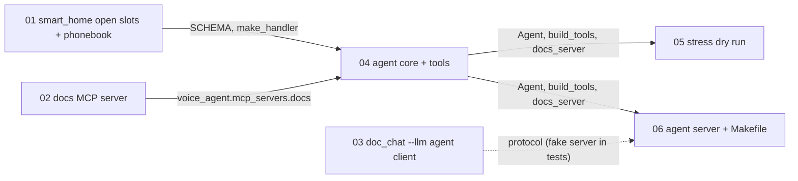

# Plan: the agent in the live voice loop (smart_home + docs MCP), for a speaking test

**Status:** confirmed 2026-10-23 · **Date:** 2026-10-23

The live loop (`doc_chat`: laptop mic, echo guard, Pi speaker) gets a new language-model backend, `--llm agent`, which talks over a local WebSocket to an agent server in `pipeline/`: one long-lived Pipecat pipeline around native Gemini 3.1 flash-lite with two kinds of tools, `smart_home` (now with open slots and a JSON phonebook for calls and messages) and the docs MCP server (new, built with fastmcp, BM25 over the McCarthy corpus). The model decides when to search the documents, the same way it decides when to act on the home. agy builds it from level-3 tickets in two waves; then the owner runs the live speaking test.

## How does it work?

"Turn off the lights and tell me what The Road is about":
1. `doc_chat` hears it (Parakeet), and with `--no-docs --llm agent` sends the conversation to `ws://127.0.0.1:8781`.
2. The agent server drops `doc_chat`'s system message (it owns the prompt, `system_agent.txt`) and asks Gemini; Gemini calls `smart_home(LIGHT_OFF)` and `search_docs("What is The Road about?")`. smart_home records the call (the ME2 dashboard only with `--live`); `search_docs` goes over MCP stdio to the docs server in the root project.
3. Gemini's answer streams back as text pieces; `doc_chat` speaks sentences as they finish. If the user interrupts, `doc_chat` drops the stream, the socket closes, and the server cancels the turn (Pipecat `InterruptionFrame`).
4. Every turn is logged to `pipeline/out/agent_server/<time>.jsonl` (question, calls, first call, first text, cancelled) for scoring against the script.

## What changes?

| | Now | After |
|---|---|---|
| Live loop's LLM | Gemini via LangChain, retrieval in `doc_chat` | `--llm agent`: the Pipecat agent with tools; retrieval is a tool call |
| Documents | BM25 inside `doc_chat` | docs MCP server (`voice_agent.mcp_servers.docs`, fastmcp 2.14.7), the precedent for tools as MCP servers |
| smart_home slots | closed ME2 vocabularies listed | open values (any time, duration, colour, temperature, reminder); CALL and MESSAGE limited to `pipeline/config/phonebook.json` |
| Dry run | 47 prompts, three models, smart_home only | 72 prompts (77 turns), native Gemini only, routing between smart_home and search_docs; one pipeline per run; `latency.py` folded in |

## Already decided (owner, 2026-10-23)

fastmcp 2.14.7 (keeps root `mcp` 1.30; fastmcp 4 would force `mcp` 2 on tickets 06-09); documents through a tool despite the extra LLM request; ME2 UI kept but not a priority (`--live` stays); phonebook for CALL/MESSAGE, loose reminders, open everything else; dry run native Gemini only; agy builds with the same level-3 method; dependencies added by Claude before handoff (done: root laptop group `fastmcp==2.14.7`, `pipeline/` `pipecat-ai[google,mcp,openai]`).

## What runs, and in what order?

| Wave | Tickets (one agy launch each, in order) |
|---|---|
| 1 | 01, 02, 03 (independent; 03 only shares the protocol, documented in both docstrings and tested against a fake) |
| 2 | 04, then 05 and 06 (both verify 04's landed exports first) |

## What could go wrong?

- **This network resets connections to Google now and then** (seen at agy start-up and once as a 20 s hang on a first request) → the agent sends a warm-up request at start; the dry run re-runs a prompt once on a bad turn; agy's `fence.sh` retries its start-up check.
- **Documents now cost a second LLM request** (about 1.4-2.3 s to first text in probes against 0.5-1.0 s with retrieval in the prompt) → measured in the live test; prefetching later if it hurts.
- **Cancel leaves stale frames** (found in the probe: a late end frame closed the next turn) → fixed in the skeleton (`responding` flag) and exercised by the probe; the live test's pivots are the real check.

## Next action

Launch wave 1 with `fence.sh` (command given in the handoff message).

---

## Task detail (for agents)

Executor: agy (`gemini-3.8-flash-high`), level 3, default profile; fence `.scratch/live-agent/agy_work/fence.sh`. Tickets: `.scratch/live-agent/tickets/`. Reference code (verified 2026-10-23: lint, mypy strict, tests, and a live stress run): `.scratch/live-agent/skeleton/`. Test pass: skip as a separate pass (each ticket carries its tests; the stress run and the live test are the integration check). Documentation pass: required (Claude, after review: `docs/SMART-HOME-TOOL.md`, `docs/MCP-SERVERS.md`, `docs/DOC-CHAT.md`, `HANDOFF.md`).
