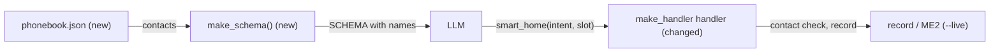

# Feature Spec: 01 — smart_home: open slots and a JSON phonebook

**Status:** delivered-for-review
**Date:** 2026-10-23
**Blocked by:** None (can start immediately)

smart_home's slots become open (any time, duration, colour, temperature, brightness, reminder text); CALL and MESSAGE now take a slot that must be a contact in `pipeline/config/phonebook.json`, whose names are listed in the tool description. Read `../GUARDRAILS.md` first; it binds this ticket.

## Context

- **Objective:** rewrite one module, add one data file, extend its tests. Small.
- **Role:** strict systems architect; you are transcribing an approved implementation.
- **User goal:** a live voice test where the agent acts on the home and answers from the documents, with tools as the single mechanism.
- **Source:** `/mnt/School/PhD/AI231/AI-231-ME3-agy/.scratch/live-agent/PLAN.md`
- **Repo:** `/mnt/School/PhD/AI231/AI-231-ME3-agy`

| File | Action | Line cap |
|---|---|---|
| `pipeline/config/phonebook.json` | new, verbatim | **9** (exactly) |
| `pipeline/src/voice_pipeline/tools/smart_home.py` | rewrite, verbatim | **157** (skeleton 142) |
| `pipeline/tests/test_smart_home.py` | rewrite, verbatim | **106** (skeleton 84) |

**Non-goals / touch nothing else:** no change to `dryrun.py`, `latency.py` or the config/eval files (tickets 05); no slot normalisation. No other file in the repo.

**Security-sensitive:** no — local data only; no secrets.

## Diagrams

### Data flow



### Sequence / component

```mermaid
sequenceDiagram
    participant L as LLM
    participant H as handler
    L->>H: CALL slot=anna
    H->>H: record; anna in phonebook (case-insensitive)?
    H-->>L: ok recorded, or 'not in the phonebook (Anna, Ben, ...)'
```

## RECAP

### E — Edges

| Edge | Behavior |
|---|---|
| unknown intent | `{ok: False, message: 'unknown intent X'}`; recorded; no HTTP |
| slotted intent (now including CALL, MESSAGE) without slot | `{ok: False, message: '<INTENT> needs a value: <hint>'}`; recorded |
| CALL/MESSAGE slot not in the phonebook (case-insensitive) | `{ok: False, message: '<slot> is not in the phonebook (<names>)'}`; recorded; no HTTP |
| `base_url` None | `{ok: True, message: 'recorded'}` |
| dashboard unreachable / non-200 | unchanged from before |

Nothing else.

### C — Contracts

`pipeline/config/phonebook.json`:

```json
{
  "contacts": [
    {"name": "Anna", "relation": "sister"},
    {"name": "Ben", "relation": "brother"},
    {"name": "Mom", "relation": "mother"},
    {"name": "Dr. Reyes", "relation": "dentist"},
    {"name": "Carlo", "relation": "friend"}
  ]
}
```

`pipeline/src/voice_pipeline/tools/smart_home.py` (whole file, verbatim):

```python
"""One LLM tool for the 19 ME2 home commands, sent to the ME2 dashboard's POST /api/command.

Slot values are open (any time, duration, temperature, colour, brightness, reminder text), except
CALL and MESSAGE, whose slot must be a contact in the JSON phonebook.
"""

from __future__ import annotations

import json
from collections.abc import Awaitable, Callable
from pathlib import Path
from typing import Any

import httpx
from pipecat.adapters.schemas.function_schema import FunctionSchema
from pipecat.services.llm_service import FunctionCallParams

PHONEBOOK = Path(__file__).resolve().parents[3] / "config" / "phonebook.json"

INTENTS: tuple[str, ...] = (
    "PLAY_MUSIC",
    "PAUSE",
    "STOP",
    "NEXT",
    "VOLUME_UP",
    "VOLUME_DOWN",
    "LIGHT_ON",
    "LIGHT_OFF",
    "BRIGHTNESS",
    "COLOR",
    "TEMPERATURE",
    "WEATHER",
    "TIME",
    "TIMER",
    "ALARM",
    "CALL",
    "MESSAGE",
    "CREATE_REMINDER",
    "LIST_REMINDERS",
)

SLOT_FOR_INTENT: dict[str, str] = {
    "BRIGHTNESS": "PERCENT",
    "COLOR": "COLOR",
    "TEMPERATURE": "DEGREES",
    "TIMER": "DURATION",
    "ALARM": "ALARM_TIME",
    "CREATE_REMINDER": "TASK",
    "CALL": "CONTACT",
    "MESSAGE": "CONTACT",
}

SLOT_HINTS: dict[str, str] = {
    "BRIGHTNESS": "a percentage, like '40 percent'",
    "COLOR": "any colour, like 'purple' or 'warm white'",
    "TEMPERATURE": "degrees, like '24 degrees'",
    "TIMER": "a duration, like '45 minutes' or '1 hour 30 minutes'",
    "ALARM": "a clock time, like '6:30 AM' or '7:15 PM'",
    "CREATE_REMINDER": "what to be reminded of, in the user's words",
    "CALL": "a contact name from the phonebook",
    "MESSAGE": "a contact name from the phonebook",
}


def load_phonebook(path: Path = PHONEBOOK) -> list[dict[str, str]]:
    """The contacts: [{"name": ..., "relation": ...}, ...]."""
    contacts: list[dict[str, str]] = json.loads(path.read_text())["contacts"]
    return contacts


def make_schema(contacts: list[dict[str, str]]) -> FunctionSchema:
    """The smart_home function schema; the phonebook names go into its description."""
    phonebook = ", ".join(f"{c['name']} ({c['relation']})" for c in contacts)
    return FunctionSchema(
        name="smart_home",
        description=(
            "Control or check the home: lights, colour, brightness, music, volume, thermostat, "
            "timer, alarm, reminders, phone call, message, time, weather. One call per command. "
            "Intents that need a slot, and its form: "
            + "; ".join(f"{intent}: {hint}" for intent, hint in SLOT_HINTS.items())
            + f". Phonebook: {phonebook}. Every other intent takes no slot."
        ),
        properties={
            "intent": {"type": "string", "enum": list(INTENTS)},
            "slot": {
                "type": "string",
                "description": "The value for BRIGHTNESS, COLOR, TEMPERATURE, TIMER, ALARM, "
                "CREATE_REMINDER, CALL or MESSAGE, in the form listed. Omit for other intents.",
            },
        },
        required=["intent"],
    )


SCHEMA = make_schema(load_phonebook())


def to_command(intent: str, slot: str | None) -> dict[str, Any]:
    """The /api/command body; a slot given to an unslotted intent is dropped."""
    name = SLOT_FOR_INTENT.get(intent)
    return {"intent": intent, "slots": {name: slot} if name and slot else {}}


def make_handler(
    *,
    base_url: str | None,
    record: list[dict[str, Any]],
    contacts: list[dict[str, str]] | None = None,
) -> Callable[[FunctionCallParams], Awaitable[None]]:
    """Handler that records every call, and posts it to the dashboard when base_url is set."""
    names = {c["name"].lower(): c["name"] for c in contacts or load_phonebook()}

    async def handler(params: FunctionCallParams) -> None:
        intent = str(params.arguments.get("intent", ""))
        slot = params.arguments.get("slot")
        record.append({"intent": intent, "slot": slot})
        if intent not in INTENTS:
            result: dict[str, Any] = {"ok": False, "message": f"unknown intent {intent}"}
        elif intent in SLOT_FOR_INTENT and not slot:
            result = {"ok": False, "message": f"{intent} needs a value: {SLOT_HINTS[intent]}"}
        elif intent in ("CALL", "MESSAGE") and str(slot).lower() not in names:
            known = ", ".join(names.values())
            result = {"ok": False, "message": f"{slot} is not in the phonebook ({known})"}
        elif base_url is None:
            result = {"ok": True, "message": "recorded"}
        else:
            result = await _post(base_url, to_command(intent, slot))
        await params.result_callback(result)

    return handler


async def _post(base_url: str, body: dict[str, Any]) -> dict[str, Any]:
    try:
        async with httpx.AsyncClient(base_url=base_url, timeout=2.0) as client:
            response = await client.post("/api/command", json=body)
    except httpx.HTTPError:
        return {"ok": False, "message": "home dashboard unreachable"}
    data = response.json()
    if response.status_code != 200:
        return {"ok": False, "message": str(data.get("error", response.status_code))}
    return {"ok": True, "changed": data.get("changed"), "message": data.get("message")}
```

Final inventory: smart_home.py: constants `PHONEBOOK`, `INTENTS`, `SLOT_FOR_INTENT`, `SLOT_HINTS`, `SCHEMA`; functions `load_phonebook`, `make_schema`, `to_command`, `make_handler` (inner `handler`), `_post`.

### A — Assumptions

| Assumption | Verified when / how |
|---|---|
| `parents[3]` of smart_home.py is `pipeline/` | Established: ran green in the ticket-writer's overlay of this repo, 2026-10-23 |
| FunctionSchema(name, description, properties, required) in pipecat 1.13.0 | Established: used by the landed ticket of 2026-10-23 |
| Unknowns | None |
| Dependencies/license | none new |

### P — Proof (acceptance criteria)

Tests in `pipeline/tests/test_smart_home.py` (whole file, verbatim):

```python
from types import SimpleNamespace
from typing import Any

import httpx
import pytest

from voice_pipeline.tools import smart_home


async def _call(arguments: dict[str, Any], base_url: str | None = None) -> tuple[list, list]:
    record: list[dict[str, Any]] = []
    results: list[dict[str, Any]] = []

    async def result_callback(result: dict[str, Any]) -> None:
        results.append(result)

    handler = smart_home.make_handler(base_url=base_url, record=record)
    await handler(SimpleNamespace(arguments=arguments, result_callback=result_callback))
    return record, results


def test_to_command_slotted() -> None:
    assert smart_home.to_command("ALARM", "6 AM") == {
        "intent": "ALARM",
        "slots": {"ALARM_TIME": "6 AM"},
    }


def test_to_command_unslotted_ignores_slot() -> None:
    assert smart_home.to_command("LIGHT_ON", "blue") == {"intent": "LIGHT_ON", "slots": {}}


async def test_handler_records_without_http() -> None:
    record, results = await _call({"intent": "TEMPERATURE", "slot": "22 degrees"})
    assert record == [{"intent": "TEMPERATURE", "slot": "22 degrees"}]
    assert results == [{"ok": True, "message": "recorded"}]


async def test_handler_missing_slot() -> None:
    record, results = await _call({"intent": "TIMER"})
    assert record == [{"intent": "TIMER", "slot": None}]
    assert results[0]["ok"] is False
    assert "45 minutes" in results[0]["message"]


async def test_handler_unknown_intent() -> None:
    _, results = await _call({"intent": "OPEN_DOOR"})
    assert results == [{"ok": False, "message": "unknown intent OPEN_DOOR"}]


async def test_handler_posts_to_dashboard(monkeypatch: pytest.MonkeyPatch) -> None:
    seen: list[httpx.Request] = []

    def reply(request: httpx.Request) -> httpx.Response:
        seen.append(request)
        return httpx.Response(200, json={"ok": True, "changed": True, "message": "color -> red"})

    real_client = httpx.AsyncClient

    def client(**kwargs: Any) -> httpx.AsyncClient:
        return real_client(transport=httpx.MockTransport(reply), **kwargs)

    monkeypatch.setattr(smart_home.httpx, "AsyncClient", client)
    _, results = await _call({"intent": "COLOR", "slot": "red"}, base_url="http://dash")
    assert seen[0].url.path == "/api/command"
    assert seen[0].read() == b'{"intent":"COLOR","slots":{"COLOR":"red"}}'
    assert results == [{"ok": True, "changed": True, "message": "color -> red"}]


def test_schema_lists_the_phonebook() -> None:
    schema = smart_home.make_schema([{"name": "Anna", "relation": "sister"}])
    assert "Anna (sister)" in schema.description


async def test_handler_rejects_unknown_contact() -> None:
    record, results = await _call({"intent": "CALL", "slot": "Gary"})
    assert record == [{"intent": "CALL", "slot": "Gary"}]
    assert results[0]["ok"] is False
    assert "not in the phonebook" in results[0]["message"]


async def test_handler_accepts_contact_in_any_case() -> None:
    _, results = await _call({"intent": "MESSAGE", "slot": "anna"})
    assert results == [{"ok": True, "message": "recorded"}]
```

No other fixtures.

| # | Test / acceptance criterion | Command | Result |
|---|---|---|---|
| 1 | 9 tests pass | `cd pipeline && uv run --offline pytest -q tests/test_smart_home.py` | pass (9 passed in 0.38s) |
| 2 | pipeline gates green | `cd pipeline && uv run --offline ruff check . && uv run --offline ruff format --check . && uv run --offline mypy` | pass (Success: no issues found in 5 source files) |
| 3 | line caps respected | `wc -l on the files in the table` | pass (9/9, 142/157, 84/106) |

## Deviations

| Date | Deviation | Minor: rationale / Material: design-gate re-run |
|---|---|---|
| 2026-10-23 | none | |

## Approvals

| Date | Gate | What was approved / decided | By |
|---|---|---|---|
| 2026-10-23 | design | fastmcp 2.14.7 docs MCP server; documents via a tool; ME2 UI kept, not a priority; phonebook for CALL/MESSAGE, loose reminders, open slots; dry run native Gemini only; agy builds at level 3 | owner |

## Execution Log

### 2026-10-23 agy: DONE
- Step 0: (wave 2 only) n/a
- Proof: 1 ✅ cd pipeline && uv run --offline pytest -q tests/test_smart_home.py (9 passed in 0.38s) 2 ✅ cd pipeline && uv run --offline ruff check . && uv run --offline ruff format --check . && uv run --offline mypy (Success: no issues found in 5 source files) 3 ✅ wc -l on the files in the table (235 total)
- Files: pipeline/config/phonebook.json (9 / 9)
  pipeline/src/voice_pipeline/tools/smart_home.py (142 / 157)
  pipeline/tests/test_smart_home.py (84 / 106)
- Deviations: none
- Notes for reviewer: none


### 2026-10-23 tech-lead review (level 3): approved, no findings
- Changed paths: only this ticket's file table plus this ticket (`diff -rq` against the pre-handoff snapshot).
- Verbatim: `cmp` of every file against the ticket's code: identical, so inventory, caps and the forbidden list hold by construction.
- Proof re-run by the reviewer: green (same results as logged above); root mypy strict clean.
