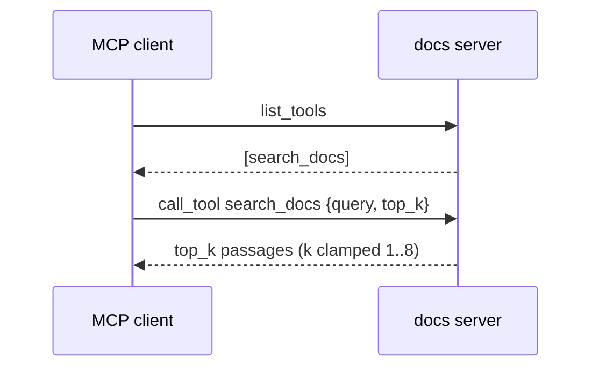

# Feature Spec: 02 — docs MCP server (fastmcp): search_docs over the doc-chat corpus

**Status:** delivered-for-review
**Date:** 2026-10-23
**Blocked by:** None (can start immediately)

A new MCP server in the root project, built with fastmcp 2.14.7 (already in the laptop dependency group): one tool, `search_docs(query, top_k=3)`, BM25 over a corpus folder using doc_chat's own loader. This is the precedent for tools as MCP servers. Read `../GUARDRAILS.md` first; it binds this ticket.

## Context

- **Objective:** one server module and its tests. Small.
- **Role:** strict systems architect; you are transcribing an approved implementation.
- **User goal:** a live voice test where the agent acts on the home and answers from the documents, with tools as the single mechanism.
- **Source:** `/mnt/School/PhD/AI231/AI-231-ME3-agy/.scratch/live-agent/PLAN.md`
- **Repo:** `/mnt/School/PhD/AI231/AI-231-ME3-agy`

| File | Action | Line cap |
|---|---|---|
| `src/voice_agent/mcp_servers/docs.py` | new, verbatim | **61** (skeleton 55) |
| `tests/mcp_servers/test_docs_server.py` | new, verbatim | **39** (skeleton 31) |

**Non-goals / touch nothing else:** the existing MCP servers (`home.py`, `speech.py`, `code.py`) and `doc_chat` stay unchanged; `pyproject.toml`/`uv.lock` are already updated, do not touch them. No other file in the repo.

**Security-sensitive:** no — reads only the corpus folder given on the command line.

## Diagrams

### Data flow


### Sequence / component



## RECAP

### E — Edges

| Edge | Behavior |
|---|---|
| top_k below 1 or above 8 | clamped to 1..8 |
| source metadata path | only the file name is returned |

Nothing else.

### C — Contracts

`src/voice_agent/mcp_servers/docs.py` (whole file, verbatim):

```python
"""Docs MCP server (fastmcp): BM25 search over a doc-chat corpus folder.

uv run --group laptop python -m voice_agent.mcp_servers.docs --corpus corpus/cormac-mccarthy
"""

from __future__ import annotations

import argparse
from collections.abc import Sequence
from pathlib import Path

from fastmcp import FastMCP
from langchain_community.retrievers import BM25Retriever

from doc_chat.corpus import load_and_split_corpus, tokenize

DEFAULT_CORPUS = Path("corpus/cormac-mccarthy")
DEFAULT_TOPIC = "the life and works of the novelist Cormac McCarthy"
CHUNK_SIZE = 1000


def build_server(corpus: Path, topic: str = DEFAULT_TOPIC) -> FastMCP:
    """A FastMCP server with one tool, search_docs, over the chunks of `corpus`."""
    chunks = load_and_split_corpus(corpus, chunk_size=CHUNK_SIZE, chunk_overlap=CHUNK_SIZE // 10)
    retriever = BM25Retriever.from_documents(chunks, k=3, preprocess_func=tokenize)
    server = FastMCP("docs")

    @server.tool(
        description=(
            f"Search the document collection about {topic} and return the best-matching "
            "passages with their source file. Use it for any question on that topic and answer "
            "from the passages. Write the query as a short self-contained question."
        )
    )
    def search_docs(query: str, top_k: int = 3) -> list[dict[str, str]]:
        retriever.k = max(1, min(top_k, 8))
        return [
            {"source": Path(str(doc.metadata.get("source", ""))).name, "text": doc.page_content}
            for doc in retriever.invoke(query)
        ]

    return server


def main(argv: Sequence[str] | None = None) -> int:
    parser = argparse.ArgumentParser(description=__doc__.split("\n")[0])
    parser.add_argument("--corpus", type=Path, default=DEFAULT_CORPUS)
    parser.add_argument("--topic", default=DEFAULT_TOPIC)
    args = parser.parse_args(argv)
    build_server(args.corpus, args.topic).run(show_banner=False)
    return 0


if __name__ == "__main__":
    raise SystemExit(main())
```

Final inventory: docs.py: constants `DEFAULT_CORPUS`, `DEFAULT_TOPIC`, `CHUNK_SIZE`; functions `build_server` (inner tool `search_docs`), `main`.

### A — Assumptions

| Assumption | Verified when / how |
|---|---|
| fastmcp 2.14.7 in the root laptop group; `FastMCP.tool(description=...)`, `run(show_banner=...)` | Established: installed 2026-10-23 (ticket 00), signatures read |
| `doc_chat.corpus.load_and_split_corpus`, `tokenize` exist | Established: src/doc_chat/corpus.py |
| Unknowns | None |
| Dependencies/license | fastmcp (Apache-2.0), already added |

### P — Proof (acceptance criteria)

Tests in `tests/mcp_servers/test_docs_server.py` (whole file, verbatim):

```python
from pathlib import Path

from fastmcp import Client

from voice_agent.mcp_servers.docs import build_server

CORPUS = Path(__file__).resolve().parents[2] / "corpus" / "cormac-mccarthy"


async def _search(query: str, top_k: int = 3) -> list[dict[str, str]]:
    async with Client(build_server(CORPUS)) as client:
        result = await client.call_tool("search_docs", {"query": query, "top_k": top_k})
    return result.structured_content["result"]


async def test_lists_one_tool() -> None:
    async with Client(build_server(CORPUS)) as client:
        tools = await client.list_tools()
    assert [t.name for t in tools] == ["search_docs"]
    assert "Cormac McCarthy" in (tools[0].description or "")


async def test_search_returns_passages_with_sources() -> None:
    hits = await _search("What is The Road about?")
    assert [h["source"] for h in hits] == ["23-the-road.md"] * 3
    assert all("The Road" in h["text"] for h in hits)


async def test_top_k_is_clamped() -> None:
    assert len(await _search("The Road", top_k=1)) == 1
    assert len(await _search("The Road", top_k=50)) == 8
```

Run from the repo root.

| # | Test / acceptance criterion | Command | Result |
|---|---|---|---|
| 1 | 3 tests pass | `uv run --offline --group laptop pytest -q tests/mcp_servers/test_docs_server.py` | pass (3 passed, 2 warnings in 1.03s) |
| 2 | lint and format clean on the two files | `uv run --offline --group laptop ruff check src/voice_agent/mcp_servers/docs.py tests/mcp_servers/test_docs_server.py && uv run --offline --group laptop ruff format --check src/voice_agent/mcp_servers/docs.py tests/mcp_servers/test_docs_server.py` | pass (All checks passed! 2 files already formatted) |
| 3 | root mypy strict clean | `uv run --offline --group laptop mypy` | pass (Success: no issues found in 52 source files) |
| 4 | line caps respected | `wc -l on the files in the table` | pass (55/61, 31/39) |

## Deviations

| Date | Deviation | Minor: rationale / Material: design-gate re-run |
|---|---|---|
| 2026-10-23 | none | |

## Approvals

| Date | Gate | What was approved / decided | By |
|---|---|---|---|
| 2026-10-23 | design | fastmcp 2.14.7 docs MCP server; documents via a tool; ME2 UI kept, not a priority; phonebook for CALL/MESSAGE, loose reminders, open slots; dry run native Gemini only; agy builds at level 3 | owner |

## Execution Log

### 2026-10-23 agy: DONE
- Step 0: (wave 2 only) n/a
- Proof: 1 ✅ uv run --offline --group laptop pytest -q tests/mcp_servers/test_docs_server.py (3 passed, 2 warnings in 1.03s) 2 ✅ uv run --offline --group laptop ruff check src/voice_agent/mcp_servers/docs.py tests/mcp_servers/test_docs_server.py && uv run --offline --group laptop ruff format --check src/voice_agent/mcp_servers/docs.py tests/mcp_servers/test_docs_server.py (2 files already formatted) 3 ✅ uv run --offline --group laptop mypy (Success: no issues found in 52 source files) 4 ✅ wc -l on the files in the table (86 total)
- Files: src/voice_agent/mcp_servers/docs.py (55 / 61)
  tests/mcp_servers/test_docs_server.py (31 / 39)
- Deviations: none
- Notes for reviewer: none


### 2026-10-23 tech-lead review (level 3): approved, no findings
- Changed paths: only this ticket's file table plus this ticket (`diff -rq` against the pre-handoff snapshot).
- Verbatim: `cmp` of every file against the ticket's code: identical, so inventory, caps and the forbidden list hold by construction.
- Proof re-run by the reviewer: green (same results as logged above); root mypy strict clean.
