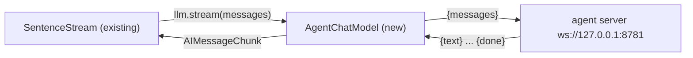
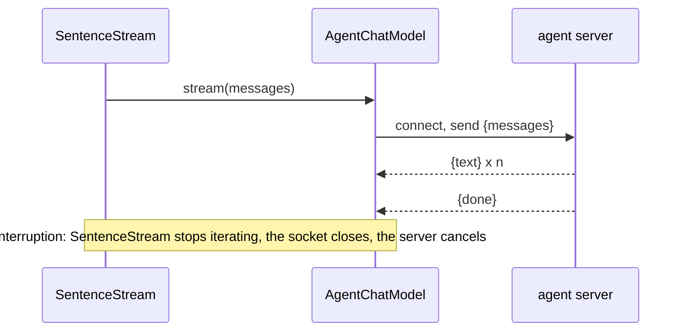

# Feature Spec: 03 — doc_chat --llm agent: a chat model that streams from the agent server

**Status:** delivered-for-review
**Date:** 2026-10-23
**Blocked by:** None (can start immediately; the server is ticket 06, tested here against a fake)

doc_chat gets a new LLM backend, `--llm agent`: a LangChain chat model (like the existing `EchoChatModel`) that sends the conversation to the agent server over a WebSocket and streams the reply. Closing the socket early (an interruption) cancels the server's turn. Read `../GUARDRAILS.md` first; it binds this ticket.

## Context

- **Objective:** one new module, its tests, three small edits in the CLI. Small.
- **Role:** strict systems architect; you are transcribing an approved implementation.
- **User goal:** a live voice test where the agent acts on the home and answers from the documents, with tools as the single mechanism.
- **Source:** `/mnt/School/PhD/AI231/AI-231-ME3-agy/.scratch/live-agent/PLAN.md`
- **Repo:** `/mnt/School/PhD/AI231/AI-231-ME3-agy`

| File | Action | Line cap |
|---|---|---|
| `src/doc_chat/agent_client.py` | new, verbatim | **79** (skeleton 71) |
| `tests/doc_chat/test_agent_client.py` | new, verbatim | **77** (skeleton 61) |
| `src/doc_chat/__main__.py` | edit (list below) | **1261** (now 1251; exactly 1261 after the edits) |

**Non-goals / touch nothing else:** `chain.py`, `SentenceStream`, retrieval and every other doc_chat behaviour unchanged; the existing error message for `--no-docs` stays word for word. No other file in the repo.

**Security-sensitive:** no — talks only to 127.0.0.1 by default; no secrets.

## Diagrams

### Data flow



### Sequence / component



## RECAP

### E — Edges

| Edge | Behavior |
|---|---|
| server sends {error} | `RuntimeError('agent server error: ...')` (SentenceStream turns it into the fallback reply) |
| no event within `timeout` | the websockets timeout error propagates |
| message types other than system/human/ai | dropped from the request |

Nothing else.

### C — Contracts

`src/doc_chat/agent_client.py` (whole file, verbatim):

```python
"""Chat model backed by the Pipecat agent server in pipeline/ (voice_pipeline.agent_server).

The server owns the system prompt, the tools (smart_home, the docs MCP server) and the LLM; this
client sends the conversation and streams the reply text back. Closing the socket before the reply
is done (the listener interrupted) tells the server to cancel it.

Protocol, one request per WebSocket connection:
  client -> {"messages": [{"role": "system"|"user"|"assistant", "content": str}, ...]}
  server -> {"text": str} ... then {"done": true}, or {"error": str}
"""

from __future__ import annotations

import json
from collections.abc import Iterator
from typing import Any

from langchain_core.callbacks import CallbackManagerForLLMRun
from langchain_core.language_models.chat_models import BaseChatModel
from langchain_core.messages import AIMessage, AIMessageChunk, BaseMessage
from langchain_core.outputs import ChatGeneration, ChatGenerationChunk, ChatResult
from websockets.sync.client import connect

DEFAULT_URL = "ws://127.0.0.1:8781"
_ROLES = {"system": "system", "human": "user", "ai": "assistant"}


def to_wire(messages: list[BaseMessage]) -> list[dict[str, str]]:
    """LangChain messages as the server's {"role", "content"} dicts."""
    return [
        {"role": _ROLES[m.type], "content": str(m.content)} for m in messages if m.type in _ROLES
    ]


class AgentChatModel(BaseChatModel):
    """Streams replies from the agent server; see the module docstring for the protocol."""

    url: str = DEFAULT_URL
    timeout: float = 30.0

    @property
    def _llm_type(self) -> str:
        return "agent"

    def _generate(
        self,
        messages: list[BaseMessage],
        stop: list[str] | None = None,
        run_manager: CallbackManagerForLLMRun | None = None,
        **kwargs: Any,
    ) -> ChatResult:
        text = "".join(str(chunk.message.content) for chunk in self._stream(messages))
        return ChatResult(generations=[ChatGeneration(message=AIMessage(content=text))])

    def _stream(
        self,
        messages: list[BaseMessage],
        stop: list[str] | None = None,
        run_manager: CallbackManagerForLLMRun | None = None,
        **kwargs: Any,
    ) -> Iterator[ChatGenerationChunk]:
        with connect(self.url, open_timeout=self.timeout) as ws:
            ws.send(json.dumps({"messages": to_wire(messages)}))
            while True:
                event = json.loads(ws.recv(timeout=self.timeout))
                if "text" in event:
                    yield ChatGenerationChunk(message=AIMessageChunk(content=event["text"]))
                elif event.get("done"):
                    return
                else:
                    raise RuntimeError(f"agent server error: {event.get('error', 'unknown')}")
```

Edit list for `src/doc_chat/__main__.py` (three replacements; each old block occurs exactly once; change nothing else):

1. In `main()`'s `--llm` argument, replace

```python
        choices=["none", "qwen", "gemini", "echo"],
        default="none",
        help="LLM backend: none, qwen, gemini, or echo (no model: repeats what it heard, then "
        "reads a fixed passage, for testing speech and interruptions). Default: none",
    )
```

with

```python
        choices=["none", "qwen", "gemini", "echo", "agent"],
        default="none",
        help="LLM backend: none, qwen, gemini, echo (no model: repeats what it heard, then "
        "reads a fixed passage, for testing speech and interruptions), or agent (the Pipecat "
        "agent server in pipeline/, with tools; use with --no-docs). Default: none",
    )
    parser.add_argument(
        "--agent-url",
        default="ws://127.0.0.1:8781",
        help="with --llm agent: the agent server (default: ws://127.0.0.1:8781)",
    )
```

2. In the LLM selection, replace

```python
    elif args.llm == "gemini":
        from doc_chat.gemini import build_gemini_chat_model
```

with

```python
    elif args.llm == "agent":
        from doc_chat.agent_client import AgentChatModel

        llm = AgentChatModel(url=args.agent_url, timeout=args.llm_timeout)
    elif args.llm == "gemini":
        from doc_chat.gemini import build_gemini_chat_model
```

3. Replace

```python
    if (args.no_docs or args.stream) and args.llm not in ("qwen", "gemini", "echo"):
```

with

```python
    if (args.no_docs or args.stream) and args.llm not in ("qwen", "gemini", "echo", "agent"):
```

(the error message on the next line stays as it is: an existing test asserts it).

Final inventory: agent_client.py: constants `DEFAULT_URL`, `_ROLES`; function `to_wire`; class `AgentChatModel` (methods `_llm_type`, `_generate`, `_stream`). `__main__.py`: no new functions.

### A — Assumptions

| Assumption | Verified when / how |
|---|---|
| websockets 17 sync client is installed in the root environment | Established: imported 2026-10-23 |
| LangChain's `stream()` appends an empty final chunk | Established: the test filters empty chunks |
| `tests/doc_chat/test_gemini.py` asserts the old `--no-docs` error text | Established: read 2026-10-23; edit 3 keeps it |
| Unknowns | None |
| Dependencies/license | none new |

### P — Proof (acceptance criteria)

Tests in `tests/doc_chat/test_agent_client.py` (whole file, verbatim):

```python
import json
import threading
from collections.abc import Iterator
from typing import Any

import pytest
from langchain_core.messages import AIMessage, HumanMessage, SystemMessage
from websockets.sync.server import ServerConnection, serve

from doc_chat.agent_client import AgentChatModel, to_wire


class FakeAgent:
    """A one-reply agent server that records what it received."""

    def __init__(self, events: list[dict[str, Any]]) -> None:
        self.events = events
        self.received: list[dict[str, Any]] = []

    def handle(self, ws: ServerConnection) -> None:
        self.received.append(json.loads(ws.recv()))
        for event in self.events:
            ws.send(json.dumps(event))


@pytest.fixture
def agent(request: pytest.FixtureRequest) -> Iterator[tuple[FakeAgent, str]]:
    fake = FakeAgent(request.param)
    with serve(fake.handle, "127.0.0.1", 0) as server:
        port = server.socket.getsockname()[1]
        thread = threading.Thread(target=server.serve_forever, daemon=True)
        thread.start()
        yield fake, f"ws://127.0.0.1:{port}"
        server.shutdown()


def test_to_wire_maps_roles() -> None:
    messages = [SystemMessage("s"), HumanMessage("q"), AIMessage("a")]
    assert to_wire(messages) == [
        {"role": "system", "content": "s"},
        {"role": "user", "content": "q"},
        {"role": "assistant", "content": "a"},
    ]


@pytest.mark.parametrize(
    "agent", [[{"text": "Lights "}, {"text": "on."}, {"done": True}]], indirect=True
)
def test_stream_yields_text_until_done(agent: tuple[FakeAgent, str]) -> None:
    fake, url = agent
    stream = AgentChatModel(url=url).stream([HumanMessage("Lights on")])
    chunks = [c.content for c in stream if c.content]
    assert chunks == ["Lights ", "on."]
    assert fake.received == [{"messages": [{"role": "user", "content": "Lights on"}]}]


@pytest.mark.parametrize("agent", [[{"error": "boom"}]], indirect=True)
def test_server_error_raises(agent: tuple[FakeAgent, str]) -> None:
    _, url = agent
    with pytest.raises(RuntimeError, match="boom"):
        list(AgentChatModel(url=url).stream([HumanMessage("x")]))
```

Run from the repo root.

| # | Test / acceptance criterion | Command | Result |
|---|---|---|---|
| 1 | the 3 new tests and the existing gemini CLI test pass | `uv run --offline --group laptop pytest -q tests/doc_chat/test_agent_client.py tests/doc_chat/test_gemini.py` | green, 10 passed (reviewer, 2026-10-23) |
| 2 | lint and format clean on the three files | `uv run --offline --group laptop ruff check src/doc_chat/agent_client.py tests/doc_chat/test_agent_client.py src/doc_chat/__main__.py && uv run --offline --group laptop ruff format --check src/doc_chat/agent_client.py tests/doc_chat/test_agent_client.py src/doc_chat/__main__.py` | green (reviewer) |
| 3 | root mypy strict clean | `uv run --offline --group laptop mypy` | green, 53 files (reviewer) |
| 4 | the CLI lists the backend | `uv run --offline --group laptop python -m doc_chat --help | grep -c -- '--agent-url'` | green, 2 (reviewer) |
| 5 | line caps respected | `wc -l on the files in the table` | green: 71/79, 61/77, 1261/1261 (reviewer) |

## Deviations

| Date | Deviation | Minor: rationale / Material: design-gate re-run |
|---|---|---|

## Approvals

| Date | Gate | What was approved / decided | By |
|---|---|---|---|
| 2026-10-23 | design | fastmcp 2.14.7 docs MCP server; documents via a tool; ME2 UI kept, not a priority; phonebook for CALL/MESSAGE, loose reminders, open slots; dry run native Gemini only; agy builds at level 3 | owner |

## Execution Log

### 2026-10-23 tech-lead review (level 3): approved, no findings
- The agy run ended with a network error (`proto: unexpected EOF`, retryable) after writing all three files and before running this ticket's Proof or writing its log entry; Status was left `in-build`.
- Verbatim: `cmp` of `agent_client.py`, `test_agent_client.py` and the edited `__main__.py` against the ticket's code: identical (the three edits applied exactly, nothing else changed).
- Proof run by the reviewer: rows 1-5 green (results in the Proof table); broader `tests/doc_chat tests/mcp_servers tests/agent`: 333 passed, 1 failed = the known `test_flow` case that needs a running speech server.
- Status set to `delivered-for-review` by the reviewer.
