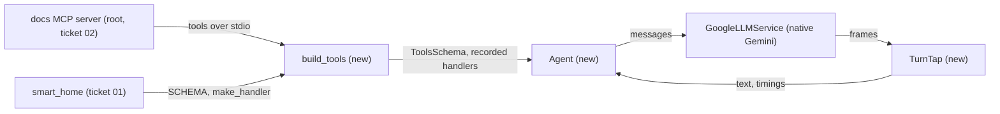
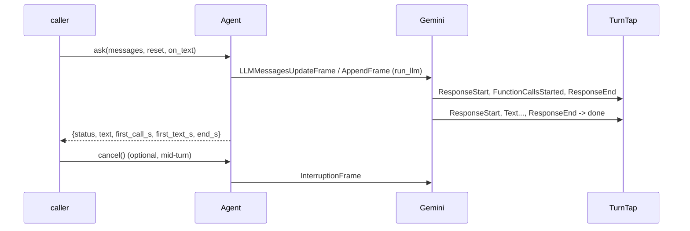

# Feature Spec: 04 — agent core: one Pipecat pipeline around native Gemini, and its tools

**Status:** delivered-for-review
**Date:** 2026-10-23
**Blocked by:** 01, 02

Two new modules in pipeline/: `agent_tools.py` (smart_home plus every tool of the docs MCP server, each call recorded) and `agent.py` (one long-lived pipeline; `ask` runs a turn and times it, streaming text to a callback; `cancel` interrupts it). Before any code, confirm tickets 01 and 02 landed: `voice_pipeline.tools.smart_home` exports `SCHEMA` and `make_handler(*, base_url, record, contacts=None)`, and `src/voice_agent/mcp_servers/docs.py` exists. A mismatch means stop. Read `../GUARDRAILS.md` first; it binds this ticket.

## Context

- **Objective:** two new modules. Medium-small.
- **Role:** strict systems architect; you are transcribing an approved implementation.
- **User goal:** a live voice test where the agent acts on the home and answers from the documents, with tools as the single mechanism.
- **Source:** `/mnt/School/PhD/AI231/AI-231-ME3-agy/.scratch/live-agent/PLAN.md`
- **Repo:** `/mnt/School/PhD/AI231/AI-231-ME3-agy`

| File | Action | Line cap |
|---|---|---|
| `pipeline/src/voice_pipeline/agent_tools.py` | new, verbatim | **65** (skeleton 59) |
| `pipeline/src/voice_pipeline/agent.py` | new, verbatim | **155** (skeleton 140) |

**Non-goals / touch nothing else:** no change to smart_home.py (ticket 01), docs.py (ticket 02), dryrun.py (ticket 05) or any server (ticket 06). No other file in the repo.

**Security-sensitive:** yes, only in that `read_key` reads the Gemini key from `~/.secrets/google-ai-studio/` at run time; it is never printed. You do not run that path.

## Diagrams

### Data flow



### Sequence / component



## RECAP

### E — Edges

| Edge | Behavior |
|---|---|
| no end of turn within 20 s | `status: 'error'` |
| cancel mid-turn | text forwarding stops, the turn returns at once; a late end frame from it cannot end the next turn (`responding` flag) |
| reset=False | messages are appended to the conversation instead of replacing it |
| an MCP tool is called | `{'tool': name, 'args': {...}}` appended to the record before the MCP call |

Nothing else.

### C — Contracts

`pipeline/src/voice_pipeline/agent_tools.py` (whole file, verbatim):

```python
"""The agent's tools: smart_home, plus every tool of the docs MCP server, each call recorded."""

from __future__ import annotations

from pathlib import Path
from typing import Any

from mcp import StdioServerParameters
from pipecat.adapters.schemas.function_schema import FunctionSchema
from pipecat.adapters.schemas.tools_schema import ToolsSchema
from pipecat.services.llm_service import FunctionCallParams
from pipecat.services.mcp_service import MCPClient

from voice_pipeline.tools.smart_home import SCHEMA, make_handler

REPO_ROOT = Path(__file__).resolve().parents[3]
DOCS_COMMAND = ["uv", "run", "--group", "laptop", "python", "-m", "voice_agent.mcp_servers.docs"]


def docs_server(command: list[str] = DOCS_COMMAND, env: dict[str, str] | None = None) -> MCPClient:
    """MCP client for the docs server (root project), started over stdio from the repo root."""
    params = StdioServerParameters(
        command=command[0], args=command[1:], cwd=str(REPO_ROOT), env=env
    )
    return MCPClient(server_params=params)


def _recorded(schema: FunctionSchema, record: list[dict[str, Any]]) -> FunctionSchema:
    inner = schema.handler
    assert inner is not None

    async def handler(params: FunctionCallParams) -> None:
        record.append({"tool": schema.name, "args": dict(params.arguments)})
        await inner(params)

    return FunctionSchema(
        name=schema.name,
        description=schema.description,
        properties=schema.properties,
        required=schema.required,
        handler=handler,
    )


async def build_tools(
    record: list[dict[str, Any]], *, live: str | None = None, docs: MCPClient | None = None
) -> ToolsSchema:
    """smart_home (posting to the ME2 dashboard only when `live` is set) and the docs tools."""
    home = FunctionSchema(
        name=SCHEMA.name,
        description=SCHEMA.description,
        properties=SCHEMA.properties,
        required=SCHEMA.required,
        handler=make_handler(base_url=live, record=record),
    )
    tools: list[FunctionSchema] = [home]
    if docs is not None:
        tools += [_recorded(s, record) for s in (await docs.tools()).standard_tools]
    return ToolsSchema(standard_tools=tools)
```

`pipeline/src/voice_pipeline/agent.py` (whole file, verbatim):

```python
"""The agent: one long-lived Pipecat pipeline around native Gemini and the agent's tools.

`Agent.ask` runs one turn and reports its timings; text is streamed to an optional callback.
`Agent.cancel` interrupts the turn in progress. The dry run and the agent server both use it.
"""

from __future__ import annotations

import asyncio
import time
from collections.abc import Awaitable, Callable
from pathlib import Path
from typing import Any

from pipecat.adapters.schemas.tools_schema import ToolsSchema
from pipecat.frames.frames import (
    EndFrame,
    Frame,
    FunctionCallsStartedFrame,
    InterruptionFrame,
    LLMFullResponseEndFrame,
    LLMFullResponseStartFrame,
    LLMMessagesAppendFrame,
    LLMMessagesUpdateFrame,
    LLMTextFrame,
)
from pipecat.pipeline.pipeline import Pipeline
from pipecat.pipeline.worker import PipelineWorker
from pipecat.processors.aggregators.llm_context import LLMContext
from pipecat.processors.aggregators.llm_response_universal import LLMContextAggregatorPair
from pipecat.processors.frame_processor import FrameDirection, FrameProcessor
from pipecat.services.google.llm import GoogleLLMService
from pipecat.workers.runner import WorkerRunner

MODEL = "gemini-3.1-flash-lite"
TURN_TIMEOUT_S = 20.0
OnText = Callable[[str], Awaitable[None]]


def read_key(secret_dir: str) -> str:
    folder = Path.home() / ".secrets" / secret_dir
    for name in ("api-key.txt", "api_key.txt"):
        path = folder / name
        if path.exists():
            return "".join(path.read_text().split())
    raise SystemExit(f"no key in ~/.secrets/{secret_dir}/")


def build_llm(system: str, model: str = MODEL) -> GoogleLLMService:
    return GoogleLLMService(
        api_key=read_key("google-ai-studio"),
        settings=GoogleLLMService.Settings(model=model, system_instruction=system),
    )


class TurnTap(FrameProcessor):
    """Times one turn (first tool call, first text, end) and forwards its text."""

    def __init__(self) -> None:
        super().__init__()
        self.done = asyncio.Event()
        self.on_text: OnText | None = None
        self.begin(None)

    def begin(self, on_text: OnText | None) -> None:
        self.done.clear()
        self.on_text = on_text
        self.text: list[str] = []
        self.started = time.perf_counter()
        self.first_call: float | None = None
        self.first_text: float | None = None
        self.calls_in_response = False
        self.responding = False  # a late end frame from a cancelled turn must not end this one

    async def process_frame(self, frame: Frame, direction: FrameDirection) -> None:
        await super().process_frame(frame, direction)
        now = time.perf_counter() - self.started
        if isinstance(frame, LLMFullResponseStartFrame):
            self.calls_in_response = False
            self.responding = True
        elif isinstance(frame, FunctionCallsStartedFrame):
            self.calls_in_response = True
            if self.first_call is None:
                self.first_call = now
        elif isinstance(frame, LLMTextFrame):
            if self.first_text is None and frame.text.strip():
                self.first_text = now
            self.text.append(frame.text)
            if self.on_text is not None:
                await self.on_text(frame.text)
        elif isinstance(frame, LLMFullResponseEndFrame) and self.responding:
            if not self.calls_in_response:
                self.done.set()
        await self.push_frame(frame, direction)


class Agent:
    """One pipeline, one connection: user aggregator -> LLM -> tap -> assistant aggregator."""

    def __init__(self, llm: GoogleLLMService, tools: ToolsSchema) -> None:
        pair = LLMContextAggregatorPair(LLMContext(tools=tools))
        self.tap = TurnTap()
        self.worker = PipelineWorker(Pipeline([pair.user(), llm, self.tap, pair.assistant()]))
        self._runner = WorkerRunner(handle_sigint=False)
        self._running: asyncio.Task[None] | None = None

    async def start(self) -> None:
        await self._runner.add_workers(self.worker)
        self._running = asyncio.create_task(self._runner.run())

    async def stop(self) -> None:
        await self.worker.queue_frame(EndFrame())
        if self._running is not None:
            await self._running

    async def ask(
        self, messages: list[Any], *, reset: bool, on_text: OnText | None = None
    ) -> dict[str, Any]:
        """One turn. reset=True replaces the conversation with `messages`, else appends them."""
        self.tap.begin(on_text)
        frame_type = LLMMessagesUpdateFrame if reset else LLMMessagesAppendFrame
        await self.worker.queue_frame(frame_type(messages=messages, run_llm=True))
        try:
            await asyncio.wait_for(self.tap.done.wait(), TURN_TIMEOUT_S)
            status = "ok"
        except TimeoutError:
            status = "error"
        return {
            "status": status,
            "text": "".join(self.tap.text),
            "first_call_s": self.tap.first_call,
            "first_text_s": self.tap.first_text,
            "end_s": time.perf_counter() - self.tap.started,
        }

    async def cancel(self) -> None:
        """Interrupt the turn in progress and stop forwarding its text."""
        self.tap.on_text = None
        await self.worker.queue_frame(InterruptionFrame())
        self.tap.done.set()
```

Final inventory: agent_tools.py: constants `REPO_ROOT`, `DOCS_COMMAND`; functions `docs_server`, `_recorded` (inner `handler`), `build_tools`. agent.py: constants `MODEL`, `TURN_TIMEOUT_S`, `OnText`; functions `read_key`, `build_llm`; classes `TurnTap` (`__init__`, `begin`, `process_frame`), `Agent` (`__init__`, `start`, `stop`, `ask`, `cancel`).

### A — Assumptions

| Assumption | Verified when / how |
|---|---|
| `MCPClient.tools()` returns a ToolsSchema whose schemas carry handlers; `ToolsSchema.standard_tools`; `FunctionSchema.handler` | Established: pipecat 1.13.0 source read 2026-10-23 |
| A late `LLMFullResponseEndFrame` from a cancelled turn arrives after the next `begin` | Established: seen in a live probe 2026-10-23; the `responding` flag fixes it (probe re-run green) |
| `GoogleLLMService` handles Gemini 3 thought signatures and tool round trips | Established: 50/50 dry run, 2026-10-23 |
| Unknowns | None |
| Dependencies/license | pipecat-ai[google,mcp,openai]==1.13.0, already in pipeline/pyproject.toml |

### P — Proof (acceptance criteria)

No unit tests in this ticket (tickets 05 and 06 test the code that uses it; the ticket-writer ran a live probe and the full stress run on this exact code). Run from the repo root.

| # | Test / acceptance criterion | Command | Result |
|---|---|---|---|
| 1 | the modules import | `cd pipeline && uv run --offline python -c "from voice_pipeline.agent import Agent, TurnTap, build_llm; from voice_pipeline.agent_tools import build_tools, docs_server; print('ok')"` | pass (ok) |
| 2 | pipeline gates green | `cd pipeline && uv run --offline ruff check . && uv run --offline ruff format --check . && uv run --offline mypy` | pass (Success: no issues found in 7 source files) |
| 3 | line caps respected | `wc -l on the files in the table` | pass (59/65, 140/155) |

## Deviations

| Date | Deviation | Minor: rationale / Material: design-gate re-run |
|---|---|---|
| 2026-10-23 | `Agent.__init__`: `PipelineWorker(..., idle_timeout_secs=None)` (3 lines incl. a comment). Pipecat's default idle timeout (about 5 min) cancelled the worker and runner during a pause in the live test; the server kept accepting connections and every turn then timed out after 20 s. Found by the reviewer in the live run; the stress runs never idled that long. | Minor: spec defect (ticket-writer's), fixed by the reviewer after integration |
| 2026-10-23 | none | |

## Approvals

| Date | Gate | What was approved / decided | By |
|---|---|---|---|
| 2026-10-23 | design | fastmcp 2.14.7 docs MCP server; documents via a tool; ME2 UI kept, not a priority; phonebook for CALL/MESSAGE, loose reminders, open slots; dry run native Gemini only; agy builds at level 3 | owner |

## Execution Log

### 2026-10-23 agy: DONE
- Step 0: (wave 2 only) confirmed pipeline/src/voice_pipeline/tools/smart_home.py exports SCHEMA and make_handler(*, base_url, record, contacts=None), and src/voice_agent/mcp_servers/docs.py exists and defines build_server and main
- Proof: 1 ✅ cd pipeline && uv run --offline python -c "from voice_pipeline.agent import Agent, TurnTap, build_llm; from voice_pipeline.agent_tools import build_tools, docs_server; print('ok')" (ok) 2 ✅ cd pipeline && uv run --offline ruff check . && uv run --offline ruff format --check . && uv run --offline mypy (Success: no issues found in 7 source files) 3 ✅ wc -l on the files in the table (199 total)
- Files: pipeline/src/voice_pipeline/agent_tools.py (59 / 65)
  pipeline/src/voice_pipeline/agent.py (140 / 155)
- Deviations: none
- Notes for reviewer: none

