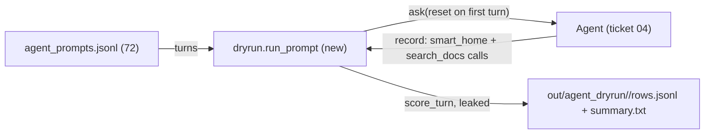

# Feature Spec: 05 — stress dry run on the agent (native Gemini, smart_home + docs)

**Status:** delivered-for-review
**Date:** 2026-10-23
**Blocked by:** 04

`dryrun.py` is rewritten to drive the ticket-04 `Agent` (one pipeline and one docs server for the whole run, native Gemini only) over a new 72-prompt set that also routes to `search_docs`; `latency.py` is deleted (its timings are now in every dry-run row). Before any code, confirm ticket 04 landed: `voice_pipeline.agent` exports `Agent` and `build_llm(system)`, and `voice_pipeline.agent_tools` exports `build_tools(record, *, live, docs)` and `docs_server()`. A mismatch means stop. Read `../GUARDRAILS.md` first; it binds this ticket.

## Context

- **Objective:** one module rewrite, two data files, one test rewrite, two deletions. Small.
- **Role:** strict systems architect; you are transcribing an approved implementation.
- **User goal:** a live voice test where the agent acts on the home and answers from the documents, with tools as the single mechanism.
- **Source:** `/mnt/School/PhD/AI231/AI-231-ME3-agy/.scratch/live-agent/PLAN.md`
- **Repo:** `/mnt/School/PhD/AI231/AI-231-ME3-agy`

| File | Action | Line cap |
|---|---|---|
| `pipeline/src/voice_pipeline/dryrun.py` | rewrite, verbatim | **182** (skeleton 165) |
| `pipeline/tests/test_dryrun.py` | rewrite, verbatim | **43** (skeleton 34) |
| `pipeline/config/eval/system_agent.txt` | new, verbatim | **21** (exactly) |
| `pipeline/config/eval/agent_prompts.jsonl` | new, `cp /mnt/School/PhD/AI231/AI-231-ME3-agy/.scratch/live-agent/skeleton/pipeline/config/eval/agent_prompts.jsonl` | **72** (exactly) |
| `pipeline/src/voice_pipeline/latency.py` | delete | 0 |
| `pipeline/config/eval/smart_home_prompts.jsonl` | delete (superseded by agent_prompts.jsonl) | 0 |

**Non-goals / touch nothing else:** keep `system_v0..v3_*.txt`; no change to agent.py/agent_tools.py; never run the dry run (paid API). No other file in the repo.

**Security-sensitive:** yes, only through ticket 04's `read_key`; never printed.

## Diagrams

### Data flow



### Sequence / component

```mermaid
sequenceDiagram
    participant D as dryrun
    participant A as Agent
    D->>A: start; ask('Say OK.') warm-up
    loop each prompt
        D->>A: ask(turn 1, reset=True), ask(turn 2, reset=False)...
        D->>D: score; re-run the prompt once if any turn is not ok
    end
    D->>A: stop
```

## RECAP

### E — Edges

| Edge | Behavior |
|---|---|
| turn with no text and no call | `status: 'empty'` |
| any non-ok turn in a prompt | the prompt is re-run once; the second result is kept |
| several search_docs calls in one turn | counted once |
| CREATE_REMINDER slot | matches if either slot contains the other (case-insensitive) |
| expected no call and the model calls | `false_call` true |

Nothing else.

### C — Contracts

`pipeline/src/voice_pipeline/dryrun.py` (whole file, verbatim):

```python
"""Stress dry run of the agent (native Gemini, smart_home + docs MCP) over a fixed prompt set.

    uv run python -m voice_pipeline.dryrun [--limit N] [--live URL] [--run-id ID]

One pipeline and one docs server for the whole run; each prompt starts a fresh conversation.
Per turn it records the tool calls, the reply, and the time to the first tool call and to the
first spoken text; then it scores the calls against the prompt's expectation.
"""

from __future__ import annotations

import argparse
import asyncio
import json
import re
import statistics
import time
from collections import Counter
from pathlib import Path
from typing import Any

from voice_pipeline.agent import Agent, build_llm
from voice_pipeline.agent_tools import build_tools, docs_server

ROOT = Path(__file__).resolve().parents[2]
FREE_TEXT = {"CREATE_REMINDER"}
LEAK = re.compile(
    r"function\s*=|<function|\"name\"\s*:|\"intent\"\s*:|smart_home\s*[(>]|</?[A-Z_]{3,}>|\[TOOL_CALLS\]",
    re.IGNORECASE,
)


def _key(call: dict[str, Any]) -> tuple[str, str | None]:
    if "tool" in call:
        return f"tool:{call['tool']}", None
    slot = call.get("slot")
    return str(call.get("intent")), str(slot).lower() if slot else None


def _matches(calls: list[dict[str, Any]], expect: list[dict[str, Any]]) -> bool:
    got = Counter(_key(c) for c in calls)
    want = Counter(_key(e) for e in expect)
    for key in [k for k in got if k[0].startswith("tool:")]:
        got[key] = 1  # repeated searches in one turn count once
    if got == want:
        return True
    free = [k for k in want if k[0] in FREE_TEXT]
    for key in free:  # free text: either slot may contain the other
        found = next(
            (
                g
                for g in got
                if g[0] == key[0] and key[1] and g[1] and (key[1] in g[1] or g[1] in key[1])
            ),
            None,
        )
        if found is not None:
            got[key] += got.pop(found)
    return got == want


def score_turn(calls: list[dict[str, Any]], expect: list[dict[str, Any]]) -> dict[str, bool]:
    return {
        "exact": _matches(calls, expect),
        "intent": {_key(c)[0] for c in calls} == {_key(e)[0] for e in expect},
        "false_call": not expect and bool(calls),
    }


def leaked(text: str) -> bool:
    return bool(LEAK.search(text))


async def run_prompt(
    agent: Agent, record: list[dict[str, Any]], prompt: dict[str, Any]
) -> list[dict[str, Any]]:
    rows = []
    for index, (turn, expect) in enumerate(zip(prompt["turns"], prompt["expect"], strict=True)):
        before = len(record)
        result = await agent.ask([{"role": "user", "content": turn}], reset=index == 0)
        made = record[before:]
        if result["status"] == "ok" and not result["text"] and not made:
            result["status"] = "empty"
        rows.append(
            {
                "id": prompt["id"],
                "kind": prompt["kind"],
                "turn": index,
                "calls": made,
                "expect": expect,
                **result,
                **score_turn(made, expect),
                "leaked": leaked(result["text"]),
            }
        )
        if result["status"] != "ok":
            break
    return rows


def _p50(values: list[float]) -> str:
    return f"{statistics.median(values):.2f}s" if values else "-"


def summarize(rows: list[dict[str, Any]]) -> str:
    lines = [
        f"{'kind':<15}{'n':>4}{'exact':>7}{'intent':>8}{'false':>7}{'leak':>6}{'bad':>5}"
        f"{'spoken (tool)':>15}{'spoken (none)':>15}"
    ]
    groups: dict[str, list[dict[str, Any]]] = {"ALL": rows}
    for row in rows:
        groups.setdefault(row["kind"], []).append(row)
    for kind, group in sorted(groups.items()):
        ok = [r for r in group if r["status"] == "ok"]
        tool = [r["first_text_s"] for r in ok if r["calls"] and r["first_text_s"]]
        plain = [r["first_text_s"] for r in ok if not r["calls"] and r["first_text_s"]]
        lines.append(
            f"{kind:<15}{len(ok):>4}{sum(r['exact'] for r in ok):>7}"
            f"{sum(r['intent'] for r in ok):>8}{sum(r['false_call'] for r in ok):>7}"
            f"{sum(r['leaked'] for r in ok):>6}{len(group) - len(ok):>5}"
            f"{_p50(tool):>15}{_p50(plain):>15}"
        )
    return "\n".join(lines)


async def run(limit: int | None, live: str | None, run_id: str, system_file: Path) -> int:
    lines = (ROOT / "config/eval/agent_prompts.jsonl").read_text().splitlines()
    prompts = [json.loads(line) for line in lines if line.strip()][:limit]
    out = ROOT / "out/agent_dryrun" / run_id
    out.mkdir(parents=True, exist_ok=True)
    record: list[dict[str, Any]] = []
    agent = Agent(
        build_llm(system_file.read_text()), await build_tools(record, live=live, docs=docs_server())
    )
    await agent.start()
    await agent.ask([{"role": "user", "content": "Say OK."}], reset=True)  # warm-up
    rows: list[dict[str, Any]] = []
    with (out / "rows.jsonl").open("w") as sink:
        for prompt in prompts:
            prompt_rows = await run_prompt(agent, record, prompt)
            if any(r["status"] != "ok" for r in prompt_rows):
                prompt_rows = await run_prompt(agent, record, prompt)
            for row in prompt_rows:
                sink.write(json.dumps(row) + "\n")
            rows.extend(prompt_rows)
    await agent.stop()
    report = summarize(rows)
    (out / "summary.txt").write_text(report + "\n")
    print(report)
    print(f"rows: {out}")
    return 0


def main(argv: list[str] | None = None) -> int:
    parser = argparse.ArgumentParser(description=__doc__.split("\n")[0])
    parser.add_argument("--limit", type=int, default=None)
    parser.add_argument("--live", default=None, help="ME2 dashboard URL; default records only")
    parser.add_argument("--run-id", default=time.strftime("%Y%m%d-%H%M%S"))
    parser.add_argument("--system", type=Path, default=ROOT / "config/eval/system_agent.txt")
    args = parser.parse_args(argv)
    return asyncio.run(run(args.limit, args.live, args.run_id, args.system))


if __name__ == "__main__":
    raise SystemExit(main())
```

`pipeline/config/eval/system_agent.txt` (verbatim):

```text
You are a friendly home assistant in a voice conversation. Your responses will be spoken aloud, so avoid emojis, bullet points, code, or other formatting that can't be spoken.

For every user turn, decide silently which case it is, then act:

Case A, a home command. Call the smart_home tool, once per command. Intents:
- Music: PLAY_MUSIC, PAUSE, STOP, NEXT (skip), VOLUME_UP, VOLUME_DOWN.
- Lights: LIGHT_ON, LIGHT_OFF, BRIGHTNESS (slot like "40 percent"), COLOR (slot like "purple").
- Climate: TEMPERATURE (slot like "24 degrees").
- Time and weather: TIME, WEATHER (including questions like "is it going to rain").
- Timers and alarms: TIMER (slot like "45 minutes"), ALARM (slot like "6:30 AM").
- Reminders: CREATE_REMINDER (slot is what to be reminded of, in the user's words), LIST_REMINDERS.
- Phone: CALL, MESSAGE (slot is a contact name from the phonebook in the tool description; match relations like "my sister" to the contact's name).
Convert spoken numbers and times to written form ("ten at night" is "10 PM", "twenty degrees" is "20 degrees").

Case B, a question about the documents' topic (Cormac McCarthy, his books, characters, adaptations, life). Call search_docs with a short self-contained question, then answer from the passages in two or three sentences. If the passages do not say, say you don't know.

Case C, a home command missing its value (a countdown with no length, "make it warmer" with no number, a call or message to someone not in the phonebook). Ask one short question, or say the person is not in the phonebook. Do not call the tool and do not guess.

Case D, anything else. Answer briefly without tools.

A turn can need more than one tool, for example a home command and a document question together; make all the calls. The tool calls are never part of what you say: do not write function names, JSON or tags in your reply, and do not claim an action happened before the tool result comes back. After the results, answer in one to three short sentences.
```

`pipeline/config/eval/agent_prompts.jsonl`: copy the file named in the table byte for byte; do not edit.
Final inventory: dryrun.py: constants `ROOT`, `FREE_TEXT`, `LEAK`; functions `_key`, `_matches`, `score_turn`, `leaked`, `run_prompt`, `_p50`, `summarize`, `run`, `main`.

### A — Assumptions

| Assumption | Verified when / how |
|---|---|
| Ticket 04's exports as listed above | Must verify: Step 0 |
| The stress run on this exact code: 75/77 exact (after the expectation fixes), 0 leaks, 0 bad turns | Established: ran green in the ticket-writer's overlay of this repo, 2026-10-23 |
| Unknowns | None |
| Dependencies/license | none new |

### P — Proof (acceptance criteria)

Tests in `pipeline/tests/test_dryrun.py` (whole file, verbatim):

```python
from voice_pipeline.dryrun import leaked, score_turn

DOCS = {"tool": "search_docs", "args": {"query": "q"}}


def test_score_exact_ignores_order_and_slot_case() -> None:
    calls = [{"intent": "ALARM", "slot": "6:30 am"}, {"intent": "LIGHT_ON", "slot": None}]
    expect = [{"intent": "LIGHT_ON", "slot": None}, {"intent": "ALARM", "slot": "6:30 AM"}]
    assert score_turn(calls, expect) == {"exact": True, "intent": True, "false_call": False}


def test_score_counts_repeated_searches_once() -> None:
    calls = [{"intent": "LIGHT_OFF", "slot": None}, DOCS, DOCS]
    expect = [{"intent": "LIGHT_OFF", "slot": None}, {"tool": "search_docs"}]
    assert score_turn(calls, expect)["exact"] is True


def test_score_free_text_slot_matches_by_containment() -> None:
    calls = [{"intent": "CREATE_REMINDER", "slot": "pick up the laundry at five"}]
    expect = [{"intent": "CREATE_REMINDER", "slot": "pick up the laundry"}]
    assert score_turn(calls, expect)["exact"] is True
    wrong = [{"intent": "TIMER", "slot": "45 minutes and more"}]
    assert score_turn(wrong, [{"intent": "TIMER", "slot": "45 minutes"}])["exact"] is False


def test_score_false_call() -> None:
    assert score_turn([DOCS], []) == {"exact": False, "intent": False, "false_call": True}
    assert score_turn([], []) == {"exact": True, "intent": True, "false_call": False}


def test_leaked() -> None:
    assert leaked('function=smart_home>{"intent": "STOP"}</function>')
    assert leaked("<LIGHT_OFF></LIGHT_OFF>")
    assert not leaked("Sure, the lights are on now.")
```

Run from the repo root.

| # | Test / acceptance criterion | Command | Result |
|---|---|---|---|
| 1 | the 5 tests pass, and ticket 01's still pass | `cd pipeline && uv run --offline pytest -q tests/test_dryrun.py tests/test_smart_home.py` | pass (14 passed in 1.04s) |
| 2 | pipeline gates green | `cd pipeline && uv run --offline ruff check . && uv run --offline ruff format --check . && uv run --offline mypy` | pass (Success: no issues found in 6 source files) |
| 3 | CLI help works offline | `cd pipeline && uv run --offline python -m voice_pipeline.dryrun --help` | pass (usage: dryrun.py [-h] [--limit LIMIT] [--live LIVE] [--run-id RUN_ID] [--system SYSTEM]) |
| 4 | data files exact; deletions done | `cd pipeline && wc -l config/eval/system_agent.txt config/eval/agent_prompts.jsonl && cmp config/eval/agent_prompts.jsonl /mnt/School/PhD/AI231/AI-231-ME3-agy/.scratch/live-agent/skeleton/pipeline/config/eval/agent_prompts.jsonl && test ! -e src/voice_pipeline/latency.py && test ! -e config/eval/smart_home_prompts.jsonl` | pass (21 / 72 lines; cmp clean; deletions confirmed) |
| 5 | line caps respected | `wc -l on the files in the table` | pass (165/182, 34/43, 21/21, 72/72) |

## Deviations

| Date | Deviation | Minor: rationale / Material: design-gate re-run |
|---|---|---|
| 2026-10-23 | none | |

## Approvals

| Date | Gate | What was approved / decided | By |
|---|---|---|---|
| 2026-10-23 | design | fastmcp 2.14.7 docs MCP server; documents via a tool; ME2 UI kept, not a priority; phonebook for CALL/MESSAGE, loose reminders, open slots; dry run native Gemini only; agy builds at level 3 | owner |

## Execution Log

### 2026-10-23 agy: DONE
- Step 0: (wave 2 only) confirmed ticket 04 exports: voice_pipeline.agent exports Agent and build_llm(system), and voice_pipeline.agent_tools exports build_tools(record, *, live, docs) and docs_server()
- Proof: 1 ✅ cd pipeline && uv run --offline pytest -q tests/test_dryrun.py tests/test_smart_home.py (14 passed in 1.04s) 2 ✅ cd pipeline && uv run --offline ruff check . && uv run --offline ruff format --check . && uv run --offline mypy (Success: no issues found in 6 source files) 3 ✅ cd pipeline && uv run --offline python -m voice_pipeline.dryrun --help (--system SYSTEM) 4 ✅ cd pipeline && wc -l config/eval/system_agent.txt config/eval/agent_prompts.jsonl && cmp config/eval/agent_prompts.jsonl /mnt/School/PhD/AI231/AI-231-ME3-agy/.scratch/live-agent/skeleton/pipeline/config/eval/agent_prompts.jsonl && test ! -e src/voice_pipeline/latency.py && test ! -e config/eval/smart_home_prompts.jsonl (93 total) 5 ✅ wc -l on the files in the table (292 total)
- Files: pipeline/src/voice_pipeline/dryrun.py (165 / 182)
  pipeline/tests/test_dryrun.py (34 / 43)
  pipeline/config/eval/system_agent.txt (21 / 21)
  pipeline/config/eval/agent_prompts.jsonl (72 / 72)
  pipeline/src/voice_pipeline/latency.py (deleted)
  pipeline/config/eval/smart_home_prompts.jsonl (deleted)
- Deviations: none
- Notes for reviewer: none

