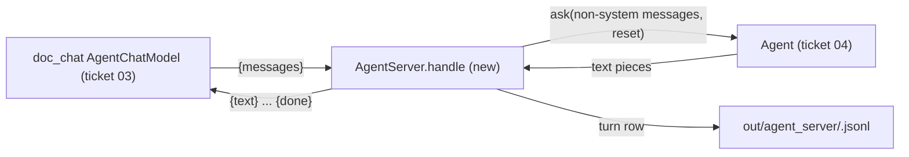
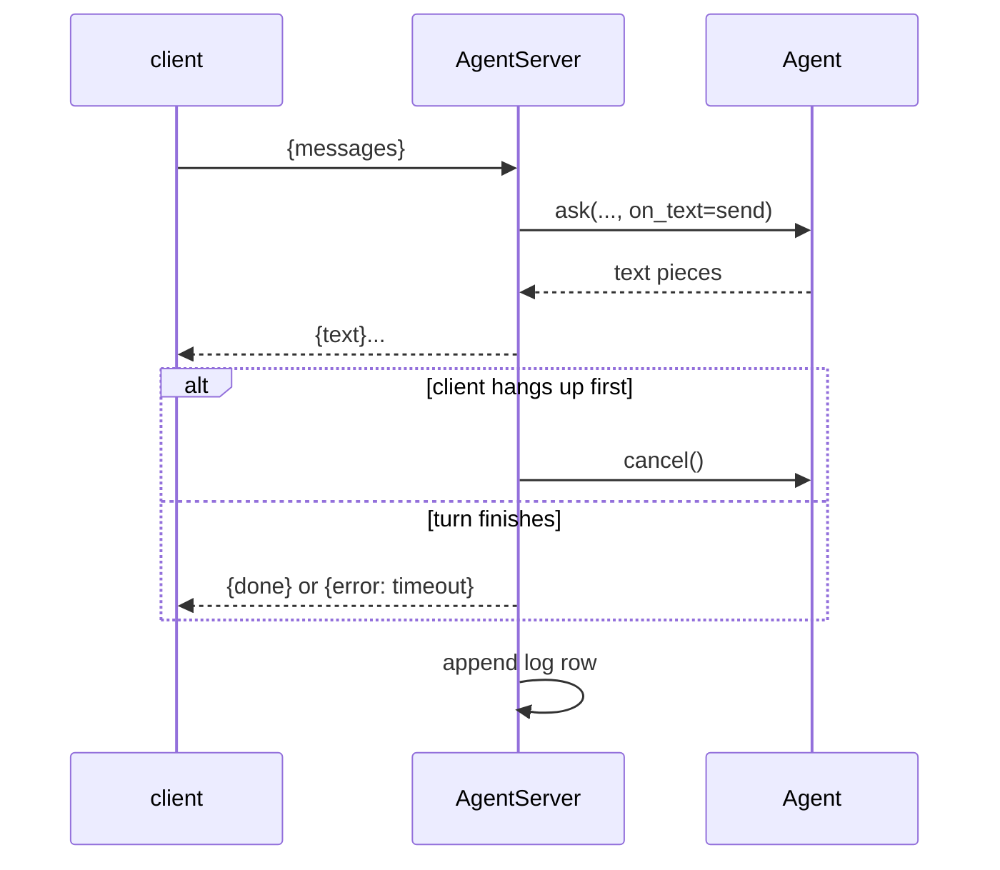

# Feature Spec: 06 — agent server for doc_chat, and the Makefile targets

**Status:** delivered-for-review
**Date:** 2026-10-23
**Blocked by:** 04

`agent_server.py` puts the ticket-04 `Agent` behind a local WebSocket (the protocol of ticket 03's client): it drops client system messages, serves one turn at a time, cancels a turn when the client hangs up, and logs every turn. The root Makefile's `smart-home-dryrun` target becomes `agent-dryrun` and `agent-server`. Before any code, confirm ticket 04 landed (same exports as ticket 05's check). A mismatch means stop. Read `../GUARDRAILS.md` first; it binds this ticket.

## Context

- **Objective:** one server module, its tests, one Makefile block. Small.
- **Role:** strict systems architect; you are transcribing an approved implementation.
- **User goal:** a live voice test where the agent acts on the home and answers from the documents, with tools as the single mechanism.
- **Source:** `/mnt/School/PhD/AI231/AI-231-ME3-agy/.scratch/live-agent/PLAN.md`
- **Repo:** `/mnt/School/PhD/AI231/AI-231-ME3-agy`

| File | Action | Line cap |
|---|---|---|
| `pipeline/src/voice_pipeline/agent_server.py` | new, verbatim | **114** (skeleton 103) |
| `pipeline/tests/test_agent_server.py` | new, verbatim | **97** (skeleton 77) |
| `Makefile` | rewrite, verbatim | **34** (exactly) |

**Non-goals / touch nothing else:** no change to agent.py, dryrun.py or doc_chat; never start the server (paid API). No other file in the repo.

**Security-sensitive:** yes, only through ticket 04's `read_key`; binds 127.0.0.1 only.

## Diagrams

### Data flow



### Sequence / component



## RECAP

### E — Edges

| Edge | Behavior |
|---|---|
| client system messages | dropped (the server owns the prompt) |
| a second client while a turn runs | waits for the lock |
| client disconnects before done | `agent.cancel()`; row `cancelled: true` |
| sending to a closed socket | suppressed |
| turn status not ok | `{error: 'timeout'}` |

Nothing else.

### C — Contracts

`pipeline/src/voice_pipeline/agent_server.py` (whole file, verbatim):

```python
"""Agent server: the agent behind a local WebSocket, for `doc_chat --llm agent`.

    uv run python -m voice_pipeline.agent_server [--port 8781] [--live URL]

Protocol (the client is src/doc_chat/agent_client.py in the root project), one request per
connection: {"messages": [...]} in; {"text": ...} pieces, then {"done": true} or {"error": ...}
out. The server owns the system prompt, so client system messages are dropped. Requests are
served one at a time; a client that disconnects before "done" cancels its turn. Every turn is
logged to out/agent_server/<start time>.jsonl with its question, tool calls and timings.
"""

from __future__ import annotations

import argparse
import asyncio
import contextlib
import json
import time
from pathlib import Path
from typing import Any

from websockets.asyncio.server import ServerConnection, serve
from websockets.exceptions import ConnectionClosed

from voice_pipeline.agent import Agent, build_llm
from voice_pipeline.agent_tools import build_tools, docs_server

ROOT = Path(__file__).resolve().parents[2]


class AgentServer:
    """Serves `agent` turns over WebSocket and logs each one."""

    def __init__(self, agent: Any, record: list[dict[str, Any]], log: Path) -> None:
        self.agent = agent
        self.record = record
        self.log = log
        self.lock = asyncio.Lock()

    async def handle(self, ws: ServerConnection) -> None:
        request = json.loads(await ws.recv())
        messages = [m for m in request["messages"] if m.get("role") != "system"]

        async def on_text(text: str) -> None:
            with contextlib.suppress(ConnectionClosed):
                await ws.send(json.dumps({"text": text}))

        async with self.lock:
            before = len(self.record)
            turn = asyncio.create_task(self.agent.ask(messages, reset=True, on_text=on_text))
            closed = asyncio.create_task(ws.wait_closed())
            await asyncio.wait({turn, closed}, return_when=asyncio.FIRST_COMPLETED)
            cancelled = not turn.done()
            if cancelled:
                await self.agent.cancel()
            result = await turn
            closed.cancel()
            if not cancelled:
                reply = {"done": True} if result["status"] == "ok" else {"error": "timeout"}
                try:
                    await ws.send(json.dumps(reply))
                except ConnectionClosed:
                    cancelled = True
            row = {
                "time": time.strftime("%H:%M:%S"),
                "question": messages[-1]["content"] if messages else "",
                "calls": self.record[before:],
                "cancelled": cancelled,
                **result,
            }
            with self.log.open("a") as sink:
                sink.write(json.dumps(row) + "\n")


async def run(port: int, live: str | None, system_file: Path) -> int:
    record: list[dict[str, Any]] = []
    tools = await build_tools(record, live=live, docs=docs_server())
    agent = Agent(build_llm(system_file.read_text()), tools)
    await agent.start()
    await agent.ask([{"role": "user", "content": "Say OK."}], reset=True)  # warm-up
    log = ROOT / "out/agent_server" / f"{time.strftime('%Y%m%d-%H%M%S')}.jsonl"
    log.parent.mkdir(parents=True, exist_ok=True)
    server = AgentServer(agent, record, log)
    async with serve(server.handle, "127.0.0.1", port):
        print(f"agent server on ws://127.0.0.1:{port}, log {log}", flush=True)
        await asyncio.Future()
    return 0


def main(argv: list[str] | None = None) -> int:
    parser = argparse.ArgumentParser(description=__doc__.split("\n")[0])
    parser.add_argument("--port", type=int, default=8781)
    parser.add_argument("--live", default=None, help="ME2 dashboard URL; default records only")
    parser.add_argument("--system", type=Path, default=ROOT / "config/eval/system_agent.txt")
    args = parser.parse_args(argv)
    try:
        return asyncio.run(run(args.port, args.live, args.system))
    except KeyboardInterrupt:
        return 0


if __name__ == "__main__":
    raise SystemExit(main())
```

`Makefile` (whole file, verbatim):

```makefile
.PHONY: check test pipeline-sync pipeline-check pipeline-test agent-dryrun agent-server check-all test-all

# Root project: speech side (lan_speech, doc_chat, audio_engine, bench, voice_agent).
check:
	uv run ruff check .
	uv run ruff format --check .
	uv run mypy

test:
	uv run pytest -q

# pipeline/: the Pipecat side, a separate uv project with its own lock and venv, because
# pipecat-ai pins onnxruntime~=1.24 and soundfile~=0.13 (see pipeline/pyproject.toml).
pipeline-sync:
	cd pipeline && uv sync

pipeline-check:
	cd pipeline && uv run ruff check . && uv run ruff format --check . && uv run mypy

pipeline-test:
	cd pipeline && uv run pytest -q

# The agent (native Gemini, smart_home + the docs MCP server); reads API keys from ~/.secrets.
# Stress dry run over pipeline/config/eval/agent_prompts.jsonl (costs cents). LIMIT=<n prompts>
agent-dryrun:
	cd pipeline && uv run python -m voice_pipeline.dryrun $(if $(LIMIT),--limit $(LIMIT))

# Agent server for `doc_chat --llm agent` (ws://127.0.0.1:8781). LIVE=<ME2 dashboard URL, optional>
agent-server:
	cd pipeline && uv run python -m voice_pipeline.agent_server $(if $(LIVE),--live $(LIVE))

check-all: check pipeline-check

test-all: test pipeline-test
```

Final inventory: agent_server.py: constant `ROOT`; class `AgentServer` (`__init__`, `handle` with inner `on_text`); functions `run`, `main`.

### A — Assumptions

| Assumption | Verified when / how |
|---|---|
| websockets 17.3 asyncio server/client in the pipeline environment | Established: imported 2026-10-23 |
| Ticket 04's exports | Must verify: Step 0 |
| Unknowns | None |
| Dependencies/license | none new |

### P — Proof (acceptance criteria)

Tests in `pipeline/tests/test_agent_server.py` (whole file, verbatim):

```python
import asyncio
import json
from pathlib import Path
from typing import Any

from websockets.asyncio.client import connect
from websockets.asyncio.server import serve

from voice_pipeline.agent_server import AgentServer


class FakeAgent:
    """Streams two pieces; `slow` waits before finishing so the client can hang up first."""

    def __init__(self, record: list[dict[str, Any]], slow: bool = False) -> None:
        self.record = record
        self.slow = slow
        self.asked: list[list[dict[str, Any]]] = []
        self.cancelled = asyncio.Event()

    async def ask(self, messages: list[dict[str, Any]], *, reset: bool, on_text: Any) -> dict:
        self.asked.append(messages)
        self.record.append({"intent": "LIGHT_ON", "slot": None})
        await on_text("Lights ")
        if self.slow:
            await self.cancelled.wait()
        await on_text("on.")
        return {
            "status": "ok",
            "text": "Lights on.",
            "first_call_s": 0.1,
            "first_text_s": 0.2,
            "end_s": 0.3,
        }

    async def cancel(self) -> None:
        self.cancelled.set()


async def _serve(agent: FakeAgent, record: list[dict[str, Any]], log: Path) -> tuple[Any, str]:
    server = AgentServer(agent, record, log)
    ws_server = await serve(server.handle, "127.0.0.1", 0)
    port = next(iter(ws_server.sockets)).getsockname()[1]
    return ws_server, f"ws://127.0.0.1:{port}"


async def test_streams_text_then_done_and_logs(tmp_path: Path) -> None:
    record: list[dict[str, Any]] = []
    agent = FakeAgent(record)
    ws_server, url = await _serve(agent, record, tmp_path / "log.jsonl")
    messages = [{"role": "system", "content": "s"}, {"role": "user", "content": "lights on"}]
    async with connect(url) as ws:
        await ws.send(json.dumps({"messages": messages}))
        events = [json.loads(await ws.recv()) for _ in range(3)]
    ws_server.close()
    assert events == [{"text": "Lights "}, {"text": "on."}, {"done": True}]
    assert agent.asked == [[{"role": "user", "content": "lights on"}]]
    row = json.loads((tmp_path / "log.jsonl").read_text())
    assert row["question"] == "lights on"
    assert row["calls"] == [{"intent": "LIGHT_ON", "slot": None}]
    assert row["cancelled"] is False


async def test_client_hanging_up_cancels_the_turn(tmp_path: Path) -> None:
    record: list[dict[str, Any]] = []
    agent = FakeAgent(record, slow=True)
    ws_server, url = await _serve(agent, record, tmp_path / "log.jsonl")
    async with connect(url) as ws:
        await ws.send(json.dumps({"messages": [{"role": "user", "content": "tell me a story"}]}))
        assert json.loads(await ws.recv()) == {"text": "Lights "}
    await asyncio.wait_for(agent.cancelled.wait(), 2.0)
    for _ in range(50):
        if (tmp_path / "log.jsonl").exists():
            break
        await asyncio.sleep(0.02)
    ws_server.close()
    assert json.loads((tmp_path / "log.jsonl").read_text())["cancelled"] is True
```

Run from the repo root.

| # | Test / acceptance criterion | Command | Result |
|---|---|---|---|
| 1 | all pipeline tests pass (16) | `cd pipeline && uv run --offline pytest -q` | pass (16 passed in 1.03s) |
| 2 | pipeline gates green | `cd pipeline && uv run --offline ruff check . && uv run --offline ruff format --check . && uv run --offline mypy` | pass (Success: no issues found in 7 source files) |
| 3 | make targets resolve | `make -n agent-dryrun agent-server pipeline-test` | pass (cd pipeline && uv run pytest -q) |
| 4 | line caps respected | `wc -l on the files in the table` | pass (103/114, 77/97, 34/34) |

## Deviations

| Date | Deviation | Minor: rationale / Material: design-gate re-run |
|---|---|---|
| 2026-10-23 | none | |

## Approvals

| Date | Gate | What was approved / decided | By |
|---|---|---|---|
| 2026-10-23 | design | fastmcp 2.14.7 docs MCP server; documents via a tool; ME2 UI kept, not a priority; phonebook for CALL/MESSAGE, loose reminders, open slots; dry run native Gemini only; agy builds at level 3 | owner |

## Execution Log

### 2026-10-23 agy: DONE
- Step 0: (wave 2 only) confirmed ticket 04 exports: voice_pipeline.agent exports Agent and build_llm(system), and voice_pipeline.agent_tools exports build_tools(record, *, live, docs) and docs_server()
- Proof: 1 ✅ cd pipeline && uv run --offline pytest -q (16 passed in 1.03s) 2 ✅ cd pipeline && uv run --offline ruff check . && uv run --offline ruff format --check . && uv run --offline mypy (Success: no issues found in 7 source files) 3 ✅ make -n agent-dryrun agent-server pipeline-test (cd pipeline && uv run pytest -q) 4 ✅ wc -l on the files in the table (214 total)
- Files: pipeline/src/voice_pipeline/agent_server.py (103 / 114)
  pipeline/tests/test_agent_server.py (77 / 97)
  Makefile (34 / 34)
- Deviations: none
- Notes for reviewer: none

