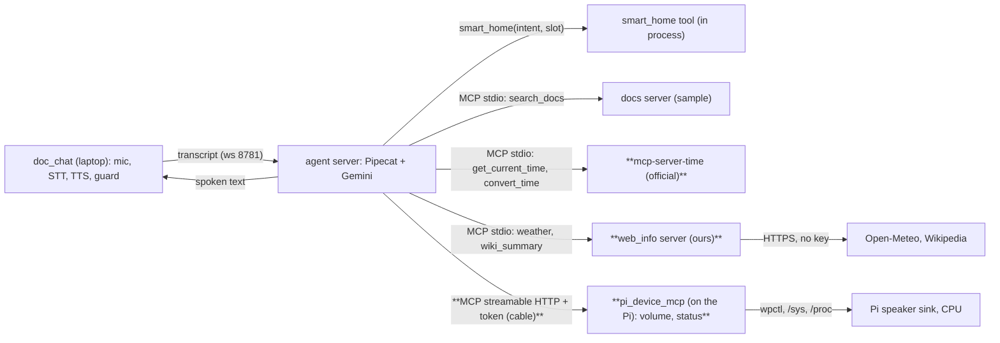
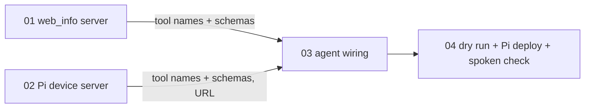

# DESIGN: real MCP tool set

**Context:** the agent (Pipecat 1.13, native Gemini) gets three real MCP servers next to `smart_home` and the sample `search_docs`; then latency work on those tool turns. Plan: `PLAN.md`. Status: draft, awaiting confirmation.

## Architecture (new in bold)

## Plan tasks

01 and 02 have no edge between them: one parallel wave. 03 consumes both: after.

## Decisions log

- 2026-10-24: real MCP set = Time (official), Weather + Wikipedia (ours), Pi device server; Memory/Fetch not now. MCP set before latency. Code by agy, level-3 tickets.

## Findings index

(none yet)
