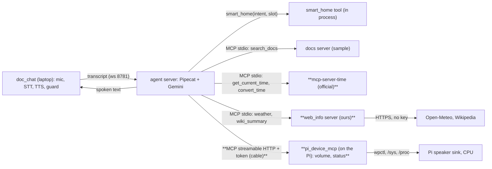
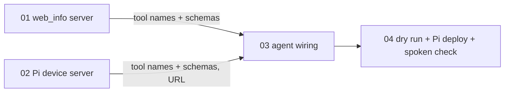

# DESIGN: real MCP tool set

**Context:** the agent (Pipecat 1.13, native Gemini) gets three real MCP servers next to `smart_home` and the sample `search_docs`; then latency work on those tool turns. Plan: `PLAN.md`. Status: draft, awaiting confirmation.

## Architecture (new in bold)

## Plan tasks

01 and 02 have no edge between them: one parallel wave. 03 consumes both: after.

## Decisions log

- 2026-10-24: real MCP set = Time (official), Weather + Wikipedia (ours), Pi device server; Memory/Fetch not now. MCP set before latency. Code by agy, level-3 tickets.
- 2026-10-24: `mcp-server-time` added to `pipeline/`; default weather place Quezon City; Pi server on port 8790 with the session token.
- 2026-10-24: TIME and WEATHER removed from `smart_home` (the requirement is the ME2 phrases, not ME2's structure); time, weather and general knowledge go to the real tools.
- 2026-10-24: speaker volume with a number and Pi status go to the Pi; relative music volume stays `smart_home` VOLUME_UP/DOWN.
- 2026-10-24: model stays `gemini-3.1-flash-lite` (Jev Router via OpenRouter: 2.94 s vs 0.98 s first token, 14/16 vs 16/16 right tool, 10x cost; `.scratch/latency-research/jev_check.py`).

## Findings index

- Weather tool ~3 s per question (fresh TLS to Open-Meteo in Germany, twice): fixed by ticket 05 (kept connection, remembered places, 10-min forecast cache).
