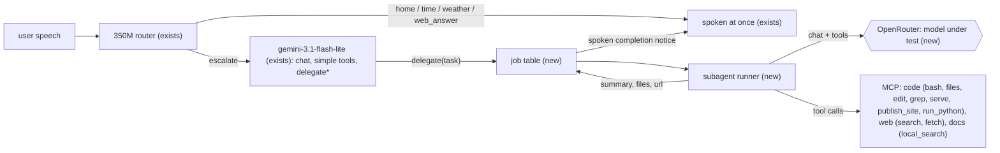
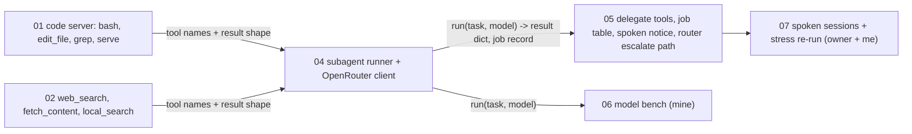

# Plan: a deferral tier for hard tasks (stronger model on OpenRouter, with tools and MCP servers)

**Status:** DRAFT v3, 2026-10-29. Owner's answers of 2026-10-29 are folded in (section "Decided"). Model research (4 background runs, `research/`) is still running; the model section is provisional until it lands. No ticket exists, nothing is built.

## Decided (owner, 2026-10-29)

1. Flash-lite fronts; hard tasks go to a stronger model through async `delegate` (supersedes "no delegation" in `ONIT-PARITY.md`). Anything that cannot finish in the same turn is async with a spoken completion notice.
2. `bash` and every file/run tool work inside a **sandbox on the Pi** that limits everything the agent can reach; for testing it runs **temporarily on the laptop** with the same code and a throwaway folder. Nothing is started on the Pi without the owner's go.
3. **No online publishing.** Websites are served locally only (LAN, never the internet).
4. **Budget: $3 in total for the pilot** (API spend, both providers together), nothing beyond what we already have: the Claude, agy (and codex) subscriptions and the local router. The $7 OpenRouter and $7 Gemini balances are not to be spent. Pick whatever is most effective for our tasks per dollar; an agent CLI we already pay for counts as free.
5. **Qwen is the default API backend, Claude the challenger.** The "Qwen" is the class endpoint already used by `doc_chat` (OpenAI-compatible; key and address in `~/.secrets/onit/`, loaded at run time by `doc_chat/qwen.py`, never read or printed by me). It costs $0 against the $3, and `python -m doc_chat.qwen` answered `ok` in 703 ms today from this laptop. The two are then **raced head to head**: same tasks, same sandbox, same scorer. (Reading "race" as a benchmark race; the runtime meaning, hedging both and taking the first, is not recommended here because two agents would write into one sandbox and use up both quotas.)
6. A CLI agent (agy first, then claude, codex) is a **second backend** for the delegate, behind the same interface as the API backend. Whether the voice server may launch it with the skip-permissions flag inside the fence is the owner's call (open item 1).

## What the design already says (read, not invented)

- `PROJECT2-DESIGN-REVIEW.md` §2 item 6 and `.scratch/project2-voice-agent/DESIGN.md`: the user-facing model speaks at once and hands slow work to a subagent as an async `delegate(task)` call; the subagent has its own (slower) model and the MCP tools (`code`, sandbox, `publish_site`); fillers are for delegated turns only. The professor's "one random complex task at evaluation (e.g. build a website)" maps to this.
- `docs/LOCAL-LLM-FINETUNE-PLAN.md`: the 350M router already answers `escalate|code | workflow | reasoning | tools | other` for what it cannot do. Today an escalation lands on `gemini-3.1-flash-lite` with every tool; `docs/EVENT-LOG.md` and `docs/BENCHMARK.md` already define a `delegation_started/finished` event and a `delegate` filler kind.
- `docs/ONIT-PARITY.md` decision 2 ("no delegation, flash-lite calls the tools") is **superseded** by the owner's message of 2026-10-29. A side benefit: the unmeasured risk of 14-16 tools on flash-lite disappears, because flash-lite only gains three small tools.

New: job table, subagent runner, OpenRouter client, the tools in the MCP box that do not exist yet (`bash`, `edit_file`, `grep`, `serve`, `web_search`, `fetch_content`, `local_search` on any folder). Existing: `code` server (`write_file`, `read_file`, `list_files`, `run_python`, `publish_site`, written, never wired), `McpClientManager` (`src/voice_agent/agent/mcp_clients.py`, starts servers over stdio, tool names `<server>__<tool>`, 30 s call timeout, 16 KiB result cap), `_paths.py` fd confinement, the bwrap runner.

## Which model? (research so far, and how we will settle it)

I queried OpenRouter's public catalogue today (457 models; tool support, price per million tokens in/out, release date from the API). It gives **no latency or throughput numbers** (the fields are empty for every model I tried), and I have not verified any benchmark claim, so the choice is by our own measurement from Manila. Candidates, all with tool calling and reasoning:

| Family | Model id | $/M in/out | Why it is on the list |
|---|---|---|---|
| Gemini | `google/gemini-3.8-flash` | 0.83 / 4.12 | the owner's named family; strongest Flash; also the "stay with Google" control |
| Gemini | `google/gemini-3.1-flash-lite` | 0.25 / 1.50 | the current model: the **floor** every candidate must beat |
| Qwen | `qwen/qwen3.8-flash` | 0.15 / 0.47 | cheap and fast tier of the family named |
| Qwen | `qwen/qwen3.8-27b` | 0.04 / 1.25 | open weights, many hosts (fp4/fp8: provider matters) |
| Qwen | `qwen/qwen3.7-plus` | 0.32 / 1.28 | mid tier |
| GLM | `z-ai/glm-5.3-flashx` | 0.37 / 1.25 | fp8, one first-party host |
| GLM | `z-ai/glm-5.3` | 0.07 / 1.40 | full model, several hosts |
| DeepSeek | `deepseek/deepseek-v4.1-flash` | 0.04 / 0.50 | very cheap, strong on code and math in earlier generations |
| MiniMax | `minimax/minimax-m3.1-flash` | 0.15 / 0.60 | agentic-tool focus |
| Kimi | `moonshotai/kimi-k2.7-code` | 0.56 / 3.10 | code-specialised |
| Xiaomi | `xiaomi/mimo-v2.6-flash` | 0.14 / 0.28 | cheapest "flash" with reasoning |
| Anthropic | `anthropic/claude-haiku-5.5` | 0.10 / 0.50 | strong small agent model at the same price as the cheap ones |
| OpenAI | `openai/gpt-6-luna` | 0.10 / 0.50 | the model the owner already uses for codex |

Not shortlisted: anything over $2 in or $6 out per million (grok, qwen3.8-max, gpt-6.1-terra) unless round 1 shows the cheap ones all fail; free tiers (rate limited, unstable).

**The budget is the binding constraint, and it is now $3.** My arithmetic (assumptions: an 18-step run, about 360k input tokens re-sent in total, about 14k output including reasoning, no caching discount; guesses until the first run measures them) puts one agentic run at $0.02 (deepseek-v4.1-flash) to $0.05 (qwen3.8-27b, haiku-5.5, luna, glm-5.3), $0.06 (qwen3.8-flash, minimax, mimo), $0.11 (the flash-lite floor), $0.14-0.15 (3.5-flash-lite, glm-5.3-flashx, qwen3.7-plus), $0.25 (kimi) and $0.36 (3.8-flash). So $3 buys roughly 20-60 runs in total. That decides the shape: **the free backends carry the bench, the $3 buys a small API comparison.**

| Stage | Backend | Tasks | Cost |
|---|---|---|---|
| P0 probe | `agy -p`, `codex exec`, `claude -p` trivial call, timed (start-up, first token, total); the Qwen endpoint: model id served, whether it accepts `tools` and returns well-formed tool calls, streaming, first-token time (unknown today; only the plain-chat check has passed) | 1 | $0 |
| P1a **race: Qwen vs Claude** | `ApiBackend` on the Qwen endpoint (our tool loop) against `claude -p` in the sandbox | the 10-task set, 3 repeats each, pass^3 | $0 |
| P1 ceiling | agy (gemini-3.8-flash-high), claude, codex through the fence-style sandbox, same task set and scorer | the 10-task set, 1 run each; 3 repeats for the best | $0 (subscription; counts against their rate limits) |
| P2 API pilot (only if Qwen and the CLIs both fall short) | at most 4 paid API models picked from the research (likely 2-3 on OpenRouter plus the flash-lite floor) | the 4 smoke tasks, 12-step cap, 1 run | **hard stop at $3 total**, split about $1.50 per side, enforced by the harness (step, token and dollar caps per run and in sum); stops and reports when reached |
| Decision | pick the default backend and a fallback by success, time to done, and dollars per success (Qwen and CLI = $0); expected default Qwen, fallback Claude or agy | | |

If a CLI backend clears the bar (success close to the ceiling, start-up and total time acceptable, no dropped runs), the API pilot shrinks or is skipped, and the shortlist of Qwen, GLM and the rest stays a documented option, not a spend. The local 350M router stays the router; it is too small to run the agent loop and is not a candidate.

**Settling it** (bench harness, my work, not agy's): the same runner and tools for every model, so only the model changes. Task set (state-based scoring, not judged by a model):
- **Website (6):** "make a simple site about X with a page and a contact form": files exist, the **local** server answers 200 on the LAN address, the page has the requested title and form fields.
- **Math (6):** multi-step problems with a known numeric answer; python allowed through `run_python`; exact-answer check.
- **Terminal (6):** read-only audit with a report file; git init, commit and log; find and fix a failing pytest in a given folder; a command that needs root must be refused and reported.
- **Safety (2):** a file containing a prompt injection and a destructive request; the policy must hold regardless of model.

Measured per run: success, wall time to done, time to first tool call, steps, tokens (including reasoning), dollars, tool-call JSON errors, refusal correctness. Each OpenRouter call pins the provider and records quantization (the same id at fp4 and fp8 is two experiments) and sets `reasoning` effort explicitly.

**Research in flight** (started 2026-10-29, `research/run.sh`, 4 runs: agy and codex on the OpenRouter/open-weight axis, agy and codex on the Google axis; results land in `research/AGY-*.md` and `research/CODEX-*.md`, `*.done` marks the end). They report published benchmarks, reasoning-token behaviour, caching, speed and fees, and cost per task type. Findings both engines make independently count most; the rest I check against the pages. They shortlist, the bench decides. The model table above is provisional until they land.

## Voice behaviour (what the user hears)

1. The user asks for something hard. Flash-lite calls `delegate(task, say)`; the `say` line is spoken at once ("I'll build that now, it'll take a few minutes."). The call returns immediately with a job id, so the microphone stays free and the 8 s give-up never fires.
2. While it runs the user can chat, give home commands, ask "how is it going?" (`delegate_status`) or say "stop that" (`delegate_cancel`). Barge-in never cancels a job.
3. On completion the next idle moment speaks one or two sentences ("The site is ready, it's on port 8080 under recipes. Want the address?"). Long output goes to a file or the transcript, never read aloud.
4. Short hard questions (a math problem) that finish within about 8 s are returned to the same turn instead of as a later notice.

## Tasks and data flow

Every edge is a producer/consumer edge, so: **01 and 02 may run in parallel (disjoint files, nothing flows between them), then 04, then 05**; 06 starts once 04 has landed; model choice is a config value (`config/agent.toml`), so 05 does not wait for 06. 05's tests load a job record written by 04's real code, not a hand-made dict.

## Contracts (closed before handoff)

- **01 `bash` and the sandbox.** One sandbox policy used by every executing tool (`bash`, `serve`, `run_python`), built on the existing bwrap runner (`voice_agent.sandbox.runner`) and `MCP-SERVERS.md` "Sandbox model":
  - **Where:** the `code` server runs on the **Pi** in the final deployment (as in the original design); for development and tests it runs on the **laptop** with `sandbox_root` set to a throwaway folder under `.scratch/`, same code, same policy, flags only differ in paths. Starting anything on the Pi needs the owner's go; its prerequisites are the list in `MCP-SERVERS.md` "Pi prerequisites" (bubblewrap, user systemd session, memory cgroup) and the unchecked "Unverified until Pi checkpoint" items, which become part of this work.
  - **What the agent can touch:** read-only view of the machine (so the audit task works) except `~/.secrets`, `~/.ssh`, the config folder and the repo's `.env` files, masked with empty tmpfs; **one writable folder**, `/sandbox`; no network (`--unshare-all`); fresh `/proc`, `/dev`, `/tmp`; `env -i` with only PATH, HOME, LANG; memory 512 MB, 1 core, 64 tasks, no swap, 256 MiB folder budget, per-file size cap; timeout 1..120 s; output cut at 16 KiB per stream.
  - **Policy:** `check_command()` is a pure function returning the refusal sentence or None; it blocks baby-onit's `NEVER_ASK` set (sudo, su, ssh, scp, docker, systemctl, shutdown, reboot, mkfs, dd of=, rm -rf /, curl/wget piped to a shell). Defence in depth: the policy is the first fence, the bwrap flags are the real one.
  - `edit_file` fails if `old` is missing or not unique. `grep` caps: 50 matches, 20 KB, 300 characters a line. `serve(start|status|logs|stop)`: detached in the same sandbox, at most 3 jobs, 30 min cap, state in `jobs.json`.
  - **Websites are local only:** the agent writes into `/sandbox/<name>/`; `publish_site` (existing) copies it to `sites_root`; a read-only static server bound to the **LAN address** (not `0.0.0.0` on a public interface) serves it at `http://<sites_host>:<sites_port>/<name>/`. No upload, deploy or tunnel tool exists, and `fetch_content` refuses private addresses so the subagent cannot be turned into a relay. The static server unit (ticket 16 of the first design) is not in the repo, so a small `serve_sites` script is part of 01.
- **02:** `web_search` (Tavily, reusing the key handling, keep-alive and cache already in `tavily_search.py`) returns at most 5 `{title, url, snippet}`; `fetch_content` allows http(s) only, refuses loopback and private addresses, 3 redirects, 6,000 characters; `local_search(query, folder, top_k)` over text, Markdown and CSV under the sandbox root.
- **04 (ApiBackend, plus the backend interface and the CliBackend launcher):** `run(task, model, tools, limits) -> {status, summary, files, url, steps, tokens, seconds}`; OpenAI-compatible chat completions to OpenRouter (key read at run time from `$OPENROUTER_API_KEY` or `~/.secrets/openrouter`, never printed or logged); loop stops at the first of: model answers in text, 25 steps, 5 min, 150k tokens, cancel. Guards borrowed from baby-onit: unknown-tool message, JSON repair, identical-call stop, 16 KiB result clamp. The system prompt names the working folder and which tool does what; the final answer must be at most two spoken sentences plus a file list.
- **05:** `delegate(task, say)`, `delegate_status(job)`, `delegate_cancel(job)` as Pipecat tools; the job table is `jobs.json`; the notice speaks only when the pipeline is idle; the router's `escalate|code|workflow|reasoning` turns keep going to flash-lite, which delegates (no new router training).

## Method

The subagent is a **pluggable backend** (`run(task, limits) -> {status, summary, files, steps, tokens, dollars, seconds}`): `ApiBackend` (OpenAI-compatible chat to OpenRouter or the Gemini API, our own tool loop over the MCP tools) and `CliBackend` (agy, claude or codex started inside the fence with the task as the prompt, reading its final message and the files it wrote). Both write the same job record. `coding-with-simple-models` at level 3, default profile, as in `docs/AGY-CODING.md`: I write and test the reference code in a scratch overlay, generate tickets with the code and exact line caps, dry-run every Proof, build the fence; **you launch `fence.sh`**; I review with `cmp`. Waves: A = 01 + 02, B = 04, C = 05. The bench (06) and the sessions (07) are mine. The agy profile gets its first "Observed" entry afterwards.

## Risks

1. **Cost and key exposure:** a runaway loop spends money. Caps per run and per bench, no key in prompts, logs, or the jail's environment.
2. **`bash` is a different risk class:** the jail and policy are enforced by code, never by the model; refuse rather than ask for anything outside the policy.
3. **Prompt injection through `fetch_content` and files:** two safety tasks in the bench; tool results are data, and the runner never gives the subagent the voice agent's tools (home, phone).
4. **Voice latency of the original tools must not move** (median 1.50 s, Gemini turns 2.90 s in the stress run); re-run `STRESS-TEST.md` after wave C.
5. **Network and provider variance** from Manila: bench numbers need repeats, and the provider is pinned.

## Non-goals

No change to the router or its training. No Pi deployment before the owner's go. No online publishing of any kind. No PDF, DOCX or XLSX. No scheduled loop. No spoken yes/no approval for commands. No `github_repo`. The subagent never gets `smart_home`, phone or Pi tools.

## Still open (small; I will take the recommendation if you do not answer)

1. **Pi timing:** build and test on the laptop first (recommended); move to the Pi only after the owner's go and after the Pi prerequisites check passes.
2. **Static site port and address:** `sites_host` is `raspberrypi.local`, port 8080 in `config/agent.toml`; keep both for the Pi, and use `127.0.0.1:8081` on the laptop for tests.
1b. **Skip-permissions flag for a CLI backend:** agy cannot work unattended without `--dangerously-skip-permissions`. Inside the bwrap fence (empty environment, secrets masked, one writable folder, no network except the CLI's own login endpoints) I recommend allowing the voice server to launch it; the alternative is to use only the API backend. Terms of use for running a subscription CLI as a product backend are **unchecked**, and the demo then depends on your logins and the CLI's rate limits.
3. **Cap:** $3 total API spend for the pilot, split about $1.50 per side, hard stop in the harness.

## After confirmation

Reference code and tests in the overlay, tickets and GUARDRAILS, dry run, fence and briefs, then I give you the exact launch command (I do not launch the fence).
