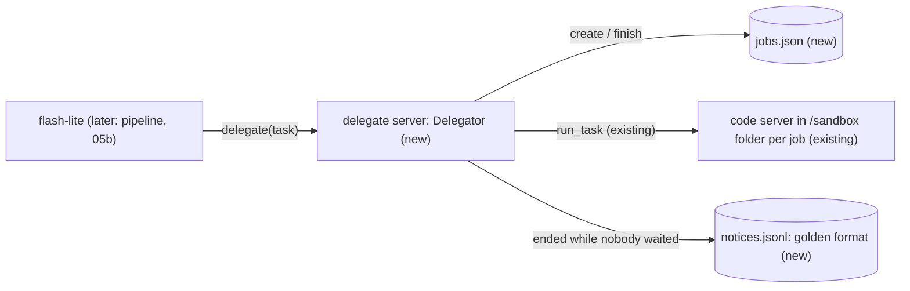

# Feature Spec: 05a — delegate MCP server: a stronger model works on a hard task in a sandbox, in the background

**Status:** ready
**Date:** 2026-10-30
**Blocked by:** 01 and 04 are already in the repo (run_task, the code server with bash, edit_file and grep)

The voice agent hands big tasks (a website, hard math with code, an audit) to a stronger model. This ticket adds the worker as an MCP server in the root project: three tools (`delegate`, `delegate_status`, `delegate_cancel`), a job table on disk, a config file choosing the model (haiku-5.5 on OpenRouter, with the class Qwen server as fallback), and a notice file that the pipeline reads in ticket 05b.

## Context

- **Objective:** delegate MCP server: a stronger model works on a hard task in a sandbox, in the background. Code is written and tested in a scratch copy; you transcribe it.
- **Role:** strict systems architect; you are transcribing an approved implementation.
- **Source:** `/mnt/School/PhD/AI231/AI-231-ME3-agy/.scratch/onit-tools/PLAN.md` and `EXPERIMENT.md`.
- **Repo:** the working directory you were given (a copy of `/mnt/School/PhD/AI231/AI-231-ME3-agy`).

| File | Action | Line cap |
|---|---|---|
| `src/voice_agent/agent/jobs.py` | new, verbatim | **95** (skeleton 86) |
| `src/voice_agent/mcp_servers/delegate.py` | new, verbatim | **241** (skeleton 219) |
| `config/delegate.toml` | new, verbatim | **30** (skeleton 30) |
| `tests/fixtures/delegate_notices.jsonl` | new, verbatim | **2** (skeleton 2) |
| `tests/agent/test_jobs.py` | new, verbatim | **77** (skeleton 61) |
| `tests/mcp_servers/test_delegate_server.py` | new, verbatim | **290** (skeleton 232) |

**Non-goals / touch nothing else:** no change to `subagent.py`, the `code` server, the sandbox runner, `mcp_clients.py`, `config/agent.toml`, or anything under `pipeline/` (ticket 05b). No `serve` tool, no web tools, no client change.

**Security-sensitive:** yes — it holds API keys and starts a model that can run commands in a sandbox. Do not log or return a key, and do not change any limit, sandbox flag or policy entry.

## Diagrams



## RECAP

### E — Edges

| Edge | Behaviour |
|---|---|
| the task finishes within `wait_s` (default 6 s, at most 20 s) | `delegate` returns `{job, status, summary}`; no notice is written |
| the task is still running at `wait_s` | `delegate` returns `{job, status: "started", message}`; when it ends a line `{"job", "text"}` is appended to `notices.jsonl` |
| the default backend ends with `error` or `budget` | the fallback runs the task again in a new folder `<job>-<fallback>`; any other non-done status is final |
| a job ends other than `done` | job status `error`; the summary is the reason sentence from `REASONS` (or "something went wrong"); the notice reads "I could not finish jobN: <reason>." |
| `delegate_cancel` on a running job | its task is cancelled, status `cancelled`, no notice; with nothing running it answers "There is no running task to stop." |
| the server restarts while a job runs | on opening the table the job becomes `lost`; no notice |
| keys | read from files at run time (`key_file`, or `~/.secrets/onit/` for the class server); never in a result, a log line or the job table |

### A — Assumptions and how they were checked

- `pipeline/` is a separate project that cannot import `voice_agent` (its own pinned dependencies), so the worker must be an MCP server the pipeline starts, like `tavily_search`. Checked: no `voice_agent` import anywhere under `pipeline/src`.
- `McpClientManager`, `registry.subset`, `run_task` and `Ledger` behave as `bench/run_bench.py` uses them; that code ran 100+ real model runs through the same calls (haiku-5.5 39/39 on the limit set).
- The class server's `/models` answer has `data[0].id`; `doc_chat.qwen` provides `_read_secret_file` and `normalize_base_url` (read).
- bwrap works on this laptop (`preflight().problems == []`); the one test that needs it is skipped otherwise.
- The golden file `tests/fixtures/delegate_notices.jsonl` is the notice format; ticket 05b's tests read the same file.

### R — Rules

Copy every code block byte for byte. No real HTTP in tests (`httpx.MockTransport`) and no model calls. Never read or print `~/.secrets`. Do not start the server outside the tests.

## C — Contracts (the code; copy it)

#### `src/voice_agent/agent/jobs.py` (new, verbatim)

```python
"""Job table of delegated tasks: jobs.json, and notices.jsonl for what to say when one ends."""

from __future__ import annotations

import json
import os
import time
from dataclasses import asdict, dataclass, field
from pathlib import Path

RUNNING, DONE, ERROR, CANCELLED, LOST = "running", "done", "error", "cancelled", "lost"


@dataclass
class Job:
    id: str
    task: str
    backend: str
    folder: str = ""
    status: str = RUNNING
    summary: str = ""
    files: list[str] = field(default_factory=list)
    started: float = field(default_factory=time.time)
    finished: float | None = None
    usd: float = 0.0


def spoken(summary: str) -> str:
    """The summary without its 'Files:' line: what is said aloud."""
    lines = (ln.strip() for ln in summary.splitlines())
    return " ".join(ln for ln in lines if ln and not ln.startswith("Files:"))


def listed_files(summary: str) -> list[str]:
    for line in reversed(summary.splitlines()):
        if line.startswith("Files:"):
            return [name.strip() for name in line[6:].split(",") if name.strip()]
    return []


class JobTable:
    """Jobs persisted after every change; a job still running when the table is opened is lost."""

    def __init__(self, state_dir: Path) -> None:
        state_dir.mkdir(parents=True, exist_ok=True)
        self.path = state_dir / "jobs.json"
        self.notices = state_dir / "notices.jsonl"
        self.counter = 0
        self.jobs: dict[str, Job] = {}
        if self.path.exists():
            data = json.loads(self.path.read_text())
            self.counter = data["counter"]
            self.jobs = {row["id"]: Job(**row) for row in data["jobs"]}
        for job in self.jobs.values():
            if job.status == RUNNING:
                job.status = LOST
        self.save()

    def save(self) -> None:
        rows = [asdict(job) for job in self.jobs.values()]
        tmp = self.path.with_name(f"{self.path.name}.{os.getpid()}.tmp")
        tmp.write_text(json.dumps({"counter": self.counter, "jobs": rows}))
        os.replace(tmp, self.path)

    def create(self, task: str, backend: str) -> Job:
        self.counter += 1
        job = Job(f"job{self.counter}", task, backend)
        self.jobs[job.id] = job
        self.save()
        return job

    def finish(self, job_id: str, status: str, summary: str = "", usd: float = 0.0) -> Job:
        job = self.jobs[job_id]
        job.status, job.summary, job.usd = status, summary, usd
        job.files, job.finished = listed_files(summary), time.time()
        self.save()
        return job

    def notify(self, job: Job) -> None:
        said = spoken(job.summary)
        text = said if job.status == DONE else f"I could not finish {job.id}: {said}."
        with self.notices.open("a") as sink:
            sink.write(json.dumps({"job": job.id, "text": text}) + "\n")

    def latest(self) -> Job | None:
        return list(self.jobs.values())[-1] if self.jobs else None
```

#### `src/voice_agent/mcp_servers/delegate.py` (new, verbatim)

```python
"""Delegate MCP server: a stronger model works on a hard task in a sandbox, in the background.

uv run --group laptop python -m voice_agent.mcp_servers.delegate [--config config/delegate.toml]

The default model (config/delegate.toml, haiku-5.5 on OpenRouter) runs a tool loop over the `code`
server in a fresh sandbox folder per job; if it ends in an error the fallback (the class Qwen
server) runs the task once more. Keys are read at run time from files and never printed or put in
a result. A job that ends is recorded in the job table with a sentence to say (jobs.py); a job that
finishes while `delegate` is still waiting is answered in that call instead.
"""

from __future__ import annotations

import argparse
import asyncio
import sys
import time
import tomllib
from collections.abc import Awaitable, Callable, Sequence
from pathlib import Path
from typing import Any

import httpx
from fastmcp import FastMCP

from doc_chat.qwen import _read_secret_file, normalize_base_url
from voice_agent.agent.jobs import CANCELLED, DONE, ERROR, RUNNING, JobTable, spoken
from voice_agent.agent.mcp_clients import McpClientManager
from voice_agent.agent.subagent import Ledger, Limits, Model, RunResult, run_task
from voice_agent.config import McpServerSpec

CONFIG = Path(__file__).resolve().parents[3] / "config" / "delegate.toml"
MAX_WAIT_S = 20.0
REASONS = {
    "step_limit": "it took too many steps",
    "time_limit": "it ran out of time",
    "token_limit": "it used up its context",
    "cost_limit": "it cost too much",
    "budget": "the delegate budget is used up",
}
Runner = Callable[[str, Model, str, Path, str], Awaitable[RunResult]]


def expand(path: str) -> Path:
    return Path(path).expanduser()


async def resolve_model(
    config: dict[str, Any], name: str, client: httpx.AsyncClient
) -> tuple[Model, str]:
    """The Model and API key of a configured backend (the class server's id is asked of it)."""
    spec = config["models"][name]
    if spec.get("secrets") == "onit":
        key = _read_secret_file("api_key.txt") or ""
        base = normalize_base_url(_read_secret_file("host_address.txt") or "")
        reply = await client.get(
            f"{base}/models", headers={"Authorization": f"Bearer {key}"}, timeout=10.0
        )
        model_id = reply.json()["data"][0]["id"]
    else:
        key = expand(spec["key_file"]).read_text().strip()
        base, model_id = spec["base_url"], spec["model"]
    prices = (spec.get("price_in", 0.0), spec.get("price_out", 0.0), spec.get("price_cached"))
    return Model(base, model_id, *prices, spec.get("extra", {})), key


class Delegator:
    """The three tools' logic: jobs run as background tasks, each in its own sandbox folder."""

    def __init__(
        self,
        config: dict[str, Any],
        table: JobTable,
        run: Runner | None = None,
        transport: httpx.AsyncBaseTransport | None = None,
    ) -> None:
        self.config, self.table, self.transport = config, table, transport
        self.run = run or self.run_in_sandbox
        self.tasks: dict[str, asyncio.Task[None]] = {}
        self.inline: set[str] = set()
        self.sandbox = expand(config["paths"]["sandbox_root"])
        cap = config["limits"]
        self.limits = Limits(cap["max_steps"], cap["max_seconds"], max_usd=cap["max_usd"])
        self.wait_s, self.max_jobs = float(cap["wait_s"]), int(cap["max_jobs"])
        budgets = {"openrouter": cap["budget_usd"], "qwen": 1e9}
        self.ledger = Ledger(table.path.with_name("spend.json"), budgets)

    async def run_in_sandbox(
        self, task: str, model: Model, key: str, folder: Path, pool: str
    ) -> RunResult:
        args = ("-m", "voice_agent.mcp_servers.code", "--root", str(folder))
        spec = McpServerSpec(command=sys.executable, args=args)
        async with McpClientManager({"code": spec}) as registry:
            if registry.unavailable:
                return RunResult(status="error", summary="the code tools did not start")
            tools = registry.subset(["code__"], exclude=["code__publish_site"])
            async with httpx.AsyncClient(transport=self.transport, timeout=120.0) as client:
                return await run_task(
                    task,
                    model,
                    key,
                    tools,
                    self.limits,
                    client=client,
                    ledger=self.ledger,
                    pool=pool,
                )

    async def work(self, job_id: str) -> None:
        job = self.table.jobs[job_id]
        names = [self.config["backend"]["default"], self.config["backend"].get("fallback")]
        result = RunResult()
        for tried, name in enumerate(n for n in names if n):
            job.backend = name
            job.folder = str(self.sandbox / (job_id if tried == 0 else f"{job_id}-{name}"))
            Path(job.folder).mkdir(parents=True, exist_ok=True)
            try:
                async with httpx.AsyncClient(transport=self.transport) as client:
                    model, key = await resolve_model(self.config, name, client)
                pool = self.config["models"][name].get("pool", name)
                result = await self.run(job.task, model, key, Path(job.folder), pool)
            except Exception as exc:
                result = RunResult(status="error", summary=type(exc).__name__)
            if result.status not in ("error", "budget"):
                break
        done = result.status == "done"
        summary = result.summary if done else REASONS.get(result.status, "something went wrong")
        job = self.table.finish(job_id, DONE if done else ERROR, summary, result.usd)
        if job_id not in self.inline:
            self.table.notify(job)

    async def delegate(self, task: str, wait_s: float | None = None) -> dict[str, Any]:
        if sum(not worker.done() for worker in self.tasks.values()) >= self.max_jobs:
            message = f"Already working on {self.max_jobs} tasks; wait for one to finish."
            return {"status": "busy", "message": message}
        wait = self.wait_s if wait_s is None else wait_s
        job = self.table.create(task, self.config["backend"]["default"])
        self.inline.add(job.id)
        worker = asyncio.create_task(self.work(job.id))
        self.tasks[job.id] = worker
        try:
            await asyncio.wait({worker}, timeout=max(0.0, min(wait, MAX_WAIT_S)))
        except asyncio.CancelledError:
            ended = self.table.jobs[job.id]
            if worker.done() and ended.status in (DONE, ERROR):  # nobody will hear the answer
                self.table.notify(ended)
            raise
        finally:
            self.inline.discard(job.id)
        if worker.done():
            done = self.table.jobs[job.id]
            return {"job": job.id, "status": done.status, "summary": spoken(done.summary)}
        return {
            "job": job.id,
            "status": "started",
            "message": "It is running in the background; the result is announced when it is done.",
        }

    def status(self, job: str = "") -> dict[str, Any]:
        found = self.table.jobs.get(job) if job else self.table.latest()
        if found is None:
            return {"status": "none", "message": "There are no delegated tasks."}
        seconds = round((found.finished or time.time()) - found.started)
        return {
            "job": found.id,
            "status": found.status,
            "task": found.task[:120],
            "seconds": seconds,
            "summary": spoken(found.summary),
        }

    def cancel(self, job: str = "") -> dict[str, Any]:
        found = self.table.jobs.get(job) if job else self.table.latest()
        if found is None or found.status != RUNNING or found.id not in self.tasks:
            return {"status": "none", "message": "There is no running task to stop."}
        self.tasks[found.id].cancel()
        self.table.finish(found.id, CANCELLED)
        return {"job": found.id, "status": CANCELLED}


def build_server(delegator: Delegator) -> FastMCP:
    server = FastMCP("delegate")

    @server.tool(
        description=(
            "Hand a big task to a stronger background assistant that can run commands and write "
            "files in a sandbox: build a small website or app, solve a hard multi-step math "
            "problem with code, audit this machine, analyse files or data. Write `task` as the "
            "complete request with every detail it needs; it cannot ask questions. A quick task "
            "returns its result; otherwise it returns 'started' and the result is announced "
            "later. Never use it for simple questions, home commands, the weather or the time."
        )
    )
    async def delegate(task: str) -> dict[str, Any]:
        return await delegator.delegate(task)

    @server.tool(description="How the latest delegated task is going, or the one named by `job`.")
    def delegate_status(job: str = "") -> dict[str, Any]:
        return delegator.status(job)

    @server.tool(description="Stop the latest delegated task, or the one named by `job`.")
    def delegate_cancel(job: str = "") -> dict[str, Any]:
        return delegator.cancel(job)

    return server


def main(argv: Sequence[str] | None = None) -> int:
    parser = argparse.ArgumentParser(prog="voice_agent.mcp_servers.delegate")
    parser.add_argument("--config", type=Path, default=CONFIG)
    args = parser.parse_args(argv)
    config = tomllib.loads(args.config.read_text())
    table = JobTable(expand(config["paths"]["state_dir"]))
    build_server(Delegator(config, table)).run(show_banner=False)
    return 0


if __name__ == "__main__":
    raise SystemExit(main())
```

#### `config/delegate.toml` (new, verbatim)

```toml
# Hard tasks the voice agent hands to a stronger model that works in a sandbox (voice_agent.mcp_servers.delegate).
[backend]
default = "haiku"
fallback = "qwen"

[limits]
max_steps = 25
max_seconds = 300
max_usd = 0.15
budget_usd = 1.0
wait_s = 4
max_jobs = 2

[paths]
state_dir = "~/.local/state/voice_agent/delegate"
sandbox_root = "~/agent_sandbox/jobs"

[models.haiku]
pool = "openrouter"
base_url = "https://openrouter.ai/api/v1"
model = "anthropic/claude-haiku-5.5"
key_file = "~/.secrets/openrouter/api-key.txt"
price_in = 0.1
price_out = 0.5
price_cached = 0.01
extra = { reasoning = { effort = "low" }, usage = { include = true } }

[models.qwen]
pool = "qwen"
secrets = "onit"
```

#### `tests/fixtures/delegate_notices.jsonl` (new, verbatim)

```json
{"job": "job1", "text": "I built the recipes site. It is in the recipes folder."}
{"job": "job2", "text": "I could not finish job2: it ran out of time."}
```

#### `tests/agent/test_jobs.py` (new, verbatim)

```python
from __future__ import annotations

import json
import subprocess
import sys
from pathlib import Path

from voice_agent.agent.jobs import DONE, ERROR, LOST, RUNNING, JobTable, listed_files, spoken

GOLDEN = Path(__file__).resolve().parents[1] / "fixtures" / "delegate_notices.jsonl"


def test_spoken_drops_the_files_line_and_files_are_listed() -> None:
    summary = "I built it.\nIt works.\nFiles: recipes/index.html, recipes/style.css"
    assert spoken(summary) == "I built it. It works."
    assert listed_files(summary) == ["recipes/index.html", "recipes/style.css"]
    assert listed_files("No files line.") == []


def test_create_finish_persist_and_reload(tmp_path: Path) -> None:
    table = JobTable(tmp_path)
    job = table.create("build a site", "haiku")
    assert (job.id, job.status) == ("job1", RUNNING) and table.latest() is job
    table.finish("job1", DONE, "Done.\nFiles: a.txt", 0.01)
    reloaded = JobTable(tmp_path)
    assert reloaded.jobs["job1"].status == DONE and reloaded.jobs["job1"].files == ["a.txt"]
    assert reloaded.create("next", "haiku").id == "job2"


def test_a_job_running_at_start_up_is_lost(tmp_path: Path) -> None:
    table = JobTable(tmp_path)
    table.create("slow", "haiku")
    assert JobTable(tmp_path).jobs["job1"].status == LOST


def test_notices_match_the_golden_file_the_pipeline_reads(tmp_path: Path) -> None:
    table = JobTable(tmp_path)
    table.create("site", "haiku")
    table.create("math", "haiku")
    table.notify(
        table.finish(
            "job1",
            DONE,
            "I built the recipes site. It is in the recipes folder.\nFiles: recipes/index.html",
        )
    )
    table.notify(table.finish("job2", ERROR, "it ran out of time"))
    assert table.notices.read_text() == GOLDEN.read_text()
    assert [json.loads(line)["job"] for line in GOLDEN.read_text().splitlines()] == ["job1", "job2"]


def test_two_processes_can_open_the_same_state_folder(tmp_path: Path) -> None:
    code = (
        "import sys\nfrom pathlib import Path\nfrom voice_agent.agent.jobs import JobTable\n"
        "for _ in range(300):\n    JobTable(Path(sys.argv[1]))\n"
    )
    procs = [
        subprocess.Popen([sys.executable, "-c", code, str(tmp_path)], stderr=subprocess.PIPE)
        for _ in range(2)
    ]
    assert [proc.wait(timeout=120) for proc in procs] == [0, 0]
```

#### `tests/mcp_servers/test_delegate_server.py` (new, verbatim)

```python
from __future__ import annotations

import asyncio
import json
import tomllib
from pathlib import Path
from typing import Any

import httpx
import pytest

from voice_agent.agent.jobs import CANCELLED, DONE, ERROR, JobTable
from voice_agent.agent.subagent import Model, RunResult
from voice_agent.mcp_servers.delegate import CONFIG, Delegator, resolve_model
from voice_agent.sandbox.runner import preflight

needs_sandbox = pytest.mark.skipif(bool(preflight().problems), reason="sandbox not ready")


def make(tmp_path: Path, run: Any, transport: httpx.AsyncBaseTransport | None = None) -> Delegator:
    key = tmp_path / "key.txt"
    key.write_text("sk-test\n")
    config = tomllib.loads(CONFIG.read_text())
    config["paths"] = {"state_dir": str(tmp_path / "state"), "sandbox_root": str(tmp_path / "jobs")}
    config["models"]["haiku"]["key_file"] = str(key)
    config["models"]["qwen"] = {**config["models"]["haiku"], "pool": "qwen"}
    return Delegator(config, JobTable(tmp_path / "state"), run, transport)


def notices(delegator: Delegator) -> list[dict[str, str]]:
    path = delegator.table.notices
    return [json.loads(line) for line in path.read_text().splitlines()] if path.exists() else []


async def test_a_quick_task_is_answered_in_the_call_and_not_announced(tmp_path: Path) -> None:
    async def quick(task: str, model: Model, key: str, folder: Path, pool: str) -> RunResult:
        return RunResult(status="done", summary="It is 42.\nFiles: none", usd=0.001)

    delegator = make(tmp_path, quick)
    out = await delegator.delegate("what is 6*7", wait_s=2.0)
    assert out == {"job": "job1", "status": DONE, "summary": "It is 42."}
    assert notices(delegator) == [] and delegator.table.jobs["job1"].usd == 0.001


async def test_a_slow_task_returns_started_and_is_announced_when_done(tmp_path: Path) -> None:
    release = asyncio.Event()

    async def slow(task: str, model: Model, key: str, folder: Path, pool: str) -> RunResult:
        await release.wait()
        return RunResult(status="done", summary="The site is ready.\nFiles: site/index.html")

    delegator = make(tmp_path, slow)
    out = await delegator.delegate("build a site", wait_s=0.05)
    assert out["status"] == "started" and delegator.status()["status"] == "running"
    release.set()
    await delegator.tasks["job1"]
    assert notices(delegator) == [{"job": "job1", "text": "The site is ready."}]
    assert delegator.status("job1")["summary"] == "The site is ready."


async def test_a_failure_uses_the_fallback_then_reports_a_reason(tmp_path: Path) -> None:
    seen: list[str] = []

    async def failing(task: str, model: Model, key: str, folder: Path, pool: str) -> RunResult:
        seen.append(pool)
        return RunResult(status="time_limit" if pool == "qwen" else "error")

    delegator = make(tmp_path, failing)
    out = await delegator.delegate("x", wait_s=2.0)
    assert seen == ["openrouter", "qwen"] and out["status"] == ERROR
    assert out["summary"] == "it ran out of time"
    assert str(delegator.table.jobs["job1"].folder).endswith("job1-qwen")


async def test_the_fallback_is_not_used_when_the_default_succeeds(tmp_path: Path) -> None:
    seen: list[str] = []

    async def fine(task: str, model: Model, key: str, folder: Path, pool: str) -> RunResult:
        seen.append(pool)
        return RunResult(status="done", summary="ok")

    await make(tmp_path, fine).delegate("x", wait_s=2.0)
    assert seen == ["openrouter"]


async def test_cancel_stops_a_running_task_and_status_handles_no_jobs(tmp_path: Path) -> None:
    async def forever(task: str, model: Model, key: str, folder: Path, pool: str) -> RunResult:
        await asyncio.sleep(60)
        return RunResult()

    delegator = make(tmp_path, forever)
    assert delegator.status()["status"] == "none" and delegator.cancel()["status"] == "none"
    await delegator.delegate("x", wait_s=0.05)
    assert delegator.cancel()["status"] == CANCELLED
    with pytest.raises(asyncio.CancelledError):
        await delegator.tasks["job1"]
    assert delegator.status("job1")["status"] == CANCELLED and notices(delegator) == []


async def test_resolve_model_reads_the_key_file_and_the_class_server(
    tmp_path: Path, monkeypatch: pytest.MonkeyPatch
) -> None:
    delegator = make(tmp_path, None)
    async with httpx.AsyncClient() as client:
        model, key = await resolve_model(delegator.config, "haiku", client)
    assert (model.model_id, key, model.extra["reasoning"]) == (
        "anthropic/claude-haiku-5.5",
        "sk-test",
        {"effort": "low"},
    )
    secrets = tmp_path / "onit"
    secrets.mkdir()
    (secrets / "api_key.txt").write_text("class-key")
    (secrets / "host_address.txt").write_text("10.0.0.5:8000")
    monkeypatch.setenv("ONIT_SECRETS_DIR", str(secrets))
    seen: list[httpx.Request] = []

    def handler(request: httpx.Request) -> httpx.Response:
        seen.append(request)
        return httpx.Response(200, json={"data": [{"id": "Qwen/Qwen3.8-27B"}]})

    delegator.config["models"]["qwen"] = tomllib.loads(CONFIG.read_text())["models"]["qwen"]
    async with httpx.AsyncClient(transport=httpx.MockTransport(handler)) as client:
        model, key = await resolve_model(delegator.config, "qwen", client)
    assert (model.base_url, model.model_id, key) == (
        "http://10.0.0.5:8000/v1",
        "Qwen/Qwen3.8-27B",
        "class-key",
    )
    assert str(seen[0].url) == "http://10.0.0.5:8000/v1/models"


@needs_sandbox
async def test_the_real_runner_works_in_a_sandbox_folder_with_a_scripted_model(
    tmp_path: Path,
) -> None:
    script = [
        {
            "choices": [
                {
                    "message": {
                        "role": "assistant",
                        "content": None,
                        "tool_calls": [
                            {
                                "id": "c1",
                                "type": "function",
                                "function": {
                                    "name": "code__bash",
                                    "arguments": json.dumps({"command": "echo hi > a.txt"}),
                                },
                            }
                        ],
                    }
                }
            ],
            "usage": {"prompt_tokens": 100, "completion_tokens": 10, "cost": 0.001},
        },
        {
            "choices": [{"message": {"role": "assistant", "content": "Wrote it.\nFiles: a.txt"}}],
            "usage": {"prompt_tokens": 120, "completion_tokens": 10, "cost": 0.001},
        },
    ]

    def handler(request: httpx.Request) -> httpx.Response:
        return httpx.Response(200, json=script.pop(0))

    delegator = make(tmp_path, None, httpx.MockTransport(handler))
    out = await delegator.delegate("write a.txt", wait_s=20.0)
    assert out["status"] == DONE and out["summary"] == "Wrote it."
    assert (tmp_path / "jobs" / "job1" / "a.txt").read_text() == "hi\n"
    assert (
        delegator.table.jobs["job1"].files == ["a.txt"]
        and delegator.table.jobs["job1"].usd == 0.002
    )


async def test_a_dropped_call_while_the_job_runs_still_gets_its_notice(tmp_path: Path) -> None:
    release = asyncio.Event()

    async def slow(task: str, model: Model, key: str, folder: Path, pool: str) -> RunResult:
        await release.wait()
        return RunResult(status="done", summary="The site is ready.")

    delegator = make(tmp_path, slow)
    call = asyncio.create_task(delegator.delegate("build a site", wait_s=5.0))
    await asyncio.sleep(0.05)
    call.cancel()
    with pytest.raises(asyncio.CancelledError):
        await call
    assert delegator.inline == set()
    release.set()
    await delegator.tasks["job1"]
    assert notices(delegator) == [{"job": "job1", "text": "The site is ready."}]


async def test_a_dropped_call_after_the_job_finished_still_gets_its_notice(tmp_path: Path) -> None:
    finished = asyncio.Event()

    async def quick(task: str, model: Model, key: str, folder: Path, pool: str) -> RunResult:
        finished.set()
        return RunResult(status="done", summary="Done fast.")

    delegator = make(tmp_path, quick)
    call = asyncio.create_task(delegator.delegate("x", wait_s=5.0))
    await finished.wait()
    call.cancel()
    with pytest.raises(asyncio.CancelledError):
        await call
    assert notices(delegator) == [{"job": "job1", "text": "Done fast."}]


async def test_the_wait_comes_from_the_config_and_jobs_are_capped(tmp_path: Path) -> None:
    release = asyncio.Event()

    async def runner(task: str, model: Model, key: str, folder: Path, pool: str) -> RunResult:
        if task == "quick":
            await asyncio.sleep(0.2)
        else:
            await release.wait()
        return RunResult(status="done", summary="ok")

    delegator = make(tmp_path, runner)
    assert (delegator.wait_s, delegator.max_jobs) == (4.0, 2)
    assert (await delegator.delegate("quick"))["status"] == DONE
    assert (await delegator.delegate("slow one", wait_s=0.01))["status"] == "started"
    assert (await delegator.delegate("slow two", wait_s=0.01))["status"] == "started"
    busy = await delegator.delegate("slow three", wait_s=0.01)
    assert busy["status"] == "busy" and len(delegator.table.jobs) == 3
    release.set()
    await asyncio.gather(*delegator.tasks.values())
    assert (await delegator.delegate("quick"))["status"] == DONE
```


### Function inventory

- `src/voice_agent/agent/jobs.py`: top-level `Job`, `spoken`, `listed_files`, `JobTable`
- `src/voice_agent/mcp_servers/delegate.py`: top-level `expand`, `resolve_model`, `Delegator`, `build_server`, `main`
- `tests/agent/test_jobs.py`: top-level `test_spoken_drops_the_files_line_and_files_are_listed`, `test_create_finish_persist_and_reload`, `test_a_job_running_at_start_up_is_lost`, `test_notices_match_the_golden_file_the_pipeline_reads`, `test_two_processes_can_open_the_same_state_folder`
- `tests/mcp_servers/test_delegate_server.py`: top-level `make`, `notices`, `test_a_quick_task_is_answered_in_the_call_and_not_announced`, `test_a_slow_task_returns_started_and_is_announced_when_done`, `test_a_failure_uses_the_fallback_then_reports_a_reason`, `test_the_fallback_is_not_used_when_the_default_succeeds`, `test_cancel_stops_a_running_task_and_status_handles_no_jobs`, `test_resolve_model_reads_the_key_file_and_the_class_server`, `test_the_real_runner_works_in_a_sandbox_folder_with_a_scripted_model`, `test_a_dropped_call_while_the_job_runs_still_gets_its_notice`, `test_a_dropped_call_after_the_job_finished_still_gets_its_notice`, `test_the_wait_comes_from_the_config_and_jobs_are_capped`

## P — Proof

Run from the repository root of your working copy. Run exactly these, in this order.

1. `uv run --offline --group laptop ruff check src/voice_agent/agent/jobs.py src/voice_agent/mcp_servers/delegate.py tests/agent/test_jobs.py tests/mcp_servers/test_delegate_server.py`
   Expected last line (ignore the timing): `All checks passed!`
2. `uv run --offline --group laptop ruff format --check src/voice_agent/agent/jobs.py src/voice_agent/mcp_servers/delegate.py tests/agent/test_jobs.py tests/mcp_servers/test_delegate_server.py`
   Expected last line (ignore the timing): `4 files already formatted`
3. `uv run --offline --group laptop mypy src/voice_agent/agent/jobs.py src/voice_agent/mcp_servers/delegate.py`
   Expected last line (ignore the timing): `Success: no issues found in 2 source files`
4. `uv run --offline --group laptop pytest -q tests/agent tests/mcp_servers/test_delegate_server.py`
   Expected last line (ignore the timing): `40 passed, 1 warning`

## Execution Log

(append dated entries below; never rewrite earlier ones)
