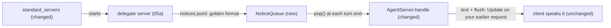

# Feature Spec: 05b — the agent starts the delegate server and speaks the notices of finished jobs

**Status:** ready
**Date:** 2026-10-30
**Blocked by:** 05a (its golden notice file `tests/fixtures/delegate_notices.jsonl` must exist: the tests here read it)

The live agent gains the delegate tools and says when a delegated job ended. It starts the delegate MCP server as an optional server, reads the notice file of ticket 05a, and after the answer to the next turn appends one spoken sentence per finished job. No client change: the sentence is sent as a flagged `text` message like the model's own `say` lines. The system prompt gains one case describing when to delegate.

## Context

- **Objective:** the agent starts the delegate server and speaks the notices of finished jobs. Code is written and tested in a scratch copy; you transcribe it.
- **Role:** strict systems architect; you are transcribing an approved implementation.
- **Source:** `/mnt/School/PhD/AI231/AI-231-ME3-agy/.scratch/onit-tools/PLAN.md` and `EXPERIMENT.md`.
- **Repo:** the working directory you were given (a copy of `/mnt/School/PhD/AI231/AI-231-ME3-agy`).

| File | Action | Line cap |
|---|---|---|
| `pipeline/src/voice_pipeline/notices.py` | new, verbatim | **29** (skeleton 26) |
| `pipeline/tests/test_notices.py` | new, verbatim | **42** (skeleton 33) |
| `pipeline/tests/test_agent_server_notices.py` | new, verbatim | **74** (skeleton 59) |
| `pipeline/src/voice_pipeline/agent_tools.py` | edit (list below) | **161** (now 158; exactly 158 after the edits) |
| `pipeline/src/voice_pipeline/agent_server.py` | edit (list below) | **460** (now 457; exactly 457 after the edits) |
| `pipeline/config/eval/system_agent.txt` | edit (list below) | **34** (now 31; exactly 31 after the edits) |
| `pipeline/tests/test_agent_tools.py` | edit (list below) | **120** (now 117; exactly 117 after the edits) |

**Non-goals / touch nothing else:** no change to `doc_chat`, `src/`, the router, the hedge, the fast path or `dryrun.py`; no new MCP server code; no client change; no new tests beyond the listed ones.

**Security-sensitive:** no — it reads a text file and starts an optional server. Do not run the agent server.

## Diagrams



## RECAP

### E — Edges

| Edge | Behaviour |
|---|---|
| a job ended since the last turn | after the turn's text and before `{"done": true}` the server sends `{"text": "Update on your earlier request: <text>", "flush": true}` once per notice |
| no notices, a cancelled turn, or a turn that is not `ok` | nothing is sent |
| the notice file does not exist, or ends in a half-written line | nothing is read until a complete line is there |
| the server starts with an old notice file | the queue starts at its end: old notices are not repeated |
| the delegate server cannot start | `standard_servers` lists it as optional, so the agent starts without the delegate tools (a warning is printed) |
| `--notices ''` | no notices are read |

### A — Assumptions and how they were checked

- The protocol is one request per connection, so the server cannot speak between turns; the notice is appended to the next turn's reply. Speaking while idle needs a client change, left to a later ticket.
- `on_say` sends `{"text": ..., "flush": true}`, which the client speaks at once (read in `agent_server.handle` and `src/doc_chat/agent_client.py`).
- The ruff import-order rule (I001) cannot be checked in the scratch copy; the Proof runs it inside the real project.
- Pipeline baseline before the edits: ruff clean, mypy 11 source files, 113 tests passing.

### R — Rules

Copy every code block and apply every edit byte for byte. Do not start the agent server or any MCP server outside the tests. Do not touch `doc_chat` or anything under `src/`.

## C — Contracts (the code; copy it)

#### `pipeline/src/voice_pipeline/notices.py` (new, verbatim)

```python
"""Spoken notices of delegated jobs that ended, read from the delegate server's notices.jsonl."""

from __future__ import annotations

import json
from pathlib import Path


class NoticeQueue:
    """The complete new lines of a JSON-lines file since the last `pop`.

    It starts at the end of an existing file, so notices from an earlier run are not repeated."""

    def __init__(self, path: Path) -> None:
        self.path = path
        self.offset = path.stat().st_size if path.exists() else 0

    def pop(self) -> list[str]:
        if not self.path.exists():
            return []
        with self.path.open("rb") as source:
            source.seek(self.offset)
            data = source.read()
        complete = data[: data.rfind(b"\n") + 1]
        self.offset += len(complete)
        return [json.loads(line)["text"] for line in complete.splitlines() if line]
```

#### `pipeline/tests/test_notices.py` (new, verbatim)

```python
import json
import shutil
from pathlib import Path

from voice_pipeline.notices import NoticeQueue

GOLDEN = Path(__file__).resolve().parents[2] / "tests" / "fixtures" / "delegate_notices.jsonl"


def test_reads_the_golden_file_the_delegate_server_tests_pin(tmp_path: Path) -> None:
    path = tmp_path / "notices.jsonl"
    queue = NoticeQueue(path)  # the file does not exist yet
    assert queue.pop() == []
    shutil.copy(GOLDEN, path)
    assert queue.pop() == [
        "I built the recipes site. It is in the recipes folder.",
        "I could not finish job2: it ran out of time.",
    ]
    assert queue.pop() == []


def test_starts_at_the_end_of_an_old_file_and_waits_for_a_complete_line(tmp_path: Path) -> None:
    path = tmp_path / "notices.jsonl"
    path.write_text(json.dumps({"job": "job1", "text": "old"}) + "\n")
    queue = NoticeQueue(path)
    assert queue.pop() == []
    line = json.dumps({"job": "job2", "text": "new"}) + "\n"
    with path.open("a") as sink:
        sink.write(line[:10])
    assert queue.pop() == []
    with path.open("a") as sink:
        sink.write(line[10:])
    assert queue.pop() == ["new"]
```

#### `pipeline/tests/test_agent_server_notices.py` (new, verbatim)

```python
import json
from pathlib import Path
from typing import Any

from websockets.asyncio.client import connect
from websockets.asyncio.server import serve

from voice_pipeline.agent_server import AgentServer
from voice_pipeline.notices import NoticeQueue


class QuickAgent:
    async def ask(
        self, messages: list[dict[str, Any]], *, reset: bool, on_text: Any, **_: Any
    ) -> dict:
        await on_text("Lights ")
        await on_text("on.")
        return {
            "status": "ok",
            "text": "Lights on.",
            "first_call_s": 0.1,
            "first_text_s": 0.2,
            "end_s": 0.3,
        }

    async def cancel(self) -> None:
        return None


async def _turn(url: str) -> list[dict[str, Any]]:
    out: list[dict[str, Any]] = []
    async with connect(url) as ws:
        await ws.send(json.dumps({"messages": [{"role": "user", "content": "lights on"}]}))
        while True:
            event = json.loads(await ws.recv())
            out.append(event)
            if event.get("done") or "error" in event:
                return out


async def test_a_finished_job_is_spoken_after_the_next_answer_once(tmp_path: Path) -> None:
    path, log = tmp_path / "notices.jsonl", tmp_path / "log.jsonl"
    path.write_text("")
    server = AgentServer(QuickAgent(), [], log, notices=NoticeQueue(path))
    ws_server = await serve(server.handle, "127.0.0.1", 0)
    url = f"ws://127.0.0.1:{next(iter(ws_server.sockets)).getsockname()[1]}"
    with path.open("a") as sink:
        sink.write(json.dumps({"job": "job1", "text": "The site is ready."}) + "\n")
    assert await _turn(url) == [
        {"text": "Lights "},
        {"text": "on."},
        {"text": "Update on your earlier request: The site is ready.", "flush": True},
        {"done": True},
    ]
    assert await _turn(url) == [{"text": "Lights "}, {"text": "on."}, {"done": True}]
    rows = [json.loads(line) for line in log.read_text().splitlines()]
    assert rows[0]["notices"] == ["The site is ready."] and rows[1]["notices"] == []
    ws_server.close()
    await ws_server.wait_closed()
```

#### `pipeline/src/voice_pipeline/agent_tools.py` (edit list, apply in order; each OLD block occurs exactly once at the moment you apply it)

**Edit 1 of 3.** Replace OLD with NEW.

OLD:

```text
TAVILY_COMMAND = [*ROOT_MODULE, "voice_agent.mcp_servers.tavily_search"]
```

NEW:

```text
TAVILY_COMMAND = [*ROOT_MODULE, "voice_agent.mcp_servers.tavily_search"]
DELEGATE_COMMAND = [*ROOT_MODULE, "voice_agent.mcp_servers.delegate"]
```

**Edit 2 of 3.** Replace OLD with NEW.

OLD:

```text
    """(required, optional) servers: docs, time, web_info, tavily_search; the Pi's if reachable."""
```

NEW:

```text
    """(required, optional) servers: docs, time, web_info, tavily_search; delegate and the Pi's
    (if reachable) are optional."""
```

**Edit 3 of 3.** Replace OLD with NEW.

OLD:

```text
    return required, [pi] if pi is not None else []
```

NEW:

```text
    optional = [stdio_server(DELEGATE_COMMAND)]
    return required, optional + ([pi] if pi is not None else [])
```

#### `pipeline/src/voice_pipeline/agent_server.py` (edit list, apply in order; each OLD block occurs exactly once at the moment you apply it)

**Edit 1 of 8.** Replace OLD with NEW.

OLD:

```text
from voice_pipeline.hedge import HedgedAgent, HedgeGate, gated_tools
```

NEW:

```text
from voice_pipeline.hedge import HedgedAgent, HedgeGate, gated_tools
from voice_pipeline.notices import NoticeQueue
```

**Edit 2 of 8.** Replace OLD with NEW.

OLD:

```text
        router: LocalRouter | None = None,
    ) -> None:
        self.router = router
```

NEW:

```text
        router: LocalRouter | None = None,
        notices: NoticeQueue | None = None,
    ) -> None:
        self.router = router
        self.notices = notices
```

**Edit 3 of 8.** Replace OLD with NEW.

OLD:

```text
            if not cancelled:
                reply = {"done": True} if result["status"] == "ok" else {"error": "timeout"}
```

NEW:

```text
            said: list[str] = []
            if not cancelled and result["status"] == "ok" and self.notices is not None:
                said = self.notices.pop()
                for text in said:
                    await on_say(f"Update on your earlier request: {text}")
            if not cancelled:
                reply = {"done": True} if result["status"] == "ok" else {"error": "timeout"}
```

**Edit 4 of 8.** Replace OLD with NEW.

OLD:

```text
                "cancelled": cancelled,
                **result,
```

NEW:

```text
                "cancelled": cancelled,
                "notices": said,
                **result,
```

**Edit 5 of 8.** Replace OLD with NEW.

OLD:

```text
    router_hold: float = 0.0,
) -> int:
    record:```

NEW:

```text
    router_hold: float = 0.0,
    notices: Path | None = None,
) -> int:
    record:```

**Edit 6 of 8.** Replace OLD with NEW.

OLD:

```text
    server = AgentServer(agent, record, log, tools if fast or router else None, router)
```

NEW:

```text
    queue = NoticeQueue(notices) if notices else None
    server = AgentServer(agent, record, log, tools if fast or router else None, router, queue)
```

**Edit 7 of 8.** Replace OLD with NEW.

OLD:

```text
    args = parser.parse_args(argv)
    try:
        return asyncio.run(
```

NEW:

```text
    parser.add_argument(
        "--notices",
        default=str(Path.home() / ".local/state/voice_agent/delegate/notices.jsonl"),
        help="where the delegate server writes the spoken notices of jobs that ended; '' for none",
    )
    args = parser.parse_args(argv)
    try:
        return asyncio.run(
```

**Edit 8 of 8.** Replace OLD with NEW.

OLD:

```text
                args.router_hold,
            )
        )
```

NEW:

```text
                args.router_hold,
                Path(args.notices) if args.notices else None,
            )
        )
```

#### `pipeline/config/eval/system_agent.txt` (edit list, apply in order; each OLD block occurs exactly once at the moment you apply it)

**Edit 1 of 1.** Replace OLD with NEW.

OLD:

```text
Case F, anything else. Answer briefly without tools.
```

NEW:

```text
Case F, a big task: building a website or app, solving a hard multi-step math problem with code, auditing this machine, or analysing files or data. Call delegate with `task` written as a complete request with every detail it needs (it cannot ask you questions); it works in the background in a sandbox. If the result comes back, say it. If it only says the task started, tell the user it will take a few minutes and carry on; the result is announced later. delegate_status says how a task is going and delegate_cancel stops it. Never use delegate for simple questions, home commands, the weather or the time.

Case G, anything else. Answer briefly without tools.
```

#### `pipeline/tests/test_agent_tools.py` (edit list, apply in order; each OLD block occurs exactly once at the moment you apply it)

**Edit 1 of 1.** Replace OLD with NEW.

OLD:

```text
    assert len(required) == 4 and optional == []  # no token: no Pi
    monkeypatch.setenv("LAN_SPEECH_TOKEN", "secret")
    assert len(standard_servers()[1]) == 1
    assert len(standard_servers(None)[1]) == 0
```

NEW:

```text
    assert len(required) == 4 and len(optional) == 1  # no token: the delegate server, no Pi
    monkeypatch.setenv("LAN_SPEECH_TOKEN", "secret")
    assert len(standard_servers()[1]) == 2
    assert len(standard_servers(None)[1]) == 1
```


### Function inventory

- `pipeline/src/voice_pipeline/notices.py`: top-level `NoticeQueue`
- `pipeline/tests/test_notices.py`: top-level `test_reads_the_golden_file_the_delegate_server_tests_pin`, `test_starts_at_the_end_of_an_old_file_and_waits_for_a_complete_line`
- `pipeline/tests/test_agent_server_notices.py`: top-level `QuickAgent`, `_turn`, `test_a_finished_job_is_spoken_after_the_next_answer_once`

## P — Proof

Run from the repository root of your working copy. Run exactly these, in this order.

1. `cd pipeline && uv run --offline ruff check src/voice_pipeline/notices.py src/voice_pipeline/agent_tools.py src/voice_pipeline/agent_server.py tests/test_notices.py tests/test_agent_server_notices.py tests/test_agent_tools.py`
   Expected last line (ignore the timing): `All checks passed!`
2. `cd pipeline && uv run --offline ruff format --check src/voice_pipeline/notices.py src/voice_pipeline/agent_tools.py src/voice_pipeline/agent_server.py tests/test_notices.py tests/test_agent_server_notices.py tests/test_agent_tools.py`
   Expected last line (ignore the timing): `6 files already formatted`
3. `cd pipeline && uv run --offline mypy`
   Expected last line (ignore the timing): `Success: no issues found in 12 source files`
4. `cd pipeline && uv run --offline pytest -q`
   Expected last line (ignore the timing): `116 passed`

## Execution Log

(append dated entries below; never rewrite earlier ones)
