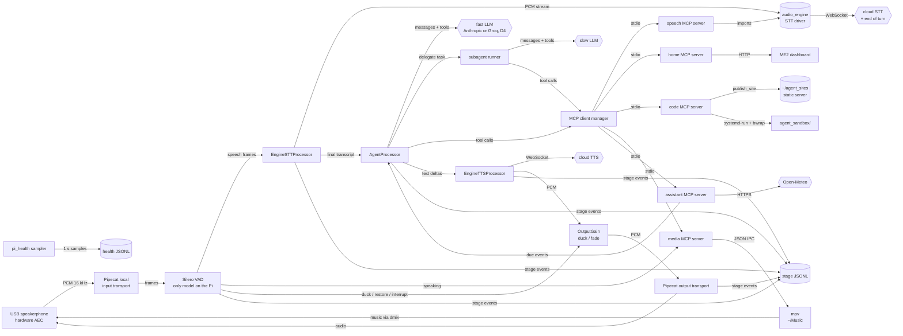
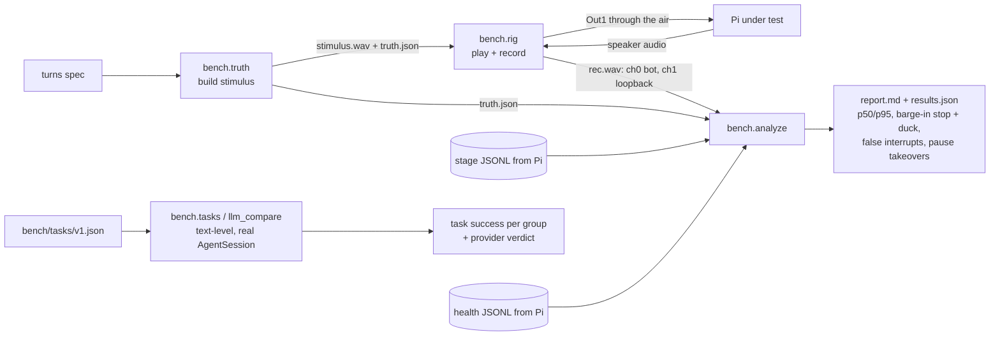
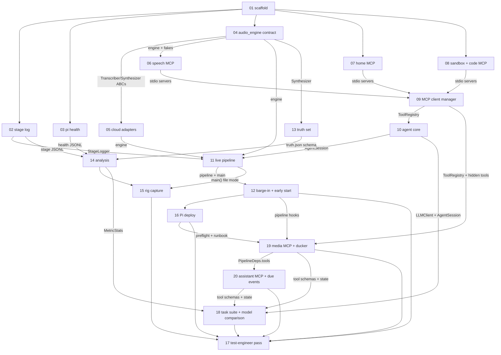

# DESIGN: Project 2, full-duplex voice agent on a Raspberry Pi

**Status:** plan written 2026-10-15, amended the same day after `FULL-DUPLEX-RESEARCH.md` and again after the professor's ME3 briefing; awaiting confirmation (decisions D1–D3 below, D4 after ticket 18)
**Source:** `PROJECT2-DESIGN-REVIEW.md` (repo root), the two MCP lesson notebooks in `resources/`, ME2 at `.scratch/vendor/AI-222-Machine-Exercises/ME2/` (commit `3d68dbb`)
**Execution:** tickets `01`–`16`, then `19`, `20`, `18`, `17`, in `tickets/`, run **sequentially** by one Sonnet developer agent per `RUNNER.md`

## Context

- **Objective:** a full-duplex, interruptible voice agent on a Pi 4/5: local Silero VAD, cloud streaming STT/LLM/TTS, MCP servers on the Pi (speech, home, media, assistant, sandboxed code), a fast user-facing model that delegates slow work to a subagent, and a latency benchmark whose clock starts at the *true* end of speech. Target: ~500 ms median to first audio.
- **Size:** large (20 tickets). Each ticket is small enough for one Sonnet session.
- **Current step:** tickets written; nothing built.
- **Deadline:** ME3 due about **2026-11-07** (tentative, professor 2026-10-15); a two-page write-up comes later.
- **Human-facing doc:** none yet.

## Professor's requirements (ME3 briefing, 2026-10-15)

Recorded from the class briefing transcript; these override earlier assumptions where they conflict.
- **Generic full-duplex agent**, English only: you can interrupt it mid-sentence and it stops and listens. Not half duplex. No wake word ideally (allowed only if the room is too noisy).
- **No model runs on the Pi except the VAD.** The Pi runs the agent harness and the MCP servers, which reach models in the cloud (commercial APIs or the class DGX, which serves a Qwen model). → smart-turn dropped; end of turn comes from the cloud STT (tickets 05, 11).
- **ASR and TTS behind tools** ("an additional tool for listening and one for speaking"); TTS must be interruptible (streaming, cancellable), not play-a-whole-file. → speech MCP server (06) + cancellable streaming TTS (05, 12).
- **The ten ME2 task groups must work for any phrasing and any value**, including multi-turn clarification and mid-action corrections ("no, I want Opalite"). Groups: music, lights, temperature, weather, time, timer, alarm, call, message, reminders. → home narrowed to devices (07), media (19), assistant (20), task suite (18).
- **One random complex task at evaluation** (e.g. "build a website"). → `delegate` + code subagent + `publish_site` (08).
- **Graded on correctness, latency/responsiveness and naturalness** (warm, not bland; hard to tell from a person); research full-duplex benchmarks. → task suite (18), rig latency + barge-in + pause-takeover (13–15), warmer prompt (10), human naturalness rating (checkpoint 9).
- **Extend by adding MCP servers** (e.g. a Spotify server) on a scalable harness; understand everything you build. `docs/` reference files are written by the tickets that own each contract.

## Architecture (data flow)

Everything is new. ME2 contributes patterns and one runtime dependency (the dashboard, ticket 07: lights, thermostat, phone), no code imports.

## Benchmark (data flow)

## Per-plan task diagram (plan 1)

An edge is a producer/consumer dependency: the consumer runs after the producer and reads its real output.

Execution is strictly sequential (`01` → `16`, `19`, `20`, `18`, `17`), which satisfies every edge above.

## Decisions log

| # | Decision | Status |
|---|---|---|
| D1 | Vendors: STT **Deepgram** streaming (WebSocket), TTS **Cartesia** (WebSocket, raw PCM out), LLM **Anthropic**: fast user-facing `claude-haiku-4-5`, delegated subagent `claude-sonnet-5-5`. All IDs and vendors live in `config/agent.toml`, so swapping is a config change plus one adapter. The professor allows any ASR/TTS (paid or open; he mentioned Qwen's) as long as TTS is interruptible; Deepgram's end-of-turn signal now also replaces the on-Pi turn model (ticket 05 A5 picks the exact model). | **proposed; confirm before ticket 05** |
| D2 | Truth-set end of speech comes from an energy boundary on the *clean* synthesized clip (no forced aligner), checked by a numeric test on a fixture with a known boundary. Recorded human turns can be added later with hand-marked boundaries. | proposed |
| D3 | Research subagent uses Anthropic's server-side `web_search` tool, not a local network tool, so no sandbox ever needs `--share-net`. Calls and messages are simulated through the ME2 dashboard's phone and logged (ticket 07); real email/SMS/telephony is out of scope (needs accounts and credentials). | proposed |
| D4 | Fast-model provider: stays **Anthropic** (`claude-haiku-4-5`) unless ticket 18's comparison shows Groq ≥ 100 ms faster at p50 TTFT, tool accuracy within 3 points, spoken-format pass ≥ 95%, confirmed by one rig run per provider. The subagent stays on Anthropic either way. | **open; decided by a human after ticket 18** (challengers now Groq and the class DGX; thresholds in ticket 18 §4) |
| — | Barge-in ducks the bot by 15 dB at the first VAD speech and fades out over 15 ms when the gate fires (7 of the last 10 32 ms windows at confidence 0.5, amended 2026-10-23 from the 250 ms rule after the Pi pilot, see ticket 12) (from `FULL-DUPLEX-RESEARCH.md` §3.3). WSOLA playback speed-up, native ring buffers/ALSA mmap, `gc.disable()`, cloud speech-to-speech and on-Pi LLMs were considered and rejected. | settled 2026-10-15 |
| — | No model on the Pi except Silero VAD (professor). End of turn: cloud STT signal, 0.8 s VAD-silence fallback. No wake word. | settled 2026-10-15 |
| — | Base tasks that need free values (timers, alarms, reminders) and music live in our own MCP servers (19, 20); the ME2 dashboard keeps only lights, thermostat and phone, whose fixed values are believable device limits. | settled 2026-10-15 |
| — | Hardware AEC (USB speakerphone or ReSpeaker playing through its own output). Software AEC is not built. | settled (review §6 decision 2) |
| — | One engine, two interfaces: `audio_engine` is imported by Pipecat processors *and* the speech MCP server. | settled (review §6 decision 4); the professor's "tool for listening, tool for speaking" matches the speech MCP server; confirm the live loop may import the engine directly (Q1) |
| — | No router LLM: the fast model answers immediately and calls `delegate(task, kind)` for slow work. | settled (review §2 item 6) |
| — | MCP SDK pinned `mcp>=1.2,<2` (FastMCP at `mcp.server.fastmcp`; the 2026-07-28 spec release changed the SDK). | settled (notebooks) |
| — | Python `>=3.12,<3.14` via uv (dev host 3.12, Debian 13 ships 3.13). | settled |

## Handoff (2026-10-15)

- **Review page:** https://claude.ai/artifact/ATuCFty8DtsoRzbMK3q1zQ. Your verdicts and notes are saved in its database, collection `feedback`, one document per item: `t01`–`t20`, `D1`–`D4`, with fields `verdict` (`approve` / `changes` / `question`) and `note`. Read them with `ArtifactData list`, apply them to the tickets, then rebuild with `python3 review/build_review.py` (writes `review/project2-ticket-review.html`; update its `decisions` list if D1–D4 change) and republish that file to the same URL.
- **Before dispatching Sonnet:** confirm D1–D3 below (05 and 10 stop as BLOCKED while D1 says "proposed"). Then follow `RUNNER.md`, starting at ticket 01.

## Human checkpoints (not agent tickets)

These need hardware or paid API calls. The tickets build the tools; a human runs them.

1. **Q1 (partly answered 2026-10-15):** the professor expects ASR/TTS as tools on the Pi that call remote models, which the speech MCP server does. Still ask: may the live streaming loop import the same engine directly instead of streaming through MCP?
2. **AEC device:** buy or borrow, set it as the Pi's default capture and playback, measure the false-interruption rate (ticket 14's metric).
3. **Pi 4 profile, week 1:** run the live loop with `pi_health` (ticket 03) and decide Pi 4 vs Pi 5 by measurement.
4. **Live API smoke:** `VOICE_AGENT_LIVE=1 uv run pytest -m live` after putting keys in `.env` (tickets 05, 10).
5. **Sandbox on the Pi:** `uv run python -m voice_agent.preflight` (ticket 16), then `uv run pytest -m pi tests/sandbox` (ticket 08).
6. **First real benchmark run** through the rig (ticket 15 runbook).
7. **Fast-model comparison (D4):** ask the instructor for the class DGX endpoint (URL, model ID, auth, tool calling on?); then `uv run python -m bench.tasks --run-id <id>` (task success on the default provider) and `uv run python -m bench.llm_compare --providers anthropic,groq,dgx --run-id <id>` (paid); one rig run per finalist; record D4.
8. **Music library and shared audio device:** put some legally owned tracks in `~/Music` on the Pi (include the demo songs), set up the dmix/dsnoop device (ticket 19 runbook), and check STT still hears you over loud music.
9. **Naturalness rating:** a few classmates hold scripted and free conversations with the agent and rate naturalness 1–5 (tone, timing, interruptions); record the median with the rig numbers for the write-up.
10. **Complex-task rehearsal:** ask for a small website and a research summary by voice; confirm `publish_site` serves it at `http://<sites_host>:8080/<name>/`.

## Findings index

(empty: one line per closed R1/R2 review finding, pointing at its ticket)
