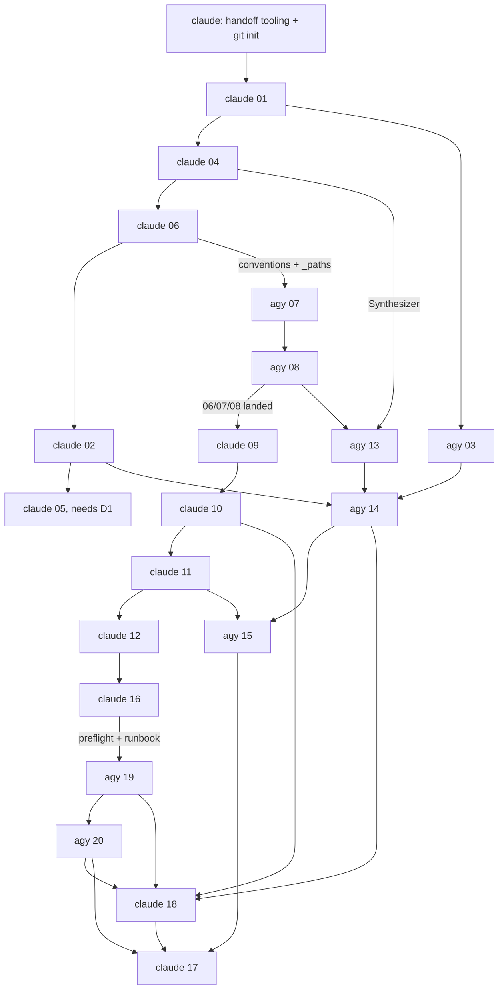

# SPLIT-PLAN: Claude Code + agy (antigravity) on Project 2

**Status:** draft for confirmation, 2026-10-15. Nothing here has been built or dispatched.
**Scope:** how the 20 RECAP tickets in `tickets/` are divided between two agents, and the file-based handoff channel that connects them. Ticket content, contracts and `RUNNER.md` rules are unchanged and bind both agents.

## 1. Roles

| | Claude Code ("claude") | agy |
|---|---|---|
| Role | First cut, integrator, owner of the spine (config, engine, agent, pipeline) | Executor of the self-contained lanes: MCP servers, bench, media/assistant |
| Merges | Yes: the only one who writes to `main` | No: works on its own branch/worktree |
| Reviews | agy's tickets (tech-lead review, security-auditor on 08) | Claude's tickets 04, 10, 11, 12 (fresh-eyes review request) |
| Runs | Ticket 17 (test-engineer), human checkpoints with the user | Nothing paid or live (RUNNER rules apply) |

## 2. Ticket split

Rule used (Operating Principle 11): parallel work is allowed only between tickets with no producer/consumer edge. Every cross-lane edge below has the producer landing (merged to `main`) first, and the consumer's task message points at that real code.

| Ticket | Owner | Why |
|---|---|---|
| 01 scaffold | claude | Everything depends on it; sets the layout both agents inherit |
| 04 audio_engine contract | claude | Contract producer for 05, 06, 11, 13 |
| 06 speech MCP (security) | claude | Sets `docs/MCP-SERVERS.md` + `_paths.resolve_inside` that 07/08 reuse |
| 02 stage event log | claude | Producer for 11 and for agy's 14 |
| 05 cloud adapters | claude | Needs D1 confirmed; core of live path |
| 09 MCP client manager | claude | Integration point of 06/07/08 |
| 10 agent core, 11 pipeline, 12 barge-in, 16 Pi deploy | claude | Critical-path spine, one context |
| 18 task suite + model comparison | claude | Drives `AgentSession`/`LLMClient` from 10; reads 14, 19, 20 |
| 17 test-engineer pass | claude (test-engineer subagent) | Independent of the code authors |
| 03 Pi health sampler | **agy** | Leaf; consumer is 14 (also agy) |
| 07 home MCP, 08 sandbox + code MCP (security) | **agy** | Need only 06's landed conventions; disjoint files; 08 gets claude's security-auditor |
| 13 truth set, 14 analysis, 15 rig capture | **agy** | One coherent bench chain, off the critical path until 15 |
| 19 media MCP, 20 assistant MCP | **agy** | Self-contained servers; 19 then 20 (shared `PipelineDeps.tools` hook) |

Count: claude 11 + 17, agy 8.

### Waves (producer → consumer, strictly in this order)



| Wave | claude | agy | Cross-lane edge satisfied |
|---|---|---|---|
| 0 | handoff tooling, `git init`, 01 | idle (listener running) | — |
| 1 | 04, 06 | 03 (after 01 lands) | 01 → 03 |
| 2 | 02, 05 | 07, 08 (after 06 lands) | 06 → 07/08 |
| 3 | 09 (after 07/08 land), 10, 11 | 13, 14 (after 04, 02, 03 land) | 04 → 13; 02, 03 → 14; 07/08 → 09 |
| 4 | 12, 16, review of agy 03/07/08/13/14 | 15 (after 11 lands) | 11 → 15 |
| 5 | review 15/19/20 | 19, 20 (after 12 + 16 land) | 12, 16 → 19 |
| 6 | 18, then 17, security-auditor on 06 and 08, tech-lead over the whole diff | review-request on 04, 10, 11, 12 | 14, 19, 20 → 18 |

Waves are a guide, not a barrier: a task is sent the moment its `Blocked by` tickets are merged.

## 3. Repo and merge model

The repo root is not under git today, and RUNNER.md assumes one commit per ticket. Proposal:

- `git init` at `/mnt/jfs_hpc/home/anthony.martin.navarez/ME3`, with `.scratch/` and `.venv/` handled so handoff files are tracked-or-ignored deliberately (see D-S2).
- claude works in the main checkout on `main`. agy works in `git worktree add ../ME3-agy -b agy/work`, so the two never write the same files at the same time.
- agy commits one commit per ticket (`<NN>: <title>`), after rebasing on `main`, and reports the SHA. Claude fast-forward merges after review. Claude resolves `pyproject.toml`/`uv.lock` conflicts (both agents run `uv add`); agy reports which packages it added.
- Shared files both may touch: `pyproject.toml`, `uv.lock`, `config/agent.toml`, `docs/MCP-SERVERS.md`, `voice_agent/config.py`. Rule: agy appends its own section and never edits claude's; anything else is a contract change → message type `question`.

## 4. Handoff channel

All under `.scratch/project2-voice-agent/handoff/`:

```
handoff/
  to-agy/        messages for agy (claude writes, listener reads)
  to-claude/     messages for claude (agy writes, monitor reads)
  done/          processed messages, moved by the reader (audit trail)
  STATE.json     {ticket: {owner, status, commit, updated}} — written only by claude
  listen_agy.py  listener (stdlib only)
  watch_claude.py  emits one line per new file in to-claude/ (fed to Claude's Monitor tool)
```

**Message file:** `<seq>-<from>-<type>-<ticket>.md`, written to `<name>.tmp` then renamed (atomic, the listener ignores `.tmp`). Frontmatter plus a short body:

```markdown
---
id: 0007
from: claude            # claude | agy
to: agy
type: task              # task | result | question | answer | review-request | review-result | blocker | cancel
ticket: 07
base: <git sha agy must start from>
reply_to: 0005          # optional
---
Execute ticket tickets/07-home-mcp-server.md per RUNNER.md. 06 is merged at <sha>; read
voice_agent/mcp_servers/_paths.py and docs/MCP-SERVERS.md for the conventions.
```

Bodies stay short; full detail goes into the ticket's `## Execution Log` (RUNNER format), same as today. A `result` message is the RUNNER reply: status line, Proof checkmarks, "details in ticket NN", commit SHA.

**Listener (`listen_agy.py`):** polls `to-agy/` every 3 s. For each new `.md` in sequence order: only `task`, `answer`, `review-request` and `cancel` trigger a run. It invokes `agy -p "<prompt>" --print-timeout 3600 --mode <D-S3>` from the agy worktree, where the prompt is "Read `handoff/<file>`, then follow `RUNNER.md` and the named ticket. Reply by writing a message to `handoff/to-agy/../to-claude/`." One message at a time (a lock file `handoff/.agy.lock` with PID, cleared on exit or when stale). Output of the agy run is saved to `done/<file>.agy.log`. If agy writes no reply message, the listener writes a synthetic `blocker` to `to-claude/` with the log tail, so a silent failure never stalls the loop. Processed messages are moved to `done/`.

**Claude side:** `watch_claude.py` runs under the Monitor tool and surfaces each new `to-claude/` file as a notification; Claude then reads it, updates `STATE.json`, merges or reviews, and writes the next `to-agy/` message.

**Loop guards (same spirit as RUNNER):** `result`/`review-result`/`blocker` never trigger an agy run; a ticket may be retried once, then escalates to the user; agy never calls paid or authenticated APIs and never pushes; messages never contain secrets.

## 5. Review and quality gates

- Every agy ticket: gate suite per RUNNER, then claude tech-lead review of that ticket's commit before it is merged. Findings go back as a `task` (fix-request appended to the ticket's Execution Log).
- 08 (sandbox) and 06: `security-auditor` before merge.
- Claude's 04, 10, 11, 12: sent to agy as `review-request`; agy returns `review-result` with R1/R2 findings (the developer never reviews its own work).
- Principle 11 check at each wave: the consumer's message cites the producer's merged SHA, and an interoperability check (consumer's real reader on producer's real output) runs before the wave closes. Principle 10: numeric fixture assertions stay in the tickets that already require them (13, 14).
- Ticket 17 and the final tech-lead review run over the merged `main`, not either branch.

## 6. Decisions needed from you

| # | Question | Recommendation |
|---|---|---|
| D-S1 | OK to `git init` the ME3 root and use a second worktree for agy? Without it two agents write one tree and RUNNER's per-ticket commits don't exist. | Yes |
| D-S2 | Should `handoff/` messages be committed or git-ignored? | Ignore; `done/` is the audit trail on disk |
| D-S3 | agy permission mode for the unattended listener: `--mode accept-edits` (asks for shell commands, so it stalls headless), `--mode auto`, or `--dangerously-skip-permissions`. Needs your call on what you trust it with; RUNNER's BLOCKED rules go in its prompt either way. | `--mode auto` inside the worktree, plus `--sandbox` if it works with `uv` |
| D-S4 | Confirm D1 (vendors/models) now. Tickets 05 and 10 stop as BLOCKED until it is confirmed; I sequenced 05 into wave 2 and 10 into wave 3. | Confirm before wave 2 |
| D-S5 | Apply your review verdicts from the artifact db (`feedback`, `t01`–`t20`, `D1`–`D4`) to the tickets first? Not yet done this session. | Yes, before the first dispatch, since agy would be executing the tickets as they stand |

## 7. First actions after confirmation

1. Apply D-S5 feedback to the tickets and confirm D-S4.
2. Claude writes `listen_agy.py`, `watch_claude.py`, `STATE.json`, runs `git init` + worktree (D-S1), and does a ping/pong smoke test: a `task` whose only job is to write a `result` containing the worktree's `git status`. No ticket work until it round-trips.
3. Claude executes ticket 01, merges, then sends agy ticket 03.
