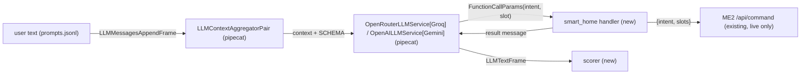

# DESIGN: smart_home tool

**Context:** one LLM tool `smart_home(intent, slot=None)` over ME2's `POST /api/command`, wired into a text-only Pipecat 1.13.0 pipeline and dry-run on Groq 8B / Gemini / Groq 70B. Status: delivered (2026-10-23): tool + dry run built by agy, reviewed; prompt variants and serial latency measured; native Gemini + v2 chosen. Results: RESULTS.md, docs/SMART-HOME-TOOL.md. Plan: `PLAN.md`. Related: `.scratch/project2-voice-agent/DESIGN.md` D6 (Pipecat), D7 (models).

## Architecture

## Per-plan task diagram (plan 1)

## Decisions log

| # | Decision | Status |
|---|---|---|
| S1 | Plain Pipecat function, not MCP | confirmed |
| S2 | Slot passed through verbatim; canonical values listed in schema | confirmed |
| S3 | `pipecat-ai[openai]==1.13.0` in a separate uv subproject `pipeline/` (pins onnxruntime~=1.24 / soundfile~=0.13); root Makefile ties both | confirmed (owner) |
| S4 | Models: Groq 8B, Gemini 3.1 flash-lite, Groq 70B control | confirmed |
| S5 | agy, level 3, launched by the owner | confirmed |

## Findings index

- F1 (spec): `LEAK` regex in `dryrun.py` missed `function=…>`, bare `{"intent"…}`, `<INTENT></INTENT>`; undercounted Groq 8B leaks 2 vs 8. Closed: widened, two test cases added.
- F2 (integration): Gemini via `OpenAILLMService` fails every tool round trip (empty phantom call; dropped thought_signature). Closed: native `GoogleLLMService` (`pipecat-ai[google]` added to pipeline/).
- Dry run 2026-10-23: Groq 8B 56% exact (rejected); Groq 70B 96%; Gemini calls 94% but no confirmations (F2). RESULTS.md.
