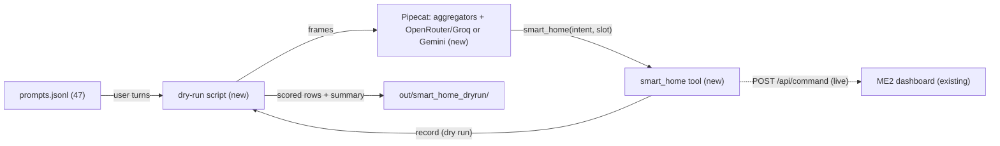

# Plan: one `smart_home` tool, wired into Pipecat, dry-run on Groq

**Status:** confirmed 2026-10-23 (see amendments) · **Date:** 2026-10-23

The language model will get **one** tool, `smart_home(intent, slot=None)`, covering all 19 ME2 commands (lights, music, thermostat, timer, alarm, reminders, phone, time, weather). The tool posts `{intent, slots}` to the ME2 dashboard's existing `POST /api/command`, so the dashboard keeps doing the validation it already does. A text-only Pipecat pipeline runs a fixed set of 47 prompts through Groq `llama-3.1-8b-instruct` (via OpenRouter) and the Gemini baseline, and reports how often each model calls the tool correctly. agy writes the code from level-3 tickets; you launch it.

## Amendments after confirmation (2026-10-23)

- **Decisions confirmed:** plain Pipecat function (the ME2 UI may become an MCP server later); slot passed through; Pipecat added; three models; agy launched from the prompts written here.
- **Separate subproject instead of a laptop-group dependency.** `pipecat-ai==1.13.0` hard-pins `onnxruntime~=1.24.3` and `soundfile~=0.13.1`. In the root project that would downgrade onnxruntime 1.31 → 1.24.4 for Parakeet, Supertonic and the Pi's Silero, and soundfile 0.14 → 0.13.1 (the full suite passed on it, but the speech latency numbers were measured on 1.31). Owner's instruction: a uv subproject plus make recipes. So `pipeline/` has its own `pyproject.toml`, `uv.lock` and `.venv`; the root is unchanged. Root `Makefile`: `pipeline-sync`, `pipeline-check`, `pipeline-test`, `smart-home-dryrun`, `check-all`, `test-all`.
- **Paths:** ticket 01 → `pipeline/src/voice_pipeline/tools/smart_home.py`, `pipeline/tests/test_smart_home.py`; ticket 02 → `pipeline/src/voice_pipeline/dryrun.py` (run as `python -m voice_pipeline.dryrun`), `pipeline/tests/test_dryrun.py`, `pipeline/config/eval/`.
- **Prompt count is 47**, not 48 (miscount, found by the Proof dry run).
- **Rows with neither text nor a call** get `status="empty"` (seen twice from Groq 8B in a probe) and the prompt is re-run once.
- **Consequence for ticket 11:** `pipeline/` cannot import the root packages (`doc_chat.bargein` and others) without taking their dependency floors. Porting `BargeInGuard` there means copying the module or relaxing soundfile; decide at ticket 11.

## How does it work?

The model sees one function with an `intent` enum of 19 names and a free-text `slot`. Its description lists the values each slotted intent accepts.

Example: "Wake me up at six in the morning."
1. The Pipecat user aggregator adds the text to the context, and `OpenRouterLLMService` (provider pinned to Groq) streams a reply.
2. The model calls `smart_home(intent="ALARM", slot="6 AM")`.
3. The handler maps `ALARM` to its slot name `ALARM_TIME` and either records the call (dry run) or posts `{"intent": "ALARM", "slots": {"ALARM_TIME": "6 AM"}}` to the dashboard (live).
4. The handler returns the dashboard's `message` ("alarm set for 6:00 AM") to the model, which says one short sentence.
5. The scorer compares the recorded calls with the prompt's expected calls.

A value the dashboard doesn't accept, such as "30 degrees", is still sent. The dashboard answers `changed: false, "Ignored: …"`, and the model is expected to tell the user it couldn't do it.

Feasibility was checked on 2026-10-23 with Pipecat 1.13.0 in a scratch venv: Groq 8B called `smart_home(intent="TEMPERATURE", slot="22 degrees")` and replied "The temperature is now set to twenty two degrees."

## What changes?

| | Now | After |
|---|---|---|
| Home control for the LLM | 5 MCP tools in `mcp_servers/home.py` (lights, thermostat, phone, message, state); no music, timer, alarm, reminders, time or weather | 1 tool, all 19 ME2 intents, through `/api/command` |
| Pipecat | not installed, no pipeline | `pipecat-ai[openai]==1.13.0` in the laptop group; a text-only pipeline used by the dry run, reused later by ticket 11 |
| Tool-calling evidence | 2 latency probes | a 47-prompt dry run per model, with a scored report |



## What do you need to decide?

1. **Plain Pipecat function, or a new MCP server?** Recommend a plain function registered with `llm.register_function`. It has the fewest moving parts and makes no extra process hop. The trade-off is that the MCP speech/code servers stay separate, but nothing forces one style. `home.py` stays untouched.
2. **Should the tool normalise slot values?** Recommend no. The tool passes `slot` through as the model wrote it, and the schema description lists the canonical forms ("22 degrees", "1 minute", "6 AM"). The trade-off: an 8B model may write "6am", and the dashboard will ignore it. The dry run will measure exactly that, which is the point.
3. **Add `pipecat-ai[openai]==1.13.0` to the `laptop` dependency group?** Recommend yes. A manifest change needs your approval, and the executor is not allowed to install anything. I add it before handoff.
4. **Which models go in the dry run?** Recommend three:
   - Groq `meta-llama/llama-3.1-8b-instruct` via OpenRouter (the latency candidate).
   - `gemini-3.1-flash-lite` direct (the baseline).
   - Groq `meta-llama/llama-3.3-70b-instruct` as a control, showing whether failures are the model's size or the prompt.

   The cost is cents in total.
5. **How should agy be launched?** Recommend that you launch it with the prompt file I write. Per your rule, I don't run agy with `--dangerously-skip-permissions`.

Already decided: Pipecat stays (D6). Groq 8B via OpenRouter is the latency candidate and Gemini the baseline (D7). Keys are read inside code from `~/.secrets/{openrouter,google-ai-studio}/` and never printed. The schema is `intent: str` (enum) and `slot: Optional[str]`. Level 3, default executor profile (agy has none yet).

## What runs, and in what order?

Which ticket feeds which? The edge means 02 waits for 01's landed schema and handler.


| # | What it does | Where | Wave |
|---|---|---|---|
| 00 | Add the dependency and lock it (not an executor ticket) | `pyproject.toml`, `uv.lock` | 0 |
| 01 | The tool: schema, slot-name mapping, dry-run recorder, dashboard client | `src/voice_agent/tools/` | 1 |
| 02 | Text-only Pipecat runner over the prompt file, scorer, report | `scripts/`, `config/eval/` | 2 |

## What could go wrong?

- **8B writes the tool call as text** (`<function=…>`), and TTS would read it aloud. → The scorer counts "leaked syntax" per model as its own column, and the 70B control separates model from prompt.
- **Pipecat 1.13 deprecations** (`model=` argument, `system` in the context, `PipelineRunner`). → The skeletons use `Settings(model=…)`, `system_instruction=…`, and `WorkerRunner.add_workers()`, and the ticket-writer runs them before handoff.
- **Free-tier or rate limits** on Gemini (agy reports 20 requests per day) can cut a run short. → The runner records HTTP errors per prompt as `error` and doesn't count them as failures. The report shows n per model.
- **OpenRouter connection drops** (seen in 1–3 of 10 requests). → One retry per turn, and the retry count is reported.
- **The ME2 dashboard is not running** for the live mode. → The dry run is the default. Live mode is optional and needs `make app` in ME2 (you start it).

## What is out of scope?

- **Not doing:** audio, barge-in, the full pipeline (ticket 11); retiring `home.py`; changing ME2; free-value timers and alarms (ticket 20).
- **Deferred:** making `smart_home` a tool of the agent core (ticket 10) and running the dry run inside the audio pipeline.

## Next action

Answer decisions 1–5 (or "go with the recommendations"). I then add the dependency, write the two level-3 tickets with compiled skeletons, and give you the agy prompt path and launch command.

---

## Task detail (for agents)

Plan-level fields: **Test pass:** skip as a separate pass. Ticket 01 has unit tests, and 02's output is itself the evaluation; the tech-lead re-runs both. **Documentation pass:** required, a short section in `docs/MCP-SERVERS.md` ("smart_home tool") and the dry-run results in `docs/HANDOFF.md`, written by Claude after review. **Review-finding handling:** surface and wait. **Executor:** agy, level 3, `models/_default.md`.

System prompt used by the dry run (verbatim, kept in `config/eval/smart_home_system.txt`):

```
You are a friendly home assistant that talks like a person. For any request to control or check
the home (lights, colour, brightness, music, volume, thermostat, timer, alarm, reminders, phone
call, message, time, weather), call the smart_home tool. Use only the slot values the tool lists;
if the user gives a value you cannot map, still call the tool with their value. If a required
value is missing, ask for it instead of calling the tool. For anything else, just answer.
Reply in one or two short spoken sentences, with no markdown.
```

### Task 01: smart_home tool

- **Files:** `src/voice_agent/tools/__init__.py` (new, empty), `src/voice_agent/tools/smart_home.py` (new), `tests/tools/__init__.py` (new, empty), `tests/tools/test_smart_home.py` (new).
- **Action:** a module holding `INTENTS` (19 names, ME2 order), `SLOT_FOR_INTENT` (copied from ME2 `app/intents.py` as derived: BRIGHTNESS→PERCENT, COLOR→COLOR, TEMPERATURE→DEGREES, TIMER→DURATION, ALARM→ALARM_TIME, CREATE_REMINDER→TASK), `SCHEMA` (a Pipecat `FunctionSchema` named `smart_home`, `intent` enum and `slot` string, description listing the canonical values), `to_command(intent, slot) -> dict` (the `/api/command` body), and `make_handler(*, base_url: str | None, record: list[dict]) -> handler`. With `base_url=None` the handler appends `{"intent", "slot"}` to `record` and returns `{"ok": True, "message": "recorded"}`. Otherwise it also POSTs `to_command(...)` with httpx (2 s timeout) and returns the dashboard's `message` and `changed`.
- **Edges:**
  - Unknown intent → `{"ok": False, "message": "unknown intent X"}`, recorded, no HTTP.
  - Slotted intent with no slot → `{"ok": False, "message": "INTENT needs a value: <canonical list>"}`, recorded, no HTTP.
  - Slot given for an unslotted intent → ignored (body has `slots: {}`).
  - Dashboard unreachable or timed out → `{"ok": False, "message": "home dashboard unreachable"}`.
  - Dashboard 400 → its `error` text.
- **Contracts:**

  ```python
  INTENTS: tuple[str, ...]
  SLOT_FOR_INTENT: dict[str, str]
  SCHEMA: FunctionSchema
  def to_command(intent: str, slot: str | None) -> dict[str, object]: ...
  def make_handler(*, base_url: str | None, record: list[dict[str, object]]) -> Callable[[FunctionCallParams], Awaitable[None]]: ...
  ```

  The handler calls `await params.result_callback(result_dict)`.
- **Established (verified):** `/api/command` takes `{intent: str, slots: dict[str,str]}`. It returns 400 `{ok: false, error}` for an unknown intent or a missing slot, and 200 `{ok, changed, message, state}` otherwise. Out-of-vocabulary values come back as `changed: false` with "Ignored: …" (ME2 `src/app/main.py:143`, `dispatch.py:handle_command`, read 2026-10-23). Accepted values: degrees 18/22/26; brightness 20/60/100 percent; colours white/red/green/blue (the grammar uses red/blue/green); timer 10/30/60 s (grammar "10 seconds", "30 seconds", "1 minute"); alarm "6 AM", "8 AM", "9 PM"; tasks "drink water", "study", "exercise". `FunctionSchema(name, description, properties, required)` and `params.arguments` / `params.result_callback` exist in pipecat 1.13.0 (`adapters/schemas/function_schema.py:20`, `services/llm_service.py:125`).
- **Must verify:** none beyond the skeleton compiling against the installed pipecat.
- **Unknowns:** none. **Dependencies/license:** pipecat-ai (BSD-2, added in 00); httpx (already present).
- **Acceptance criteria:**
  - Tests green: `test_to_command_slotted`, `test_to_command_unslotted_ignores_slot`, `test_handler_records_without_http`, `test_handler_missing_slot`, `test_handler_unknown_intent`, `test_handler_posts_to_dashboard` (httpx `MockTransport`).
  - ruff, mypy and pytest green.
- **Non-goals:** no MCP server; no slot normalisation; `home.py` untouched.
- **Security-sensitive:** no. The dashboard is local; no secrets in this module.
- **Blocked by:** 00.

### Task 02: Pipecat dry run and scorer

- **Files:** `scripts/smart_home_dryrun.py` (new), `config/eval/smart_home_prompts.jsonl` (new, copied verbatim from `.scratch/smart-home-tool/prompts.jsonl`), `config/eval/smart_home_system.txt` (new, the text above), `tests/scripts/test_smart_home_dryrun.py` (new, scorer only).
- **Action:** for each model in `--models` (`groq-8b`, `groq-70b`, `gemini-lite`), and each prompt:
  1. Build a fresh `LLMContext(tools=ToolsSchema(standard_tools=[SCHEMA]))` and `LLMContextAggregatorPair`, and the LLM service:
     - `OpenRouterLLMService(api_key=…, settings=OpenRouterLLMService.Settings(model=…, provider={"order": ["Groq"], "allow_fallbacks": False}), system_instruction=…)`, or
     - `OpenAILLMService` with `base_url` set to the Gemini OpenAI-compatible endpoint.
  2. Register `make_handler(base_url=args.live, record=calls)`, and run a `PipelineWorker(Pipeline([user, llm, tap, assistant]))` with `WorkerRunner.add_workers()`.
  3. For each turn, queue `LLMMessagesAppendFrame([...], run_llm=True)` and wait for the turn to finish (`LLMFullResponseEndFrame` after any tool round trip, 20 s cap).
  4. Record the calls, the text, first-token time and total time.
  5. Write one JSONL row per turn to `out/smart_home_dryrun/<run-id>/<model>.jsonl` and print a summary table per model and kind: exact match, intent-only match, false calls on negative and ambiguous turns, leaked-syntax count (regex on the text: `<function`, `"name"\s*:`, `smart_home\(`), errors, first-token p50.
- **Edges:**
  - HTTP or timeout error → row `status="error"`, excluded from the scores but counted.
  - One retry per turn on a dropped connection; retries are counted.
  - Expected `[]` and the model asks a question → pass.
  - Calls compared as multisets of `(intent, slot.lower() or None)`.
- **Contracts:** `def score_turn(calls: list[dict], expect: list[dict]) -> dict[str, bool]` (keys `exact`, `intent`, `false_call`); `def leaked(text: str) -> bool`; CLI: `python scripts/smart_home_dryrun.py --models groq-8b,gemini-lite [--live URL] [--limit N] [--run-id ID]`.
- **Established (verified):** a text-only pipeline of `[user aggregator, OpenRouterLLMService, tap, assistant aggregator]` with `LLMMessagesAppendFrame(run_llm=True)` produced a tool call and a spoken reply on 2026-10-23 (scratch probe).
- **Must verify (ticket-writer, before handoff):**
  - The exact frame that marks the end of a turn after a tool round trip in 1.13.0.
  - That `system_instruction` is accepted by both services.
  - That `WorkerRunner.add_workers()` runs a worker to completion with an `EndFrame`.
- **Unknowns:** none after the checks above. **Dependencies/license:** pipecat-ai (00).
- **Acceptance criteria:**
  - Scorer tests green: `test_score_exact`, `test_score_intent_only`, `test_score_false_call`, `test_leaked`.
  - `--models groq-8b --limit 3` runs end to end (human-run, uses the OpenRouter key).
  - ruff, mypy and pytest green.
- **Non-goals:** no audio; no retries beyond one; no new prompts; no changes to ticket-01 files.
- **Security-sensitive:** yes, but only in that it reads API keys. Keys are read from `~/.secrets/...` inside the script, never printed, and errors show the exception class only (the `doc_chat/gemini.py` pattern).
- **Blocked by:** 01.
