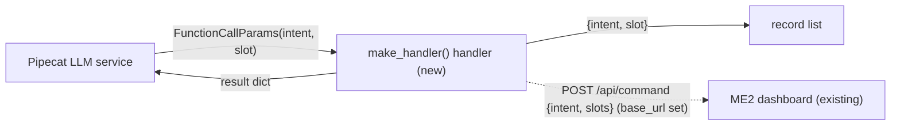

# Feature Spec: 01 — smart_home tool (one LLM tool for the 19 ME2 commands)

**Status:** delivered-for-review
**Date:** 2026-10-23
**Blocked by:** None (ticket 00, the `pipeline/` subproject with pipecat-ai 1.13.0, is already landed)

Adds `smart_home(intent, slot=None)`: a Pipecat function schema plus a handler that records each call and, when given a dashboard URL, posts it to ME2's `POST /api/command`. Read `../GUARDRAILS.md` first; it binds this ticket.

## Context

- **Objective:** one tool module and its unit tests in the `pipeline/` subproject. Small (about 180 lines with tests).
- **Role:** strict systems architect; you are transcribing an approved implementation.
- **User goal:** the LLM controls lights, music, thermostat, timer, alarm, reminders, phone, time and weather through one function.
- **Source:** `/mnt/School/PhD/AI231/AI-231-ME3-agy/.scratch/smart-home-tool/PLAN.md`, Task 01.
- **Repo:** `/mnt/School/PhD/AI231/AI-231-ME3-agy` (work only under `pipeline/`).

| File | Action | Line cap |
|---|---|---|
| `pipeline/src/voice_pipeline/tools/__init__.py` | new, empty | **0** |
| `pipeline/src/voice_pipeline/tools/smart_home.py` | new | **121** (skeleton 110) |
| `pipeline/tests/test_smart_home.py` | new | **83** (skeleton 67) |

**Non-goals / touch nothing else:** no MCP server; no slot normalisation; no other file in the repo (in particular `src/voice_agent/mcp_servers/home.py`, `pyproject.toml`, `uv.lock`, `pipeline/pyproject.toml`, `pipeline/uv.lock`, `Makefile`).

**Security-sensitive:** no — the dashboard is local; this module reads no secrets.

## Diagrams

### Data flow

What does one call carry, and where does it go?



### Sequence / component

```mermaid
sequenceDiagram
    participant L as LLM service
    participant H as handler
    participant D as ME2 dashboard
    L->>H: params.arguments = {intent, slot}
    H->>H: record.append; check intent and slot
    alt base_url set and command valid
        H->>D: POST /api/command (2 s timeout)
        D-->>H: {ok, changed, message} or 400 {error}
    end
    H->>L: await params.result_callback(result)
```

## RECAP

### E — Edges

| Edge | Behavior |
|---|---|
| unknown intent | `{"ok": False, "message": "unknown intent X"}`; recorded; no HTTP |
| slotted intent without slot (None or "") | `{"ok": False, "message": "<INTENT> needs a value: <values>"}`; recorded; no HTTP |
| slot given to an unslotted intent | dropped from the body (`slots: {}`) |
| `base_url` is None | `{"ok": True, "message": "recorded"}` |
| dashboard unreachable or timed out | `{"ok": False, "message": "home dashboard unreachable"}` |
| dashboard non-200 | `{"ok": False, "message": <its error field>}` |

Nothing else.

### C — Contracts

`pipeline/src/voice_pipeline/tools/__init__.py`: empty file.

`pipeline/src/voice_pipeline/tools/smart_home.py` (verbatim):

```python
"""One LLM tool for the 19 ME2 home commands, sent to the ME2 dashboard's POST /api/command."""

from __future__ import annotations

from collections.abc import Awaitable, Callable
from typing import Any

import httpx
from pipecat.adapters.schemas.function_schema import FunctionSchema
from pipecat.services.llm_service import FunctionCallParams

INTENTS: tuple[str, ...] = (
    "PLAY_MUSIC",
    "PAUSE",
    "STOP",
    "NEXT",
    "VOLUME_UP",
    "VOLUME_DOWN",
    "LIGHT_ON",
    "LIGHT_OFF",
    "BRIGHTNESS",
    "COLOR",
    "TEMPERATURE",
    "WEATHER",
    "TIME",
    "TIMER",
    "ALARM",
    "CALL",
    "MESSAGE",
    "CREATE_REMINDER",
    "LIST_REMINDERS",
)

SLOT_FOR_INTENT: dict[str, str] = {
    "BRIGHTNESS": "PERCENT",
    "COLOR": "COLOR",
    "TEMPERATURE": "DEGREES",
    "TIMER": "DURATION",
    "ALARM": "ALARM_TIME",
    "CREATE_REMINDER": "TASK",
}

SLOT_VALUES: dict[str, str] = {
    "BRIGHTNESS": "'20 percent', '60 percent', '100 percent'",
    "COLOR": "'white', 'red', 'green', 'blue'",
    "TEMPERATURE": "'18 degrees', '22 degrees', '26 degrees'",
    "TIMER": "'10 seconds', '30 seconds', '1 minute'",
    "ALARM": "'6 AM', '8 AM', '9 PM'",
    "CREATE_REMINDER": "'drink water', 'study', 'exercise'",
}

SCHEMA = FunctionSchema(
    name="smart_home",
    description=(
        "Control or check the home: lights, colour, brightness, music, volume, thermostat, "
        "timer, alarm, reminders, phone call, message, time, weather. One call per command. "
        "Intents that need a slot, with the values the home accepts: "
        + "; ".join(f"{intent}: {values}" for intent, values in SLOT_VALUES.items())
        + ". Every other intent takes no slot."
    ),
    properties={
        "intent": {"type": "string", "enum": list(INTENTS)},
        "slot": {
            "type": "string",
            "description": "The value for BRIGHTNESS, COLOR, TEMPERATURE, TIMER, ALARM or "
            "CREATE_REMINDER, written like the listed values. Omit for other intents.",
        },
    },
    required=["intent"],
)


def to_command(intent: str, slot: str | None) -> dict[str, Any]:
    """The /api/command body; a slot given to an unslotted intent is dropped."""
    name = SLOT_FOR_INTENT.get(intent)
    return {"intent": intent, "slots": {name: slot} if name and slot else {}}


def make_handler(
    *, base_url: str | None, record: list[dict[str, Any]]
) -> Callable[[FunctionCallParams], Awaitable[None]]:
    """Handler that records every call, and posts it to the dashboard when base_url is set."""

    async def handler(params: FunctionCallParams) -> None:
        intent = str(params.arguments.get("intent", ""))
        slot = params.arguments.get("slot")
        record.append({"intent": intent, "slot": slot})
        if intent not in INTENTS:
            result: dict[str, Any] = {"ok": False, "message": f"unknown intent {intent}"}
        elif intent in SLOT_FOR_INTENT and not slot:
            result = {"ok": False, "message": f"{intent} needs a value: {SLOT_VALUES[intent]}"}
        elif base_url is None:
            result = {"ok": True, "message": "recorded"}
        else:
            result = await _post(base_url, to_command(intent, slot))
        await params.result_callback(result)

    return handler


async def _post(base_url: str, body: dict[str, Any]) -> dict[str, Any]:
    try:
        async with httpx.AsyncClient(base_url=base_url, timeout=2.0) as client:
            response = await client.post("/api/command", json=body)
    except httpx.HTTPError:
        return {"ok": False, "message": "home dashboard unreachable"}
    data = response.json()
    if response.status_code != 200:
        return {"ok": False, "message": str(data.get("error", response.status_code))}
    return {"ok": True, "changed": data.get("changed"), "message": data.get("message")}
```

Final inventory (smart_home.py): constants `INTENTS`, `SLOT_FOR_INTENT`, `SLOT_VALUES`, `SCHEMA`; functions `to_command`, `make_handler` (with inner `handler`), `_post`.

### A — Assumptions

| Assumption | Verified when / how |
|---|---|
| `/api/command` takes `{intent, slots: dict[str,str]}`; 400 `{ok: false, error}` for unknown intent / missing slot; 200 `{ok, changed, message, state}` otherwise; unsupported values give `changed: false` | Established: ME2 `src/app/main.py:143`, `src/app/dispatch.py:handle_command`, read 2026-10-23 |
| `FunctionSchema(name, description, properties, required)`; `FunctionCallParams.arguments`, `.result_callback` in pipecat 1.13.0 | Established: `pipeline/.venv/.../pipecat/adapters/schemas/function_schema.py:32`, `services/llm_service.py:125`, 2026-10-23 |
| The skeleton passes ruff, mypy --strict and its tests | Established: run by the ticket-writer 2026-10-23 |
| Unknowns | None |
| Dependencies/license | pipecat-ai 1.13.0 (BSD-2) and httpx (BSD-3), both already in `pipeline/pyproject.toml`; add nothing |

### P — Proof (acceptance criteria)

No existing fixtures or stubs to reuse; no parametrize.

Tests in `pipeline/tests/test_smart_home.py` (verbatim):

```python
from types import SimpleNamespace
from typing import Any

import httpx
import pytest

from voice_pipeline.tools import smart_home


async def _call(arguments: dict[str, Any], base_url: str | None = None) -> tuple[list, list]:
    record: list[dict[str, Any]] = []
    results: list[dict[str, Any]] = []

    async def result_callback(result: dict[str, Any]) -> None:
        results.append(result)

    handler = smart_home.make_handler(base_url=base_url, record=record)
    await handler(SimpleNamespace(arguments=arguments, result_callback=result_callback))
    return record, results


def test_to_command_slotted() -> None:
    assert smart_home.to_command("ALARM", "6 AM") == {
        "intent": "ALARM",
        "slots": {"ALARM_TIME": "6 AM"},
    }


def test_to_command_unslotted_ignores_slot() -> None:
    assert smart_home.to_command("LIGHT_ON", "blue") == {"intent": "LIGHT_ON", "slots": {}}


async def test_handler_records_without_http() -> None:
    record, results = await _call({"intent": "TEMPERATURE", "slot": "22 degrees"})
    assert record == [{"intent": "TEMPERATURE", "slot": "22 degrees"}]
    assert results == [{"ok": True, "message": "recorded"}]


async def test_handler_missing_slot() -> None:
    record, results = await _call({"intent": "TIMER"})
    assert record == [{"intent": "TIMER", "slot": None}]
    assert results[0]["ok"] is False
    assert "1 minute" in results[0]["message"]


async def test_handler_unknown_intent() -> None:
    _, results = await _call({"intent": "OPEN_DOOR"})
    assert results == [{"ok": False, "message": "unknown intent OPEN_DOOR"}]


async def test_handler_posts_to_dashboard(monkeypatch: pytest.MonkeyPatch) -> None:
    seen: list[httpx.Request] = []

    def reply(request: httpx.Request) -> httpx.Response:
        seen.append(request)
        return httpx.Response(200, json={"ok": True, "changed": True, "message": "color -> red"})

    real_client = httpx.AsyncClient

    def client(**kwargs: Any) -> httpx.AsyncClient:
        return real_client(transport=httpx.MockTransport(reply), **kwargs)

    monkeypatch.setattr(smart_home.httpx, "AsyncClient", client)
    _, results = await _call({"intent": "COLOR", "slot": "red"}, base_url="http://dash")
    assert seen[0].url.path == "/api/command"
    assert seen[0].read() == b'{"intent":"COLOR","slots":{"COLOR":"red"}}'
    assert results == [{"ok": True, "changed": True, "message": "color -> red"}]
```

| # | Test / acceptance criterion | Command | Result |
|---|---|---|---|
| 1 | the 6 tests above pass | `cd pipeline && uv run --offline pytest -q tests/test_smart_home.py` | pass (6 passed in 0.33s) |
| 2 | gates green | `cd pipeline && uv run --offline ruff check . && uv run --offline ruff format --check . && uv run --offline mypy` | pass (Success: no issues found in 3 source files) |
| 3 | line caps respected | `wc -l` on the files in the table | pass (0/0, 110/121, 67/83) |

## Deviations

| Date | Deviation | Minor: rationale / Material: design-gate re-run |
|---|---|---|

## Approvals

| Date | Gate | What was approved / decided | By |
|---|---|---|---|
| 2026-10-23 | design | plain Pipecat function, slot passed through, pipeline/ subproject, models groq-8b / gemini-lite / groq-70b, agy executor | owner |

## Execution Log

### 2026-10-23 agy: DONE
- Proof: 1 ✅ `cd pipeline && uv run --offline pytest -q tests/test_smart_home.py` (6 passed in 0.33s) 2 ✅ `cd pipeline && uv run --offline ruff check . && uv run --offline ruff format --check . && uv run --offline mypy` (Success: no issues found in 3 source files) 3 ✅ `wc -l` on the files in the table (177 total)
- Files:
  - `pipeline/src/voice_pipeline/tools/__init__.py` (0 / 0)
  - `pipeline/src/voice_pipeline/tools/smart_home.py` (110 / 121)
  - `pipeline/tests/test_smart_home.py` (67 / 83)
- Deviations: none
- Notes for reviewer: none; transcribed verbatim from ticket contracts and proof sections.

### 2026-10-23 tech-lead review (level 3): approved, no findings
- Changed paths: only the ticket's file table plus this ticket (`diff -rq` against the pre-handoff snapshot).
- Verbatim: `cmp` of `smart_home.py` and `test_smart_home.py` against the ticket's code: identical, so the inventory, caps (110/121, 67/83) and forbidden list hold by construction; `tools/__init__.py` is 0 bytes.
- Proof and gates re-run by the reviewer: 6 passed; ruff check, ruff format --check, mypy strict clean.
- Ticket edits: Status, Proof results and the Execution Log entry only.
