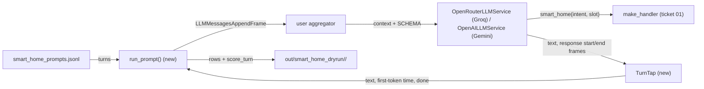
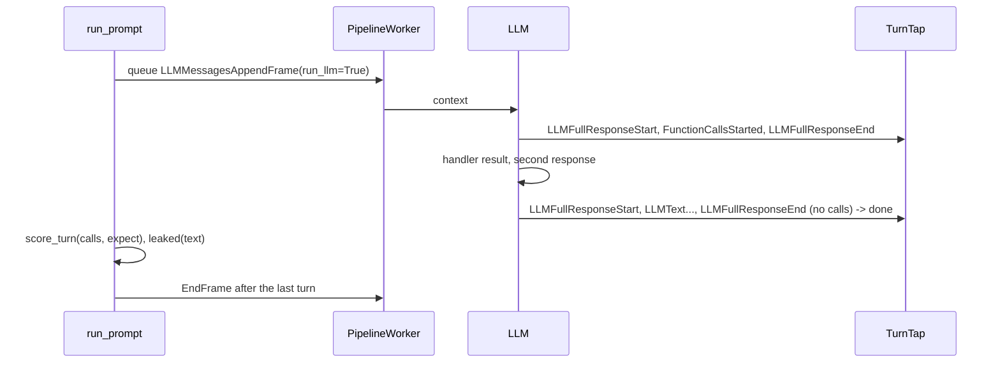

# Feature Spec: 02 — smart_home dry run through Pipecat, scored per model

**Status:** delivered-for-review
**Date:** 2026-10-23
**Blocked by:** 01

A text-only Pipecat pipeline runs the 47-prompt set through each model, records every `smart_home` call, and prints a scored table. Before any code, confirm ticket 01 landed: `pipeline/src/voice_pipeline/tools/smart_home.py` exports `SCHEMA` (a `FunctionSchema` named `smart_home`) and `make_handler(*, base_url, record)`. A mismatch means stop. Read `../GUARDRAILS.md` first; it binds this ticket.

## Context

- **Objective:** the dry-run module, its scorer tests, and the two config files. Small (about 300 lines with tests).
- **Role:** strict systems architect; you are transcribing an approved implementation.
- **User goal:** know whether Groq 8B (and the baselines) call the tool correctly with a plain system prompt, before the audio pipeline is built.
- **Source:** `/mnt/School/PhD/AI231/AI-231-ME3-agy/.scratch/smart-home-tool/PLAN.md`, Task 02.
- **Repo:** `/mnt/School/PhD/AI231/AI-231-ME3-agy` (work only under `pipeline/`).

| File | Action | Line cap |
|---|---|---|
| `pipeline/src/voice_pipeline/dryrun.py` | new | **264** (skeleton 240) |
| `pipeline/tests/test_dryrun.py` | new | **31** (skeleton 25) |
| `pipeline/config/eval/smart_home_prompts.jsonl` | new, `cp` of `/mnt/School/PhD/AI231/AI-231-ME3-agy/.scratch/smart-home-tool/prompts.jsonl` | **47** (exactly) |
| `pipeline/config/eval/smart_home_system.txt` | new, verbatim below | **6** (exactly) |

**Non-goals / touch nothing else:** no audio; no retries beyond the one in the skeleton; no new prompts; no changes to ticket 01's files; **do not run the dry run against real models** (it needs API keys and costs money; the human runs it after review); no other file in the repo.

**Security-sensitive:** yes — `read_key` reads API keys from `~/.secrets/<dir>/` at run time; keys are never printed or logged. You do not run that path.

## Diagrams

### Data flow

What does one prompt go through?



### Sequence / component



## RECAP

### E — Edges

| Edge | Behavior |
|---|---|
| turn not finished within 20 s | row `status="error"`; remaining turns of that prompt skipped |
| model returns neither text nor a call | row `status="empty"` |
| any non-ok row in a prompt | the whole prompt is re-run once; the second result is kept |
| expected no call and the model asks or answers | `exact` and `intent` true, `false_call` false |
| expected no call and the model calls | `false_call` true |
| slot case differs ("6 am" vs "6 AM"); slot `""` vs None | equal |
| unknown model name on the CLI | exit with a message listing the models |
| no key file | exit with `no key in ~/.secrets/<dir>/` |

Nothing else.

### C — Contracts

`pipeline/src/voice_pipeline/dryrun.py` (verbatim):

```python
"""Dry run of the smart_home tool: prompts through a text-only Pipecat pipeline, scored per model.

uv run python -m voice_pipeline.dryrun --models groq-8b,gemini-lite [--limit N] [--live URL]
"""

from __future__ import annotations

import argparse
import asyncio
import json
import re
import statistics
import time
from collections import Counter
from pathlib import Path
from typing import Any

from openai.types.chat import ChatCompletionUserMessageParam
from pipecat.adapters.schemas.tools_schema import ToolsSchema
from pipecat.frames.frames import (
    EndFrame,
    Frame,
    FunctionCallsStartedFrame,
    LLMFullResponseEndFrame,
    LLMFullResponseStartFrame,
    LLMMessagesAppendFrame,
    LLMTextFrame,
)
from pipecat.pipeline.pipeline import Pipeline
from pipecat.pipeline.worker import PipelineWorker
from pipecat.processors.aggregators.llm_context import LLMContext
from pipecat.processors.aggregators.llm_response_universal import LLMContextAggregatorPair
from pipecat.processors.frame_processor import FrameDirection, FrameProcessor
from pipecat.services.openai.llm import OpenAILLMService
from pipecat.services.openrouter.llm import OpenRouterLLMService
from pipecat.workers.runner import WorkerRunner

from voice_pipeline.tools.smart_home import SCHEMA, make_handler

ROOT = Path(__file__).resolve().parents[2]
MODELS: dict[str, tuple[str, str]] = {
    "groq-8b": ("openrouter", "meta-llama/llama-3.1-8b-instruct"),
    "groq-70b": ("openrouter", "meta-llama/llama-3.3-70b-instruct"),
    "gemini-lite": ("google-ai-studio", "gemini-3.1-flash-lite"),
}
GEMINI_URL = "https://generativelanguage.googleapis.com/v1beta/openai/"
LEAK = re.compile(r"<function|\"name\"\s*:|smart_home\(|\[TOOL_CALLS\]")
TURN_TIMEOUT_S = 20.0


def read_key(secret_dir: str) -> str:
    folder = Path.home() / ".secrets" / secret_dir
    for name in ("api-key.txt", "api_key.txt"):
        path = folder / name
        if path.exists():
            return "".join(path.read_text().split())
    raise SystemExit(f"no key in ~/.secrets/{secret_dir}/")


def build_llm(model: str, system: str) -> OpenAILLMService:
    secret_dir, model_id = MODELS[model]
    if secret_dir == "openrouter":
        return OpenRouterLLMService(
            api_key=read_key(secret_dir),
            settings=OpenRouterLLMService.Settings(
                model=model_id,
                system_instruction=system,
                provider={"order": ["Groq"], "allow_fallbacks": False},
            ),
        )
    return OpenAILLMService(
        api_key=read_key(secret_dir),
        base_url=GEMINI_URL,
        settings=OpenAILLMService.Settings(model=model_id, system_instruction=system),
    )


class TurnTap(FrameProcessor):
    """Collects one turn's text and first-token time; sets `done` when the turn ends."""

    def __init__(self) -> None:
        super().__init__()
        self.done = asyncio.Event()
        self.text: list[str] = []
        self.started = 0.0
        self.first: float | None = None
        self.calls_in_response = False

    def begin(self) -> None:
        self.done.clear()
        self.text = []
        self.started = time.perf_counter()
        self.first = None

    async def process_frame(self, frame: Frame, direction: FrameDirection) -> None:
        await super().process_frame(frame, direction)
        if isinstance(frame, LLMFullResponseStartFrame):
            self.calls_in_response = False
        elif isinstance(frame, (LLMTextFrame, FunctionCallsStartedFrame)):
            if self.first is None:
                self.first = time.perf_counter() - self.started
            if isinstance(frame, LLMTextFrame):
                self.text.append(frame.text)
            else:
                self.calls_in_response = True
        elif isinstance(frame, LLMFullResponseEndFrame) and not self.calls_in_response:
            self.done.set()
        await self.push_frame(frame, direction)


async def run_prompt(
    model: str, prompt: dict[str, Any], system: str, live: str | None
) -> list[dict[str, Any]]:
    calls: list[dict[str, Any]] = []
    llm = build_llm(model, system)
    llm.register_function("smart_home", make_handler(base_url=live, record=calls))
    pair = LLMContextAggregatorPair(LLMContext(tools=ToolsSchema(standard_tools=[SCHEMA])))
    tap = TurnTap()
    worker = PipelineWorker(Pipeline([pair.user(), llm, tap, pair.assistant()]))
    runner = WorkerRunner(handle_sigint=False)
    await runner.add_workers(worker)
    running = asyncio.create_task(runner.run())
    rows = []
    for index, (turn, expect) in enumerate(zip(prompt["turns"], prompt["expect"], strict=True)):
        before = len(calls)
        tap.begin()
        message: ChatCompletionUserMessageParam = {"role": "user", "content": turn}
        await worker.queue_frame(LLMMessagesAppendFrame(messages=[message], run_llm=True))
        try:
            await asyncio.wait_for(tap.done.wait(), TURN_TIMEOUT_S)
            status = "ok"
        except TimeoutError:
            status = "error"
        text = "".join(tap.text)
        made = calls[before:]
        if status == "ok" and not text and not made:
            status = "empty"
        rows.append(
            {
                "model": model,
                "id": prompt["id"],
                "kind": prompt["kind"],
                "turn": index,
                "status": status,
                "calls": made,
                "expect": expect,
                "text": text,
                "first_s": tap.first,
                "total_s": time.perf_counter() - tap.started,
                **score_turn(made, expect),
                "leaked": leaked(text),
            }
        )
        if status == "error":
            break
    await worker.queue_frame(EndFrame())
    await running
    return rows


def _key(call: dict[str, Any]) -> tuple[str, str | None]:
    slot = call.get("slot")
    return str(call.get("intent")), str(slot).lower() if slot else None


def score_turn(calls: list[dict[str, Any]], expect: list[dict[str, Any]]) -> dict[str, bool]:
    return {
        "exact": Counter(map(_key, calls)) == Counter(map(_key, expect)),
        "intent": Counter(c.get("intent") for c in calls) == Counter(e["intent"] for e in expect),
        "false_call": not expect and bool(calls),
    }


def leaked(text: str) -> bool:
    return bool(LEAK.search(text))


def summarize(rows: list[dict[str, Any]]) -> str:
    lines = [
        f"{'model':<12}{'kind':<15}{'n':>4}{'exact':>7}{'intent':>8}{'false':>7}"
        f"{'leak':>6}{'bad':>5}{'first p50':>11}"
    ]
    groups: dict[tuple[str, str], list[dict[str, Any]]] = {}
    for row in rows:
        groups.setdefault((row["model"], row["kind"]), []).append(row)
        groups.setdefault((row["model"], "ALL"), []).append(row)
    for (model, kind), group in sorted(groups.items()):
        ok = [r for r in group if r["status"] == "ok"]
        firsts = [r["first_s"] for r in ok if r["first_s"] is not None]
        p50 = f"{statistics.median(firsts):.2f}s" if firsts else "-"
        lines.append(
            f"{model:<12}{kind:<15}{len(ok):>4}{sum(r['exact'] for r in ok):>7}"
            f"{sum(r['intent'] for r in ok):>8}{sum(r['false_call'] for r in ok):>7}"
            f"{sum(r['leaked'] for r in ok):>6}{len(group) - len(ok):>5}{p50:>11}"
        )
    return "\n".join(lines)


async def run(models: list[str], limit: int | None, live: str | None, run_id: str) -> int:
    prompts = [
        json.loads(line)
        for line in (ROOT / "config/eval/smart_home_prompts.jsonl").read_text().splitlines()
        if line.strip()
    ][:limit]
    system = (ROOT / "config/eval/smart_home_system.txt").read_text()
    out = ROOT / "out/smart_home_dryrun" / run_id
    out.mkdir(parents=True, exist_ok=True)
    rows: list[dict[str, Any]] = []
    for model in models:
        with (out / f"{model}.jsonl").open("w") as sink:
            for prompt in prompts:
                prompt_rows = await run_prompt(model, prompt, system, live)
                if any(r["status"] != "ok" for r in prompt_rows):
                    prompt_rows = await run_prompt(model, prompt, system, live)
                for row in prompt_rows:
                    sink.write(json.dumps(row) + "\n")
                rows.extend(prompt_rows)
    report = summarize(rows)
    (out / "summary.txt").write_text(report + "\n")
    print(report)
    print(f"rows: {out}")
    return 0


def main(argv: list[str] | None = None) -> int:
    parser = argparse.ArgumentParser(description=__doc__.split("\n")[0])
    parser.add_argument("--models", default="groq-8b,gemini-lite,groq-70b")
    parser.add_argument("--limit", type=int, default=None)
    parser.add_argument("--live", default=None, help="ME2 dashboard URL; default records only")
    parser.add_argument("--run-id", default=time.strftime("%Y%m%d-%H%M%S"))
    args = parser.parse_args(argv)
    models = args.models.split(",")
    for model in models:
        if model not in MODELS:
            raise SystemExit(f"unknown model {model}; choose from {', '.join(MODELS)}")
    return asyncio.run(run(models, args.limit, args.live, args.run_id))


if __name__ == "__main__":
    raise SystemExit(main())
```

Final inventory (dryrun.py): constants `ROOT`, `MODELS`, `GEMINI_URL`, `LEAK`, `TURN_TIMEOUT_S`; functions `read_key`, `build_llm`, `run_prompt`, `_key`, `score_turn`, `leaked`, `summarize`, `run`, `main`; class `TurnTap` (methods `__init__`, `begin`, `process_frame`).

`pipeline/config/eval/smart_home_system.txt` (verbatim, 6 lines, trailing newline):

```text
You are a friendly home assistant that talks like a person. For any request to control or check
the home (lights, colour, brightness, music, volume, thermostat, timer, alarm, reminders, phone
call, message, time, weather), call the smart_home tool. Use only the slot values the tool lists;
if the user gives a value you cannot map, still call the tool with their value. If a required
value is missing, ask for it instead of calling the tool. For anything else, just answer.
Reply in one or two short spoken sentences, with no markdown.
```

`pipeline/config/eval/smart_home_prompts.jsonl`: `cp /mnt/School/PhD/AI231/AI-231-ME3-agy/.scratch/smart-home-tool/prompts.jsonl pipeline/config/eval/smart_home_prompts.jsonl` (47 lines; do not edit).

### A — Assumptions

| Assumption | Verified when / how |
|---|---|
| In pipecat 1.13.0 a tool turn emits `LLMFullResponseStart, FunctionCallsStarted, LLMFullResponseEnd`, then a second response without `FunctionCallsStarted` | Established: frame trace, 2026-10-23 (scratch probe) |
| `Settings(model=..., system_instruction=...)` on both services; `OpenRouterLLMService.Settings(provider=...)`; `WorkerRunner(handle_sigint=False)`, `add_workers`, `run()` ends after `EndFrame` | Established: the skeleton ran 3 models x 6 prompts end to end, 2026-10-23 |
| The skeleton passes ruff, mypy --strict and its tests | Established: run by the ticket-writer 2026-10-23 |
| Ticket 01's `SCHEMA` and `make_handler` are landed as in its ticket | Must verify: Step 0 above |
| Unknowns | None |
| Dependencies/license | pipecat-ai 1.13.0 (BSD-2), its `openai` extra (Apache-2.0), already in `pipeline/pyproject.toml`; add nothing |

### P — Proof (acceptance criteria)

No existing fixtures or stubs to reuse; no parametrize. Ticket 01's tests stay as landed.

Tests in `pipeline/tests/test_dryrun.py` (verbatim):

```python
from voice_pipeline.dryrun import leaked, score_turn


def test_score_exact() -> None:
    calls = [{"intent": "ALARM", "slot": "6 am"}, {"intent": "LIGHT_ON", "slot": None}]
    expect = [{"intent": "LIGHT_ON", "slot": None}, {"intent": "ALARM", "slot": "6 AM"}]
    assert score_turn(calls, expect) == {"exact": True, "intent": True, "false_call": False}


def test_score_intent_only() -> None:
    calls = [{"intent": "ALARM", "slot": "6am"}]
    expect = [{"intent": "ALARM", "slot": "6 AM"}]
    assert score_turn(calls, expect) == {"exact": False, "intent": True, "false_call": False}


def test_score_false_call() -> None:
    calls = [{"intent": "WEATHER", "slot": None}]
    assert score_turn(calls, []) == {"exact": False, "intent": False, "false_call": True}
    assert score_turn([], []) == {"exact": True, "intent": True, "false_call": False}


def test_leaked() -> None:
    assert leaked('<function=smart_home>{"intent": "LIGHT_ON"}</function>')
    assert leaked('{"name": "smart_home", "parameters": {}}')
    assert not leaked("Sure, the lights are on now.")
```

| # | Test / acceptance criterion | Command | Result |
|---|---|---|---|
| 1 | the 4 tests above pass, and ticket 01's 6 still pass | `cd pipeline && uv run --offline pytest -q` | pass (10 passed in 0.68s) |
| 2 | gates green | `cd pipeline && uv run --offline ruff check . && uv run --offline ruff format --check . && uv run --offline mypy` | pass (Success: no issues found in 4 source files) |
| 3 | the module imports and its CLI help works (no network) | `cd pipeline && uv run --offline python -m voice_pipeline.dryrun --help` | pass (  --run-id RUN_ID) |
| 4 | config files exact | `cd pipeline && wc -l config/eval/*` shows 47 and 6; `cmp config/eval/smart_home_prompts.jsonl /mnt/School/PhD/AI231/AI-231-ME3-agy/.scratch/smart-home-tool/prompts.jsonl` | pass (  53 total) |
| 5 | line caps respected | `wc -l` on the files in the table | pass (  318 total) |

## Deviations

| Date | Deviation | Minor: rationale / Material: design-gate re-run |
|---|---|---|

## Approvals

| Date | Gate | What was approved / decided | By |
|---|---|---|---|
| 2026-10-23 | design | plain Pipecat function, slot passed through, pipeline/ subproject, models groq-8b / gemini-lite / groq-70b, agy executor | owner |

## Execution Log

### 2026-10-23 agy: DONE
- Proof: 1 ✅ `cd pipeline && uv run --offline pytest -q` (10 passed in 0.68s) 2 ✅ `cd pipeline && uv run --offline ruff check . && uv run --offline ruff format --check . && uv run --offline mypy` (Success: no issues found in 4 source files) 3 ✅ `cd pipeline && uv run --offline python -m voice_pipeline.dryrun --help` (  --run-id RUN_ID) 4 ✅ `cd pipeline && wc -l config/eval/* && cmp config/eval/smart_home_prompts.jsonl /mnt/School/PhD/AI231/AI-231-ME3-agy/.scratch/smart-home-tool/prompts.jsonl` (  53 total) 5 ✅ `wc -l` on the files in the table (  318 total)
- Files:
  - `pipeline/src/voice_pipeline/dryrun.py` (240 / 264)
  - `pipeline/tests/test_dryrun.py` (25 / 31)
  - `pipeline/config/eval/smart_home_prompts.jsonl` (47 / 47)
  - `pipeline/config/eval/smart_home_system.txt` (6 / 6)
- Deviations: none
- Notes for reviewer: none; transcribed verbatim from ticket contracts and proof sections.


### 2026-10-23 tech-lead review (level 3): approved, no findings
- Changed paths: only the ticket's file table plus this ticket; ticket 01's files unchanged.
- Verbatim: `cmp` of `dryrun.py`, `test_dryrun.py`, `smart_home_system.txt` against the ticket's code, and of `smart_home_prompts.jsonl` against the source: identical, so the inventory, caps (240/264, 25/31, 47, 6) and forbidden list hold by construction.
- Proof and gates re-run by the reviewer: 10 passed; ruff, format, mypy strict clean; `--help` works offline.
- Observation (executor, minor): the Execution Log does not record the Step 0 producer check it was asked to do first; the landed producer matched, so no effect.
