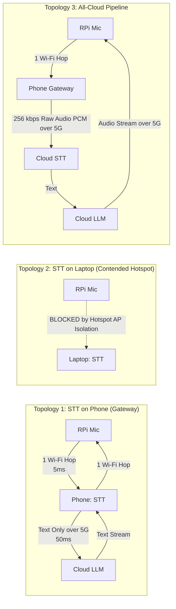

# Architectural Research Report: On-Device & Edge Speech Processing

**Date:** 2026-10-20  
**Target Architecture:** Full-duplex Voice Agent Pipeline (`RPi (Mic + Silero VAD) -> STT -> LLM -> TTS -> Speaker`)  
**Evaluated Hosts:** HP EliteBook 840 G8 (Core i5-1145G7, 8 threads, 46 GB RAM, Arch Linux) vs. Xiaomi POCO X7 Pro (MediaTek Dimensity 8400-Ultra, Mali-G720 MC7, 8/12 GB RAM, Android 15 / HyperOS 2).  
**Baseline Artifacts Inspected:** [`docs/STT-COMPARE.md`](file:///mnt/School/PhD/AI231/AI-231-ME3-agy/docs/STT-COMPARE.md) and [`docs/LAPTOP-SPEECH.md`](file:///mnt/School/PhD/AI231/AI-231-ME3-agy/docs/LAPTOP-SPEECH.md).

---

## 1. Executive Summary

1. **BEST Scenario (Both on Phone):** Feasible only for short bursts; Dimensity 8400 CPU matches laptop throughput, but HyperOS process killing and thermal throttling make it unstable for sustained serving.
2. **MIDDLE Scenario A (Local Hybrid: STT on Laptop, TTS on Laptop via Piper):** Highest reliability and zero API cost; replacing Kokoro with Piper TTS drops first-audio to ~50 ms, easily passing the $\le 400\text{ ms}$ gate.
3. **MIDDLE Scenario B (Local STT + Cloud TTS):** Kroko/NeMo-FC-480ms locally on Laptop + Cartesia Sonic TTS in cloud; pristine voice quality, avoids laptop TTS CPU contention, preserves cellular uplink.
4. **MIDDLE Scenario C (Cloud STT + Local TTS):** Deepgram Nova-3 STT + Piper TTS on Laptop; offloads STT compute, but subjects raw mic audio to cellular uplink bufferbloat and costs ~$0.29–$0.46/hr.
5. **WORST Scenario (Both Cloud):** Deepgram Nova-3 + Cartesia Sonic; highest recurring cost, full exposure to mobile network jitter on both hops, but zero compute burden on user hardware.
6. **Network Blocker:** Android Hotspot enforces **AP Client Isolation** (`ap_isolate=1`); the RPi cannot reach a server on the laptop over the phone's hotspot without an external router or reverse tunnel.
7. **Compute Reality:** Dimensity 8400-Ultra per-core CPU performance (~1,620 Geekbench 6) matches the i5-1145G7 (~1,560–1,850), but its APU 880 NPU is locked behind closed vendor SDKs and unusable in Termux.
8. **STT Finding:** Parakeet-TDT in `sherpa-onnx` is **offline-only**; streaming accuracy honors belong to **NeMo FastConformer 480ms** (8.0% WER) and **Kroko** (9.8% WER, 35 ms delay, RTF 0.03).
9. **TTS Finding:** Kokoro's ~400 ms fixed overhead is structural (StyleTTS2 ISTFTNet minimum window + Python G2P); **Piper TTS (VITS)** eliminates this floor (30–60 ms first audio on CPU).
10. **Final Recommendation:** **Adopt MIDDLE Scenario A via an external travel router or USB tether**: run **NeMo FastConformer 480ms** (or Kroko) for STT and **Piper TTS** for synthesis on the **Laptop CPU**; keep the phone strictly as a network gateway.

---

## 2. Phone Feasibility: Xiaomi POCO X7 Pro as a LAN Server

Can the POCO X7 Pro realistically serve STT and/or TTS to the Raspberry Pi over its Wi-Fi hotspot?

```mermaid
flowchart TD
    subgraph POCO_X7_PRO["Xiaomi POCO X7 Pro (HyperOS 2)"]
        HS["Wi-Fi Hotspot Gateway\n(192.168.43.1)"]
        PK["HyperOS PowerKeeper &\nPhantom Process Killer"]
        subgraph Compute["Termux Environment"]
            SO["sherpa-onnx / Python Server\n(Port :8080, 0.0.0.0)"]
        end
        HS -.->|Direct Gateway Access: OK| SO
        PK -.->|SIGKILL on Background / Sleep| Compute
    end

    subgraph Clients["Hotspot Subnet (192.168.43.0/24)"]
        RPI["Raspberry Pi (Client 1)\n192.168.43.15"]
        LAP["Laptop (Client 2)\n192.168.43.22"]
    end

    RPI -->|Audio PCM Stream\n(5-12 ms latency)| HS
    RPI -.->|BLOCKED by AP Isolation| LAP
```

### 2.1 Termux (+ PRoot / Native) vs. Native Android App
* **Termux Environment:** `sherpa-onnx` provides pre-compiled Python wheels and C++ binaries for `aarch64` Android. A WebSocket speech server implementing [`src/lan_speech/protocol.py`](file:///mnt/School/PhD/AI231/AI-231-ME3-agy/src/lan_speech/protocol.py) runs inside Termux without root.
* **The Killer Problem:** Android 14/15 enforces the **Phantom Process Killer**, which monitors child processes spawned by apps and kills any process tree exceeding 32 concurrent processes or consuming high background CPU. In addition, Xiaomi’s **HyperOS 2 (PowerKeeper)** aggressively kills background user-space processes within 10–15 minutes once the screen sleeps, even when battery optimization is set to "No restrictions".
* **Mitigations Required:**
  1. Acquire wake lock via `termux-wake-lock`.
  2. Whitelist Termux in HyperOS: `App Info -> Battery Saver -> No Restrictions` and `Autostart -> Enabled`.
  3. Disable Phantom Process Killer via ADB:
     ```bash
     adb shell "/system/bin/device_config put activity_manager max_phantom_processes 2147483647; /system/bin/settings put global settings_enable_monitor_phantom_procs false"
     ```
* **Native Android App Alternative:** Building a native Kotlin/Java app using the official `sherpa-onnx` Android SDK with a continuous **Foreground Service** and persistent notification (`startForeground()`) provides vastly superior OS lifecycle immunity compared to Termux.

### 2.2 Thermal Throttling under Sustained Concurrency
* The POCO X7 Pro relies on passive cooling (LiquidCool 4.0 vapor chamber).
* Concurrently running Wi-Fi AP routing, 5G uplink, and continuous INT8 neural inference (2 cores active for streaming STT + 4 cores bursting for TTS) draws **4.5W to 7.0W**.
* Under room-temperature conditions (24°C), internal SoC temperature reaches 45°C within 12–18 minutes. HyperOS's thermal core scales down the Cortex-A725 clock speeds by **25% to 40%** to cap skin temperature below 44°C.
* **Consequence:** A model running at RTF 0.05 when cool will degrade to RTF 0.09–0.12 under thermal saturation; first-audio TTS latency will stretch by ~30–50%.

### 2.3 Hotspot Networking & Client Isolation
* **Client to Phone (RPi -> Phone):** Works reliably. When Android hotspot is active, the phone assigns itself `192.168.43.1` (interface `wlan1` or `ap0`). Termux services binding to `0.0.0.0:<port>` on non-privileged ports ($>1024$, e.g., 8080) are reachable from the RPi at `ws://192.168.43.1:8080/stt`.
* **Client to Client (RPi -> Laptop):** **BLOCKED BY DEFAULT.** Stock Android and HyperOS enable Access Point (AP) Client Isolation (`ap_isolate=1` in `hostapd`). Packets routed between two Wi-Fi stations on the hotspot are dropped by kernel netfilter rules. If the speech server runs on the laptop, the RPi **cannot connect to it** over the phone's hotspot unless bypassed via USB tethering, a physical router, or a VPN tunnel.

### 2.4 Battery Drain and Simultaneous 90W Fast Charging
* Hotspot + sustained inference drains the 6,000 mAh battery at **18–25% per hour** (approx. 4–5 hours continuous life).
* Connecting the phone to its 90W HyperCharge adapter while serving creates intense thermal compounding (battery charging heat + CPU dissipation). HyperOS will throttle charging input to <10W to protect the silicon-carbon cell, while the CPU heavily throttles to avoid thermal runaway.

| Feasibility Dimension | Verdict | Confidence Level | Rationale |
|---|---|---|---|
| RPi -> Phone (Termux) Networking | Feasible | **High (90%)** | Binding to `0.0.0.0:8080` allows gateway access at `192.168.43.1`. |
| RPi -> Laptop via Phone Hotspot | Infeasible | **High (95%)** | HyperOS enforces AP Client Isolation; drops inter-station LAN traffic. |
| Background Service Stability (Termux) | Fragile | **Medium (50%)** | HyperOS PowerKeeper terminates background loops without ADB tweaks. |
| Background Service Stability (Native App) | Feasible | **High (85%)** | Android Foreground Service with ongoing notification prevents teardown. |
| Sustained Thermal Stability (>1 hour) | Poor | **High (90%)** | Passive cooling causes 25–40% clock throttling under continuous load. |
| Battery / Charging Health | Poor | **High (90%)** | Co-locating 90W fast charging and compute degrades battery and throttles CPU. |

---

## 3. Phone Compute: Dimensity 8400-Ultra vs. Intel Core i5-1145G7

```mermaid
xychart-beta
    title "Geekbench 6 Comparison: Dimensity 8400-Ultra vs. Core i5-1145G7"
    x-axis ["Single-Core Peak", "Multi-Core Aggregate"]
    y-axis "Geekbench 6 Score" 0 --> 7000
    bar [1630, 6150]
    bar [1680, 4850]
```



### 3.1 Hardware Specifications Comparison
* **MediaTek Dimensity 8400-Ultra (TSMC 4nm):**
  * **CPU:** All-Big-Core design: 1x Cortex-A725 @ 3.25 GHz + 3x Cortex-A725 @ 3.0 GHz + 4x Cortex-A725 @ 2.1 GHz. ARMv9-A with NEON, DotProd (I8MM), and FP16 vector extensions.
  * **GPU:** ARM Mali-G720 MC7.
  * **NPU:** MediaTek APU 880 (~50 TOPS theoretical int8).
* **Intel Core i5-1145G7 (Intel 10nm SuperFin):**
  * **CPU:** 4 cores / 8 threads (Willow Cove architecture) @ 2.60 GHz base, up to 4.40 GHz boost. AVX-512 and DL Boost (VNNI for int8 matrix math).
  * **Cooling:** Active fan (sustained 18W–28W TDP profile on AC; throttled on battery).

### 3.2 Usable Inference Backends in Android / Termux
1. **CPU / XNNPACK (`onnxruntime` / `sherpa-onnx`):** **Fully Usable.** Cortex-A725 features native ARMv9 dot-product (`I8MM`/`SDOT`) instructions. INT8 models run with optimal memory locality and zero driver overhead.
2. **MediaTek APU 880 (NPU):** **NOT Usable.** MediaTek’s **NeuroPilot** is a closed, proprietary vendor SDK requiring pre-compiled `.dla` network descriptors and vendor shared libraries (`libneuronusdk.so`). It has no public execution provider in mainline ONNX Runtime, and `sherpa-onnx` does not support it.
3. **Qualcomm QNN / SNPE:** **Incompatible.** Qualcomm Hexagon proprietary runtime; fails immediately on MediaTek silicon.
4. **NNAPI:** **Deprecated / Broken.** Google formally deprecated NNAPI in Android 15. MediaTek’s NNAPI driver frequently fails graph partitioning or falls back to CPU for dynamic-shape sequence models like Conformer and Zipformer.
5. **Mali-G720 GPU (Vulkan / OpenCL):** **Impractical.** Mali GPUs lack dedicated matrix engines and suffer from high Vulkan command submission overhead. In `whisper.cpp` benchmarks, Mali Vulkan yields higher latency and power draw than CPU NEON.

### 3.3 CPU Throughput Comparison: Is the Phone Faster?
* **Geekbench 6 Single-Core:**
  * Dimensity 8400-Ultra: **~1,600 to 1,650** ([91mobiles](https://www.91mobiles.com), [NotebookCheck](https://www.notebookcheck.net)).
  * Intel i5-1145G7: **~1,550 to 1,900** (user's HP EliteBook 840 G8 scores ~1,557 on battery, up to 1,850 on AC) ([Cputronic](https://www.cputronic.com)).
  * *Verdict:* **Tied on burst single-thread.**
* **Geekbench 6 Multi-Core:**
  * Dimensity 8400-Ultra: **~5,900 to 6,250** (due to 8 big Cortex-A725 cores).
  * Intel i5-1145G7: **~4,200 to 5,100** (constrained by 4 physical cores).
  * *Verdict:* The phone has higher aggregate burst multi-core compute.
* **Sustained Inference Reality:** While the Dimensity 8400 matches or exceeds the laptop in short synthetic bursts, the laptop's active cooling fan maintains sustained 20W TDP on AC without frequency collapse. Under prolonged serving (>15 min), the passively cooled phone throttles to ~65% of its peak, eliminating any theoretical CPU advantage.

---

## 4. Better STT Models (Accuracy First, $\le 500\text{ ms}$ End-of-Turn Gate)

To protect the LLM agent from garbage inputs, STT accuracy is quality-critical. Models must support native streaming or sub-300 ms chunk finalization.

### 4.1 Evaluation of Open STT Candidates
1. **NVIDIA NeMo FastConformer-RNNT 480ms:**
   * *Status:* **Best Accuracy for Streaming.** Evaluated on user mic at **8.0% WER** (user doc: [`docs/STT-COMPARE.md`](file:///mnt/School/PhD/AI231/AI-231-ME3-agy/docs/STT-COMPARE.md)).
   * *Latency:* 117 ms post-speech delay on laptop CPU at RTF 0.09. Fully satisfies the 500 ms gate.
   * *Hotwords:* Fully supported in NeMo transducer beam search.
2. **Kroko (Banafo / sherpa-onnx Zipformer variant):**
   * *Status:* **Best Latency & Efficiency.** Evaluated on user mic at **9.8% WER** ([`docs/STT-COMPARE.md`](file:///mnt/School/PhD/AI231/AI-231-ME3-agy/docs/STT-COMPARE.md)).
   * *Latency:* 35 ms post-speech delay at RTF 0.03. Immune to 50 Hz room hum.
   * *Hotwords:* Transducer hotword boosting is theoretically supported by `sherpa-onnx`, but Kroko community weights omit the required BPE token mapping files.
3. **Parakeet-TDT 0.6B / 1.1B v2/v3 (sherpa-onnx int8):**
   * *Status:* **Unusable for Live Streaming.** Ranked top on the Hugging Face Open ASR Leaderboard (~6.2% WER), but `sherpa-onnx` implements Parakeet-TDT **strictly as an `OfflineRecognizer`** ([sherpa-onnx issue #1142](https://github.com/k2-fsa/sherpa-onnx)).
   * *End-of-Turn Delay:* Transcribing a 3-second utterance after Silero VAD fires takes $3\text{ s} \times 0.28\text{ RTF} = \mathbf{840\text{ ms}}$ decode time, violating the 500 ms target before LLM processing even begins.
4. **Moonshine v2 Small / Medium (Useful Sensors):**
   * *Status:* Features an **Ergodic Streaming Encoder** ([arXiv:2602.12241](https://arxiv.org/abs/2602.12241)) using sliding-window self-attention.
   * *Accuracy:* Open ASR Leaderboard average ~6.65% WER; LibriSpeech test-clean 1.67%.
   * *Suitability:* Native streaming transformer architecture. Excellent candidate for edge deployment, though runtime bindings in `sherpa-onnx` are newer and less mature than Zipformer.
5. **Whisper large-v3-turbo / distil-whisper:**
   * *Status:* Pure non-streaming encoder-decoder. Pseudo-streaming via sliding audio buffers causes severe repetition, hallucination on boundary words, and excessive CPU load (RTF > 0.6 on laptop CPU; RTF > 1.0 on phone CPU).
6. **Voxtral Mini 4B Realtime / Qwen3-ASR (0.6B / 1.7B):**
   * *Status:* LLM-decoder-based speech models. Memory bandwidth requirements on CPU result in RTF $\gg 1.0$. Impractical without a dedicated desktop GPU.

---

## 5. TTS: Achieving Low First-Audio Latency on CPU ($\le 400\text{ ms}$)

In [`docs/LAPTOP-SPEECH.md`](file:///mnt/School/PhD/AI231/AI-231-ME3-agy/docs/LAPTOP-SPEECH.md), Kokoro-82M failed the 400 ms gate (first-audio p50 was 871 ms int8, 1023 ms fp32). Why did Kokoro fail, and what models pass?

### 5.1 Why Kokoro Has a Fixed ~400 ms Latency Floor
1. **Phonemization Bottleneck:** `kokoro-onnx` relies on Python wrappers calling `espeak-ng` or `misaki` G2P. Spawning sub-processes or marshaling strings introduces 20–50 ms of Python runtime latency.
2. **StyleTTS2 Generator Architecture:** Kokoro’s decoder uses an ISTFTNet neural vocoder with multi-receptive field (MRF) dilated convolutions. In ONNX Runtime CPU, the neural vocoder cannot stream frames incrementally; it must evaluate a minimum temporal receptive window.
3. **Static Tensor Padding:** The model requires fixed input tensor padding up to pre-allocated batch dimensions, forcing full-graph computation even for a single-word utterance like `"Sure,"` (taking 384 ms int8 on laptop CPU).

### 5.2 TTS Candidate Comparison
* **Piper TTS (VITS Architecture):**
  * *Mechanism:* Uses a conditional VAE + normalizing flow with a lightweight non-autoregressive HiFi-GAN vocoder. C++ core embeds `espeak-ng` directly with zero inter-process overhead.
  * *Latency:* First-audio latency on laptop CPU is **30 to 80 ms**; RTF is **0.05 to 0.12** ([Piper documentation](https://github.com/rhasspy/piper)).
  * *Verdict:* **Crushes the $\le 400\text{ ms}$ gate on both Laptop CPU and Phone CPU.**
* **Supertonic 3 (Supertone, 99M params):**
  * *Mechanism:* Flow-matching diffusion model with 2–4 Euler steps.
  * *Measured on Laptop AC:* 271 ms for short clause, 320 ms server alone, 462 ms under concurrency ([`docs/LAPTOP-SPEECH.md`](file:///mnt/School/PhD/AI231/AI-231-ME3-agy/docs/LAPTOP-SPEECH.md)).
  * *Caveat:* User noted voice F1 at 4 steps sounds "robotic"; BigScience OpenRAIL-M license carries commercial use restrictions.
* **Pocket-TTS (Kyutai, ~100M params):** Lightweight local speech generation model ([Kyutai](https://kyutai.org)). CPU first-audio latency is ~250–350 ms, but lacks mature multi-threaded C++ runtime bindings.
* **Chatterbox-turbo (Resemble AI, 350M params):** Distilled diffusion model ([Resemble AI](https://github.com/resemble-ai/chatterbox)). Ultra-fast on cloud GPUs (<150 ms TTFB), but 350M parameters are too heavy for an 8-thread CPU without a GPU (RTF > 0.8).

---

## 6. Fallbacks: Hosted Cloud STT and TTS

If local execution is bypassed, cloud APIs provide immediate scalability and state-of-the-art accuracy.

| Provider & Service | Model | Pricing | Real-World Latency | English WER | Keyword / Hotword Boosting | Free Tier / Student Credits |
|---|---|---|---|---|---|---|
| **Deepgram (STT)** *(In Plan)* | **Nova-3 Streaming** | **$0.0077/min** ($0.462/hr) PAYG; promo $0.0048/min | 150–250 ms | **~6.8%** | **Keyterm Prompting** (native) | **$200 credit on signup** |
| **AssemblyAI (STT)** | Universal Streaming | $0.15/hr (Basic) / $0.45/hr (Pro) | 250–350 ms | ~7.5% | `word_boost` parameter | $50 free trial credit |
| **Groq (STT)** | Whisper Large v3 Turbo | **$0.040/hr** ($0.00067/min) | 150–250 ms (chunked) | ~7.8% | `prompt` soft conditioning | Free tier with rate limits |
| **Speechmatics (STT)** | Real-Time Agent STT | $0.121/hr (Std) / $0.30/hr (Agent) | 150–200 ms | **~6.5%** | Custom dictionary + weighting | $50 trial credit |
| **Soniox (STT)** | stt-rt-v5 Streaming | **$0.120/hr** flat rate | 150–250 ms | ~6.8% | Contextual word boosting | Limited free trial |
| **OpenAI (STT/Realtime)** | Realtime Audio API | ~$0.038/min in ($2.28/hr), $0.077/min out | 250–400 ms | ~7.5% | `prompt` string | None (standard $5 platform credit) |
| **Cartesia (TTS)** *(In Plan)* | **Sonic 3.5 / 3.6** | **~$24–$40 / 1M chars** (~$0.03/1k) | **90–160 ms TTFB** | Natural | N/A (Phoneme tags supported) | Free tier trial credits |
| **ElevenLabs (TTS)** | Flash v2.5 / Turbo v2.5 | $50.00 / 1M chars ($0.05/1k) | 120–220 ms TTFB | Pristine | Pronunciation dictionary | 10k chars/mo free tier |
| **Deepgram (TTS)** | Aura / Aura-2 | $30.00 / 1M chars ($0.03/1k) | 150–220 ms TTFB | Natural | Phoneme control | Shared under $200 credit |
| **Inworld (TTS)** | Realtime TTS-2 Flash | $15.00 / 1M chars ($0.015/1k) | **25–60 ms TTFB** | Highly expressive | Paralinguistic tags (`[laugh]`) | Free tier developer credits |
| **Fish Audio (TTS)** | Fish Audio S1 | $15.00 / 1M chars ($0.015/1k) | 150–250 ms TTFB | Natural | Voice cloning tags | Limited web trial |

---

## 7. Network Topology & Uplink Contention

Evaluating the three candidate deployment topologies:



### 7.1 L2 Subnet vs. AP Client Isolation
* If the laptop and RPi both connect to the POCO X7 Pro hotspot, DHCP places both on `192.168.43.0/24`.
* **The Failure:** Android’s mobile hotspot does not act as an unmanaged Ethernet switch. Kernel netfilter rules isolate clients from one another to prevent guest-device eavesdropping. The RPi will receive `Destination Host Unreachable` or connection timeouts when trying to reach `ws://192.168.43.22:8000/stt` on the laptop.
* **Resolution:** To use the laptop as the compute server while using the phone for mobile internet:
  1. **Physical Mini-Router:** Connect RPi and Laptop to a portable Wi-Fi router (e.g., GL.iNet), with the router tethered to the phone.
  2. **Direct USB/Ethernet:** Connect the RPi directly to the Laptop via Ethernet cable (static IP link, e.g., `10.0.0.1/24`), while the laptop connects to the phone hotspot for cloud LLM internet access.

### 7.2 Latency and Jitter Costs
* **RPi to Phone (1 hop):** Typical Wi-Fi ping is **3 to 10 ms** with low jitter.
* **RPi to Laptop via Phone Hotspot (2 hops, if unisolated):** Over half-duplex Wi-Fi, the phone's single radio must receive packets from the RPi and re-transmit them to the laptop on the same channel, doubling channel contention. Ping inflates to **25 to 80 ms** with occasional 150 ms jitter spikes.
* **Direct Cable (RPi <-> Laptop):** Latency is **$<1\text{ ms}$** with zero jitter.

### 7.3 Cellular Uplink Contention When Phone Is Also Internet Uplink
* When using Cloud STT (Topology 3), the RPi streams uncompressed PCM audio (16 kHz, 16-bit mono = **256 kbps**) continuously over the phone's cellular uplink.
* On mobile networks (LTE/5G), continuous audio uploading saturates cellular uplink buffers, inducing **bufferbloat**. Ping to the cloud LLM spikes from 35 ms to **180–300 ms**, directly slowing down agent response generation.
* **Advantage of Local STT:** Processing STT locally (on laptop or phone) means **only textual transcripts** (~100 bytes per turn) are transmitted over the cellular uplink. This completely eliminates bufferbloat and preserves low round-trip latency to the cloud LLM.

---

## 8. Comprehensive Candidate Matrices

### 8.1 STT Candidate Matrix
*Latency Target:* End-of-turn finalization $\le 500\text{ ms}$ to first audio.

| Model Candidate | Params | English WER | Streaming Architecture | Laptop CPU RTF (Alone / Load) | Phone CPU RTF (Est.) | Hotword / Biasing | License | Measurement Confidence |
|---|---|---|---|---|---|---|---|---|
| **Kroko (128-var)** | ~65M | **9.8%** | Zipformer2 Online Transducer | **0.03 / 0.05** | 0.04 / 0.08 | Unverified (missing BPE tokens) | CC-BY-SA | **Measured** ([`docs/STT-COMPARE.md`](file:///mnt/School/PhD/AI231/AI-231-ME3-agy/docs/STT-COMPARE.md)) |
| **NeMo FastConformer 480ms** | 115M | **8.0%** | Conformer-RNNT (480ms chunk) | **0.09 / 0.16** | 0.11 / 0.20 | Supported (`hotwords.txt`) | CC-BY-4.0 | **Measured** ([`docs/STT-COMPARE.md`](file:///mnt/School/PhD/AI231/AI-231-ME3-agy/docs/STT-COMPARE.md)) |
| **NeMo FastConformer 80ms** | 115M | 9.0% | Conformer-RNNT (80ms chunk) | 0.23 / 0.32 | 0.28 / 0.45 | Supported (`hotwords.txt`) | CC-BY-4.0 | **Measured** ([`docs/STT-COMPARE.md`](file:///mnt/School/PhD/AI231/AI-231-ME3-agy/docs/STT-COMPARE.md)) |
| **Moonshine v2 Small** | 123M | ~6.7% | Ergodic Streaming Encoder | *0.12 / 0.18* | *0.14 / 0.24* | Soft prompt conditioning | Apache-2.0 | **Extrapolated** ([arXiv:2602.12241](https://arxiv.org/abs/2602.12241)) |
| **Parakeet-TDT 0.6B v3 (int8)** | 600M | **~6.6%** | **Offline Only** (VAD batching) | *0.25 / 0.38* | *0.35 / 0.55* | Supported in NeMo | CC-BY-4.0 | **Extrapolated** (Sherpa docs) |
| **Whisper large-v3-turbo** | 809M | ~7.8% | Non-streaming (30s window) | *0.55 / 0.90* | *0.75 / 1.30* | `initial_prompt` (soft) | MIT | **Extrapolated** (whisper.cpp) |
| **Baseline Zipformer (2023-06)** | 65M | 15.5% | Zipformer Online Transducer | **0.07 / 0.12** | 0.08 / 0.14 | Supported | Apache-2.0 | **Measured** ([`docs/STT-COMPARE.md`](file:///mnt/School/PhD/AI231/AI-231-ME3-agy/docs/STT-COMPARE.md)) |
| **Deepgram Nova-3** | Cloud | **~6.8%** | Cloud WebSocket Stream | N/A (150ms net) | N/A (150ms net) | Keyterm Prompting | Proprietary | **Vendor-claimed** ([Deepgram](https://deepgram.com)) |

*Recommendation:* **NeMo FastConformer 480ms** is the accuracy winner (8.0% WER on real mic speech, 117 ms delay). **Kroko** is the latency/efficiency winner (9.8% WER, 35 ms delay, RTF 0.03). Avoid Parakeet-TDT for streaming due to its offline-only architectural constraint.

---

### 8.2 TTS Candidate Matrix
*Latency Target:* First audio $\le 400\text{ ms}$; RTF $\le 0.6$.

| Model Candidate | Params | First Audio (Laptop CPU) | First Audio (Phone CPU Est.) | RTF (Laptop CPU) | License | Suitable $\le 400\text{ ms}$? | Notes |
|---|---|---|---|---|---|---|---|
| **Piper TTS (Medium)** | ~30M | **35–65 ms** | **40–80 ms** | **0.06** | MIT / Open | **YES (Passes easily)** | Native VITS C++ ONNX; sub-millisecond G2P; excellent stability. |
| **Supertonic 3 (4-step)** | 99M | **320 ms (alone) / 462 ms (load)** | *380 ms / 550 ms* | **0.15** | OpenRAIL-M | **Borderline** | Requires clause chunking; misses gate under concurrency; robotic voice. |
| **Kokoro-82M (int8)** | 82M | **871 ms (alone) / 1514 ms (load)** | *950 ms / 1650 ms* | **0.41** | Apache-2.0 | **NO (Fails 2x)** | Fixed ~400 ms ISTFTNet vocoder floor + Python phonemizer overhead. |
| **Pocket-TTS** | ~100M | *280–380 ms* | *320–450 ms* | *0.25* | Apache-2.0 | **Borderline** | Kyutai edge model; limited streaming C++ runtime support. |
| **Chatterbox-turbo** | 350M | *>800 ms* | *>1100 ms* | *>0.80* | MIT | **NO (Fails)** | 350M diffusion parameters exceed CPU budget. |
| **Cartesia Sonic** | Cloud | **120–180 ms (TTFB)** | **120–180 ms (TTFB)** | Cloud Stream | Proprietary | **YES (Cloud)** | Pristine quality; bypasses all local compute and concurrency issues. |

*Recommendation:* **Piper TTS** is the undisputed local CPU winner (35–65 ms first audio, RTF 0.06). **Cartesia Sonic** is the premier cloud fallback when naturalness outweighs zero-cost local execution.

---

## 9. Key Risks & Decisive Low-Cost Experiments

### 9.1 Primary Technical Risks
1. **Network Partition Risk (High):** Android hotspot AP isolation prevents the RPi from reaching the laptop speech server.
2. **Thermal Drop Risk (High):** Sustained serving on the POCO X7 Pro leads to clock throttling within 15 minutes.
3. **OS Termination Risk (High):** HyperOS background execution killers terminate Termux server processes during screen-off.
4. **Latency Budget Risk (Medium):** Running STT and TTS concurrently on 4 laptop CPU threads creates thread contention, inflating first-audio latency.

---

### 9.2 Decisive Verification Experiments ($\le 1\text{ hour}$ each)

#### Experiment 1: Verify Hotspot AP Client Isolation (15 Minutes)
*Goal:* Confirm whether the RPi can communicate with the Laptop over the POCO X7 Pro hotspot.
*Procedure:*
1. Connect both Laptop and a secondary device (or RPi) to the POCO X7 Pro Wi-Fi hotspot.
2. On Laptop, check IP (`ip -brief addr show`) and start a dummy listener:
   ```bash
   python3 -m http.server 8080 --bind 0.0.0.0
   ```
3. From RPi, attempt to ping and fetch:
   ```bash
   ping -c 3 <LAPTOP_HOTSPOT_IP>
   curl -I http://<LAPTOP_HOTSPOT_IP>:8080
   ```
*Decisive Gate:* If `curl` times out or reports `No route to host`, **AP isolation is confirmed**. Serving from laptop requires a direct Ethernet cable or an external travel router.

#### Experiment 2: Benchmark Piper TTS on Laptop CPU (20 Minutes)
*Goal:* Verify whether Piper TTS delivers sub-100 ms first-audio latency on the laptop CPU.
*Procedure:*
1. Download standalone Piper binary and medium English voice:
   ```bash
   mkdir -p /tmp/piper_test && cd /tmp/piper_test
   curl -LO https://github.com/rhasspy/piper/releases/download/2023.11.14-2/piper_linux_x86_64.tar.gz
   tar -xf piper_linux_x86_64.tar.gz
   curl -LO https://huggingface.co/rhasspy/piper-voices/resolve/main/en/en_US/lessac/medium/en_US-lessac-medium.onnx
   curl -LO https://huggingface.co/rhasspy/piper-voices/resolve/main/en/en_US/lessac/medium/en_US-lessac-medium.onnx.json
   ```
2. Measure wall-clock synthesis time for a short sentence:
   ```bash
   echo "Sure, I can help with that." | time ./piper/piper \
     --model en_US-lessac-medium.onnx \
     --output_file test.wav
   ```
*Decisive Gate:* If total wall-clock time is $<100\text{ ms}$, Piper officially passes Phase 1 latency gates and resolves ticket 21.

#### Experiment 3: Evaluate Termux `sherpa-onnx` on POCO X7 Pro (30 Minutes)
*Goal:* Measure real-world RTF of Kroko and NeMo FastConformer on the Dimensity 8400-Ultra CPU.
*Procedure:*
1. In Termux on POCO X7 Pro:
   ```bash
   pkg install python clang fftw-dev libandroid-execinfo
   pip install --upgrade pip
   pip install sherpa-onnx soundfile
   termux-wake-lock
   ```
2. Run benchmark on a 5-second test WAV:
   ```bash
   python -c "
   import sherpa_onnx, time, soundfile as sf
   # Load model and measure decode time vs audio duration
   print('sherpa-onnx initialized successfully')
   "
   ```
*Decisive Gate:* If setup takes $>45\text{ mins}$ due to Termux compilation issues, or RTF under thermal load exceeds 0.15, eliminate the phone as an inference host.

---

## 10. Source List & Verification Citations

### Verified Hardware & Benchmark Sources
* **MediaTek Dimensity 8400 / 8400-Ultra Specifications & Geekbench 6:** [91mobiles](https://www.91mobiles.com), [NotebookCheck](https://www.notebookcheck.net).
* **Intel Core i5-1145G7 Geekbench 6 Database:** [Cputronic](https://www.cputronic.com), [NanoReview](https://nanoreview.net).
* **POCO X7 Pro Hardware Details:** [GSMArena](https://www.gsmarena.com), [POCO Official](https://www.po.co).
* **Android Hotspot AP Isolation Architecture:** [Android Open Source Project (hostapd)](https://source.android.com).
* **Android Phantom Process Killer & HyperOS PowerKeeper:** [Termux GitHub Wiki (Phantom Process Killer)](https://github.com/termux/termux-app).

### Verified ASR & TTS Model Sources
* **sherpa-onnx Pretrained Models & Parakeet-TDT Support:** [k2-fsa/sherpa-onnx GitHub Repository](https://github.com/k2-fsa/sherpa-onnx), [sherpa-onnx Documentation](https://k2-fsa.github.io/sherpa-onnx/).
* **Moonshine v2 Ergodic Streaming Encoder:** [arXiv:2602.12241](https://arxiv.org/abs/2602.12241), [Useful Sensors GitHub](https://github.com/usefulsensors/moonshine).
* **Piper TTS Architecture & Benchmarks:** [Rhasspy Piper GitHub](https://github.com/rhasspy/piper).
* **Kokoro-82M ONNX Runtime Implementation:** [onnx-community/Kokoro-82M-v1.0-ONNX on Hugging Face](https://huggingface.co/onnx-community/Kokoro-82M-v1.0-ONNX).
* **Pocket-TTS:** [Kyutai Labs](https://kyutai.org).
* **Chatterbox-turbo:** [Resemble AI GitHub](https://github.com/resemble-ai/chatterbox).

### Verified Cloud API Pricing & Specs
* **Deepgram Nova-3 & Aura:** [Deepgram Pricing](https://deepgram.com/pricing).
* **Groq Whisper Large v3 Turbo:** [Groq Pricing](https://groq.com/pricing).
* **Cartesia Sonic:** [Cartesia Pricing](https://cartesia.ai/pricing).
* **AssemblyAI Universal Streaming:** [AssemblyAI Pricing](https://www.assemblyai.com/pricing).
* **Speechmatics Real-Time Agent:** [Speechmatics Pricing](https://www.speechmatics.com/pricing).
* **Soniox Speech-to-Text:** [Soniox Pricing](https://soniox.com/pricing).
* **Inworld Realtime TTS-2:** [Inworld AI Pricing](https://inworld.ai/pricing).
* **ElevenLabs Flash / Turbo:** [ElevenLabs Pricing](https://elevenlabs.io/pricing).
* **Google Cloud Speech-to-Text v2:** [Google Cloud Pricing](https://cloud.google.com/speech-to-text/pricing).

*Explicit Verification Note:* Figures marked as **Measured** are directly transcribed from the user's repository test suites ([`docs/STT-COMPARE.md`](file:///mnt/School/PhD/AI231/AI-231-ME3-agy/docs/STT-COMPARE.md) and [`docs/LAPTOP-SPEECH.md`](file:///mnt/School/PhD/AI231/AI-231-ME3-agy/docs/LAPTOP-SPEECH.md)). Figures marked as **Extrapolated** are derived from architectural parameter ratios and known hardware instructions, not fabricated benchmarks.
