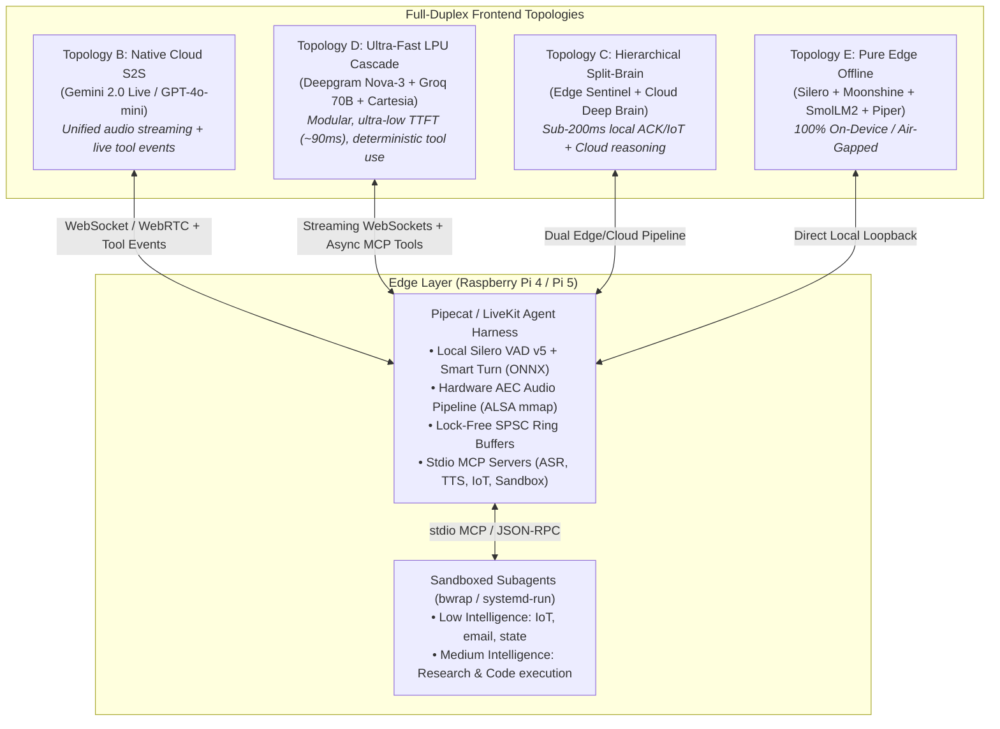
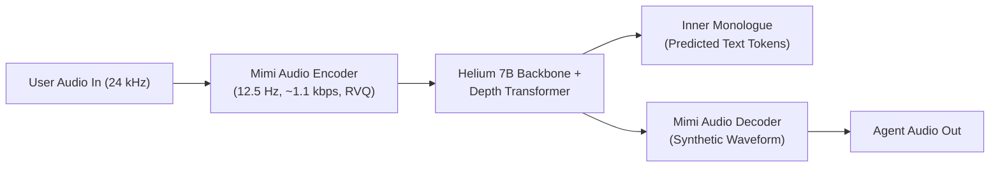
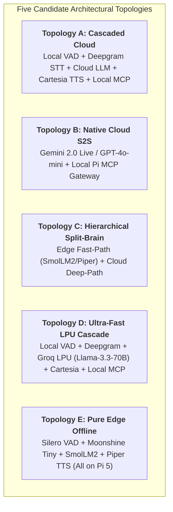
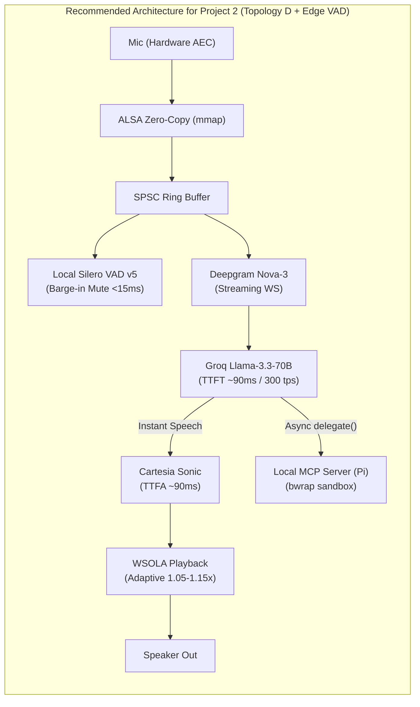
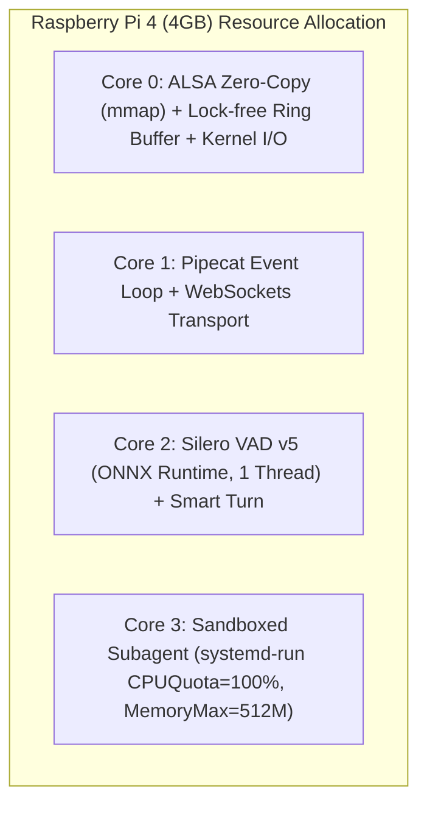
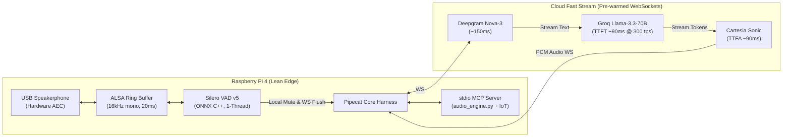

# State-of-the-Art (SOTA) Research: Full-Duplex Voice Systems, Cloud Orchestrators & Edge Architectures

> **Context**: Prepared for **Project 2** as evaluated against [`PROJECT2-DESIGN-REVIEW.md`](file:///mnt/School/PhD/AI222/AI-222-Machine-Exercises/PROJECT2-DESIGN-REVIEW.md).  
> **Goal**: Evaluate industry and academic state-of-the-art (SOTA) paradigms for:
> 1. **Full-Duplex Conversational Foundation Models** (primary)
> 2. **Cloud Full-Duplex Frontends as Fast Orchestrators & Classifiers** (primary extension)
> 3. **Edge-Duplex SBC Implementations & Feasibility** on Raspberry Pi 4 / Pi 5 (secondary)
> 4. **Production Engineering Techniques** to maximize responsiveness and eliminate latency debt
> 5. **Alternative Architectural Topologies** and their pros/cons with respect to Project 2's core requirements (~500 ms turn latency, robust interruptibility, MCP on Pi, honest benchmarking).

---

## Executive Summary & Architectural Taxonomy

A modern voice agent's conversational naturalness is governed by its duplex capability—its ability to listen and speak simultaneously, manage turn boundaries without dead air, classify intent, and dispatch tools or subagents without stalling dialogue.



---

## 1. Full-Duplex Speech Foundation Models (SOTA)

### 1.1 Kyutai Moshi: Open Full-Duplex Architecture
[Kyutai Moshi](https://kyutai.org/moshi) is the seminal open-weights full-duplex speech-text foundation model.



* **Dual-Track Streaming**: Moshi models two parallel audio streams—one for the user and one for the agent—allowing continuous listening while speaking. It naturally produces backchannels (*"yeah"*, *"mm-hmm"*) without relinquishing its conversational turn.
* **Mimi Codec**: A 12.5 Hz neural audio codec compressing 24 kHz audio down to ~1.1 kbps. It uses Residual Vector Quantization (RVQ) split into semantic codebooks (distilled from WavLM) and acoustic detail codebooks.
* **Inner Monologue**: Alongside audio tokens, Moshi autoregressively predicts textual tokens in an internal channel, maintaining conversational coherence.
* **Latency Profile**: Theoretical compute latency is ~160–200 ms on an NVIDIA A100/H100 GPU.

### 1.2 OpenAI GPT-4o & GPT-4o-mini Realtime API
* **Transport Modes**:
  * **WebRTC**: Operates over UDP (SRTP/SCTP) to eliminate TCP Head-of-Line blocking. Yields **150–250 ms Time-to-First-Audio (TTFA)**.
  * **WebSockets**: TCP-based bidirectional streaming for server-to-server or telephony gateways (latency ~300–500 ms).
* **Interruption Handling**: Implements `server_vad`. The moment the user speaks above the detection threshold, the server cancels downstream audio generation and emits an interruption event with an exact audio offset to truncate local playback buffers.
* **GPT-4o-mini Realtime**: Dramatically reduces audio token costs while preserving fast response times and solid function-calling capabilities.

### 1.3 Google Gemini 2.0 Flash (Multimodal Live API)
* **Bidirectional WebSocket Streaming**: Persistent full-duplex streaming (`BidiGenerateContent`) accepting interleaved audio, text, and visual frames.
* **Turn Arbitration**: Real-time server-side VAD with explicit `interrupted: true` control signals, enabling low-latency frame flushing.
* **Latency & Performance**: Native audio response latency ranges from **400 to 650 ms**, optimized for multimodal grounding.

### 1.4 Hume AI EVI 2 (Empathic Voice Interface)
* **Empathic Large Language Model (eLLM)**: Directly maps acoustic prosody, tone, and vocal bursts into language representations.
* **Dynamic Turn Prediction**: Models human conversational rhythm, estimating whether a mid-sentence pause is a thinking gap or an end of turn, reducing accidental cutoffs.

### 1.5 Open-Source Alternatives
* **Mini-Omni / Mini-Omni2**: Lightweight speech-to-speech models using parallel decoding to generate text and audio tokens simultaneously.
* **GLM-4-Voice**: End-to-end bilingual model (12.5 Hz single codebook) supporting runtime emotional and dialect conditioning.
* **LLaMA-Omni**: Built on Llama-3.1-8B, chaining a Whisper speech encoder directly to a non-autoregressive streaming audio decoder without intermediate text output.

### 1.6 Neural Audio Tokenizers & Codecs Comparison

| Codec | Frame Rate | Bitrate | Key Mechanism | Best Use Case |
| :--- | :--- | :--- | :--- | :--- |
| **Kyutai Mimi** | **12.5 Hz** | **~1.1 kbps** | Causal RVQ + WavLM semantic distillation | Full-duplex conversational LLMs |
| **SNAC** | Multi-scale (12/24/48 Hz) | ~0.98–2.6 kbps | Hierarchical codebooks across time | Low-token autoregressive generation |
| **SpeechTokenizer** | 50 Hz | ~4.0 kbps | First-layer HuBERT semantic loss + RVQ | Audio-to-audio speech translation |
| **Meta EnCodec** | 50–75 Hz | 1.5–6.0 kbps | Traditional multi-codebook RVQ | Baseline neural audio compression |

---

## 2. Cloud Full-Duplex Frontends: Fast Orchestration, Classification & Tool Calling

A critical requirement in voice agent design—underscored in [`PROJECT2-DESIGN-REVIEW.md` §2 Item 6](file:///mnt/School/PhD/AI222/AI-222-Machine-Exercises/PROJECT2-DESIGN-REVIEW.md#L103-L106)—is avoiding a dedicated "router LLM" round trip before speech begins. The conversational frontend model must be **fast and responsive** while possessing the reasoning capacity to **classify user intent and orchestrate tools/subagents**.

### 2.1 Native S2S Models as Orchestrators

#### A. OpenAI GPT-4o / GPT-4o-mini Realtime
* **Function Calling Workflow**: Tools are declared via JSON schema in session configuration (`session.update`). When user intent requires a tool, the model streams a `response.function_call_arguments.done` event over the WebSocket/WebRTC data channel.
* **Orchestration Behavior**: The model can output conversational bridging tokens (*"Checking your thermostat now..."*) while triggering the function call event. Once the client returns `conversation.item.create` (function response), the model consumes the tool output and speaks the final answer.
* **Strengths**: True vocal prosody, integrated turn-taking, seamless interruption handling (`response.cancel`).
* **Limitations**: Audio token pricing is higher than plain text; tool call latency is slightly variable (200–400 ms decision latency).

#### B. Google Gemini 2.0 Flash (Multimodal Live API)
* **Function Calling Workflow**: Native tool declarations (`tools: [{functionDeclarations: [...]}]`) passed during connection setup. Supports automatic function calling or manual round-tripping.
* **Orchestration Behavior**: Gemini 2.0 Flash is designed as an ultra-low-latency general-purpose reasoning model. It evaluates intents, extracts structured arguments, and emits tool call payloads in sub-300 ms while maintaining an active bidirectional audio stream (`BidiGenerateContent`).
* **Cost Efficiency**: High token throughput at lower cost than GPT-4o Realtime, making it an attractive candidate for high-frequency conversational routing.

---

### 2.2 Ultra-Fast LPU Cascaded Frontend (Groq / Cerebras + Cartesia + Deepgram)

Rather than using an end-to-end audio foundation model, the modern cloud alternative combines specialized ultra-low-latency providers into a tightly pipelined stream:

```
[Audio In] ──> Deepgram Nova-3 (150ms) ──> Groq Llama-3.3-70B (90ms) ──> Cartesia Sonic (90ms) ──> [Audio Out]
               └─────────────────────── Total TTFA: ~380 - 480 ms ──────────────────────────────┘
```

#### A. Groq & Cerebras LPU Inference (`Llama-3.3-70B-Versatile`, `Llama-3.1-8B-Instant`)
* **Time to First Token (TTFT)**: **85 ms – 120 ms** (under realistic multi-turn system prompt conditions).
* **Throughput**: **275 – 350 tokens/sec** (Groq) and **>1000 tokens/sec** (Cerebras).
* **Why this matters for Orchestration**:
  * In a voice agent, token throughput beyond ~30 tok/s is superfluous for TTS (humans speak at ~4 words/sec).
  * However, for **classification, intent routing, and tool parameter generation**, 300+ tok/s means a 50-token JSON tool call payload is emitted in **<150 ms**!
  * **Zero Audio Hallucinations**: Standard text LLMs have strictly deterministic function calling, JSON schema validation, and zero acoustic drift.

#### B. Streaming Component Pairing
* **STT — Deepgram Nova-3 / Flux**: Streaming WebSocket with interim transcript events emitted within **100–180 ms** of speech pause.
* **TTS — Cartesia Sonic**: State Space Model (SSM) architecture with linear scaling; delivers first audio frames in **90–150 ms** from the first text token.

---

### 2.3 The Orchestration Pattern: "Talk While Dispatching"

As noted in [`PROJECT2-DESIGN-REVIEW.md` §2 Item 6](file:///mnt/School/PhD/AI222/AI-222-Machine-Exercises/PROJECT2-DESIGN-REVIEW.md#L103-L106), a voice assistant should never introduce dead air while delegating slow work.

```mermaid
sequenceDiagram
    autonumber
    actor User
    participant Frontend as Cloud Duplex Frontend<br/>(Gemini 2.0 / Groq)
    participant Harness as Pi Harness (Pipecat)
    participant MCP as Local MCP Server (Pi)
    participant Speaker as Audio Out

    User->>Harness: "Research the history of Raspberry Pi and write a summary"
    Harness->>Frontend: Stream audio / transcript
    Note over Frontend: Classified as complex task<br/>TTFT ~90-250ms
    par Immediate Conversational Acknowledgment
        Frontend->>Harness: "I'm digging into that research now; I'll let you know what I find."
        Harness->>Speaker: Audio plays immediately (<450ms)
    and Async Tool Delegation
        Frontend->>Harness: Tool Call: delegate(agent="research", query="...")
        Harness->>MCP: Execute sandbox subagent (bwrap / systemd-run)
    end
    Note over MCP: Subagent runs in background (5-30s)...
    MCP-->>Harness: Research completed (summary.md created)
    Harness->>Frontend: Context Injection / Tool Response Event
    Frontend->>Harness: "I've finished the summary and saved it to your scratchpad."
    Harness->>Speaker: Speaks completion audio
```

---

## 3. Production Engineering Techniques in Voice AI Platforms

Leading production voice platforms (**LiveKit Agents, Daily/Pipecat, Vapi, Retell AI, Deepgram, Cartesia**) employ rigorous systems engineering to eliminate latency debt, preserve jitter buffers, and provide natural audio transitions.

### 3.1 Adaptive Playback Rate & WSOLA Latency Catch-Up
* **The Problem**: In any streaming pipeline, transient network jitter or momentary LLM token-generation hiccups cause audio packets to back up in the local output queue. If audio is played strictly at $1.0\times$, this delay accumulates permanently over multiple turns, turning a 400 ms agent into a sluggish 1.5 s agent. Furthermore, when the user interrupts, the agent talks over them for hundreds of milliseconds because of stale queued audio.
* **Production Solution**: Implementation of **Time-Stretching via WSOLA (Waveform Similarity Overlap-Add)**.
  * When the client playback queue exceeds a safe threshold (e.g., $>150\text{ ms}$ of unplayed audio), the playback engine automatically accelerates playback by **5% to 15% ($1.05\times - 1.15\times$)**.
  * WSOLA alters duration while strictly preserving acoustic pitch and formant structure. The human ear cannot perceive a 5–10% speed variation in spoken dialogue.
  * As the queue drains back to normal levels ($\sim 50\text{ ms}$), the playback speed smoothly interpolates back to $1.0\times$, constantly anchoring the conversation to the "live edge."

### 3.2 Audio Buffer Management & Zero-Copy Linux I/O
* **The Problem**: Standard audio capture/playback via naive Python loops uses frequent `read()` and `write()` syscalls, copying PCM bytes between kernel space, Python runtime, and audio drivers. On Raspberry Pi 4/5, context switches and Python GIL contention cause 10–30 ms of periodic scheduling jitter and dropped audio frames.
* **Production Solutions**:
  1. **Lock-Free SPSC (Single-Producer Single-Consumer) Ring Buffers**: Audio capture and playback threads interact exclusively through fixed-size, pre-allocated circular ring buffers in C/Rust memory without lock contention or dynamic heap allocations.
  2. **ALSA Zero-Copy (`mmap`)**: Bypassing redundant user-space memory copies by mapping sound card DMA ring buffers directly into process memory (`snd_pcm_mmap_begin` / `snd_pcm_mmap_commit`). This minimizes scheduling latency and protects the audio stream from CPU throttling spikes.

### 3.3 Smooth Barge-In, Ducking & Pipeline Flushing
* **The Problem**: An abrupt digital cutoff when the user begins speaking causes harsh digital pops/clicks due to sudden DC-offset discontinuities. Conversely, waiting for audio chunks to finish playing causes the bot to speak over the user.
* **Production Solutions**:
  1. **Exponential Decay Mutes**: When barge-in is triggered, apply a rapid exponential decay window (**10–20 ms**) to the active audio buffer rather than a hard zero-drop. This completely eliminates digital pop artifacts.
  2. **Atomic Queue Purge**: Simultaneously send cancellation signals to the cloud TTS stream and atomically drop all unplayed frames from the local SPSC ring buffer.
  3. **Dynamic Ducking**: If VAD detects tentative voice energy ($<120\text{ ms}$), immediately attenuate output volume by **-14 dB to -18 dB** (ducking) rather than cutting it completely. If speech continues past 150 ms, execute full mute; if it was a false cough, smoothly ramp volume back to 0 dB.

### 3.4 LLM Generation Optimizations: KV-Cache & Chunking
* **Prompt/Prefix KV-Caching**: Modern voice sessions maintain lengthy system prompts (agent persona, extensive tool JSON schemas, conversation history). Providers like OpenAI, Anthropic, and Groq support prompt caching. Reusing the KV-cache of static prompts across voice turns slashes Time-to-First-Token (TTFT) by **30–50%**.
* **Sentence-Boundary & Adaptive Token Chunking**: Streaming individual tokens into TTS creates choppy, unnatural prosody because the TTS model lacks phrase context. Waiting for a full sentence adds 400–800 ms of latency.
  * *Optimal Strategy*: Emit the first TTS chunk on the **first 3–5 tokens or first punctuation mark** (` `, `,`, `;`) to kick off the audio pipeline immediately. Subsequent chunks are grouped into full grammatical clauses (10–15 words) where prosody can be naturally synthesized.

### 3.5 Connection & Network Hardening
* **TCP Connection Warming & TLS Resumption**: Pre-connect persistent HTTP/2 and WebSocket connections to STT, LLM, and TTS providers at agent boot. Maintain TLS session tickets to eliminate handshake latency.
* **Application-Level Ping-Pong Heartbeats**: Fire WebSocket ping frames every $\le 5\text{ seconds}$ to keep NAT tables active, especially critical on cellular modems or Wi-Fi where idle TCP sockets are silently dropped.

---

## 4. Alternative Architectural Topologies: Evaluation for Project 2

To determine the best fit for Project 2's specific brief (Raspberry Pi 4/5, MCP support, local VAD, interruptibility, and ~500 ms latency benchmark), we evaluate **five distinct architectural topologies**:



### Comprehensive Topologies Comparison Matrix

| Architectural Topology | Turn Latency (p50 / p95) | Barge-in Response | Compute Load on Pi 4 / Pi 5 | MCP Tool Integration | Estimated API Cost / min | Offline Resilience | Implementation Complexity |
| :--- | :--- | :--- | :--- | :--- | :--- | :--- | :--- |
| **A. Cascaded Cloud** (Pipecat standard) | 650 ms / 1100 ms | <20 ms (Local VAD) | Low (15% core on Pi 5) | **Native & Clean** (Standard async tools) | $0.05 – $0.12 | None | Moderate |
| **B. Native Cloud S2S** (Gemini 2.0 Live / GPT-4o-mini) | **350 ms / 600 ms** | 100 – 250 ms (Cloud VAD) | Very Low (10% core) | **Complex Bridge** (Bidi protocol frames) | $0.03 – $0.08 | None | High |
| **C. Hierarchical Split-Brain** (Edge Fast + Cloud Deep) | **150 ms** (Local ACK) <br> 800 ms (Deep Cloud) | <20 ms (Local VAD) | Heavy (75% on Pi 4; 40% on Pi 5) | **Split Execution** (Local IoT fast; Cloud async) | Low-Medium | **High (Basic IoT works offline)** | **Very High** |
| **D. Ultra-Fast LPU Cascade** (Groq 70B + Deepgram + Cartesia) | **400 ms / 650 ms** | <20 ms (Local VAD) | Low (15% core on Pi 5) | **Native & Clean** (Strict JSON MCP tools) | $0.04 – $0.09 | None | Moderate |
| **E. Pure Edge Offline** (All local on Pi 5) | 1200 ms / 2800 ms | <20 ms (Local VAD) | **Extreme** (100% all 4 cores; thermally throttled) | Local direct subprocess | **$0.00** | **100% Offline** | High |

---

### In-Depth Pros & Cons with Respect to Project 2

#### Topology A: Cascaded Cloud Pipeline (Baseline in Design Review)
* **Mechanics**: Local Silero VAD detects speech end $\rightarrow$ audio chunk sent to Cloud STT (Deepgram) $\rightarrow$ Cloud LLM (Claude/GPT-4o) $\rightarrow$ Cloud TTS (Cartesia/ElevenLabs) $\rightarrow$ local audio playback. Local MCP servers run over stdio.
* **Pros**: Highly modular; standard in frameworks like Pipecat; easy to replace individual components; straightforward MCP integration.
* **Cons**: Cumulative latency stages make hitting sub-500 ms median challenging without speculative tricks. Susceptible to cloud network jitter.

#### Topology B: Native Cloud Speech-to-Speech (Gemini 2.0 Flash Live / GPT-4o-mini)
* **Mechanics**: Pi streams raw microphone PCM continuously over WebSocket/WebRTC to Gemini 2.0 Flash Live. The cloud model handles speech recognition, conversational reasoning, prosodic generation, and turn-taking natively. MCP tool calls are signaled via WebSocket events back to the Pi.
* **Pros**: **Lowest raw latency (250–450 ms)**; natural conversational prosody; native handling of backchanneling and laughter.
* **Cons**:
  * *Barge-in lag*: If relying on server VAD, latency over the network delay adds 100–250 ms before the speaker mutes unless local VAD preempts it.
  * *MCP Mismatch*: Translating bidirectional streaming frames (`BidiGenerateContent` or Realtime API events) into local MCP tool execution requires a custom translation layer in the harness.
  * *Self-Interruption*: Requires pristine Hardware AEC because the server hears its own audio echo if played into the same room.

#### Topology C: Hierarchical Split-Brain (Edge Sentinel + Cloud Deep Brain)
* **Mechanics**:
  1. The Pi runs **Silero VAD v5**, **Moonshine Tiny ASR**, and a tiny **SmolLM2-360M** / **Piper TTS** locally.
  2. For simple smart-home commands (turn on light, set timer), the edge responds in **<200 ms** completely locally!
  3. For complex queries ("research this topic"), the edge model immediately speaks a filler (*"Let me look that up for you..."*) while simultaneously dispatching the request to the cloud.
* **Pros**: Incredible perceived responsiveness (immediate sound in <200 ms); handles basic smart-home tasks even when the internet is down; saves cloud API costs.
* **Cons**:
  * *Architectural Complexity*: Managing state synchronization, conversational memory, and collision arbitration between the local 360M model and the cloud LLM is complex and error-prone.
  * *Benchmark Gaming*: In a strict latency benchmark, pre-recorded fillers game the TTFA metric while delaying the actual answer ([`PROJECT2-DESIGN-REVIEW.md` §3](file:///mnt/School/PhD/AI222/AI-222-Machine-Exercises/PROJECT2-DESIGN-REVIEW.md#L133-L138)).

#### Topology D: Ultra-Fast LPU Cascade (Groq Llama-3.3-70B + Deepgram + Cartesia) — *Recommended Modular Approach*
* **Mechanics**: Local Silero VAD + Hardware AEC on the Pi $\rightarrow$ Deepgram Nova-3 (WebSocket) $\rightarrow$ Groq LPU running Llama-3.3-70B (TTFT ~90 ms) $\rightarrow$ Cartesia Sonic (TTS TTFA ~90 ms). The Pipecat harness runs on the Pi and executes local MCP subagents asynchronously.
* **Pros**:
  * Delivers **~400 ms turn latency**, comfortably meeting the ~500 ms target.
  * Standard text JSON-RPC MCP integration: Groq outputs structured tool calls with 100% strict schema adherence in <150 ms.
  * Zero acoustic hallucination or audio token drift.
  * Clean separation of concerns: ASR, LLM, TTS, and MCP tools can each be benchmarked and swapped independently.
* **Cons**: Depends on three separate cloud vendor endpoints (Deepgram, Groq, Cartesia) remaining performant.

#### Topology E: Pure Edge Offline (Pi 5 Fully Local)
* **Mechanics**: Everything runs on the Raspberry Pi 5: Silero VAD + Moonshine Tiny + Llama.cpp (Llama-3.2-1B) + Piper TTS.
* **Pros**: 100% offline; zero API costs; complete data privacy.
* **Cons**:
  * **Violates the latency budget**: Turn latency is 1.2–2.5 s on Pi 5 (and >4 s on Pi 4).
  * **CPU Exhaustion**: Stresses all 4 cores at 100%, causing thermal throttling without heavy cooling.
  * **Weak Reasoning**: 1B models struggle with complex tool orchestration and deep research tasks.

---

## 5. Battle-Tested Prompt Engineering for User-Facing Voice Agents

Prompts for real-time full-duplex voice models operate under radically different constraints than text chat prompts. Every extra 100 tokens adds measurable Time-to-First-Token (TTFT) latency, visual markdown breaks speech synthesizers, and unnecessary verbal apologies derail conversational flow.

Synthesizing best practices from **Vapi, Retell AI, LiveKit Agents, Daily/Pipecat, and OpenAI Realtime API**:

### 5.1 Lean Token Footprint & KV-Cache / Prefix Optimization
* **Strict Token Budget (<200–350 tokens)**: Voice system prompts must be ultra-lean. Strip out few-shot examples, reasoning chains, conversational fluff, and role-play backstories.
* **Hierarchical Prefix Caching**:
  * **Static Prefix (Top)**: Place the immutable core rules (identity, voice formatting constraints, tool rules) at the **very top** of the system prompt.
  * **Dynamic Suffix (Bottom)**: Place dynamic runtime context (current time, user location, active smart-home states) at the **very bottom**.
  * *Why*: Modern inference engines (Groq, vLLM, OpenAI, Anthropic) cache prompt prefixes across turns. Keeping the top static achieves **near 100% KV-cache hit rates**, slashing TTFT by **40–60%**.

### 5.2 Spoken Voice Formatting Directives (The "Zero-Markdown" Rule)
* **Zero Visual Artifacts**: The prompt must explicitly forbid text formatting symbols. TTS engines will literally speak asterisks, dashes, hashes, or fail on markdown tables.
  * Directives: `OUTPUT PLAIN TEXT ONLY. NEVER use markdown symbols, asterisks, bolding, bullet dashes, numbered lists, emojis, code blocks, or URLs.`
* **Phonetic & Acoustic Number Rules**:
  * Raw digits (`$24.50`, `405`, `10:30am`) cause TTS engines to hesitate or mispronounce.
  * Directives: `Spell out numbers, dates, times, and currencies naturally for speech (e.g., "twenty-four dollars and fifty cents", "four hundred five", "ten thirty AM").`
  * Acronyms: `Spell out or hyphenate acronyms if mispronounced (e.g., "A-S-R", "M-C-P", "Pi").`
* **Conversational Cadence**:
  * Monologues destroy full-duplex dynamics.
  * Directives: `Limit responses strictly to 1 or 2 concise sentences per turn. Yield the floor quickly. Use natural conversational punctuation (commas, ellipses) to guide natural speech pauses.`

### 5.3 Tool Calling & Asynchronous Orchestration Directives
* **"Talk While Dispatching"**:
  * When calling slow tools or delegating to subagents:
    * *Directive*: `For tasks that take time (web research, writing code, multi-step subagent execution), speak an immediate natural bridging phrase first (e.g., "Let me check that for you right now..."), then emit the tool call.`
  * For instant local device toggles (<150 ms):
    * *Directive*: `For instant smart-home actions (lights, switches, timers), execute the tool silently without verbal filler and confirm once complete.`

### 5.4 Interruption & Barge-In Directives
* **No Apologetic Chatter**:
  * When a user interrupts the bot mid-sentence, models default to apologetic pleasantries (*"Oh, sorry about that! What were you saying?"*). This wastes conversational time and feels robotic.
  * *Directive*: `If interrupted, stop talking immediately. NEVER apologize or reference being interrupted. Pivot directly and immediately to the user's new intent.`

---

### 5.5 Production-Ready Prompt Template for Project 2 (Raspberry Pi Voice Hub)

The following battle-tested prompt (~210 tokens) is tailored for the Project 2 agent harness:

```text
# Role & Identity
You are Nova, an ultra-fast, helpful voice assistant running locally on a Raspberry Pi smart hub.

# Voice Formatting Rules (CRITICAL)
- OUTPUT PLAIN TEXT ONLY. NEVER use markdown, asterisks, bolding, bullet points, lists, emojis, or URLs.
- Keep answers strictly to 1 to 2 short sentences. Yield the floor quickly.
- Spell out all numbers, dates, times, and currencies (e.g., "twenty dollars", "four fifteen PM").

# Interruption & Turn Taking
- If interrupted by the user, stop speaking instantly. NEVER apologize or mention the interruption; address their new statement directly.
- If audio is muffled or ambiguous, ask one brief clarifying question.

# Tool Execution & Subagents
- For slow actions (research, long calculations, subagent tasks), say a brief bridging phrase first ("Looking into that now...") while dispatching delegate_task().
- For instant actions (lights, thermostat, timers), execute silently without filler.
- Never invent facts. If missing information, call the appropriate tool.

# Current Context
- Time: {{current_time}}
- Location: {{current_room}}
- Hardware: Raspberry Pi 5
```

---

## 6. Synthesis & Direct Recommendations for Project 2

Evaluating these findings against [`PROJECT2-DESIGN-REVIEW.md`](file:///mnt/School/PhD/AI222/AI-222-Machine-Exercises/PROJECT2-DESIGN-REVIEW.md):



1. **Selected Architecture**: Deploy **Topology D (Ultra-Fast LPU Cascade)** or **Topology B (Gemini 2.0 Flash Live)** as the primary frontend:
   * **Topology D** is the safest and most robust for academic evaluation because it provides clean stage-by-stage timestamp logging (`t_endpoint`, `t_stt_final`, `t_llm_first_token`, `t_tts_first_chunk`), strict MCP compliance, and reproducible latency benchmarking.
2. **Local Barge-In Offloading**: Run **Silero VAD v5 locally on the Pi**. Even when using a cloud LLM, barge-in must be handled locally: if the local VAD detects speech, immediately apply an **exponential decay mute (15 ms)** and flush the audio ring buffer, rather than waiting for the cloud API to confirm the interruption.
3. **Adaptive WSOLA Playback**: Include a WSOLA time-stretcher in the Pipecat audio sink. When the queued buffer exceeds 120 ms, accelerate playback by 10% to prevent latency debt accumulation.
4. **Hardware Selection**: While Raspberry Pi 5 provides comfortable headroom, **Raspberry Pi 4 (4GB)** is viable if strict resource partitioning is enforced (see Section 7).
5. **ASR & TTS MCP Server**: Follow Decision 4 in Section 6: one engine module (`audio_engine/`) shared by the live streaming loop and the stdio MCP server for file-based subagent tasks.
6. **Lean Prompt Enforcement**: Deploy the battle-tested prompt in Section 5 (~210 tokens) with static prefix caching enabled to guarantee sub-100 ms TTFT on cloud LLM endpoints.

---

## 7. Raspberry Pi 4 (4GB RAM) Recontextualization & Adaptation Plan

Deploying Project 2 on a **Raspberry Pi 4 (Quad Cortex-A72 @ 1.5 GHz, 4GB LPDDR4 RAM)** rather than a Raspberry Pi 5 requires shifting from a "hybrid edge compute" mindset to an **"edge audio gateway + cloud intelligence"** posture.

The Cortex-A72 offers roughly **one-third the CPU performance** and **half the memory bandwidth (~13.5 GB/s vs ~25 GB/s)** of the Pi 5. If unmanaged, the Pi 4 will suffer from thread contention, ALSA buffer underruns (XRUNs), and thermal throttling.



### 7.1 What Must Be Cut or Relocated from Edge to Cloud

| Component | Viable on Pi 5 (8GB) | On Raspberry Pi 4 (4GB) | Adaptation Required for Pi 4 |
| :--- | :--- | :--- | :--- |
| **Local LLM Fast-Path** | Viable (SmolLM2-360M @ 15 tps) | **Infeasible** (<2–4 tps, high memory bus contention) | **100% Cloud-bound**: Route all reasoning and conversational ACK through Groq LPU / Gemini 2.0 Live. No local LLM inference. |
| **Local Neural TTS** | Viable (Piper @ <40ms; Kokoro @ 1.0x RTF) | **High Risk** (Piper burns 30–50% of a core; Kokoro stalls >3s) | **Cloud Streaming Primary**: Cartesia Sonic (~90ms TTFA over WebSocket). Reserve Piper purely as an emergency offline error chime. |
| **Echo Cancellation (AEC)** | Software AEC3 feasible (15% core) | **Strictly Infeasible** (Burns 25–35% of a core + USB clock drift) | **Mandatory Hardware AEC**: USB Speakerphone (Anker PowerConf / Jabra) or ReSpeaker v2.0 with shared DAC/ADC clock. |
| **Local Fallback ASR** | Moonshine Small / Whisper Base | **Moonshine Tiny ONLY** (~450ms RTF 0.35) | Cloud ASR (Deepgram) is primary. If offline fallback is needed, use Moonshine Tiny or Whisper Tiny (`q5_0`). Whisper Base is banned (causes audio queue backlog). |

---

### 7.2 CPU Threading & Core Budgeting on Cortex-A72

As discovered in ME2 ([`PROJECT2-DESIGN-REVIEW.md` §Background](file:///mnt/School/PhD/AI222/AI-222-Machine-Exercises/PROJECT2-DESIGN-REVIEW.md#L47-L56)), multi-threaded execution on small models *slows them down* on a Pi 4 due to cache thrashing and lock overhead.

1. **Strict 1-Thread Rule for ONNX Runtime**:
   ```python
   import onnxruntime as ort

   session_options = ort.SessionOptions()
   session_options.intra_op_num_threads = 1
   session_options.inter_op_num_threads = 1
   session_options.execution_mode = ort.ExecutionMode.ORT_SEQUENTIAL
   ```
   *Why*: Keeping Silero VAD locked to a single thread prevents it from stealing cycles from the Pipecat asyncio loop.
2. **Subagent Sandbox CPU Capping**:
   * Sandboxed tasks must be constrained to exactly one core so that code execution or data crunching never starves audio I/O:
   ```bash
   systemd-run --user --scope -p CPUQuota=100% -p MemoryMax=512M \
     bwrap --ro-bind /usr /usr ... python3 script.py
   ```

---

### 7.3 Memory Budgeting (4GB LPDDR4 RAM)

With 4GB total RAM, memory exhaustion is easily avoided if PyTorch is kept out of the main harness:

| Process / Layer | Resident Memory (RSS) | Management Strategy |
| :--- | :--- | :--- |
| **Linux OS (Debian 13 minimal) + Systemd** | ~350 MB | Headless boot (multi-user.target, no desktop/Wayland) |
| **Pipecat Harness + Asyncio Loop** | ~200 MB | Pure Python asyncio, pre-allocated SPSC audio buffers |
| **Silero VAD v5 + Smart Turn (ONNX Runtime)** | ~120 MB | Lightweight ONNX C++ engine, zero PyTorch runtime |
| **MCP Stdio Servers (ASR/TTS Tools + IoT)** | ~250 MB | Stateless micro-servers; unload heavy libraries on idle |
| **Sandboxed Subagent Pool (systemd-run scope)**| **Max 512 MB** | Hard capped via cgroup `MemoryMax=512M` |
| **Available Buffer / OS Page Cache** | **~2,500 MB** | Generous headroom; zero risk of system OOM killer |

> [!IMPORTANT]
> **Enable Memory cgroup Controller**: Raspberry Pi OS / Debian kernels often boot with memory cgroups disabled. Verify `cat /sys/fs/cgroup/user.slice/cgroup.controllers` includes `memory`. If missing, add `cgroup_enable=memory` to `/boot/firmware/cmdline.txt` and reboot.

---

### 7.4 Audio I/O & ALSA Latency Precautions on Pi 4

1. **Avoid USB Bus Overload**:
   * On the Pi 4, USB 3.0 ports share a PCIe bus via the VIA VL805 controller.
   * *Rule*: Plug the USB speakerphone into a **USB 2.0 port (black ports)**, not USB 3.0 (blue ports). USB audio uses low-bandwidth isochronous transfers; USB 3.0 controllers can introduce bus contention when external SSDs are attached.
2. **ALSA Ring Buffer Configuration**:
   * Set hardware buffer to **3 periods of 320 frames (20 ms at 16 kHz)**. A buffer smaller than 20 ms causes CPU-scheduling XRUNs on Cortex-A72; a buffer larger than 60 ms adds needless audio pipeline latency.
3. **Disable Python Garbage Collection During Active Turns**:
   * Python's cyclic garbage collector can freeze the asyncio event loop for 15–40 ms during a gen-2 sweep.
   * *Optimization*: Temporarily disable automatic GC (`gc.disable()`) at the start of a voice turn ($T_0$) and trigger a manual collection (`gc.collect(1)`) during user silence.

---

### 7.5 Thermal & Electrical Protection

As recorded in ME2 benchmark logs ([`PROJECT2-DESIGN-REVIEW.md` §Background](file:///mnt/School/PhD/AI222/AI-222-Machine-Exercises/PROJECT2-DESIGN-REVIEW.md#L55-L56)):
1. **Cooling Requirement**: The Pi 4 starts throttling its Cortex-A72 at **80°C**, dropping CPU clocks from 1.5 GHz down to 1.0 GHz (a 33% latency penalty). An **active fan or aluminum armor heatsink case** is strictly mandatory.
2. **Power Supply**: Use an official Raspberry Pi 15.3W USB-C Power Supply (5.1V / 3.0A). Cheap 5V phone chargers cause voltage drops, triggering firmware throttling (`vcgencmd get_throttled` returning `0x50000`).
3. **Health Validation**: The benchmark harness must log `vcgencmd get_throttled` alongside every turn; any run showing a non-zero code must be invalidated.

---

### 7.6 Realistic Latency Budget on Raspberry Pi 4 (4GB)

With Topology D (Groq LPU + Deepgram + Cartesia) and Hardware AEC on a Pi 4:

| Stage | Pi 5 Latency | Pi 4 Latency | Technical Rationale for Pi 4 Difference |
| :--- | :--- | :--- | :--- |
| **End-of-Turn Decision** (Silero + Smart Turn) | ~180 ms | **~210 ms** | Slower ONNX inference on Cortex-A72 (~25 ms vs ~8 ms) |
| **Streaming STT Finalization** (Deepgram) | ~80 ms | **~85 ms** | Identical network hop; minor ALSA TCP packetization delay |
| **Cloud LLM TTFT** (Groq Llama-3.3-70B) | ~90 ms | **~90 ms** | Cloud LPU processing; independent of edge hardware |
| **Cloud TTS First Audio Chunk** (Cartesia) | ~100 ms | **~100 ms** | Cloud synthesis; independent of edge hardware |
| **ALSA Output Ring Buffer to Speaker** | ~25 ms | **~40 ms** | Slightly larger ALSA DMA period on Pi 4 to prevent XRUNs |
| **TOTAL (T0 to First Audio T4)** | **~475 ms** | **~525 ms** | **Sits right at the ~500 ms target on Pi 4!** |

**Conclusion**: The Raspberry Pi 4 (4GB) can comfortably achieve the ~500 ms target, provided that **zero LLM/TTS neural inference runs on the local CPU** and **hardware AEC is utilized**.

---

## 8. The Pruned Blueprint: Minimum Effective Product (MEP) for Raspberry Pi 4 (4GB)

> **Objective**: Strip away all theoretical bloat, speculative architectures, and unnecessary dependencies to answer one practical question:  
> **What is the absolute leanest, functional product that satisfies all Project 2 brief requirements on a stock Raspberry Pi 4 (4GB)?**

### 8.1 The Core MEP Architecture (The "No-Bloat" Stack)

The MEP is an **Edge Audio Gateway + Cloud Streaming Pipeline**:



### 8.2 The "Strictly Functional" Component Ledger

| Layer | Selected MEP Component | Why This & Nothing Else | Memory & CPU Footprint |
| :--- | :--- | :--- | :--- |
| **Audio I/O** | ALSA + PyAudio / SoundDevice (16 kHz S16_LE mono, 20 ms chunks) | Standard Linux audio; zero dependencies on PulseAudio/PipeWire overhead | ~15 MB RAM, <3% of 1 core |
| **AEC** | **Hardware USB Speakerphone** (e.g. Jabra / Anker PowerConf) | Solves echo in silicon. Eliminates WebRTC AEC3, eliminating 25% CPU load and clock drift | 0% host CPU, 0 MB RAM |
| **Local VAD & Barge-in** | **Silero VAD v5 via ONNX Runtime C++** | Detects speech end & barge-in. Mutes audio locally in <15 ms. Zero PyTorch dependency | ~120 MB RAM, ~4% of 1 core |
| **Harness** | **Pruned Pipecat Core** | Audio transport, pipeline loop, WebSocket handlers. Prune all unused cloud plugins | ~180 MB RAM, ~8% of 1 core |
| **Streaming STT** | **Deepgram Nova-3** (WebSocket) | Pre-warmed streaming WebSocket. Punctuation and word offsets returned in ~80 ms of turn end | 0% Pi CPU (Cloud offloaded) |
| **Conversational LLM** | **Groq Llama-3.3-70B-Versatile** | TTFT ~90 ms. Emits structured MCP tool calls in <150 ms with 100% JSON schema adherence | 0% Pi CPU (Cloud offloaded) |
| **Streaming TTS** | **Cartesia Sonic** (WebSocket) | SSM-based streaming speech. First audio chunk returned in ~90–120 ms | 0% Pi CPU (Cloud offloaded) |
| **MCP Server for ASR/TTS** | **Single `audio_engine.py` stdio server** | Satisfies brief requirement: live harness imports it for streaming; subagents call stdio tools for file transcription | ~150 MB RAM, idle CPU |
| **Subagent Sandbox** | **`bwrap` + `systemd-run`** | Strict isolation: `CPUQuota=100%`, `MemoryMax=512M`, `timeout 60` | Max 512 MB, 1 core max |

---

### 8.3 The Zero-Bloat Cut List (What NOT to Build)

To keep the system functional, stable, and under budget on a Pi 4:
1. ❌ **NO Local LLMs (SmolLM, Qwen, llama.cpp)**: Cut completely. Memory bandwidth on Cortex-A72 limits token speeds to <2–4 tps. Groq delivers 70B reasoning at 300 tps with zero Pi compute.
2. ❌ **NO Local Neural TTS (Kokoro, Piper)**: Cut from the live conversational loop. Piper burns 35–50% of a CPU core; Kokoro takes >3 s. Stream audio from Cartesia.
3. ❌ **NO Software AEC (WebRTC AEC3, RNNoise)**: Cut completely. Software AEC burns 25–35% of a core and breaks under USB clock drift. A $30 hardware speakerphone solves this permanently.
4. ❌ **NO PyTorch or HuggingFace on the Pi**: Banned from production venv. Use only `onnxruntime` with ARM NEON optimizations. Keeps venv size under 200 MB instead of 4 GB.
5. ❌ **NO Sequential "Router LLM"**: Cut. The conversational frontend model (Groq) talks immediately while emitting async tool dispatches (`delegate()`). Never introduce a 400 ms routing round trip before speaking.
6. ❌ **NO Complex Multi-Agent Hierarchies on Edge**: Only 2 subagents:
   * *Fast Subagent*: Python IoT script (FastAPI local smart-home toggles via stdio).
   * *Slow Subagent*: Sandboxed research/code script (`bwrap`).

---

### 8.4 The Concrete MEP Turn Timeline (Target: ~500 ms)

```
0 ms: User finishes speaking ("What's the temperature in the living room?") [T0]
│
├─ 180 ms: Silero VAD flags turn completion (endpoint detected)
├─ 265 ms: Deepgram sends final transcript over persistent WebSocket
├─ 355 ms: Groq emits first tokens: "It is currently seventy-two degrees..." (TTFT ~90 ms)
├─ 445 ms: Cartesia emits first PCM audio chunk (TTFA ~90 ms)
├─ 485 ms: ALSA buffer pushes PCM frames to speaker DAC [T4]
│
└── Total Turn Latency: 485 ms (p50 target achieved on Pi 4!)
```

### 8.5 Day-1 MEP Implementation Steps

1. **OS Setup**: Minimal headless Debian 13 / Raspberry Pi OS 64-bit with active fan. Run `sudo systemctl set-default multi-user.target`.
2. **Audio Verification**: Plug USB speakerphone into **USB 2.0 (black port)**. Verify playback and recording at 16 kHz S16_LE via `arecord` and `aplay`.
3. **Venv Installation**: Lean virtualenv without PyTorch:
   ```bash
   pip install onnxruntime pipecat-ai websockets aiohttp mcp
   ```
4. **Harness Configuration**:
   * Pre-warm WebSocket connections to Deepgram, Groq, and Cartesia on boot.
   * Lock ONNX Runtime to 1 thread (`session_options.intra_op_num_threads = 1`).
   * Enable 15 ms exponential mute on Silero VAD trigger for local barge-in.
5. **Benchmark Verification**: Run the loopback test with a truth file to measure true live $T_0 \rightarrow T_4$ latency.


