# How agy writes code here (level-3 tickets, the fence, the review)

**Bottom line.** agy (Antigravity CLI, `gemini-3.8-flash-high`) copies code that the assistant has already written and tested; it does not design. Five agy waves (the `smart_home` tool, the agent with a docs server, the echo canceller and duck) came back **byte-identical to the tickets with no deviations**, once the tickets contained the full code. The earlier tickets 01-14, at level 2 (contracts and tests but no code), passed every gate and the tech-lead review still found 1 blocker, 13 should-fix and 18 note findings (`.scratch/project2-voice-agent/handoff/REVIEW-main-92f3edb.md`). The method is the `coding-with-simple-models` skill at level 3, from the branch `feat/role-composable-pipeline` of `~/Documents/skills/mine` (not yet on its `main`), which runs `feature-engineering`'s roles (tech-lead, ticket-writer, developer) with every decision closed before handoff.

```mermaid
flowchart LR
    A["plan + decisions (owner confirms)"] --> B["reference code + tests, written and run in a scratch copy of the repo"]
    B --> C["ticket generator: code, edit lists, line caps, GUARDRAILS"]
    C --> D["dry run: extract code from the ticket text, run every Proof command"]
    D --> E["work copy + snapshot + fence"]
    E --> F["owner launches fence.sh"]
    F --> G["review: paths, cmp vs reference, Proof re-run"]
    G --> H["copy into repo (backup), gates, document, commit"]
```

## Steps, with the files from the echo work (`.scratch/echo-fix/`) as the example

1. **Plan** (`PLAN.md`, `DESIGN.md`): what changes, decisions needed, risks; the owner confirms before any ticket exists.
2. **Reference code in a scratch overlay.** New files in `skeleton/`; changes to existing files as exact old/new text pairs in `edits_a.py`, `edits_b.py` (`apply_edits.py` fails if an old block is not unique). `build_overlay.sh` rebuilds the overlay and runs ruff, mypy and the tests. This is where the design problems showed up (a reference lead of 200 ms that was wrong, a test that fed the canceller 15 s of reference at once, a missing import, a changed error message an existing test asserts).
3. **Generate the tickets** (`gen_tickets.py`): per ticket a diagram, the RECAP (edge cases with behaviours, contracts as code, assumptions with how they were verified, proof commands with expected results), a file table with **exact line caps** computed from the post-edit files, the function inventory, non-goals, and the shared `GUARDRAILS.md` (a list of forbidden additions: type checks on own outputs, extra try/except, new helpers, comments, network calls, and so on).
4. **Dry-run the tickets.** A script extracts the code and the edit lists from the ticket *text* into a clean copy, applies them, and runs every Proof command as written. This is what caught a prompt-count error (47 not 48) and a test count (7 not 8) before agy could trip on them.
5. **Build the fence.** A work copy of the repo with its own offline environments (`uv sync --offline`), a pristine snapshot `orig/` beside it, a backup of agy's `settings.json`, `fence.sh` and one brief per wave. The brief opens with "Done by you alone: do not launch subagents", gives the reading order (GUARDRAILS, the developer role file, the plan, the tickets), repeats the three rules that matter (copy byte-for-byte; when blocked report and stop; nothing beyond the inventory, tests and caps, never compress lines to fit), and asks for a terse reply plus a log entry in each ticket.
6. **The fence** (`fence.sh`): `bwrap` with the whole filesystem read-only except the work copy, agy's `~/.gemini` and `~/.cache`; `~/.secrets` and `~/.ssh` replaced by empty tmpfs; an empty environment (`env -i`); `--sandbox --mode accept-edits --dangerously-skip-permissions --model gemini-3.8-flash-high --print-timeout 60m`; a loop that retries only agy's start-up check. Tested before use with a canary (write inside works, write outside is refused) and with a plain shell under the same arguments. The assistant does not launch it (the permission classifier refuses the flag, and the owner never approved it for the assistant): **the owner runs it**, in bash mode (`!` first) or in a terminal.
7. **Review**, as the tech-lead role does at level 3: `diff -rq orig work` (every changed path is on the ticket's file table), `cmp` of every file against the reference (identical means the inventory, the caps and the forbidden list hold by construction), the Proof commands re-run by the reviewer, the ticket's Status/Proof/Deviations/Execution Log entries read, a review entry appended. If agy stopped mid-ticket (a network drop), the reviewer runs the Proof, logs it, and sets the status.
8. **Integrate**: back up the files about to be overwritten, copy the accepted files (an array in a bash script; not a zsh string variable), `cmp`, run the full gates, key scan, document, commit by file name.

## What to expect and what has gone wrong

- agy's replies were accurate about its own work in all three runs; it logged "Deviations: none" and the files matched. It did not log the producer check in the first wave 2 (no effect).
- Failures were all around it: the network (agy's start-up check, a mid-run drop; relaunching the same command is safe), the launch (a command typed without bash mode reaches the assistant as chat text; the assistant's `/tmp` is not the owner's `/tmp`), and the assistant's own tickets (a leak-detector regex too narrow, a reference file not formatted, a Pipecat idle timeout the reference code left on).
- Everything agy ran needs the work copy's environment to resolve **offline**: a dependency change goes in first, by the assistant, with the owner's yes (`pyproject.toml` / `uv.lock`), then the work copy is built.
- The method costs the assistant most of the effort (the reference code, its tests and the dry runs); agy's run is 20-30 minutes. It pays when the tickets are small and the contracts exact; it is not worth it for a one-line change.

## Where things are

`.scratch/smart-home-tool/`, `.scratch/live-agent/`, `.scratch/echo-fix/`: each has `PLAN.md`, `tickets/` (with agy's execution logs and the review entries), `agy_work/` (`fence.sh`, the briefs, agy's final replies; the `work/` and `orig/` copies are scratch), and for the last two the generators. `.scratch/project2-voice-agent/AGY-GUARDRAILS.md` and `RUNNER.md` are the older, looser rules for the earlier waves.
