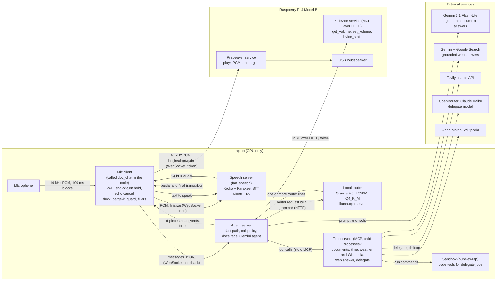
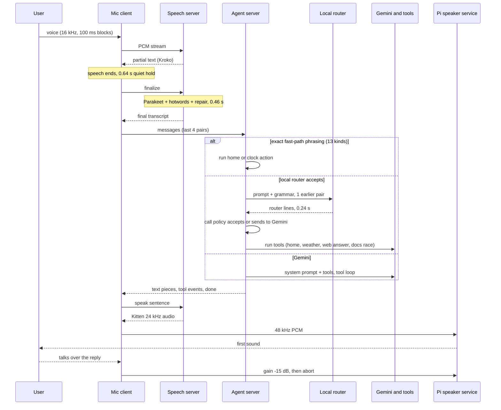

# A home voice assistant on a laptop and a Raspberry Pi: architecture, measurements and rebuild guide

State described: 5 November 2026. This document is self-contained. It needs no access to the source code, the tickets or the project history.

## Abstract

This is a spoken assistant for a home and for a few "big tasks". The user talks to a laptop microphone. The answer comes out of a USB loudspeaker attached to a Raspberry Pi 4, which is joined to the laptop by one Ethernet cable. All speech recognition, speech synthesis and turn routing run on the laptop CPU, with no GPU. A fine-tuned 350-million-parameter local model (the "local router") answers simple turns by itself. Turns it declines go to a cloud model (Gemini 3.1 Flash-Lite). Web questions use Google Search grounding, then Tavily, then Wikipedia. Big tasks go to a sandboxed "delegate" job that runs Claude Haiku through OpenRouter. On 60 live turns on 2026-11-05 the delay from end of speech to first sound was 1.58 s at the median and 3.68 s at the 90th percentile. Stopping the voice after the user interrupts takes about 1 ms. The local router scores 60 of 62 on a held-out test. Speech recognition word error is 4.4% on a hard set of entity-heavy sentences and 8.9% on recorded real turns. The system has real limits (section 12). The main one is that responses much below 1.5 s would need a speech-to-speech design.

## Contents

1. Bottom line and headline numbers
2. Glossary
3. Deployment topology
4. One turn, step by step
5. Components in depth
6. Security design
7. Measured performance
8. Design decisions and rejected alternatives
9. Replication requirements
10. Configuration reference
11. Lifecycle: start, stop, health
12. Known limitations

---

## 1. Bottom line and headline numbers

**What it is.** A cascade voice agent: microphone, speech-to-text, a decision about who answers, text-to-speech, loudspeaker. The decision step is the interesting part. Roughly 60% of turns are answered by a small local model or by fixed rules, which is faster and cheaper than calling a cloud model every time. The cloud model is the safety net for everything else.

**What runs where.**

| Place | What runs |
|---|---|
| Laptop (CPU only) | Mic client, speech server (STT and TTS), agent server, local router, tool servers, delegate sandbox |
| Raspberry Pi 4 Model B | Pi speaker service (plays audio) and Pi device service (volume and status tools). No model runs on the Pi. |
| Cloud | Gemini (agent, grounded search, document answers), Tavily, Claude Haiku via OpenRouter, Open-Meteo, Wikipedia |

**Headline numbers** (details and methods in section 7):

| Measure | Result |
|---|---|
| End of speech to first sound, 60 live turns, 2026-11-05 | median 1.58 s, 90th percentile 3.68 s |
| Same, split by route in a scripted spoken test of 59 lines | fast path 1.01 s, local router 1.53 s, Gemini 3.57 s |
| Scripted spoken test, 59 lines through the real loudspeaker and microphone | 47 pass, 10 fail, 2 not run |
| Local router on a held-out set of 62 items | 60 correct (its predecessor scored 45) |
| Voice stops after the user talks over it | about 1 ms |
| Speech-to-text word error, hard entity set (59 sentences) | 4.4% raw, 3.2% after name repair |
| Speech-to-text word error, 116 recorded real turns | 8.9% |

For comparison, production phone-agent platforms measured by others sit at 1.3 to 1.7 s median. This system is inside that range at the median and outside it at the 90th percentile.

---

## 2. Glossary

| Term | Meaning |
|---|---|
| **End-of-turn hold** | After the user stops speaking, the mic client waits this long (0.6 s) for more speech before deciding the turn is over. It is the largest single contributor to latency and cannot be shortened without cutting people off (section 8). |
| **Barge-in** | The user speaks while the assistant is talking. The assistant must stop quickly and treat the new speech as the next turn. |
| **Echo guard** | The set of measures that stop the assistant's own voice, coming back through the room into the microphone, from being mistaken for a barge-in. It combines echo cancellation, a learned echo level, a voice-activity check and a text comparison. |
| **Hotwords** | A list of names (1,444) given to the final recogniser as a bias, so rare names such as places, brands and people are more likely to be spelled correctly. |
| **Entity repair** | After recognition, a phonetic matching step that corrects a mis-heard name to the closest name in a known list, if one is close enough. In this deployment it is narrow (section 5.2). |
| **Fast path** | A set of exact phrasings (for example "lights on", "what time is it") that are recognised by simple pattern matching and run without any model. |
| **Router line protocol** | The compact text format the local router emits: one line per action, such as `TIMER|45 minutes` or `weather|Baguio|today`. A program reads it directly. |
| **Grammar-constrained decoding** | The router's output is forced, token by token, to match a formal grammar, so every line it produces is syntactically valid. |
| **Grounded search** | Asking Gemini to answer using live Google Search results, so the answer reflects current facts and is tied to sources. |
| **Documents-vs-web race** | For a lookup question, a web search and an attempt to answer from a loaded document set start together. A document answer wins only if it passes strict checks. |
| **Give-up** | If nothing at all comes back for a turn within a time limit, the turn is cancelled and the assistant apologises, instead of leaving silence. |
| **Stall fallback** | If a cloud model has received its tool results but says nothing for 4 s, the turn is answered directly from the tool result. |
| **Delegate** | A background job, run by a separate cloud model with code tools, for big tasks such as building a small web page. The user is told when it finishes. |
| **Sandbox** | The restricted environment in which delegate jobs run commands (bubblewrap, resource limits, no home directory). |
| **MCP** | Model Context Protocol. A standard way for a model to discover and call tools. Tool servers speak MCP either over standard input/output (child processes) or over HTTP. |
| **AEC** | Acoustic echo cancellation: removing a known playback signal from the microphone signal. |
| **Ducking** | Lowering the loudspeaker volume (by 15 dB here) the moment the user starts speaking, before it is certain that they are interrupting. |
| **p90 / median** | 90th percentile / middle value of the measured turns. |

---

## 3. Deployment topology



The Ethernet cable carries three things: the speech server, the Pi speaker service and the Pi device service. Everything cloud-bound goes out over the laptop's normal internet connection.

**Why this split.** Audio must reach a loudspeaker that is physically separate from the microphone, so the Pi is only an audio sink. Keeping all models on the laptop avoids loading a Pi 4. A direct cable gives a 1 to 2 ms round trip and removes dependence on Wi-Fi.

### Hardware used

| Item | Value |
|---|---|
| Laptop | HP EliteBook 840 G8, Intel Core i5-1145G7 at 2.60 GHz, 4 cores / 8 threads, 46 GiB RAM, Arch Linux, Linux kernel 7.2.2 |
| Single-board computer | Raspberry Pi 4 Model B Rev 1.2 (RAM size not recorded) |
| Loudspeaker | USB sound card/speaker that only opens at 48 kHz |
| Microphone | The laptop's own. The Pi has no microphone in use: measured speech was only 5 to 15 dB above its noise floor. |
| Link | Ethernet cable, link-local IPv4 addressing, about 1.5 ms round trip |

### Network services and who may call them

| Service | Listens on | Authentication |
|---|---|---|
| Local router (llama.cpp server) | local machine (default binding not verified) | none |
| Speech server | the cable interface address only | bearer token (the server refuses to start off loopback without one) |
| Agent server | loopback only | none; any local process on the laptop can call it |
| Pi speaker service | all Pi interfaces | bearer token |
| Pi device service | all Pi interfaces | bearer token, constant-time comparison, Host-header allow-list |

### Session token

One shared secret, stored in a file readable only by its owner, on both the laptop and the Pi. The start-up scripts compare only the first 12 hex characters of the secret's SHA-256 hash on both machines and refuse to start if they differ. The secret is read into an environment variable at run time. It is never written to a configuration file or to a service unit.

---

## 4. One turn, step by step

**Bottom line.** Of the 1.58 s median, about 1.0 s is spent before any thinking starts: 0.64 s waiting to be sure the user has finished and 0.46 s recognising the words. The rest, about 0.55 s, is routing, a small amount of text generation and the first synthesised sentence.

Median times are from one live session of 60 turns on 2026-11-05, measured from the end of speech to the event in question, unless stated.

| # | Stage | Median | Notes |
|---|---|---|---|
| 1 | The user speaks. The mic client sends 16 kHz audio in 100 ms blocks to the speech server. A streaming recogniser (Kroko) sends back partial text. | not applicable | Partial text lets the client show progress and decide on barge-in. |
| 2 | **End-of-turn hold.** The client waits for 0.6 s of quiet after speech, checked at 100 ms block edges, then sends a `finalize` message. | **0.639 s** (p90 0.644) | Fixed by design; see section 8. |
| 3 | **Final recognition** on the speech server: trim silence, add padding, decode with NVIDIA Parakeet using hotwords, then entity repair. | **0.456 s** (p90 0.544) | The recogniser starts only at `finalize`. |
| 4 | Final text is back at the client. | **1.005 s** after speech end (p90 1.175) | Sum of stages 2 and 3 plus transport. |
| 5 | The client removes its own filler phrases from the text, handles stop words, and sends the last 4 question/answer pairs to the agent server. | small, not measured | |
| 6 | The agent server decides who answers: fast path, local router, or Gemini (section 5.3). | router call 0.239 s median, p90 0.317 (69 calls) | Fast path costs about 0 s on the server. |
| 7 | The chosen calls run (home command, weather, web answer, documents race) or Gemini runs its tool loop. | depends on the route | |
| 8 | Text streams back to the client, which cuts it into sentences and asks the speech server to speak each. | not applicable | |
| 9 | **Kitten TTS** synthesises the first sentence at 24 kHz. The client resamples to 48 kHz and sends it to the Pi. | first TTS audio 0.252 s (p90 0.353; 61 turns) | |
| 10 | The Pi writes the audio to the USB loudspeaker: **first sound**. | **1.578 s** total from speech end (p90 3.683); 0.550 s from final text (p90 2.696) | The large p90 comes from Gemini turns. |

The stage "final text to first sound" mixes three routes, which is why its tail is long. By route, in the 59-line spoken test: fast path 1.01 s, local router 1.53 s, Gemini 3.57 s.



The mic client keeps listening while the agent works and while the Pi plays. If the user talks over the reply, the client first ducks the speaker, then aborts it, and takes the new speech as the next turn.

---

## 5. Components in depth

### 5.1 Mic client

**Role.** Capture the microphone, decide when a turn ends, talk to the speech server and the agent server, send the answer to the Pi, and notice interruptions. It is the only component that hears and speaks at the same time, so it owns all timing and echo logic.

| Part | What it does and why | Settings |
|---|---|---|
| Capture | Microphone input, 16 kHz mono, 100 ms blocks. | |
| End of turn | An energy-based pause detector with a measured room noise floor (speech must exceed the floor by a ratio of 2.5; floor 0.008). A pause of 0.6 s ends the turn. The noise floor is carried between turns. This is used instead of a model-based detector because it is cheap and predictable. | hold 0.6 s |
| Voice activity (Silero VAD) | The Silero VAD ONNX model scores each 32 ms window for speech. Used for barge-in only, not for ending turns. | confidence 0.5 |
| Barge-in guard | An interruption counts only when Silero reports speech in at least 7 of the last 10 windows **and** the signal level is above the learned echo level in at least 3 of the last 8 blocks. The echo level is the 0.95 quantile of the last 60 blocks (6 s) times a margin of 1.2. During the first 1.0 s of each reply a prior of 0.8 of the voice is assumed to have returned, because the echo estimate has no data yet. An absolute floor of 0.06 block RMS (about -24 dBFS) applies. | 7/10, 3/8, quantile 0.95, window 60, margin 1.2, warm-up 1.0 s, floor 0.06 |
| Echo cancellation | WebRTC AEC3 (through the LiveKit audio-processing module). Its reference signal is the audio being sent to the Pi, with zero added lead. | on |
| Ducking | On the first sign of speech the Pi speaker gain drops 15 dB. If the user does not go on to interrupt, the gain returns. This makes the room quieter before the guard has decided. | -15 dB |
| Echo text guard | An "interruption" whose words are the assistant's own words is dropped. For a real interruption, the assistant's own words are stripped from the front of the transcript. | |
| Stop words | A bare stop or quit phrase stops the voice and listens again. "Wait, stop, tell me about X" is treated as a pivot to X. | |
| History | The last 4 question/answer pairs go to the agent server. The server keeps only 1 pair for the local router. | 4 |
| Reply cap | Replies are limited to 90 words. | 90 |
| Fillers | Pre-recorded short lines played while waiting (section 5.8). | |
| Warm-up | At start: measure the room, open the Pi connection with 0.1 s of silence, send one request through the agent path. This removes first-request cost from the first real turn. | on |
| Pre-rendered replies | The 8 fixed fast-path confirmations ("Okay, lights on.") are synthesised once at start and played from memory. | |
| Playback | Each sentence is resampled (polyphase) to the rate the Pi announces (48 000 Hz) and sent in 50 ms slices framed by `begin`, binary PCM, and `end` or `abort`. | |
| Recording | Optional per-session record: settings, a one-line-per-turn log, what was said, what the bot said, and a guard trace with one line per 100 ms. | |

**Failure behaviour.** If the agent server is down, the turn is logged as failed and the client listens again. A turn the agent never answers is given up (section 5.8). The client ignores its own filler lines when they appear in the next transcript.

### 5.2 Speech server

**Role.** Convert speech to text and text to speech for the mic client, over a WebSocket protocol. Frames are limited to 64 KiB, text to 2,000 characters, and connections to 4. A bearer token is required.

#### Speech to text: a hybrid of two models

**Why two models.** A streaming recogniser gives instant partial text but is less accurate. An offline recogniser is accurate but only works on a whole utterance. The server uses the streaming one for partials and the offline one for the final answer. Measured on agent commands, the streaming model used alone gave about 22% word error against 8% for Parakeet (5% with hotwords).

| Part | Model and setting |
|---|---|
| Streaming | **Kroko** streaming zipformer model (sherpa-onnx, release dated 2025-08-06), 2 threads. Produces partials. Its own endpoint rule (1.2 s of silence) is never reached because the client's 0.6 s hold fires first. |
| Final | **NVIDIA Parakeet TDT 0.6B v2**, int8-quantised, run through the **sherpa-onnx** library (version 1.13.8). Licence CC-BY-4.0. 2 threads, modified beam search with 4 active paths, hotword score 1.0. |
| Audio preparation | Trim silence (keeping 0.3 s before and 0.4 s after the speech), then add **0.5 s of zeros before and 1.0 s after**. At most 25 s of audio are kept. |
| Fallback | If Parakeet fails, the Kroko text is used. |
| Early decode | Off (rejected, section 8). |
| Hotwords | 1,444 names: 639 other, 237 places, 232 brands, 192 music, 142 contacts, 2 terms. Each is given in lower case and Title case. The list was built for a Philippine household: Philippine and international public figures, places, brands, banks and e-wallets, music, sports, foods, plus the 142 names in the demo phonebook. |
| Entity repair | A phonetic ladder (silent correction, implicit correction, confirm, targeted question, re-prompt) over the categories the client requests. In this deployment the client requests a category that the names list does not contain, so repair acts on only the 2 "term" names (EDSA, Ballon d'Or). The other 1,442 names act as hotwords only. This conclusion is from reading the code and was not run. |
| Output | Raw Parakeet text, repaired text, and repair details. |

The padding matters. Reducing the zeros lowers accuracy (section 8).

#### Text to speech

| Part | Value |
|---|---|
| Model | **Kitten TTS Micro 0.8** (a small StyleTTS2-derived model, ONNX, 24 kHz output), 2 ONNX threads. |
| Voice | A voice named **Jasper**. |
| Level | Each chunk is scaled so active speech sits at -21.3 dBFS RMS (gain limited to -9 to +3 dB), because the barge-in guard was tuned at that level. |
| Silence trim | Leading and trailing silence is trimmed with a small margin. |
| Text normaliser | Kitten reads some text badly, so a normaliser rewrites it first. Years are spoken as years; "AM" and "PM" as letters (without this, "AM" is read as one word); dates take an ordinal; numbers of 1,000 or more are written the way Kitten reads back correctly (a comma after each scale word, "and" before a short thousands tail, billions as "one point four billion"); a few proper names get respellings ("EDSA" as "Ed sah"). It was tuned by synthesising text, transcribing it back with Parakeet and comparing. On 200 numbers in the 29,000 to 30,999 range, 7 were read back wrongly before the fix and 0 after. |
| Pauses | 0.12 s after a comma, 0.40 s after a sentence end. |

**Failure behaviour.** Missing model files stop start-up with an error naming the file (checked against a SHA-256 manifest). A missing token off loopback stops start-up. A client that disconnects cancels its synthesis.

### 5.3 Agent server and the call policy

**Role.** Decide, per turn, who answers, as cheaply as possible, and guarantee that a refusal at any step falls through to the next.

**Protocol.** One request per WebSocket connection: `{"messages": [...]}` in; text pieces, tool events, then `done` (or `error`) out. The server ignores system messages from the client and owns its own prompt. Requests run one at a time. If the client disconnects before `done`, the turn is cancelled. Each turn is appended to a log with the question, calls, timings, route and router lines.

**Order of decisions.**

1. **Fast path.** The whole transcript must match one exact phrasing after lower-casing and stripping words such as "please", "hey", "okay", "thanks". There are 13 kinds: 8 fixed home commands (lights on and off, play, pause, stop, next, volume up and down), the clock ("what time is it", "what's the date"; time zone Asia/Manila; no tool needed), a timer ("set a timer for 45 minutes"), an alarm, and speaker volume with a percentage. The real action runs, then a fixed sentence is spoken.

2. **Local router** (section 5.3.1). One HTTP call to the router with a grammar. Time limit 1.5 s. It sees 1 earlier question/answer pair. A timeout, a failed server, an unparsable reply or an explicit `escalate` line sends the turn to Gemini.

3. **Call policy.** A rule layer that decides whether this server may run and speak each router call, or whether Gemini should take the turn. The router can only make a turn faster, never lose it.

| Guard | Rule |
|---|---|
| Chat reply | A `none` (plain chat) reply is accepted only for a user turn of at most 5 words and a reply of at most 10 words. A reply that repeats 3 or more of the user's own words is rejected as a garbled turn. |
| Documents loaded | If a document search tool exists, a chat reply to a question goes to Gemini instead. |
| Time values | A timer must carry a duration; an alarm a time of day or duration. |
| Numeric slots | Every number in a timer, alarm, brightness, temperature or volume slot must appear in the user's own words, not be carried over from history. A duration with no number needs "a", "an", "half" or "quarter" plus a unit. |
| Unsupported | Reminder listing without a home-control tool goes to Gemini. |
| Time zone | Must be a valid IANA time zone name. |
| **Pi status** | **Every device-status call from the router is refused and goes to Gemini.** The first retrained router answered pings and volume changes with the Pi's status. The current router scored 12 of 12 on Pi turns in the held-out set, but the flag stays off until a spoken check on the real Pi has been done. If switched on, the question must still contain a Pi word and a status topic and no volume, ping or command word. |
| Reasoning | A lookup for a question that needs a decision ("should I bring an umbrella") goes to Gemini. |
| Statements | A web lookup runs only if the user asked a question or shares a content word with the query. |
| Swap | The router is trained to emit a Wikipedia lookup, but the server runs it as a web answer. A single swapped call asks the whole user question. A web-answer call keeps the router's own rewritten question, because that question resolved follow-up context. |

4. **Gemini** takes everything else (section 5.4). The server runs **one** Gemini pipeline, and only after the router declines. Running two Gemini requests in parallel ("hedging") is implemented but turned off (section 8).

**Failure behaviour.** In one 74-turn agent log from 2026-11-05: routes were router 45, Gemini 24, fast path 5. Router refusals were 19 explicit `escalate`, 3 for the Pi-status rule, and 2 for a failed lookup.

#### 5.3.1 The local router

**What problem it solves.** A cloud call costs about 1.8 s median for the first text (p90 3.27 s). Many turns are simple: a home command, a timer, the weather, a short factual question. A small model on the laptop can map these to tool calls in about 0.24 s. It is not trusted with anything open-ended; it escalates those.

| Item | Value |
|---|---|
| Model | **IBM Granite 4.0 H 350M**, fine-tuned with LoRA (low-rank adapters) |
| Training idea | **Knowledge distillation.** First a larger teacher, Granite 4.0 H 1B, was fine-tuned with LoRA (rank 32) on synthetic training examples; then the 350M student was trained to match the teacher's outputs (its token probabilities), so it keeps most of the teacher's accuracy at a third of the size. The examples are generated from templates, not collected from users: each template gives an utterance and its exact target line(s), with added noise (recognition-style errors), multi-turn follow-ups, two-action turns, deferrals to the cloud, pleasantries, and questions that lack a required value. The router chooses among 28 outputs: 17 home intents, 8 information tools, `none` and `escalate`. Later rounds added web questions about changing facts, arithmetic sent to the cloud, and history-independence cases (a new request after an unrelated earlier one, acknowledgements, statements, questions about an action already done, garbled turns). The first teacher baseline used about 8,400 examples and about an hour on one shared A100 GPU (2026-10-28). |
| Deployed file | The merged model quantised to **GGUF Q4_K_M** (4-bit), 222,662,144 bytes. A Q8_0 file exists but is unused. |
| Server | **llama.cpp** (commit dated 2026-10-28), CPU build, 3 threads, context 8,192, one slot, flash attention on, prompt caching on. |
| Warm-up | One request at start fills the prompt cache. |
| Generation | Temperature 0, at most 48 new tokens. |

**Output protocol.** The router emits one line per action, in a pipe-separated format. A made-up example, to show the shape:

```
Input:  "set a timer for ten minutes"
Output: TIMER|10 minutes

Input:  "what's the weather in Cebu tomorrow"
Output: weather|Cebu|tomorrow

Input:  "who won the basketball final last night"
Output: web_answer|who won the basketball final last night

Input:  "write me a small web page about cats"
Output: escalate|needs a big task
```

Line names include 17 home-control intents (for example `LIGHT_ON`, `TIMER`, `ALARM`), a clock and a time conversion, `weather`, `wiki_summary`, `web_answer`, `search_docs`, volume and Pi-status tools, `none` (a short chat reply) and `escalate`. There are 37 line names in total, including 9 file, shell and web tools that the router can only escalate, never run.

**Grammar-constrained decoding.** The server is given a GBNF grammar generated from the same specification used in training. At every token the decoder may only choose tokens that keep the output valid under the grammar. Every output is therefore a valid line by construction. A wrong action is still possible; a malformed one is not. This removes parsing failures and lets a 350M model be used safely.

**Router history.** The router was improved in stages. A previous version scored 45 of 62 on the held-out set; the deployed version scores 60 of 62 (section 7.2).

### 5.4 The Gemini agent

**Role.** Handle everything the router and fast path decline, with a tool loop.

| Item | Value |
|---|---|
| Model | **Gemini 3.1 Flash-Lite**, through the Pipecat framework (version 1.13) using its Google LLM service. |
| System prompt | About 1 055 words. Cases: home command, time/weather/knowledge, questions about a loaded document set, Pi tools, a command missing a value, big task (delegate), anything else. Every tool call also carries a short `say` argument. The big task's *chain protocol* (the multi-turn research/build sequence) is a separate block (`system_agent_case_f.txt`) appended to a turn only while a chain is active, when the router escalates it, or when there is no router. |
| Tools | 13: home control (17 intents, with a phone book of 5 contacts), document search, current time, time conversion, weather, Wikipedia summary, web answer, delegate, delegate status, delegate cancel, and from the Pi: get volume, set volume, device status. The three Pi tools are absent if the Pi was unreachable at start; the prompt then tells the model to say the Pi cannot be reached. |
| Connection | IPv4 only (IPv6 connections to Google were being reset on this network). A keep-alive of 300 s keeps idle connections warm. |
| `say` sentence | A short line the model emits with a tool call so the user hears something during the tool. It is held for 0.6 s and dropped if the tool answers first. For weather it is not held. |
| Sentence tools | Weather, Wikipedia, web answer, get volume and set volume return a ready sentence. The result is spoken directly without a second model call, unless it failed or the question needs reasoning. |
| **Stall fallback** | After every tool in a response has returned, if the model says nothing for **8.0 s** (**16.0 s** after `web_research`, **10.0 s** after `search_docs`), the turn is answered from the tool result (Pi status worded for the question, or the tool's own sentence, else "Sorry, I got the result but couldn't put it into words. Could you ask again?"); for `web_research` and `search_docs` the answer is always the generic apology, never the untrusted search data, and the model's late reply is interrupted. It was added after a 16 s stall on 2026-11-05. |
| Turn cap | 20 s; past it the turn returns an error. |
| Warm-up | One "Say OK." request at start. |

**Tool servers.** They are child processes of the agent server, speaking MCP over standard input/output:

| Server | Tools | Notes |
|---|---|---|
| Documents (required) | search | BM25 keyword search over a sample corpus of Cormac McCarthy texts. |
| Time (required) | current time, time conversion | Local zone Asia/Manila. |
| Weather and Wikipedia (required) | weather, Wikipedia summary | **Open-Meteo** geocoding and forecast, and Wikipedia; no API key needed. |
| Web answer (required) | web answer | Section 5.5. |
| Delegate (optional) | delegate, status, cancel | Section 5.7. |
| Pi device (optional) | volume, status | MCP over HTTP to the Pi (section 5.6). |

A required server that cannot start stops the agent. An optional one is left out with a warning.

### 5.5 Lookups

**Web answer.** Bottom line: Google-grounded Gemini first, Tavily second, Wikipedia last, each with a hard time limit, so a slow service costs at most a few seconds.

1. **Year spelling.** Spoken years ("twenty eighty seven") are turned into digits (2087) before searching.
2. **Cache.** 600 s lifetime, 64 entries, keyed by content words. Two wordings of one question share an entry and join an in-flight call (word overlap 0.75).
3. **Grounded Gemini** (first choice): Gemini 3.1 Flash-Lite with Google Search enabled. The prompt asks for at most two short sentences, gives today's date, and says to search only for things that can change. Time limit **3.0 s**. A counter file tracks searches; at **4,500** in a month (Google's free allowance is 5,000) the system stops using search. Beyond the free allowance Google charges USD 14 per 1,000 searches.
4. **Tavily** search API: depth "fast", a short generated answer included, 3 results, total limit **3.5 s**. If a year or name in the question appears in no source, the answer starts "I couldn't confirm X in what I found."
5. **Wikipedia** extract, if both fail.
6. A background ping every 20 s keeps the Tavily and Google connections warm while lookups are happening, and stops after 600 s of idleness.

The agent server retries once on a transient failure. After 1.0 s it tells the client "a lookup is under way", so the client plays a matching filler line.

**Documents-vs-web race.** Bottom line: when a document set is loaded, a question that the router sent to the web is also tried against the documents, and the document answer is used only if it is verifiably grounded. This avoids the web contradicting the user's own documents.

- When the router chose a web lookup as the turn's only call and the document search tool exists, both start together.
- The document side searches, then makes **one** Gemini request which must reply `ANSWER:` plus `QUOTE:` (3 to 12 words copied verbatim from the passages), or `NONE`.
- It is accepted only if the quote appears verbatim in the passages **and** every number and every capitalised word of the answer appears in them.
- The document side has a cap of 2.5 s. If accepted, it is spoken; otherwise the web result is; if neither, Gemini takes the turn.
- In the 2026-11-05 agent log, 9 turns raced.

### 5.6 Pi services

- **Speaker service.** Plays 16-bit mono PCM at 48 kHz to the USB card. On connect it announces its rate. Messages: `begin`, binary frames, `end` (finish playing), `abort` (silent within one 50 ms slice plus about 35 ms of device buffer, with an 8 ms fade), `gain` (in dB, for ducking). A new `begin` closes any older player.
- **Device service.** MCP over streamable HTTP, stateless. `get_volume` and `set_volume(percent)` use the Pi's audio server (WirePlumber's `wpctl`) on the USB sink. `device_status` returns CPU temperature, uptime in minutes, 1-minute load, free memory and whether the speaker sink exists.
- **Failure.** If the Pi tools do not answer at agent start, they are left out. A fragility: the agent server learns the Pi's address from a fixed default, so a Pi that comes back on a different link-local address is silently left out until the address is given explicitly.

### 5.7 Delegate tier

**Bottom line.** For "big tasks" the assistant starts a background job on a stronger model with code tools, answers the user immediately ("on it"), and announces the result after the next normal reply. The jobs are budget-limited and sandboxed, but the sandbox has network access, which is a deliberate and accepted risk (section 6).

| Item | Value |
|---|---|
| Purpose | Build a small web page or app, solve hard multi-step maths with code, audit the machine, analyse files. |
| Default model | **Claude Haiku (anthropic/claude-haiku-5.5) via OpenRouter**, low reasoning effort. |
| Fallback | A class-provided open endpoint serving Qwen3.8-27B (an OpenAI-compatible API); used only if the default ends in an error or budget stop. |
| Limits per job | 25 steps, 300 s, USD 0.15. Total budget USD 1.00. At most 2 jobs at once. |
| Spend so far | USD 0.0147 across 16 jobs, as recorded on OpenRouter. |
| Wait | The `delegate` call waits 1 s. A quick job answers in the same call; otherwise it returns "started" and the result is announced later. |
| Status and cancel | `delegate_status(job)` and `delegate_cancel(job)`. A job can be given as an id or a few words from its description. |
| Notices | When a job ends, a sentence is queued. The agent server reads new notices after finishing a normal turn and says them after the reply, prefixed "Update on your earlier request:". The queue starts at the end, so old notices are not repeated. |
| Job tools | write, read, list and edit files; grep; shell; run Python. (A site-publishing tool exists in the code and is excluded.) |

**Sandbox.** Each command runs under `systemd-run --user --scope` (memory 512 MB, CPU 100% of one core, 64 tasks, no swap), wrapped in `timeout` (default 60 s, at most 120 s) and `prlimit` (256 MiB maximum file size), around **bubblewrap** with `--unshare-all --share-net --die-with-parent --new-session --clearenv`. Mounts:

| Mount | Mode |
|---|---|
| Host `/usr`, `/etc`, `/opt`, `/srv`, `/var` | read-only |
| `/tmp` | memory-backed, per command |
| Shared job workspace | read-write; every job sees earlier jobs' files |
| Python library folder with pygame 2.6.1 (built from source) | read-only, on `PYTHONPATH`; SDL set to dummy video and audio drivers |
| The user's home directory and secret files | **not mounted** |

**Network is on** inside the sandbox, so the jobs can download packages and call `ping` and `curl`. A command filter also refuses `sudo`, `su`, `doas`, `ssh`, `scp`, `sftp`, `docker`, `podman`, `systemctl`, power commands, `mount`, `chroot`, `nc`, `telnet`, `mkfs`, `curl | sh`, fork bombs, recursive `rm` of the root or home, and `dd` onto a device.

### 5.8 Fillers and give-up rules

**Bottom line.** Silence reads as a dead system, so the client fills waits with short pre-recorded lines, and gives up cleanly rather than hang. Times count from when the final transcript is ready. All lines are synthesised once at start.

| Situation | Rule | Value |
|---|---|---|
| Nothing back yet | A **stall** line ("Mm, one moment.") | 1.8 s |
| Nothing back yet | A **notice** line ("Sorry, this is taking a little longer...") | 2.5 s |
| **Nothing back at all** | **Give-up**: cancel the turn, abort the player, cancel synthesis, say "Sorry, I lost my connection...", and log it | **8.0 s** |
| The agent shows progress (a tool call, a `say`, or text) | The notice moves to 15.0 s and the cap to 20.0 s | |
| Delegate in progress | Cap | 12.0 s |
| Text has started | Nothing is timed; a started answer is never given up | |
| A tool call arrives before anything was said | That tool's line ("Let me look that up." style; 10 tools have lines) replaces the stall; at most one stall-or-tool line per turn | |
| Spacing | A timed line waits until the previous one has finished plus 1.5 s | |
| Order | Lines rotate least-recently-used first so one is never repeated twice in a row | |

The stall fallback (section 5.4) and the 20 s agent cap sit behind these on the server side.

---

## 6. Security design

**Bottom line.** Secrets are never in the code, in a configuration file or in a log. The two network links that leave the laptop's loopback carry a shared token. The one accepted weakness is that delegate jobs can reach the network.

| Control | Design |
|---|---|
| API keys | Gemini, Tavily and OpenRouter keys (and the class endpoint's key and address) are read from files in a restricted per-service folder in the user's home, at process start. Environment variables can override them. Keys are sent only in request headers and are not logged. (This was checked from the code's documentation, not audited line by line.) |
| Session token | One shared token, in an owner-only file on both machines, used as a bearer token on the speech server, the Pi speaker service, the Pi device service, the agent server and the local router. Never stored in a configuration file or service unit. Compared across machines by a 12-character hash prefix. |
| Service exposure | The speech server binds only to the cable interface. The agent server and the router bind only to loopback and require the token too, because a delegate job shares the laptop's loopback and would otherwise reach them. The Pi's two services bind to all Pi interfaces, guarded by the token. |
| SSH to the Pi | A dedicated key; the Pi's host key is pinned on first use and never disabled. |
| Sandbox | Section 5.7. The home directory and the secrets folder are not mounted. The environment is cleared. Memory, CPU, time, file-size, step and money caps apply. |

**Sandbox risks accepted by the owner, 2026-11-05:**

1. Model-written code can reach any host, including the local network (the router, the Pi, other machines) and cloud metadata addresses. The network switch is for the whole sandbox, not per command, and no proxy filters it.
2. It can send out anything it can read: the shared workspace and the read-only host system folders. The home directory and secrets are not mounted.
3. Prompt injection from downloaded pages or files can steer the model. The prompt says to treat them as data, but there is no technical barrier.
4. Abuse of the machine's IP address (downloads, outbound attacks). Limits are CPU 100%, 512 MB, 300 s per job and 256 MB of files.
5. The shared workspace persists between jobs, and two concurrent jobs can overwrite each other.
6. The extra library folder is read-only but is on the Python path.

A separate network namespace for the sandbox (the `passt` or `slirp4netns` packages, no route to the laptop's own services) is a possible later step and has not been done.

---

## 7. Measured performance

One speaker, one room, one laptop, small counts. Differences below about 0.3 s should be treated as noise.

### 7.1 Latency

| Measure | Value | Method and date |
|---|---|---|
| End of speech to first sound, all turns | median **1.578 s**, p90 3.683 s, 60 turns | One live session; timestamps from the client log and server breakdown; 2026-11-05 |
| Same, client log only | median 1.572 s (61 turns). The session had 74 turns including 8 give-ups and 4 barge-ins. | Same session |
| By route | all 1.59 s; fast path 1.01 s; router 1.53 s; Gemini 3.57 s | A scripted 59-line spoken test through the real loudspeaker and microphone, 2026-11-05 |
| End-of-turn hold | 0.639 s (p90 0.644) | Same live session |
| Recogniser on the server | 0.456 s (p90 0.544); clips under 2 s: 0.370 s (2 turns); clips of 4 s and over: 0.465 s (21 turns) | Same |
| Final text after speech end | 1.005 s (p90 1.175) | Same |
| First TTS audio | 0.252 s (p90 0.353; 61 turns) | Same |
| Router call | 0.239 s (p90 0.317; 69 calls) | Agent server log, 2026-11-05 |
| Agent-side time to first text, by route | router 0.27 s (p90 2.01; 45 turns); Gemini 1.80 s (p90 3.27; 19 turns); fast path about 0 (5 turns). Excludes hold, recogniser and TTS. | Agent server log |
| Voice to silence after an interruption | 0.9 ms (scripted test); median 1 ms over 4 barge-ins in the live session | Time from the cancel decision to silence at the player |
| False interruptions by its own echo | 0 | Scripted test and the live session |
| Buffer underruns | 0 | Live session |
| Give-ups | 8 of 74 turns hit the 8 s cap in the live session, before the stall fallback was added. A replay with the fix prevents 9 of the 11 give-ups logged that day. | 2026-11-05 |

### 7.2 Accuracy

| Measure | Result | Notes |
|---|---|---|
| Router, held-out set of 62 items (29 multi-turn, 12 Pi, 10 delegate, 9 statements) | **60/62**; the previous version scored 45/62 | 2026-11-05. 7 of the 62 user turns are generic commands also found in the training data. |
| Router, a second set of 77 items | 76/77 | Same date |
| Router, 87-prompt pack (92 checks) | 78/92 | An earlier distilled variant scored 79 on the same pack |
| Router, changing facts sent to the web | 20/20 | An earlier variant scored 0/10 |
| Router, fresh arithmetic escalated | 10/10 | |
| Router, fresh timers stay timers | 5/5 | |
| Scripted spoken test, 59 lines, loudspeaker to microphone | 47 pass, 10 fail, 2 not run | 2026-11-05 |
| Speech to text, hard set of 59 sentences with 83 entity mentions | word error 4.4% raw, **3.2% after repair**; entity recall 78/83 = 94.0% (74/83 raw) | 2026-11-05 |
| Speech to text, 116 recorded real user turns | word error 8.9%; entities 34/39 | Same |
| Speech to text without hotwords (comparison) | word error 11.0% raw; entities 65/83 after repair | Same |

### 7.3 Cost

- Per turn: no per-turn figure is recorded.
- Day totals on 2026-11-05 (a development day with many test runs): Gemini about USD 0.04, delegate (Haiku) USD 0.0064.
- Delegate spend over its lifetime: USD 0.0147 across 16 jobs.
- Grounded search: free up to 5,000 searches a month; USD 14 per 1,000 beyond that; the system stops at 4,500.

### 7.4 Against the industry

Industry figures come from phone systems and other setups and were not re-fetched for this document. They are from published benchmarks of production phone calls and of tool-using workflows (the latter from a 2026-10-22 report), plus course notes.

| System | Median (p95) | Kind |
|---|---|---|
| Course notes: "exceptional" / "good" / "sluggish" | under 0.6 s / 0.6 to 0.9 s / over 1.2 s | targets for a plain answer with no tool |
| Telnyx | 1.30 s (1.86) | real phone calls |
| ElevenLabs | 1.42 s (1.77) | real phone calls |
| Bland | 1.52 s (2.25) | real phone calls |
| Vapi | 1.56 s (2.01) | real phone calls |
| Retell | 1.74 s (2.26) | real phone calls |
| **This system, all turns** | **1.58 s (p90 3.68)** | live, Pi loudspeaker included |
| **This system, fast path / router / Gemini** | **1.01 / 1.53 / 3.57 s** | scripted test |
| ElevenLabs, GPT Realtime, Telnyx, Pipecat, Retell, PolyAI, LiveKit, Vapi | 1.27, 1.58, 1.82, 1.97, 2.21, 2.46, 2.59, 3.08 s | tool-workflow means |

Reading. The median is inside the real phone-call range and level with GPT Realtime's tool mean. The Gemini turns (3.57 s) are at the slow end of the tool means. The 90th percentile is well above the phone 95th percentiles (1.77 to 2.26 s). Against the course notes' bands every figure here is "sluggish". Our figure includes the Pi playback path, which industry figures usually do not, and ours is one speaker in one room.

Per component against commonly cited targets:

| Component | Target | Ours | Verdict |
|---|---|---|---|
| End-of-turn hold | 0.2 to 0.5 s | 0.639 s | Over. Shorter holds cut people off. |
| Recognition after speech end | under 50 ms (streaming) | 0.456 s (offline model) | Over, by design: accuracy over speed. |
| Word error | under 10% | 8.9% recorded, 4.4% hard set | Meets |
| TTS first audio | under 250 ms | 0.252 s | At target |
| Halt audio on interruption | under 50 to 100 ms | about 1 ms | Meets |
| False cut-offs by own echo | zero | 0 | Meets |
| Network to loudspeaker | under 30 to 50 ms | cable, 1 to 2 ms TCP connect (measured 2026-10-25) | Meets |
| Give-up on a stuck turn | about 8 s with an apology | 8 s (20 s once progress is shown) | Meets |

---

## 8. Design decisions and rejected alternatives

**Bottom line.** Every latency idea below was measured, and each lost either accuracy or reliability for a gain smaller than the noise. The two decisions that did pay off were routing simple turns to a local model and keeping cloud connections warm.

| Alternative | What was measured | Why rejected |
|---|---|---|
| **Streaming recogniser as the final recogniser** (Kroko alone) | About 22% word error on agent commands, against Parakeet 8% (5% with hotwords). | Too inaccurate. Kroko is kept only for partials. |
| **Swapping in NVIDIA Nemotron Speech Streaming 0.6B** as the final recogniser | Entity recall 80.7% against Parakeet's 94.0%; word error 3.1 points worse; not faster while the router was busy (621 ms against 591 ms). It failed 3 of 4 rules fixed before the test. | Less accurate and not faster. |
| **Shorter fixed end-of-turn hold** | In a sweep over 14 phrases, a 0.6 s hold cut off 2 speakers mid-phrase, 0.5 s cut 3, and 0.4 s cut 7. | More cut-offs for a gain of 0.1 to 0.2 s. 0.6 s is kept. |
| **Adaptive hold** (shorter hold when the partial text already looks like a complete command) | It fired on only 1 to 4 of 133 turns because the streaming partial lags the speech by 1 to 2 words. Best-case median saving was 13 ms, with 1 wrong text. | No real gain, a risk of wrong text. |
| **Early decode** (start the offline decode before the hold ends) | At 200 ms ahead: gain of 0.16 s, not statistically significant (p = 0.17); hard-set word error on short commands rose from 4.9% to 7.4%. | Small, unproven gain for a clear accuracy loss. Off. |
| **Less padding on the final recogniser's input** | Hard-set word error: 4.9% with 0.5 s lead and 1.0 s tail, 5.4% with 0.3 s and 0.5 s, 6.6% with none. | Shorter padding lost accuracy, so the padding stays at 0.5 s and 1.0 s. |
| **Two parallel Gemini requests ("hedging")** | After the keep-alive was added, the median gain was about 80 ms. | Not worth double the requests. Off in the deployed stack; the code supports it. |
| **Gemini 3.5 Flash-Lite instead of 3.1** | Same speed, and three stalls of 7.8 to 16.7 s in the test. | Reliability. 3.1 Flash-Lite is kept. |
| **A local LLM as the main model or as a Gemini stand-in** | A local model could take only about 10% of turns, saving about 0.04 s on average. | Too few turns to matter. The local router is used only for the narrow set of turns it can map to tools. |
| **Hearing through the Pi microphone** | Speech was only 5 to 15 dB above the Pi's noise floor. | Not usable. The laptop microphone is used. |
| **Letting the router answer Pi-status questions** | An earlier router answered pings and volume changes with the Pi's status. | Rule-based refusal remains until a spoken Pi check is done. |

Two decisions that are accepted rather than rejected:

- The 0.6 s hold and the offline recogniser together put about 1.0 s before any thinking. Going below about 1.5 s median would need a speech-to-speech model, which is a different architecture and a scope decision, not a tuning step.
- The router is distilled from a larger model because a general local LLM was not accurate enough on tool choice, while a 350M model trained on the narrow task, with grammar-constrained output, was.

---

## 9. Replication requirements

### Hardware and operating system

- A laptop or desktop with at least 8 hardware threads and several GB of free RAM. The reference machine has 4 cores / 8 threads at 2.6 GHz and 46 GiB RAM. No GPU is used. The three CPU-bound services are told to use 3 (router) plus 2 (Kroko) plus 2 (Parakeet) threads, plus 2 for Kitten, so the 8 hardware threads are shared.
- A Linux system with bubblewrap, `systemd-run --user`, `prlimit`, an audio stack that the microphone library can open. The reference is Arch Linux.
- A Raspberry Pi 4 Model B (or similar) running Linux with the WirePlumber audio tools, a USB loudspeaker that opens at 48 kHz, and a Python environment with a portable audio library.
- One Ethernet cable between laptop and Pi. Both ends use automatic link-local IPv4 addressing, so no router is required. The Pi's SSH key is installed so the laptop can start its services.

### Software to install

| Item | Notes |
|---|---|
| llama.cpp | A CPU build, with the server binary. Reference commit dated 2026-10-28. |
| The router model | Granite 4.0 H 350M with the fine-tuned LoRA, merged and quantised to GGUF Q4_K_M. |
| sherpa-onnx 1.13.8 | With the Kroko streaming model and the Parakeet TDT 0.6B v2 int8 model. |
| Kitten TTS Micro 0.8 | With the Jasper voice, plus its ONNX runtime. |
| Silero VAD | The ONNX model. |
| Pipecat 1.13 | With the Google LLM service. |
| LiveKit RTC audio-processing module | For WebRTC AEC3. |
| Open-Meteo and Wikipedia access | No key needed. |

### Accounts and APIs

| Service | Used for | Cost note |
|---|---|---|
| Google AI Studio (Gemini API key) | Agent, document answer, grounded web answers | Free search allowance 5,000 a month; model use about USD 0.04 on a heavy test day |
| Tavily | Web answer fallback | Not recorded (used only when grounded search fails) |
| OpenRouter | Claude Haiku for the delegate | USD 0.0064 on the same day; hard caps USD 0.15 per job and USD 1.00 total |
| Optional: a Qwen-compatible endpoint | Delegate fallback | Class-provided, no cost recorded |

Approximate running cost on a heavy development day: under USD 0.05. A per-turn cost has not been measured.

### What must be configured

1. A shared session token file with identical contents on laptop and Pi.
2. The API keys, each in its own owner-only file, readable by the processes that need it.
3. The list of names for hotwords (1,444 in the reference), covering the places, brands, contacts and music the household uses.
4. The pre-recorded filler lines and the fixed fast-path confirmations (synthesised at start).
5. A phone book of contacts for the message tool (5 in the reference).
6. A document set if document questions are wanted (the reference uses a sample of Cormac McCarthy texts).
7. A job workspace folder and a read-only library folder for the sandbox.
8. The Pi's speaker device name, its sample rate (48 kHz), and its SSH access.
9. Time zone (the reference uses Asia/Manila).

### Start-up order

Router, speech server, Pi services, agent server, then the mic client. This order matters because the agent server checks which Pi tools exist when it starts.

---

## 10. Configuration reference

| Knob | Current value | Effect |
|---|---|---|
| Router threads | 3 | llama.cpp threads for generation and batch. |
| Router context, slots, flash attention | 8,192, 1, on | |
| Router timeout | 1.5 s | Slower router answers fall to Gemini. |
| Router history | 1 earlier question/answer pair | |
| Router Pi-status flag | off | Router Pi-status calls go to Gemini. |
| Chat limits | user turn at most 5 words; reply at most 10 | |
| Hedging | off | One Gemini pipeline. |
| Gemini over IPv4 only | on | |
| Keep-alive | 300 s | |
| Stall fallback | 4.0 s | |
| Agent turn cap | 20 s | |
| `say` hold | 0.6 s (weather 0) | |
| Lookup acknowledgement | 1.0 s | |
| Document race cap | 2.5 s | |
| Grounded / Tavily timeouts, cache | 3.0 s / 3.5 s / 600 s | |
| Grounded searches per month | 4,500 | |
| Recogniser | Kroko plus Parakeet | |
| Hotword score, padding, threads | 1.0, 0.5 s + 1.0 s, 2 + 2 | |
| Early decode | off | |
| TTS engine, voice | Kitten, Jasper | |
| End-of-turn hold | 0.6 s | |
| Barge-in detector | Silero plus level; 7/10 and 3/8; confidence 0.5 | |
| Learned echo bar | quantile 0.95, window 60, margin 1.2, prior 0.8 | |
| Warm-up allowance, absolute floor | 1.0 s, 0.06 | |
| Echo cancellation, duck | on, -15 dB | |
| History, reply cap | 4 pairs, 90 words | |
| Filler timing | stall 1.8, notice 2.5, give-up 8, progress 15 and 20, delegate 12, gap 1.5 s | |
| Pi service lifetime | 7,200 s when started over SSH; unlimited as systemd units | |
| Pi detection refresh | 120 minutes | |
| Delegate limits | 25 steps, 300 s, USD 0.15 per job, USD 1.00 total, 2 jobs, network on | |
| Sandbox limits | 512 MB, 100% CPU, 60 s default and 120 s maximum per command, 256 MiB files | |

---

## 11. Lifecycle: start, stop, health

- **Detect the Pi** (read-only on the Pi). Seven checks: find the cable interface and the laptop's link-local address; find the Pi (neighbours first, then last known addresses, over SSH); read the Pi's own addresses; compare the token hash prefix; pick the USB sound card by stable name; check the Pi's repository and Python environment; write a small address file all-or-nothing. On a failure it names the step, prints a fix and leaves the old file unchanged. The address file is regenerated automatically when it is missing or older than 120 minutes.
- **Start.** Checks that the router, speech and agent ports are free, then starts router (ready when its health check answers, up to 60 s), speech server (port listening, up to 120 s), Pi services over SSH (both ports open from the laptop, 8 tries), and the agent server (ready when it logs that it is listening, up to 120 s; warns if a Pi tool did not load). Each laptop service runs in its own process group and its process ID is stored.
- **Pi services end themselves after 2 hours** when started over SSH, because they run under a 7,200 s timeout. A systemd mode that restarts on failure and starts at boot exists but has not been verified on the real system.
- **Talk.** The mic client runs in the foreground, records a session folder, and uses all the settings of section 5.1.
- **Stop.** Services are stopped by stored process ID, by signalling the whole process group, after confirming that the process command line matches. Nothing is stopped by name or by port.
- **Status.** A read-only check of the cable, the Pi, which laptop ports listen, the router's model path, and whether the Pi's two ports accept a connection; optionally the Pi logs and CPU temperature.

---

## 12. Known limitations

**Open issues.**

1. Delegate replies still tell the user "a few minutes", which is not always true. A system-prompt change needs a dry run first.
2. A single typed turn "Cancel it." received "Okay." without cancelling the job. It needs a live check with conversation history.
3. The router's Pi-status calls are still refused, though the router now scores 12 of 12 on Pi turns in the held-out set. The change waits for a spoken check on the real Pi.
4. The scoring script for the spoken test has two known faults: a check against the bot repeating the user misfires on slot echoes such as "Reminder set: buy rice."; and the document set was not loaded for the document lines in the last run.
5. Some names are still misheard, including some Philippine place names, a novel character's name, the word "Pi" (heard as "pyre") and a personal name.
6. Responses below about 1.5 s median need a different architecture (speech to speech). This is a scope decision.

**Other limits.**

- The router's two held-out misses: "Message <unknown name>" routes to the message tool, which refuses names outside the phone book; and one statement repeated an escalate.
- Document search covers only the sample corpus. The path is exercised by the race, but real user documents are not wired in.
- A Pi that returns on a different link-local address is silently dropped from the agent's tools until the address is passed explicitly. The 2-hour Pi timeout means a long session must restart the Pi services.
- Delegate jobs can reach the local network (section 6).
- The 90th-percentile latency (3.68 s) is driven by Gemini turns (3.57 s median) and by occasional cloud stalls.
- Measurements are from one speaker, one room and one laptop with small counts. Seven of the 62 held-out router items are generic commands that also occur in training data.
- Not verified live as of 2026-11-04: the stop command, the systemd mode of the Pi services, and the Pi-side self-check. The talk command has been used since.
- Entity repair acts on only 2 names in the deployed configuration (section 5.2), which was derived from reading the code and not run.
- The router's training data are synthetic and generated from templates; the exact templates and counts are not published here. A reader rebuilding the router must write their own generator for the line protocol and the intent list.
