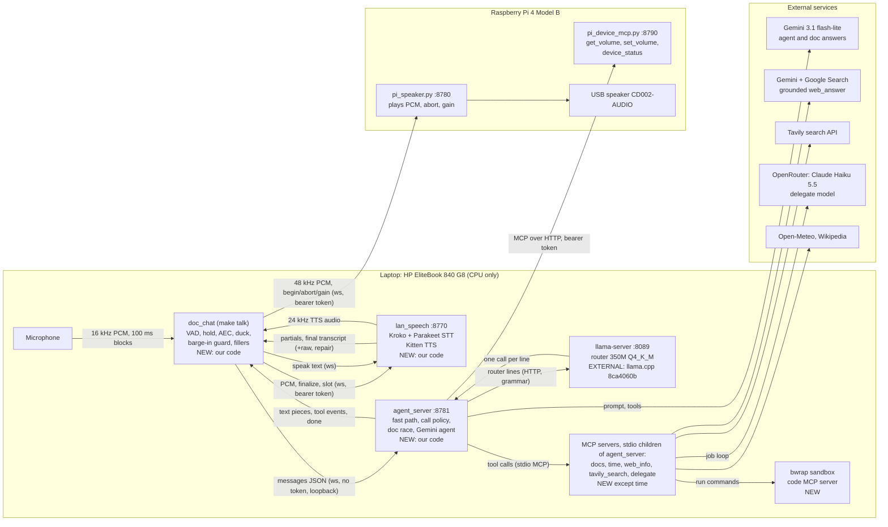
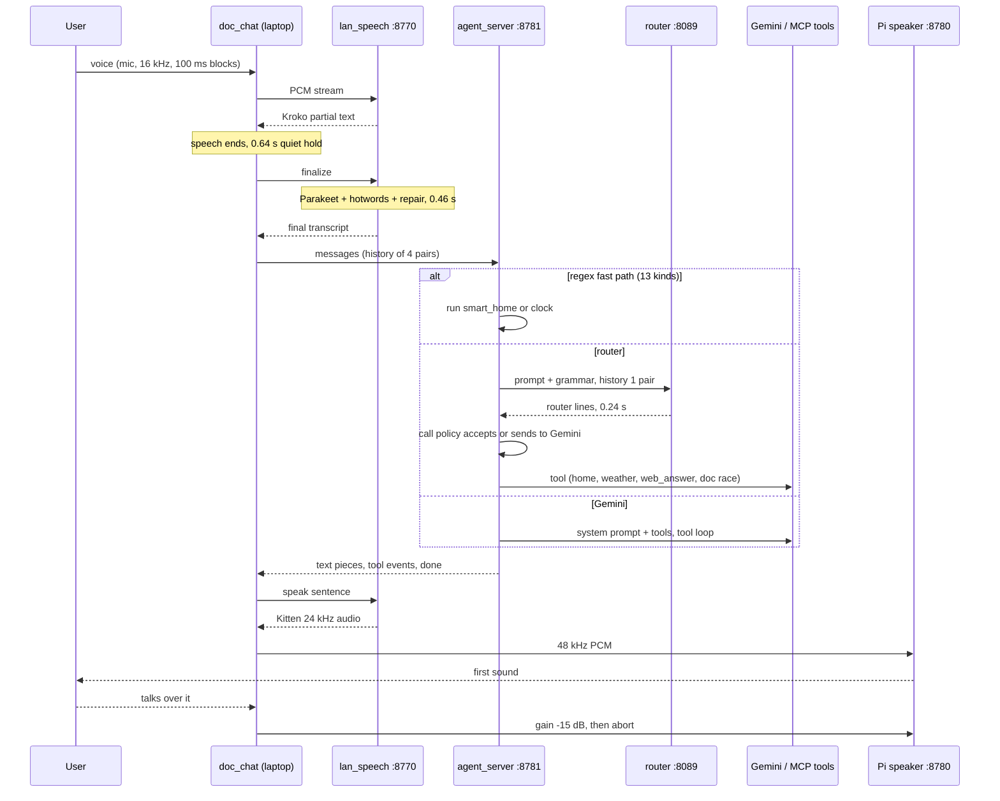

# Architecture of the voice agent as deployed (2026-11-05)

What `make pi-detect`, `make up` and `make talk` start at branch `agy/interrupts`, tip `1733091`. The source of truth is the code and the config; older documents describe earlier states (section 11 lists where they disagree). Every number names its source. "Not verified" means I could not check it from the code or a recorded file.

Paths are relative to the repository root unless they start with `~` or `/`. `pipeline/` is a separate uv project (Pipecat) with its own lock.

## 1. Summary

A spoken assistant for a home and a few "big tasks". The user talks to a **laptop microphone**; the answer comes out of a **USB loudspeaker on a Raspberry Pi 4 Model B** joined to the laptop by one Ethernet cable (link-local addresses). Everything that thinks runs on the **laptop CPU** (HP EliteBook 840 G8, Core i5-1145G7, 8 threads, 46 GiB RAM): speech to text (Kroko streaming plus Parakeet final), a **350M fine-tuned router** (Granite 4.0 H 350M, Q4_K_M, llama.cpp) that answers simple turns itself, text to speech (Kitten TTS Micro 0.8, voice Jasper), and the agent server. The cloud is used for the turns the router will not take (**Gemini 3.1 flash-lite** through Pipecat), for web answers (Gemini with Google Search, then Tavily, then Wikipedia) and for big tasks (a **delegate** job on **Claude Haiku 5.5 via OpenRouter** in a bubblewrap sandbox). The Pi runs no model: it plays audio and reports its own volume and status.

Headline numbers (sources in section 7): end of speech to first sound **1.58 s median, 3.68 s p90** over 60 live turns (`out/sessions/stack-1105-0829`, 2026-11-05); spoken v4 score **47 pass / 10 fail / 2 not run of 59** (`docs/PROGRESS-2026-11-05.md`); the router scores **60/62** on the held-out set, **76/77** on the OnIt set, **78/92** on the 87-prompt pack; stopping the voice after an interruption takes **about 1 ms**; Parakeet word error is **4.4% raw (3.2% after repair) on the hard set** and **8.9% on recorded turns**. Production phone agents sit at 1.3-1.7 s; we are inside that range at the median and outside it at p90.

## 2. Deployment topology

Edges labelled "ws" are WebSockets. The cable link (`config/pi.env.example`: laptop `169.254.0.1`, Pi `169.254.0.2` are examples only) carries the speech server, the Pi speaker and the Pi device tools. Gemini, Tavily, OpenRouter and the weather and Wikipedia calls go out over the laptop's normal internet.

### Hardware

| Item | Value | Source |
|---|---|---|
| Laptop | HP EliteBook 840 G8, Intel Core i5-1145G7 @ 2.60 GHz, 4 cores / 8 threads, 46 GiB RAM, Arch Linux, kernel 7.2.2 | `docs/LAPTOP-SPEECH.md:12-17`; `lscpu`, `free -g` run 2026-11-05 |
| Pi | Raspberry Pi 4 Model B Rev 1.2, RAM not recorded | `docs/pi-results/NOTES.md:9` |
| Loudspeaker | USB card/speaker "CD002-AUDIO" (Jieli), opens only at 48 kHz | `docs/ECHO-AGENT-BRIEF.md:60`, `config/pi.env.example` |
| Pi microphone | not used (speech only 5-15 dB above its noise) | `docs/ECHO-AGENT-BRIEF.md:60` |
| Cable | Ethernet, link-local `169.254.x.x`, about 1.5 ms round trip | `docs/ECHO-AGENT-BRIEF.md:60` |
| Current detected addresses | laptop `169.254.145.121`, Pi `169.254.230.219`, detected 2026-11-05 10:34 +0800 | `config/pi.env` (git-ignored; address lines only) |

### Ports

All verified in `scripts/stack/lib.sh:47-48` (defaults) and the start commands.

| Port | Service | Bound to | Auth |
|---|---|---|---|
| 8089 | router (`llama-server`) | llama.cpp default, loopback (no `--host` passed in `up.sh:47`; default not verified) | none |
| 8770 | speech server `lan_speech` | `$LAPTOP_IP` (the cable address, `up.sh:56`) | bearer token (required; server refuses to start without one off loopback) |
| 8781 | agent server | `127.0.0.1` (`agent_server.py:505`) | none (loopback only) |
| 8795 | apps server `voice_agent.apps_server` (`up.sh` `start_apps`) | `127.0.0.1` only | none; serves read-only `~/agent_sandbox/workspace/apps/<name>/`, section 8 |
| 8780 | Pi speaker `pi_speaker.py` | `0.0.0.0` on the Pi (`pi_speaker.py` `--host`) | bearer token |
| 8790 | Pi device tools `pi_device_mcp.py` | `0.0.0.0` on the Pi | bearer token (constant-time compare), Host-header allow-list from `hostname -I` |

### Session token

One shared secret in `~/.config/lan_speech_token` (mode 600) on the laptop and on the Pi. The scripts compare only the first 12 hex characters of its SHA-256 on both sides (`pi_detect.sh` step 4, `up.sh:77-79`) and refuse to start on a mismatch. The token is read into `LAN_SPEECH_TOKEN` at run time; it is never written to `config/pi.env` or to a systemd unit (`pi_service.sh:2-3`).

## 3. Lifecycle

### 3.1 `make pi-detect` (`scripts/stack/pi_detect.sh`, 7 checks)

Read-only on the Pi. On a failure it names the step, prints a fix, exits 1 and leaves `config/pi.env` as it was.

| # | Check | What it does |
|---|---|---|
| 1 | cable interface | finds the laptop's `169.254.x.x` address and interface (`CABLE_IF`, `LAPTOP_IP`) |
| 2 | find the Pi | tries neighbours on that interface, then the last known addresses, over ssh with `PI_KEY`; pings `ff02::1` if none answers |
| 3 | Pi addresses | reads the Pi's own `169.254` address and its fe80 address over ssh (`PI_V4`, `PI_V6`) |
| 4 | session token | the same 12-character SHA-256 prefix on both sides |
| 5 | loudspeaker | picks the USB sound card by stable ALSA name (`PI_AUDIO_PATTERN`, default `CD002`) from `/proc/asound/cards` |
| 6 | Pi repository | repository path exists, `.venv/bin/python` exists, optional `PI_LD_LIBRARY_PATH` (portaudio under `~/.local`) |
| 7 | write `config/pi.env` | all or nothing (temp file, then `mv`) |

`config/pi.env` holds: `CABLE_IF LAPTOP_IP PI_V4 PI_V6 PI_USER PI_KEY PI_REPO PI_AUDIO_DEVICE PI_SPEAKER_RATE PI_LD_LIBRARY_PATH PORT_* DETECTED_AT` (example: `config/pi.env.example`). It is git-ignored (`.gitignore`). Every stack script re-runs `pi-detect` when the file is missing or older than `PI_ENV_MAX_AGE_MIN` = 120 minutes (`lib.sh` `load_env`). Side effect seen in ticket K: `make status` once rewrote the file this way.

### 3.2 `make up` (`scripts/stack/up.sh all`)

Order is fixed so the agent sees the Pi tools: router, speech server, Pi services, agent server (`up.sh:108`). Before starting it checks that ports 8089, 8770 and 8781 are free (`check_free`, `up.sh:104`).

| Step | Command (abridged) | Ready test | Log, PID file |
|---|---|---|---|
| router | `llama-server --jinja -c 8192 -np 1 -fa on -t 3 -tb 3 -m <gguf> --port 8089` (`up.sh:47`) | `GET /health`, 60 s | `out/stack/logs/router.log`, `out/stack/pids/router` |
| speech | `uv run --offline --group laptop python -m lan_speech --host $LAPTOP_IP --port 8770 --stt-model parakeet --entities config/entities.json --tts-engine kitten --kitten-voice Jasper` with `KITTEN_SITE` set (`up.sh:55-57`) | port listening, 120 s | `speech.log`, `pids/speech` |
| Pi | token compare, then over ssh: `timeout 7200 .venv/bin/python -u scripts/pi_speaker.py --device CD002-AUDIO --rate 48000 --port 8780` and `scripts/pi_device_mcp.py --port 8790`, both `nohup` (`up.sh:88-93`) | both ports open from the laptop, 8 tries | on the Pi: `/tmp/pi_speaker.log`, `/tmp/pi_device.log`, `/tmp/pi_speaker.pid`, `/tmp/pi_device.pid` |
| agent | in `pipeline/`: `uv run python -m voice_pipeline.agent_server --ipv4 --hedge -1 --router-url http://127.0.0.1:8089` (`up.sh:63`) | log line `agent server on`, 120 s; warns `left out` if a Pi tool did not load | `agent.log`, `pids/agent` |

Variables (Makefile:10-25): `ROUTER_MODEL` = `router-350m-kd-web3-s0-unverified`, `ROUTER_THREADS` 3, `GGUF_TOOLS` `~/work/gguf-tools`, `ENTITIES` `config/entities.json`, `KITTEN_VOICE` Jasper, `KITTEN_SITE` `~/work/tts-bakeoff/venv/lib/python3.12/site-packages`, `PI_START` `ssh`, `PI_RUN_SECONDS` 7200, `DRY=1` prints the commands only.

Each laptop service starts with `setsid` in its own process group and its PID is written to `out/stack/pids/<name>` (`up.sh` `bg`).

### 3.3 The Pi services stop themselves after 2 hours

`PI_START=ssh` (default) wraps both Pi processes in `timeout $PI_RUN_SECONDS` (7200 s), so they exit about two hours after `make up`. With `PI_START=systemd` the Pi runs them as user units `pi-speaker` and `pi-device-mcp` (`deploy/systemd/*.service`, installed by `deploy/install-pi.sh`, `Restart=on-failure`, `loginctl enable-linger` for boot start); no timeout. Both unit files call `scripts/stack/pi_service.sh`, which reads the token file and execs the same two scripts. systemd mode was **not verified live** (`docs/PROGRESS-2026-11-04.md` Open 2).

### 3.4 `make talk` (`scripts/stack/talk.sh`)

Foreground; needs the microphone. Records into `out/sessions/stack-<MMDD-HHMM>` and writes that path to `out/stack/last_session`. The command line is in section 5.1. `TALK_ARGS` appends flags; `NOTE` is stored in `session.json`.

### 3.5 `make down` and `make status`

`down.sh all` stops the agent, the speech server and the router **by PID file** (it signals the whole process group, because `uv run` is the parent; it checks `/proc/<pid>/cmdline` first so a reused PID is not killed), then stops the Pi services by their PID files (or `systemctl --user stop` in systemd mode). It never matches by name or port. `status.sh` is read-only: cable interface, ping to the Pi, which of 8089/8770/8781 listen, the router's model path from `/props`, whether Pi ports 8780/8790 accept a connection; `PI_LOGS=1` adds the Pi logs and CPU temperature. `make restart-agent` restarts only the agent server; `make up-laptop` and `make up-pi` start the halves.

## 4. One turn, end to end

Medians are from `.scratch/fix-2026-11-05/i/breakdown.txt` (session `stack-1105-0829`, n=60, 2026-11-05) unless another source is named.

| # | Stage | Median | Where |
|---|---|---|---|
| 1 | The user speaks; the mic client sends 16 kHz PCM in 100 ms blocks to the speech server; Kroko streams partial text back | n/a | `doc_chat/speech.py` `listen_turn` |
| 2 | **Pause hold**: the client waits `--vad-hold 0.6` s of quiet after speech (decided at 100 ms block edges), then sends `finalize` | **0.639 s** (p90 0.644) | `speech.py:427`, `lan_speech/pause.py` |
| 3 | **Recogniser** on the server: trim, pad (0.5 s lead, 1.0 s tail), Parakeet decode with hotwords, name repair | **0.456 s** (p90 0.544) | `lan_speech/hybrid_stt.py` |
| 4 | Final text is back at the client | **1.005 s** after speech end (p90 1.175) | `breakdown.txt` |
| 5 | The client strips filler text, handles stop words and sends `{"messages": [...]}` (last 4 pairs) to the agent server over loopback | small, not measured | `doc_chat/agent_client.py` |
| 6 | Agent server: **fast path** regex; else **router** (about 0.24 s); else Gemini | fast 0.0 s server side; router `router_s` **0.239 s** median, p90 0.317 (n=69) | `agent_server.py:379`; agent log `pipeline/out/agent_server/20261105-082810.jsonl` |
| 7 | The routed calls run (home tool, weather, `web_answer`, doc race) or Gemini runs its tool loop | route-dependent, see 7.2 | `agent_server.py:240` |
| 8 | Text pieces stream to the client, which cuts them into sentences and asks the speech server to speak each | n/a | `doc_chat/__main__.py` `turn` |
| 9 | **Kitten TTS** makes the first sentence (24 kHz), the client resamples to 48 kHz and sends it to the Pi | TTS first audio **0.252 s** median, p90 0.353 (n=61, `turns.jsonl` `tts_first_audio_ms`) | `speech.py`, `playback.py` |
| 10 | The Pi writes the audio to the USB card: **first sound** | total **1.578 s** from speech end (p90 3.683); final text to first sound **0.550 s** (p90 2.696) | `breakdown.txt` |

The stage "final text to first sound" mixes all three routes, which is why its p90 is large. Section 7.2 splits it by route.

The mic client keeps listening while the agent works and while the Pi plays (section 5.1). If the user talks over the reply, the client ducks the Pi speaker, then aborts it and takes the new speech as the next turn.

## 5. Components in depth

### 5.1 Mic client: `src/doc_chat/` (`make talk`)

**Role.** Capture the microphone, decide when a turn ends, talk to the speech server and the agent server, play the answer on the Pi, and notice an interruption.

**Command** (`scripts/stack/talk.sh:11-15`): `python -m doc_chat --mic --llm agent --no-docs --slot "doc+term?" --stream --server ws://$LAPTOP_IP:8770 --play-remote ws://$PI_V4:8780 --vad both --vad-confidence 0.5 --silero-kofn 7/10 --level-kofn 3/8 --barge-echo-quantile 0.95 --barge-echo-window 60 --barge-echo-margin 1.2 --barge-echo-prior 0.8 --trace-guard --history 4 --max-words 90 --aec --duck-db -15 --strip-echo-prefix --barge-warmup-s 1.0 --barge-min-bar 0.06 --fillers --record <dir>`.

| Part | What it does | Setting and where |
|---|---|---|
| Capture | `sounddevice` input, 16 kHz mono, 100 ms blocks | `speech.py:140,362`, `rate = 16000`, `block_ms = 100` |
| End of turn | energy pause detector with a room noise floor (ratio 2.5, floor 0.008); a pause of `--vad-hold` 0.6 s ends the turn; the floor is carried between turns | `lan_speech/pause.py`, `speech.py:427` |
| Silero VAD | `assets/silero_vad.onnx`, confidence 0.5; used for barge-in (`--vad both`), not for end of turn | `talk.sh`, `__main__.py:1389-1392` |
| Barge-in guard | An interruption counts only when Silero says speech in 7 of the last 10 windows (32 ms each) **and** the level is above the learned echo in 3 of the last 8 blocks (100 ms). The echo level is the 0.95 quantile of the last 60 blocks, times margin 1.2; prior 0.8 of the voice assumed back during the first 1.0 s of each reply; absolute floor 0.06 block RMS (-24 dBFS) | `--silero-kofn 7/10 --level-kofn 3/8 --barge-echo-* --barge-warmup-s 1.0 --barge-min-bar 0.06`; `bargein.py` |
| Echo cancellation | WebRTC AEC3 through `livekit.rtc.AudioProcessingModule`, reference = the audio sent to the Pi, lead 0 ms | `aec.py`, `--aec` (needs `--play-remote`) |
| Ducking | On the first sign of speech the Pi speaker gain drops by 15 dB (`gain` message), and returns if the user does not interrupt | `--duck-db -15`, `--duck-k 2` default |
| Echo text guard | An "interruption" whose words are the assistant's own is dropped; `--strip-echo-prefix` also removes its words from the front of a real interruption | `__main__.py:790-813` |
| Stop words | A bare stop or quit phrase stops the voice and listens again; "wait, stop, tell me about X" is treated as a pivot | `__main__.py:71-128, 765-770` |
| History | the last 4 question/answer pairs go to the agent server; the server keeps only 1 pair for the router | `--history 4`; `router.py:29` |
| Reply cap | `--max-words 90` | `talk.sh` |
| Fillers | pre-recorded lines, section 5.8 | `fillers.py`, `config/fillers.json` |
| Warm-up | on by default: measures the room, opens the Pi socket with 0.1 s of silence, sends one request through the agent path | `--warmup`, `__main__.py:687` |
| Pre-rendered replies | the 8 fixed fast-path confirmations are synthesised once at start and played from memory | `config/fast_phrases.json`, `--preload-phrases` |
| Playback to the Pi | each sentence is resampled (scipy `resample_poly`) to the rate the Pi announces (48 000 Hz), sent in 50 ms slices with `begin` / binary PCM / `end` or `abort` | `playback.py:160-230` |
| Recording | `--record out/sessions/stack-<time>`: `session.json` (git commit, settings), `turns.jsonl`, `audio/` (what was said), `bot/` (what it said), `guard.jsonl` (`--trace-guard`, one line per 100 ms) | `__main__.py:191` |

**Failure behaviour.** If the agent server is down the turn fails and is logged as a failed record, then it listens again (`__main__.py:778-780`). If the Pi socket is unreachable the playback raises; `make up` would not have passed. A turn the agent never answers is given up (section 5.8). The client ignores its own filler lines in the next transcript (`strip_fillers`).

### 5.2 Speech server: `src/lan_speech/` (port 8770)

**Protocol.** WebSocket endpoints `/stt`, `/tts`, `/voices` and HTTP `/healthz`, bearer token required; frames at most 64 KiB, text at most 2 000 characters, at most 4 connections (`server.py:33-35`).

**STT: hybrid** (`--stt-model parakeet`, `hybrid_stt.py`):

| Part | Model and setting |
|---|---|
| Streaming and turn ends | **Kroko** sherpa-onnx streaming zipformer `en-kroko-2025-08-06`, 2 threads; produces the partials; its own endpoint is 1.2 s of silence, but the client's 0.6 s hold decides first |
| Final | **Parakeet TDT 0.6B v2**, int8 (`nvidia/parakeet-tdt-0.6b-v2`, sherpa-onnx export, CC-BY-4.0), 2 threads, `modified_beam_search`, 4 active paths, hotword score 1.0 |
| Library | sherpa-onnx 1.13.8 (`docs/LAPTOP-SPEECH.md:16`; not re-checked) |
| Audio prepared for Parakeet | trim silence (keep 0.3 s lead, 0.4 s tail), then add **0.5 s of zeros before and 1.0 s after** (`hybrid_stt.py:150-151`, `lan_speech/__main__.py:46-55`); at most 25 s of audio kept |
| Early decode | off (`--early-decode-ms 0`); rejected, section 10 |
| Hotwords | all names in `config/entities.json`: **1 444 names** (counted: other 639, place 237, brand 232, music 192, contact 142, term 2). Each is written in lower and Title case |
| Name repair | a phonetic ladder (silent, implicit, confirm, targeted, reprompt) over the categories named by the client's `--slot "doc+term?"`. `entities.json` has **no `doc` category**, so only the **2 `term` names** (EDSA, Ballon d'Or) are repair targets in this deployment; the other 1 442 act as hotwords only. By reading `transcript_repair.py:499-513`; not run |
| Result | `raw_text` (Parakeet), `text` (after repair), `repair` details |

Kroko's `finalize` path pads 1.5 s of zeros (`engines.py:21`, `FINALIZE_TAIL_S`); Parakeet's pad is the 1.0 s above. If Parakeet fails the Kroko text is used (`hybrid_stt.py` `_decode_audio`).

**TTS** (`--tts-engine kitten --kitten-voice Jasper`):

| Part | Value |
|---|---|
| Model | **Kitten TTS Micro 0.8** (`KittenML/kitten-tts-micro-0.8`, StyleTTS2-derived, ONNX, 24 kHz), 2 ONNX intra-op threads |
| Voice | `Jasper`; the client sends `F1` (a Supertonic name), which Kitten does not know, so the server uses its default voice (`engines.py:374-377`) |
| Install | `kittentts` is not a project dependency; `KITTEN_SITE` points at the bake-off venv `~/work/tts-bakeoff` |
| Level | each chunk is scaled so active speech is -21.3 dBFS RMS (gain limits -9 to +3 dB), because the echo guard was tuned on that level (`engines.py:244-262`) |
| Silence trim | leading and trailing silence trimmed with a small margin |
| Text normaliser `kitten_text` | keeps case and punctuation; years spoken as years; "AM/PM" as letters; dates with an ordinal; numbers of 1 000 or more in the form Kitten reads back correctly (comma after each scale word, "and" before a short thousands tail, billions as "one point four billion"); respellings `EDSA` to "Ed sah", `Duterte` to "Du-tair-tay" (`engines.py:270-304`, round trip through Parakeet, 2026-11-04) |
| Pauses | 0.12 s after a comma, 0.40 s after a sentence end (`--comma-pause`, `--sentence-pause`) |

**Failure behaviour.** Missing model files stop startup with exit 2 naming the file (`models.py` SHA-256 manifest). No token off loopback stops startup. A dropped client cancels its synthesis.

### 5.3 Agent server turn routing: `pipeline/src/voice_pipeline/agent_server.py` (port 8781)

**Protocol.** One request per WebSocket connection: `{"messages": [...]}` in; `{"text": ...}` pieces, `{"event": "tool", ...}`, then `{"done": true}` or `{"error": "timeout"}` out. Client system messages are dropped (the server owns the prompt). Requests run one at a time under a lock. If the client closes before `done`, the turn is cancelled (`agent_server.py:396-420`). Each turn appends a row to `pipeline/out/agent_server/<start>.jsonl` (question, calls, timings, route, `router_lines`, `race`, notices).

**Order of decisions per turn** (`handle`, `agent_server.py:400-414`):

1. **Fast path** (`fast_path.py`): the whole transcript must match one exact phrasing after lower-casing and stripping "please", "hey", "okay", "thanks". 13 kinds: 8 fixed home commands (lights on/off, play, pause, stop, next, volume up/down; a fixed confirmation each), the clock ("what time is it", "what's the date", Asia/Manila, no tool), timer ("set a timer for 45 minutes"), alarm, speaker volume with a percent. The real tool runs, then the fixed sentence is said.
2. **Local router** (`router.py`), because `--router-url` is set: one HTTP call to llama-server `/v1/chat/completions` with a GBNF grammar, `temperature 0`, `max_tokens 48`, `cache_prompt`, timeout **1.5 s**, history of **1** earlier pair. The reply is lines in the project's line protocol (`finetune/spec/tools.py`): `LIGHT_ON`, `TIMER|45 minutes`, `weather|Baguio|today`, `web_answer|...`, `none|reply`, `escalate|why`. The grammar knows 37 line names (17 home intents, `get_current_time`, `convert_time`, `weather`, `wiki_summary`, `web_answer`, `search_docs`, `get_volume`, `set_volume`, `device_status`, 9 file/shell/web tools that the router can only escalate, `none`, `escalate`). A timeout, a down server, a parse failure or `escalate` sends the turn to Gemini.
3. **Call policy** (`call_policy.py`, `decide`): decides per call whether this server may run and speak it, else Gemini takes the turn. The rules:

| Guard | Rule | Line |
|---|---|---|
| chat | a `none|` reply only for a user turn of at most 5 words and a reply of at most 10 words; a reply that repeats the user's words (3 or more words) is rejected as a garbled turn | `call_policy.py:21-26,328-` |
| documents loaded | a chat reply to a question goes to Gemini while `search_docs` exists | `_verdict` |
| time values | `TIMER` must be a duration, `ALARM` a time of day or duration | `TIME_CHECKS` |
| numeric slots | every number in a `TIMER`, `ALARM`, `BRIGHTNESS`, `TEMPERATURE` or `set_volume` slot must be in the user's words (not carried from history); a duration with no number needs "a / an / half / quarter" plus a unit | `slot_from_user` |
| `LIST_REMINDERS`, no `smart_home` | unsupported, Gemini | `_verdict` |
| time zone | must be a valid IANA zone | `_verdict` |
| **`ROUTER_DEVICE_STATUS = True`** (was False until 2026-11-05) | a router `device_status` call runs only when `device_question()` passes: a Pi word plus a status topic and no volume, ping, level or command word ("Sata speaker to thirty per cent" is refused). Replay of 534 logged router turns: 7 decisions changed, all genuine status questions, 0 ping/latency/volume turns accepted. Awaits the spoken Pi check (`PROGRESS-2026-11-05.md` Open 3) | `call_policy.py`, `_verdict` |
| reasoning | a lookup for a question that needs a decision ("should I bring an umbrella") goes to Gemini | `question.needs_reasoning` |
| statements | `web_answer`/`wiki_summary` only if the user asked a question or shares a content word with the query ("not a question") | `_lookup_asked` |
| swap | the trained `wiki_summary` runs as `web_answer`; a single swapped call asks the whole user question; a `web_answer` keeps the router's own question (it resolved follow-up context) | `plan` |

4. **Gemini** takes everything else (section 5.4). `up.sh` starts the server with `--hedge -1`, so there is **one** Gemini pipeline, not two racing ones, and the router runs **first**; Gemini starts only after the router declines (`agent_server.py:371-377`). `--router-hold` is 0 and has no effect without hedging.

**Failure behaviour.** The router can only make a turn faster, never lose it: every refusal falls through to Gemini. A web lookup that fails before anything was spoken also falls through. Router refusals in the 2026-11-05 agent log (74 turns): `escalate` 19, `unsupported: device_status` 3, `lookup failed or Gemini first` 2; routes: router 45, Gemini 24, fast path 5 (`pipeline/out/agent_server/20261105-082810.jsonl`).

**Router model.**

| Item | Value |
|---|---|
| Name | `router-350m-kd-web3-s0-unverified` (`Makefile:5`), Hugging Face adapter `martinnavs/granite-4.0-h-350m-router-kd-web3-s0-unverified` |
| Base | `ibm-granite/granite-4.0-h-350m`, LoRA fine-tuned by knowledge distillation on the class cluster |
| File | `~/work/gguf-tools/models/router-350m-kd-web3-s0-unverified/gguf/router-Q4_K_M.gguf`, 222 662 144 bytes (a Q8_0 of 366 195 200 bytes sits next to it, unused) |
| Server | llama.cpp commit `8ca4060b` (2026-10-28), CPU build; `--jinja -c 8192 -np 1 -fa on -t 3 -tb 3` |
| Grammar | GBNF generated from `finetune/spec/tools.py:355`, so every output line is valid by construction |
| Warm-up | one request at start fills the prompt cache (`router.py` `warm_up`) |

### 5.4 The Gemini agent: `pipeline/src/voice_pipeline/agent.py`

| Item | Value |
|---|---|
| Model | `gemini-3.1-flash-lite` (`agent.py:48`), native Pipecat `GoogleLLMService` (Pipecat 1.13) |
| System prompt | `pipeline/config/eval/system_agent.txt` (720 words): cases A home command, B time/weather/knowledge, C Cormac McCarthy documents, D Pi tools, E command missing a value, F big task (delegate), G anything else; every tool call also carries a `say` argument |
| Key | read from `~/.secrets/google-ai-studio/api-key.txt` at start (`agent.py` `read_key`); never logged |
| Tools the model sees | 13: `smart_home` (17 intents, phonebook of 5 contacts in `pipeline/config/phonebook.json`), `search_docs`, `get_current_time`, `convert_time`, `weather`, `wiki_summary`, `web_answer`, `delegate`, `delegate_status`, `delegate_cancel`, and from the Pi `get_volume`, `set_volume`, `device_status` (the Pi's three are absent if the Pi was unreachable when the agent started) |
| Connection | `--ipv4` (IPv6 to Google resets on this network); keep-alive **300 s** so idle connections stay warm (`KEEPALIVE_S`) |
| Hedging | **off** in the deployed stack (`--hedge -1`); the code supports two racing requests (`hedge.py`) and the server default is on |
| `say` sentence | a short line the model emits with a tool call; held 0.6 s and dropped if the tool answers first; `weather` has no hold (`SAY_DELAY_BY_TOOL`) |
| One request for sentence tools | `weather`, `wiki_summary`, `web_answer`, `get_volume`, `set_volume` return a ready sentence; the result is spoken without a second LLM call unless it failed or the question needs reasoning (`agent_tools.py:50,134-153`) |
| **Stall watchdog** | after every tool of a response has returned, if the model says nothing for **4.0 s** (`STALL_S`), the turn is answered from the tool result (Pi status worded for the question, or the tool's own sentence, else "Sorry, I got the result but couldn't put it into words. Could you ask again?"), and the model's late reply is interrupted. Added after a 16 s stall on 2026-11-05 (ticket G) |
| Turn cap | `TURN_TIMEOUT_S = 20.0`; past it the turn returns `error` |
| Warm-up | one "Say OK." request at start |

**MCP servers started as children of the agent server** (`agent_tools.py:90-98`; all `uv run --group laptop python -m voice_agent.mcp_servers.<name>` from the repo root except time):

| Server | Tools | Notes |
|---|---|---|
| `docs` (required) | `search_docs` | BM25 over `corpus/cormac-mccarthy` (the sample corpus; `doc_chat --no-docs` loads nothing itself) |
| time (required) | `get_current_time`, `convert_time` | `mcp_server_time --local-timezone Asia/Manila` |
| `web_info` (required) | `weather`, `wiki_summary` | Open-Meteo geocoding and forecast, Wikipedia; keyless |
| `tavily_search` (required) | `web_answer` | section 5.5 |
| `delegate` (optional) | `delegate`, `delegate_status`, `delegate_cancel` | section 5.7 |
| Pi device server (optional) | `get_volume`, `set_volume`, `device_status` | MCP over HTTP to the Pi, section 5.6 |

A required server that cannot start stops the agent; an optional one is left out with a warning (`build_tools`).

### 5.5 Lookups

**`web_answer`** (`src/voice_agent/mcp_servers/tavily_search.py`, `gemini_grounding.py`):

1. `spoken_years_to_digits`: "twenty eighty seven" becomes 2087 before searching ("nineteen" to "twenty" centuries and "two thousand ..." forms; `tavily_search.py:176`).
2. **Cache**, 600 s, 64 entries, keyed by content words; two wordings of one question share an entry and join an in-flight call (`CACHE_TTL_S`, `same_question`, overlap 0.75).
3. **Grounded Gemini** (first choice): `gemini-3.1-flash-lite` with `google_search`, system prompt "at most two short sentences", told today's date, searches only for things that can change; timeout **3.0 s**. Each call is added to a ledger (`~/.local/state/voice_agent/web_answer_ledger.jsonl`); when the month's searches reach **4 500** (of 5 000 free) it stops using search. `WEB_BACKEND=tavily` turns Gemini off.
4. **Tavily** `/search` (`search_depth` `fast`, `include_answer basic`, 3 results), total timeout **3.5 s**. A year or name in the question that no source mentions makes the answer start with "I couldn't confirm X in what I found."
5. **Wikipedia** extract if both fail.
6. A background ping keeps the Tavily and Google connections warm every 20 s while lookups are happening (stops after 600 s idle).

The agent server adds: a retry once on a transient failure (`TRANSIENT`), and after **1.0 s** (`LOOKUP_ACK_S`) it tells the client "a lookup is under way" so the filler plays the tool's line.

**Documents race** (`agent_server.py:175-238`, `doc_answer.py`). When the router chose a lookup (`web_answer` or `wiki_summary`) as the turn's only call and `search_docs` exists, the web lookup and a documents answer start together:

- `search_docs` gets the user's question, then **one** Gemini request (`gemini-3.1-flash-lite`, thinking minimal) must reply `ANSWER:` plus `QUOTE:` (3-12 words copied verbatim) or `NONE`.
- It is accepted only if the quote appears verbatim in the passages **and** every number and every capitalised word of the answer appears in them (`quote_ok`, `names_numbers_ok`).
- Cap **2.5 s** (`DOC_ANSWER_TIMEOUT_S`). If the documents answer is accepted, it is spoken (`winner: docs`); otherwise the web result is (`winner: web`); if neither, Gemini takes the turn.
- Each turn logs `race` = `{docs, doc_s, winner, rejected}`. In the 2026-11-05 log, 9 turns raced.

### 5.6 Device tools on the Pi (`scripts/pi_speaker.py`, `scripts/pi_device_mcp.py`)

- **Speaker** (port 8780): plays 16-bit mono PCM at 48 kHz through `sounddevice` to the card named `CD002-AUDIO`; on connect it sends `{"type":"hello","rate":48000}`; messages `begin`, binary frames, `end` (finish playing), `abort` (silent within one 50 ms slice plus about 35 ms of device buffer, with an 8 ms fade), `gain` (dB, for ducking). Reconnecting with a new `begin` closes the old player.
- **Device tools** (port 8790, MCP streamable HTTP, stateless): `get_volume`, `set_volume(percent)` through `wpctl` on the sink whose name contains `CD002`; `device_status` returns CPU temperature, uptime in minutes, 1-minute load, free memory and whether the speaker sink exists.
- **How `device_status` is answered.** The router's call is guarded by `device_question()` (`ROUTER_DEVICE_STATUS = True`, `call_policy.py`). For the model's own call, `agent_tools._recorded` words the result with `device_say.device_sentence` and tells the pipeline not to ask the model again, unless the question joins a status request to another kind (`device_say.single_question`) or the result has no usable numbers; before, every Pi status answer cost a second Gemini call (one stalled about 16 s on 2026-11-05). The Pi's address comes from `$PI_DEVICE_URL` (set by `up.sh` from `config/pi.env`), else the old constant.
- **Failure.** If the Pi tools do not answer when the agent starts, they are left out and the system prompt tells the model to say the Pi cannot be reached. **Fragility:** the agent server's default Pi URL is the constant `http://169.254.230.219:8790/mcp` (`agent_tools.py:35`); `up.sh` does not pass `--pi-url`, so a Pi that comes back on another link-local address is silently left out until `--pi-url` is given. The detected address today equals the constant.

### 5.7 Delegate tier (`src/voice_agent/mcp_servers/delegate.py`, `config/delegate.toml`)

| Item | Value |
|---|---|
| Purpose | big tasks: build a small site or app, hard multi-step maths with code, audit this machine, analyse files |
| Model | default `haiku` = `anthropic/claude-haiku-5.5` via OpenRouter (`reasoning effort low`); fallback `qwen` (the class server, id asked of it at run time); the fallback runs only if the default ends in `error` or `budget` |
| Keys | `~/.secrets/openrouter/api-key.txt`; the class server uses the `~/.secrets/onit/` folder (`doc_chat/qwen.py:28`) |
| Limits per job | 25 steps, 300 s, USD 0.15 (`max_usd`); total budget USD 1.00; at most 2 jobs at once (`config/delegate.toml`) |
| Spend so far | USD 0.0147 recorded on OpenRouter, 16 jobs (`~/.local/state/voice_agent/delegate/spend.json`, `jobs.json`) |
| Wait | `delegate` waits `wait_s = 1` s; a quick job answers in the same call, otherwise it returns `started` and the result is announced later |
| State | `~/.local/state/voice_agent/delegate/jobs.json` (all jobs), `notices.jsonl` (spoken notices), `spend.json` |
| Tools | `delegate(task)`, `delegate_status(job)`, `delegate_cancel(job)`; `job` may be an id or a few words of the description (id, then substring, then shared content words, then newest) |
| Notices | when a job ends, a sentence is appended to `notices.jsonl`. The agent server reads new lines after it has finished a normal turn and says them **after the reply** as " Update on your earlier request: ..." (`agent_server.py:423-426`, `notices.py`). The queue starts at the end of the file, so old notices are not repeated |
| Job tools | the `code` MCP server minus `publish_site`: `write_file`, `read_file`, `list_files`, `edit_file`, `grep`, `bash`, `run_python` (`delegate.py` `run_in_sandbox`) |

**Sandbox** (`src/voice_agent/sandbox/runner.py:138-190`, flags from `delegate.py`): each command runs as `systemd-run --user --scope` (MemoryMax **512M**, CPUQuota **100%**, TasksMax 64, no swap) around `timeout` (default **60 s**, at most **120 s** per command) and `prlimit --fsize=256 MiB`, around `bwrap --unshare-all --share-net --die-with-parent --new-session --clearenv`. Mounts: host `/usr` and `/etc`, `/opt`, `/srv`, `/var` **read-only**; `/tmp` a tmpfs; the **shared workspace** `~/agent_sandbox/workspace` read-write at `/sandbox` (every job sees earlier jobs' files); `~/agent_sandbox/pylibs` read-only (pygame 2.6.1, built from source) with `PYTHONPATH`, `SDL_VIDEODRIVER=dummy`, `SDL_AUDIODRIVER=dummy`. The home folder and `~/.secrets` are **not** mounted. **Network is on** (`network = true`), for the whole sandbox. `shell_policy.check_command` refuses `sudo su doas ssh scp sftp docker podman systemctl shutdown reboot poweroff halt mount umount chroot nc ncat telnet mkfs*`, `curl | sh`, fork bombs, recursive `rm` of `/` or `~`, `dd of=/dev/*`. The folder `~/agent_sandbox/jobs/<id>` holds only the job's `log.txt`.

### 5.8 Fillers and give-up rules (`src/doc_chat/fillers.py`, `config/fillers.json`)

Times count from when the final transcript is ready. All lines are synthesised once at session start.

| Situation | Rule | Value (`config/fillers.json`) |
|---|---|---|
| Nothing back yet | a **stall** line ("Mm, one moment.") | **1.8 s** (`stall_s`) |
| Nothing back yet | a **notice** line ("Sorry, this is taking a little longer...") | 2.5 s (`notice_s`) |
| **Nothing back at all** | **give up**: cancel the turn, abort the player, cancel TTS, say "Sorry, I lost my connection...", log `gave_up` | **8.0 s** (`giveup_s`) |
| The agent shows progress (a tool call, a `say`, or text) | the early notice becomes one at **15.0 s**; the cap becomes **20.0 s** | `progress_notice_s`, `progress_giveup_s` |
| Delegate in progress | cap **12.0 s** | `progress_giveup_by_tool.delegate` |
| Text has started | nothing is timed; a started answer is never given up | `TurnFillers.text_arrived` |
| A tool call arrives before anything was said | that tool's line ("Let me look that up." style; 10 tools have lines) replaces the stall; at most one stall-or-tool line per turn | `tools` |
| Spacing | a timed line waits until the previous one has finished playing plus **1.5 s** | `gap_s` |
| Order | lines rotate least-recently-used first so one never repeats twice in a row | `Fillers.pick` |
| Server-side | a post-tool model stall of 4 s is answered from the result (5.4); the agent turn cap is 20 s | `agent.py` |

## 6. Data and state on disk

| What | Path | Written by | Git |
|---|---|---|---|
| Stack logs and PID files | `out/stack/logs/{router,speech,agent}.log`, `out/stack/pids/*`, `out/stack/last_session` | `up.sh`, `talk.sh` | ignored (`out/`) |
| Live session | `out/sessions/stack-<MMDD-HHMM>/` : `session.json`, `turns.jsonl`, `audio/`, `bot/`, `guard.jsonl` | `doc_chat --record` | ignored |
| Default turn log | `out/doc_chat/turns.jsonl` | `doc_chat --log` | ignored |
| Agent server turns | `pipeline/out/agent_server/<YYYYMMDD-HHMMSS>.jsonl` (38 files now) | `agent_server.py:490` | ignored (`out/`) |
| Pi logs | `/tmp/pi_speaker.log`, `/tmp/pi_device.log`, PID files on the Pi | `up.sh` | n/a |
| Pi detection result | `config/pi.env`, `config/pi_known_hosts` | `pi_detect.sh` | ignored |
| Session token | `~/.config/lan_speech_token` on both machines | by hand (`docs/PI-BRIDGE.md`) | outside the repo |
| Delegate state | `~/.local/state/voice_agent/delegate/{jobs.json,notices.jsonl,spend.json}` | delegate server | outside the repo |
| Delegate sandbox | `~/agent_sandbox/{workspace,jobs,pylibs}` | delegate jobs | outside the repo (`agent_sandbox/` also in `.gitignore`) |
| Grounded-search ledger | `~/.local/state/voice_agent/web_answer_ledger.jsonl` | `gemini_grounding.py` | outside the repo |
| Router, TTS and speech models | `~/work/gguf-tools`, `~/work/tts-bakeoff`, `models/` | by hand | `models/` ignored |
| Names list and fillers | `config/entities.json` (1 444 names), `config/fillers.json`, `config/fast_phrases.json` | committed | tracked |
| Held-out material | `docs/stress/spoken-test-v3.*`, `spoken-test-v4.*`, `.scratch/web-prefilter/`, recorded audio | owner | local only, never committed (`PROGRESS-2026-11-04.md`) |
| Working notes | `.scratch/` | agents | untracked |

The agent server's log row has: `time`, `question`, `calls`, `cancelled`, `notices`, `status`, `text`, `first_call_s`, `first_text_s`, `end_s`, `routed`, `router_s`, `router_lines`, `router_reason`, `race`, `fast_path`, `stall_fallback`.

## 7. Measured performance

Only the latest numbers. One speaker, one room, one laptop, small counts; differences under about 0.3 s are noise (`docs/INDUSTRY-COMPARISON.md`, Caveats).

### 7.1 Live latency, end of speech to first sound

| Measure | Value | Source and date |
|---|---|---|
| All turns, live session | median **1.578 s**, p90 3.683 s (n=60) | `.scratch/fix-2026-11-05/i/breakdown.txt`, 2026-11-05 |
| Same session, client log | median 1.572 s (n=61), 74 turns incl. 8 give-ups and 4 barge-ins | `out/sessions/stack-1105-0829/turns.jsonl`, 2026-11-05 |
| Spoken v4 by route | all **1.59 s**; fast path **1.01 s**; router **1.53 s**; Gemini **3.57 s** | `docs/PROGRESS-2026-11-05.md`, 2026-11-05 |
| Pause hold | 0.639 s (p90 0.644) | `breakdown.txt` |
| Recogniser on the server | 0.456 s (p90 0.544); under 2 s clips 0.370 s (n=2), 4 s and over 0.465 s (n=21) | `breakdown.txt` |
| Final text after speech end | 1.005 s (p90 1.175) | `breakdown.txt` |
| TTS first audio | 0.252 s (p90 0.353, n=61) | `turns.jsonl` `tts_first_audio_ms` |
| Router call | 0.239 s (p90 0.317, n=69) | agent log `20261105-082810.jsonl` |
| Agent-side first text, by route | router 0.27 s (p90 2.01, n=45); Gemini 1.80 s (p90 3.27, n=19); fast path about 0 (n=5) | same log, `first_text_s` (server side, excludes hold, recogniser and TTS) |
| Interruption: voice to silence | **0.9 ms** (spoken v4); 1 ms median over 4 barge-ins in `stack-1105-0829` (`cancel_to_silence_ms`) | `PROGRESS-2026-11-05.md`; `turns.jsonl` |
| False interruptions by its own echo | **0** | spoken v4 (`PROGRESS-2026-11-05.md`); 0 `ignored_echo` rows in `stack-1105-0829` |
| Buffer underruns | 0 | `turns.jsonl` `audio_underruns` |
| Give-ups | 8 of 74 turns hit the 8 s cap **before fix G** (this is the `stack-1105-0829` session); after fix G a replay keeps 9 of 11 logged give-ups from happening | `PROGRESS-2026-11-05.md` |

### 7.2 Accuracy

| Measure | Result | Source and date |
|---|---|---|
| Router, held-out set (62: multi-turn 29, Pi 12, delegate 10, statements 9) | **60/62** (kd-web2 was 45/62) | `PROGRESS-2026-11-05.md`, 2026-11-05 |
| Router, OnIt set | **76/77** | same |
| Router, 87-prompt pack (92 checks) | **78/92** (kd-s0 79, "at the bar") | same |
| Changing facts to `web_answer` | 20/20 (kd-s0 0/10) | same |
| Fresh arithmetic escalated / fresh timers stay TIMER | 10/10 / 5/5 | same |
| Held-out caveat | 7 of the 62 user turns are generic commands also found in the training banks | same |
| Spoken v4 (59 lines, Pi loudspeaker, laptop mic) | **47 pass / 10 fail / 2 not run** | same |
| STT, hard set (59 sentences, 83 entity mentions): WER | **4.4% raw, 3.2% after repair** | `.scratch/fix-2026-11-05/k/RESULTS.md`, 2026-11-05 |
| STT, hard set: entity recall | **78/83 = 94.0%** (74/83 raw) | same |
| STT, 116 recorded user turns: WER | **8.9%**; entities 34/39 | same |
| STT without hotwords (comparison) | WER 11.0% raw, entities 65/83 after repair | same |
| Kitten text path | years, AM/PM, dates, big numbers read back correctly; 29,0xx-30,0xx tails 7 wrong of 200 to 0 | `PROGRESS-2026-11-04.md` |

### 7.3 Cost

- Per turn: **not documented** as a per-turn figure. Day totals on 2026-11-05: delegate (haiku) USD 0.0064 against the owner's USD 0.15 cap, Gemini about USD 0.04 (`PROGRESS-2026-11-05.md`).
- Delegate ledger so far: USD 0.0147 on OpenRouter over 16 jobs (`spend.json`, read 2026-11-05).
- Grounded search: free up to 5 000 searches a month per Google, stopped at 4 500 by the ledger; USD 14 per 1 000 beyond that (`gemini_grounding.py:1-15`).

### 7.4 Against the industry

Industry sources are in `docs/INDUSTRY-COMPARISON.md` and `docs/OPTIMIZATION-RESEARCH.md` (production phone calls from OpenBenchmarks, tool-workflow means from Cekura 2026-10-22, the owner's course notes `docs/VOICE-AGENT-EVALUATION-METRICS.md`); I did not re-fetch them.

End of speech to first sound:

| System | Median (p95) | Kind |
|---|---|---|
| Course notes "exceptional" / "good" / "sluggish" | under 0.6 s / 0.6-0.9 s / over 1.2 s | aspiration, plain text answer, no tool |
| Telnyx | 1.30 s (1.86) | real phone calls |
| ElevenLabs | 1.42 s (1.77) | real phone calls |
| Bland | 1.52 s (2.25) | real phone calls |
| Vapi | 1.56 s (2.01) | real phone calls |
| Retell | 1.74 s (2.26) | real phone calls |
| **This system, all turns** | **1.58 s (p90 3.68)** | live, Pi loudspeaker included |
| **This system, fast path / router / Gemini** | **1.01 / 1.53 / 3.57 s** | spoken v4 |
| ElevenLabs | 1.27 s | tool-workflow mean |
| GPT Realtime | 1.58 s | tool-workflow mean |
| Telnyx | 1.82 s | tool-workflow mean |
| Pipecat | 1.97 s | tool-workflow mean |
| Retell | 2.21 s | tool-workflow mean |
| PolyAI | 2.46 s | tool-workflow mean |
| LiveKit | 2.59 s | tool-workflow mean |
| Vapi | 3.08 s | tool-workflow mean |

Reading: our median is inside the real phone-call range (1.30-1.74 s) and level with GPT Realtime's tool mean; our Gemini turns (3.57 s) are at the slow end of the tool-workflow means (Vapi 3.08 s); our p90 (3.68 s) is well above the phone p95 values (1.77-2.26 s). By the course notes' bands every figure is "sluggish" (over 1.2 s). The notes' 0.6-0.9 s needs a different architecture (speech to speech), per `PROGRESS-2026-11-05.md`.

Per component, against the targets in `INDUSTRY-COMPARISON.md`:

| Component | Industry target | Ours | Verdict |
|---|---|---|---|
| End-of-turn hold | 0.2-0.5 s | 0.639 s | over; shorter holds cut people off (hold sweep: of 14 phrases a 0.6 s hold cut 2, 0.5 s cut 3, 0.4 s cut 7, `breakdown.txt` notes) |
| STT after speech end | under 50 ms streaming | 0.456 s (offline Parakeet) | over, by design: accuracy against speed |
| STT WER | under 10% | 8.9% recorded, 4.4% hard set | meets |
| TTS first audio | under 250 ms | 0.252 s median | at the target |
| Halt audio on interruption | under 50-100 ms | about 1 ms | meets |
| False cut-offs by own echo | zero | 0 | meets |
| Network to the loudspeaker | under 30-50 ms | cable, 1-2 ms TCP connect (2026-10-25) | meets |
| Give-up on a stuck turn | about 8 s with an apology | 8 s (20 s once progress is shown) | meets |

Caveats: our figure includes the Pi playback path, which industry figures usually do not; the industry figures come from phone systems and other test setups; ours are one speaker and one room.

## 8. Security and secrets

| Secret | Where it is read (path only) | Used by |
|---|---|---|
| Gemini key | `~/.secrets/google-ai-studio/api-key.txt` (also `$GEMINI_API_KEY`, `$GEMINI_KEY_FILE`) | agent, doc answer, grounded `web_answer` |
| Tavily key | `~/.secrets/tavily/api-key.txt` (also `$TAVILY_API_KEY`, `$TAVILY_KEY_FILE`) | `web_answer` |
| OpenRouter key | `~/.secrets/openrouter/api-key.txt` | delegate (haiku) |
| Class server key and address | `~/.secrets/onit/` (`$ONIT_SECRETS_DIR`) | delegate fallback, `doc_chat --llm qwen` |
| Session token | `~/.config/lan_speech_token` on the laptop and the Pi | speech server, Pi speaker, Pi device tools, agent server (bearer header on the WebSocket handshake), router (`llama-server --api-key-file`) |
| ssh key to the Pi | path in `PI_KEY` (default `~/.ssh/id_ed25519_pi`) | stack scripts; host key pinned in `config/pi_known_hosts` with alias `pi-cable` (`accept-new`, never disabled) |

Keys are sent only in headers and are not logged or put in a result (docstrings of `tavily_search.py`, `gemini_grounding.py`; not audited line by line here). The token is never stored in `config/pi.env` or a unit file.

**Network exposure.** The speech server listens on the cable address only; the agent server on loopback; the Pi's two ports on `0.0.0.0` of the Pi (cable and Wi-Fi), guarded by the token. The delegate sandbox shares the laptop's loopback (`--share-net`), so loopback is not a boundary: the agent server (`agent_server.py`, HTTP 401 on the handshake, constant-time compare, refuses to start without `LAN_SPEECH_TOKEN` unless `--no-token`) and the router (`--api-key-file`; `/health` stays public in llama-server, everything else needs the key) require the session token, which is not visible inside the sandbox (home is not mounted, the environment is cleared). Option, not installed: `passt` (`pasta --config-net --no-map-gw -- bwrap ... --unshare-all --share-net`, untested) or `slirp4netns --disable-host-loopback` would give the sandbox its own network namespace with NAT and no route to host loopback, while the LAN stays reachable.

**Browser apps (ticket T).** The delegate writes playable web versions to `/sandbox/apps/<name>/index.html` (host `~/agent_sandbox/workspace/apps/`). `apps_server.py` serves them at `http://127.0.0.1:8795/<name>/`: bound to 127.0.0.1, GET/HEAD only, names `[a-z0-9_-]` (40 characters), no directory listing, no dotfiles, no symlinks (a job can create one pointing at any host path), no `..`, files up to 5 MB, and on every response `Content-Security-Policy: default-src 'self'; connect-src 'none'; img-src 'self' data:; style-src 'self' 'unsafe-inline'; script-src 'self' 'unsafe-inline'; form-action 'none'; base-uri 'none'; frame-ancestors 'none'` (the last three are additions to the owner's list), `X-Content-Type-Options: nosniff`, `Cache-Control: no-store`. Agent-written JavaScript therefore cannot fetch, open a WebSocket or load anything from another origin (the router, agent server and speech server on localhost, or the internet). Not covered: CSP cannot stop the page from navigating the browser tab to another URL, and all apps share one origin (`localStorage`). The agent's `open_app(name)` tool (Gemini route only, not the router) runs `xdg-open http://127.0.0.1:8795/<name>/` for an existing app, only when the user's words ask to open or play it or agree to an offer, and refuses any name outside `[a-z0-9_-]`. A finished port is announced by the notice and never opened by itself (owner decision 2026-11-05).

**Sandbox risks accepted by the owner** (`.scratch/fix-2026-11-05/tickets/H-delegate-terminal-work.md`, Risks, 2026-11-05):

1. Model-written code can reach any host, including the LAN (the router, the Pi, other machines) and cloud metadata addresses; the network switch is for the whole sandbox, not per command, and no proxy filters it.
2. It can send out anything it can read: `/sandbox` and the read-only host `/etc`, `/usr`, `/opt`, `/srv`, `/var`. Home and `~/.secrets` are not mounted.
3. Prompt injection from downloaded pages or files can steer the model; the prompt says to treat them as data, with no technical barrier.
4. Abuse of the machine's IP (downloads, outbound attacks); limits are CPU 100%, 512M, 300 s per job and 256 MB of files.
5. The shared workspace persists between jobs; two concurrent jobs (max 2) can overwrite each other.
6. `pylibs` is read-only but is on `PYTHONPATH`; only pygame is in it.

Mitigations in place: no sudo or ssh (`shell_policy`), no secrets mounted, memory, CPU and time caps, budget caps. A firewall rule or network namespace is a possible later step, not done.

## 9. Configuration reference

| Knob | Where | Current value | Effect |
|---|---|---|---|
| `ROUTER_MODEL` | Makefile:5 | `router-350m-kd-web3-s0-unverified` | which GGUF the router serves |
| `ROUTER_THREADS` | Makefile:6 | 3 | llama.cpp `-t`/`-tb`; the speech server uses 2+2, so the 8 hardware threads are shared |
| router `-c -np -fa` | `up.sh:47` | 8192, 1, on | context, one slot, flash attention |
| `--router-timeout` | `router.py:28` | 1.5 s | slower router answers fall to Gemini |
| `HISTORY_PAIRS` | `router.py:29` | 1 | earlier turns shown to the router |
| `ROUTER_DEVICE_STATUS` | `call_policy.py:32` | `False` | router `device_status` calls go to Gemini |
| `CHAT_MAX_WORDS` / `CHAT_REPLY_MAX_WORDS` | `call_policy.py:21-25` | 5 / 10 | longest router chat turn / reply |
| `--hedge` | `up.sh:63` | `-1` (off) | one Gemini pipeline; code default is on |
| `--ipv4` | `up.sh:63` | on | Gemini over IPv4 only |
| `--keepalive` | `agent.py:58` | 300 s | idle Gemini connections stay open |
| Gemini model | `agent.py:48` | `gemini-3.1-flash-lite` | agent, doc answer, grounded answer |
| `STALL_S` | `agent.py:52` | 4.0 s | post-tool model silence before answering from the result |
| `TURN_TIMEOUT_S` | `agent.py:49` | 20 s | cap on one agent turn |
| `SAY_DELAY_S` | `agent.py:44` | 0.6 s (weather 0) | hold on the model's `say` sentence |
| `LOOKUP_ACK_S` | `agent_server.py:68` | 1.0 s | when the client is told a lookup is running |
| `DOC_ANSWER_TIMEOUT_S` | `doc_answer.py:18` | 2.5 s | cap on the documents side of the race |
| grounded timeout / Tavily timeout / cache | `tavily_search.py:41,53,56` | 3.0 s / 3.5 s / 600 s | web answer fall-through and reuse |
| `MONTHLY_SEARCH_CAP` | `gemini_grounding.py:43` | 4 500 | grounded searches per month |
| `--stt-model` | `up.sh:56` | `parakeet` | hybrid Kroko + Parakeet |
| `--entities` | Makefile:7 | `config/entities.json` (1 444 names) | Parakeet hotwords and repair list |
| hotword score / pads / threads | `lan_speech/__main__.py` | 1.0 / 0.5 s + 1.0 s / 2+2 | Parakeet bias, padding, threads |
| `--early-decode-ms` | `lan_speech/__main__.py` | 0 (off) | no speculative decode |
| `--tts-engine`, voice | `up.sh:56` | `kitten`, `Jasper` | TTS |
| `--vad-hold` | `speech.py:427` (default) | 0.6 s | end-of-turn pause |
| `--vad both`, `--vad-confidence` | `talk.sh` | both, 0.5 | barge-in detector |
| `--silero-kofn` / `--level-kofn` | `talk.sh` | 7/10 / 3/8 | barge-in onset rules |
| `--barge-echo-*` | `talk.sh` | quantile 0.95, window 60, margin 1.2, prior 0.8 | learned echo bar |
| `--barge-warmup-s`, `--barge-min-bar` | `talk.sh` | 1.0 s, 0.06 | start-of-reply allowance, absolute floor |
| `--aec`, `--duck-db` | `talk.sh` | on, -15 dB | echo canceller, ducking |
| `--history`, `--max-words` | `talk.sh` | 4, 90 | context and reply length |
| filler timing | `config/fillers.json` | stall 1.8, notice 2.5, give-up 8, progress 15 / 20, delegate 12, gap 1.5 s | section 5.8 |
| `PI_START`, `PI_RUN_SECONDS` | Makefile:14-15 | `ssh`, 7200 | how the Pi services run and when they stop |
| `PI_ENV_MAX_AGE_MIN` | Makefile:16 | 120 | re-detect when `config/pi.env` is older |
| delegate limits | `config/delegate.toml` | 25 steps, 300 s, USD 0.15 per job, USD 1.00 total, 2 jobs, network on | section 5.7 |
| sandbox | `runner.py:29-36` | 512M, 100% CPU, 60 s default (120 s max), 256 MiB files | section 5.7 |
| Pi tool URL | `agent_tools.py:35` | `http://169.254.230.219:8790/mcp` | fixed unless `--pi-url` is passed |
| `WEB_BACKEND` | env | unset (grounded Gemini first) | `tavily` skips Gemini |
| `TAVILY_DEPTH` | env | `fast` | Tavily search depth |

## 10. Known limits and open issues

**Open** (`docs/PROGRESS-2026-11-05.md`, Open):

1. Delegate replies still say "a few minutes"; a system-prompt line needs a dry run and the owner's go.
2. "Cancel it." in a single typed turn got "Okay." without a cancel; check live with history.
3. `ROUTER_DEVICE_STATUS` still False; kd-web3 got Pi 12/12; decide with a spoken Pi check.
4. Scorer: the parrot check misfires on slot echoes ("Reminder set: buy rice."); documents were not loaded for the document lines in v4.
5. Names still misheard: Dumaguete, John Grady Cole, Pi ("pyre"), Marisol.
6. Below about 1.5 s needs a different architecture (speech to speech): a scope decision.

**Other limits found while writing this document**

- Misses of kd-web3 on the held-out set: "Message <unknown name>" routes to `MESSAGE` (the tool refuses names outside the phonebook), and one statement repeated an escalate (`PROGRESS-2026-11-05.md`).
- The documents served are the Cormac McCarthy sample corpus; the loaded-documents path is exercised by the race but real user documents are not wired in (`--no-docs`, default `docs` corpus of the `docs` MCP server).
- The Pi URL constant (5.6) and the 2-hour Pi timeout (3.3) make a long session need `make up-pi` again.
- Delegate jobs can reach the LAN (section 8).
- Not verified live as of 2026-11-04: `make down`, `make talk` from the Makefile target, `PI_START=systemd`, `make pi-check` on the Pi (`PROGRESS-2026-11-04.md` Open 2). `make talk` has been used since (session `stack-1105-0829`).

**Measured and rejected for latency**

| Idea | Result | Source |
|---|---|---|
| Nemotron Speech Streaming 0.6B as the final recogniser | entity recall 80.7% vs 94.0%, WER +3.1 points, not faster with the router busy (621 vs 591 ms); fails 3 of 4 pre-registered rules | `.scratch/fix-2026-11-05/k/RESULTS.md` |
| Adaptive hold for complete commands | fires on 1-4 of 133 turns (the partial lags 1-2 words), median -13 ms at best, 1 wrong text | `.scratch/fix-2026-11-05/i/ADAPTIVE-HOLD.md` |
| Shorter fixed hold | of 14 phrases: 0.6 s cut 2, 0.5 s cut 3, 0.4 s cut 7 | `docs/OPTIMIZATION-RESEARCH.md` (quoted in `breakdown.txt`) |
| Less finalize padding | shorter zeros lose accuracy (hard-set WER 4.9% with 0.5 + 1.0 s, 5.4% with 0.3 + 0.5 s, 6.6% with none) | `out/padding-eval.txt` |
| Early decode at 200 ms | 0.16 s gain, p = 0.17, hard-set WER 4.9% to 7.4% on short commands | `.scratch/early-decode-ab/`, `lan_speech/__main__.py` help text |
| Kroko as the final recogniser | about 22% WER on agent commands against Parakeet 8% (5% with hotwords) | `src/lan_speech/hybrid_stt.py` docstring |
| Hedging two Gemini requests | median gain about 80 ms after the keep-alive; off in the deployed stack | `docs/HANDOFF.md` section 0 (2026-10-27) |
| `gemini-3.5-flash-lite` | same speed, three stalls of 7.8-16.7 s | `docs/HANDOFF.md` section 0 |
| A local LLM as the Gemini stand-in | touches about 10% of turns, about 0.04 s on average | `docs/HANDOFF.md` section 0 |

## 11. Differences from older docs

The code or config wins.

1. **Hedging.** `docs/LATENCY.md` (R4) and `HANDOFF.md` describe two racing Gemini pipelines. `up.sh:63` starts the agent with `--hedge -1`, so hedging is off; the router goes first, then one Gemini request.
2. **Stall filler.** The docstring of `fillers.py` and the `--fillers` help text say 1.2 s. `config/fillers.json` says `stall_s` 1.8 s, and `docs/LATENCY.md` R2b agrees with the config.
3. **Padding.** `out/padding-eval.txt` and the `breakdown.txt` note say "1.5 s zeros kept". The Parakeet code pads 0.5 s lead and **1.0 s** tail (`hybrid_stt.py:150-151`); the 1.5 s is the Kroko finalize tail (`engines.py:21`).
4. **Name repair.** `PROGRESS-2026-11-04.md` mentions the server flag `--repair-only doc`; `make up` does not pass it (`SPEECH_ARGS` is empty). With `--slot "doc+term?"` and no `doc` category in `config/entities.json`, only the 2 `term` names are repair targets; the 1 444 names are all hotwords.
5. **Live router.** `ROUTER-WEB-AND-DOCS-RACE.md` says kd-web2 is "not yet the live router"; `HANDOFF.md` (2026-11-04 block) says the live agent still uses kd-s0. The default is now kd-web3 (`Makefile:5`, commit `b8ffe69`).
6. **Session record.** `out/sessions/stack-1105-0829/session.json` has the note "router-350m-kd-web2" and git commit `0031a26`, while `PROGRESS-2026-11-05.md` reports the spoken v4 result as kd-web3. The router was kd-web3: the stack was started with `ROUTER_MODEL=router-350m-kd-web3-s0-unverified make up` at 08:27, and `make status` at 08:28 showed the llama-server `model_path` `.../router-350m-kd-web3-s0-unverified/gguf/router-Q4_K_M.gguf`. The note is wrong because `make talk` was run without `ROUTER_MODEL`, and the Makefile default was still kd-web2 then (it became kd-web3 in b8ffe69). The note records the variable, not the running server.
7. **System prompt path.** Older text says `config/eval/system_agent.txt`; the file is `pipeline/config/eval/system_agent.txt` (the server resolves it from `pipeline/`).
8. **Agent server log path.** `LIVE-AGENT.md` says `pipeline/out/agent_server/`; `agent_server.py` docstring says `out/agent_server/`. The file is written under `pipeline/out/agent_server/` (the root is `pipeline/`).
9. **Entities.** Older docs and `HANDOFF.md` mention `config/entities-docs.json` (Harry Potter names) as the loaded list; `make up` loads `config/entities.json`.
10. **`config/agent.toml`** describes Deepgram, Cartesia and Claude models. The live stack does not read it (only `voice_agent/config.py` does).
11. **TTS and STT defaults.** The speech server's own defaults are Supertonic TTS and Kroko STT (`lan_speech/__main__.py`); `make up` overrides them to Kitten (Jasper) and the hybrid. Older latency tables for TTS (352 ms, 2026-10-25) are Supertonic.
12. **Pi tool URL.** Docs say the agent finds the Pi from `config/pi.env`; the agent server uses a hard-coded address (`agent_tools.py:35`) and `up.sh` does not pass `--pi-url`.
13. **Fast path size.** `HANDOFF.md` says 13 kinds; the code has 13 (8 fixed home, 2 clock, timer, alarm, speaker volume), matching.
