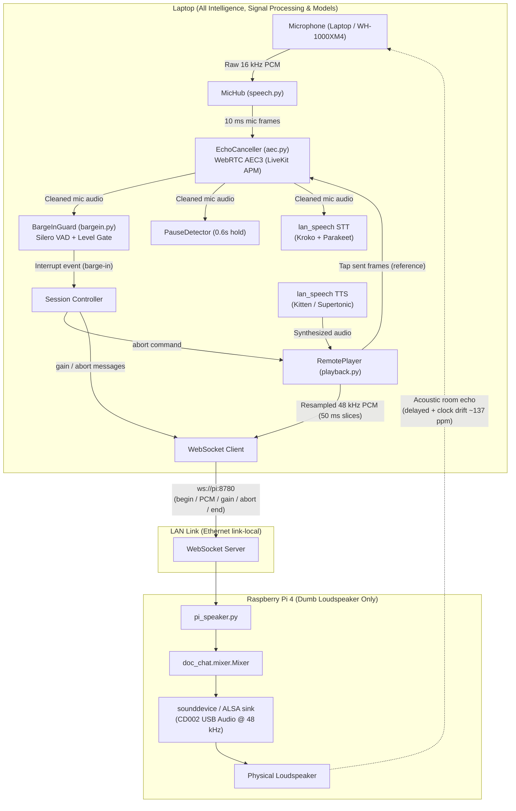

# Audio Input, Output, and Echo Cancellation (AEC) Architecture

**Status:** Current production architecture (branch `agy/interrupts`, November 2026).  
**Key Fact:** **The Raspberry Pi does NOT run, control, or process AEC.** The Pi is strictly a remote output sink (loudspeaker). All audio capture, echo cancellation, VAD, pause detection, speech recognition, and barge-in logic execute on the **Laptop CPU**.

---

## 1. Executive Summary & Component Ownership

| Responsibility | Device | Process / Component | Details |
|---|---|---|---|
| **Audio Input (Mic)** | **Laptop** | `doc_chat` (`MicHub` in `speech.py`) | 16 kHz mono capture from laptop internal mic or Bluetooth headset (WH-1000XM4). |
| **Acoustic Echo Cancellation (AEC)** | **Laptop** | `doc_chat.aec.EchoCanceller` | WebRTC AEC3 via `livekit.rtc.AudioProcessingModule` running in Python on laptop CPU. |
| **Barge-In / Interruption Guard** | **Laptop** | `doc_chat.bargein.BargeInGuard` | Dual-stage: Silero VAD (7 of 10 windows @ 0.5) + energy level against learned echo floor. |
| **Turn-Ending Pause Detection** | **Laptop** | `lan_speech.pause.PauseDetector` | Evaluates clean audio after `vad_hold` (0.6 s default). |
| **Speech-to-Text (STT)** | **Laptop** | `lan_speech` (port 8770) | Hybrid: Kroko streaming partials + Parakeet final transcription. |
| **Text-to-Speech (TTS)** | **Laptop** | `lan_speech` (port 8770) | Kitten TTS (Jasper voice, 24 kHz) or Supertonic-3 (44.1 kHz). |
| **Audio Output Pacing & Transport** | **Laptop** | `doc_chat.playback.RemotePlayer` | Resamples TTS to 48 kHz, feeds laptop AEC reference, streams 50 ms slices over WebSocket. |
| **Audio Output Sink (Speaker)** | **Raspberry Pi** | `scripts/pi_speaker.py` (port 8780) | Receives 48 kHz PCM over LAN, mixes with `Mixer`, outputs to USB speaker (`CD002`). |
| **Pi Microphone** | **None** | **Decommissioned** | Not connected / not recorded in production. |

---

## 2. End-to-End Dataflow Diagram



---

## 3. The Audio Input Path (Laptop)

1. **Hardware Capture**:
   - The microphone source is opened on the laptop via `sounddevice` (PortAudio) or PulseAudio (`--mic-device pulse` when routing headset).
   - Audio format: 16 kHz, 16-bit mono PCM in 100 ms blocks.
2. **`MicHub` Dispatcher**:
   - Manages one continuous recording thread so audio is captured seamlessly across states (while idle, while LLM generates, and while the speaker plays).
   - If `--aec` is enabled, `MicHub` passes each 10 ms slice to `EchoCanceller.process()`.
3. **Laptop-Side AEC Execution (`src/doc_chat/aec.py`)**:
   - Instantiates `livekit.rtc.AudioProcessingModule(echo_cancellation=True)`.
   - **Render Stream (Reference)**: `EchoCanceller.reference()` receives the exact audio chunks the laptop sends to the Pi speaker.
   - **Capture Stream**: `EchoCanceller.process()` feeds the microphone frame in lockstep.
   - The WebRTC AEC3 engine identifies the acoustic impulse response between the Pi speaker and the laptop mic, subtracts the predicted echo, and applies non-linear suppression.
   - **Clock Drift**: Because the laptop microphone soundcard and the Pi USB DAC run on independent quartz oscillators, they drift by ~137 ppm (~8 ms per minute). WebRTC AEC3 tracks this drift dynamically on the laptop.
4. **Downstream Consumers of Cleaned Audio**:
   - **BargeInGuard**: Uses Silero VAD (7/10 windows $\ge 0.5$) combined with an adaptive echo energy threshold.
   - **PauseDetector**: Measures trailing silence to trigger end-of-turn `finalize` (0.6 s default).
   - **STT Engine**: Streams audio frames over WebSocket to `lan_speech` on `127.0.0.1:8770`.

---

## 4. The Audio Output Path (Laptop $\to$ Pi)

1. **Synthesis**:
   - `lan_speech` synthesizes text chunks on the laptop CPU into PCM audio.
2. **Streaming & Pacing (`src/doc_chat/playback.py`)**:
   - `RemotePlayer` resamples audio from the synthesis rate (24 kHz or 44.1 kHz) to 48 kHz (the rate announced by the Pi).
   - Paces audio transmission in 50 ms slices matching real-time playback (never more than ~250 ms ahead of the speaker).
   - **Simultaneously copies the exact 16 kHz downsampled slice into `EchoCanceller.reference()`**.
3. **Pi Speaker Service (`scripts/pi_speaker.py`)**:
   - Runs on the Pi under Python 3.12, listening on port 8780.
   - Authenticates connection using `LAN_SPEECH_TOKEN`.
   - Accepts wire messages:
     - `{"type": "begin"}`: Prepares a new playback channel.
     - Binary frames: 48 kHz 16-bit mono PCM chunks.
     - `{"type": "gain", "db": -15.0}`: Immediately drops volume for ducking when user starts speaking.
     - `{"type": "abort"}`: Clears queued playback buffers and mutes within ~35 ms + 8 ms fade.
     - `{"type": "end"}`: Marks stream complete.
   - **No microphone is opened or monitored by `pi_speaker.py`.**

---

## 5. Why Does Confusion Arise About "Pi AEC"?

If another agent declares that *"the Pi's AEC doesn't control it"* or asks about *"Pi-side AEC"*, here is the historical context:

1. **The Abandoned October 2026 Experiment (Pi-side PipeWire AEC)**:
   - Early in the project (`docs/PI-RESULTS.md`, `docs/RESEARCH-HANDOFF-PI.md`), the team attempted to run a USB microphone directly on the Raspberry Pi with a PipeWire AEC module (`config/pipewire-echo-cancel.conf`).
   - **Why it failed and was abandoned:**
     - The Pi's USB microphone had unusable signal-to-noise ratio (speech was only 5–15 dB above room noise).
     - PipeWire's software AEC caused 1.0 s user-onset delays, round-trip latency jumps (200 ms to 950 ms), and unstable self-triggering at 60% volume.
     - The Pi's CPU was constrained and struggled with simultaneous duplex audio processing.
2. **The Current Production Architecture (Laptop-side WebRTC AEC)**:
   - On 2026-10-23 (`docs/AEC-REMOTE-SPEAKER.md`), the architecture was pivoted permanently:
     - The Pi microphone was completely retired (`docs/ARCHITECTURE.md:68: "Pi microphone: not used"`).
     - The laptop took over all microphone capture.
     - AEC was rebuilt in Python on the laptop (`src/doc_chat/aec.py`) using LiveKit's WebRTC AEC3, using the laptop's network output stream as the reference.
   - Therefore, **the Pi has zero involvement in echo cancellation**. Any agent asserting that the Pi controls AEC is conflating the retired PipeWire prototype with the active codebase.

---

## 6. How to Verify Live

To inspect the active processes and audio routes:

1. **Verify Laptop AEC & Mic**:
   ```bash
   # Run doc_chat with laptop-side AEC enabled
   python -m doc_chat --mic --play-remote ws://$PI_V4:8780 --aec --duck-db -15 ...
   ```
   Check terminal log at startup:
   ```text
   [sounddevice input: 16000 Hz, 100 ms blocks]
   [AEC enabled: WebRTC AEC3 via LiveKit APM (reference tapped from RemotePlayer)]
   ```

2. **Verify Pi is Output-Only**:
   ```bash
   ssh pi "ps aux | grep pi_speaker"
   # Output shows:
   # python -u scripts/pi_speaker.py --device CD002 --rate 48000 --port 8780
   
   # Check active audio devices on Pi:
   ssh pi "arecord -l"  # No recording streams active
   ssh pi "aplay -l"    # Card CD002 is active as playback sink only
   ```
