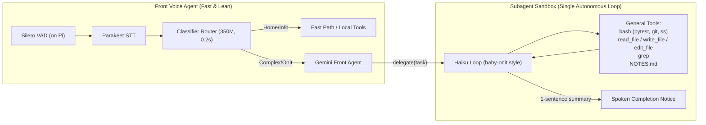

# Architecture Audit & Lean OnIt-Parity Plan: Did We Overengineer the Harness?

Status: **Completed 2026-11-09**.  
Context: Review of the multi-step chain evaluation harness after achieving 8/8 live passes ($0.082) and tightening evaluation predicates, evaluated against the professor's 2026-10-27 added criterion: **"The voice agent must be able to do all that OnIt can do"** (`docs/ONIT-PARITY.md`).

---

## 1. Executive Verdict: Yes, ~35% Accidental Complexity

The core mechanisms solving real failure modes are **genuinely necessary (~65%)**:
- **In-flight lookup deduplication** in `agent_tools.py`: LLMs routinely emit parallel tool calls for a single intent in one turn. Deduplicating concurrent calls with a 10s timeout and `try...finally` resolution saves budget and enforces concurrency limits without deadlocks.
- **Context bridging from chat to sandbox**: Subagents running in isolated sandboxes cannot see earlier voice turns unless search findings and primary URLs are explicitly handed to them.
- **Deliverable type disambiguation**: Subagents originally defaulted all web generation to canvas/game templates (`apps/<name>/index.html`) and spoke game-ready sentences ("say open it to play it"). Explicitly routing markdown, python, and CSV files to `/sandbox/<filename>` is fundamental instruction alignment.
- **Strict source URL validation**: Rejecting bare domains (no path) and unreferenced/unused sources in `SOURCES.json` guarantees citation hygiene.

However, **accidental complexity and technical debt grew around these mechanisms (~35%)**:
1. **Three overlapping memory stores**: Research facts are stored in `chain.json` (regex-parsed from spoken replies), in `/sandbox/scratch/NOTES.md` (written to disk), *and* in concatenated task strings. This created synchronization drift and state bugs.
2. **String-munging vs. tool schema**: Because `delegate(task: str)` takes an unstructured string, we appended programmatic suffixes, stripped them in eval, and wrote 50+ lines of complex regexes to extract dates and versions from the string blob.
3. **Prompt bloat on every voice turn**: Case F in `system_agent.txt` grew from 4,976 to ~6,541 characters (+31% tokens). Every simple turn ("what time is it?", "turn on lights") pays an unnecessary 25–40 ms TTFT latency tax.
4. **Stacked subagent gate loops**: The subagent runs up to 3 separate post-run interventions (sources gate, content lint with figure-counting regexes, and a 7-step warning).
5. **10-minute blanket router skip**: Keeps routing ordinary commands to Gemini long after a delegate job has finished, degrading voice latency on subsequent home commands.

---

## 2. The Curveball from the Demo & OnIt Parity

On 2026-10-27, the professor introduced a major scope addition (`docs/ONIT-PARITY.md`):
> *"The current voice agent should be able to do all that OnIt can do."*

OnIt is the professor's autonomous coding and terminal harness (~35k lines); baby-onit is its 1.5k line distillation (*"the model proposes; the harness acts; repeat until the model stops proposing"*). Their flagship tasks are:
1. **Document Q&A with citations** over local folders (`local_search` + `read_file`).
2. **Build a web app from scratch** (`write_file`, `bash` `pytest`, `edit_file`, `git commit`).
3. **Run a security audit** on a server and write findings to a report (`bash ss`, `df`, `find`, `write_file`).
4. **Manage long-running jobs** (`serve` / `delegate` start, status, logs, stop).

### How the Current Stack Measures Against OnIt's 73 Benchmark Cases

| OnIt Category | Benchmark Cases | Current Voice Agent Support | Status |
|---|:---:|---|:---:|
| **Shell Commands** (`s01`-`s14`) | 14 | `code.py` `bash` tool with read-only host policy | **Supported** |
| **File Operations** (`d07`-`d14`) | 8 | `read_file`, `write_file`, `edit_file`, `grep` in `code.py` | **Supported** |
| **Safety Blocklist** (`f01`-`f05`) | 5 | `shell_policy.py` refuses `sudo`, root deletion, `shutdown` | **Supported** |
| **Web Research** (`w01`-`w07`) | 7 | `web_research` (Tavily), `web_answer`, curl in subagent | **Supported** |
| **Code / Edits** (`c01`-`c06`) | 6 | `edit_file`, `write_file` in sandbox with git identity | **Supported** |
| **Background Jobs** (`v01`-`v06`) | 6 | `delegate` starts async job, frees mic, sends completion event | **Supported** |
| **Multi-turn Dependent** (`m01`-`m03`) | 3 | Files persist in `/sandbox` across turns; chain state tracks job | **Supported** |
| **Workflows** (`e01`-`e08`) | 8 | Research/compare works (`product_table`); iterative test-and-fix loop unverified | **Partial** |
| **Document Search** (`d01`-`d06`) | 6 | `docs.py` (BM25) hardcoded to Cormac McCarthy sample corpus | **Gapped** |

---

## 3. The Minimal Lean Set for the Demo

To deliver OnIt parity without compounding overengineering or harming voice latency, we adopt **baby-onit's minimal philosophy**: *keep tools general, keep the loop simple, and avoid specialized scaffolding.*

### The 4 Elements of the Minimal Lean Set:

1. **A Single General-Purpose Sandbox Loop (baby-onit parity)**:
   - Do not build separate specialized harnesses for app building, security auditing, and research.
   - The subagent already has `bash`, `write_file`, `edit_file`, `grep`, and `git`. It can run `pytest`, inspect errors, edit code, and commit.
   - That single loop covers OnIt flagship tasks 2 (build web app) and 3 (security audit) out of the box.

2. **Folder-Parametric Document Search (`local_search`)**:
   - Generalize `docs.py` to accept an optional `path` parameter: `search_docs(query: str, path: str = ".")`.
   - Run BM25 over files in the requested directory on demand.
   - Covers OnIt flagship task 1 (local document Q&A) without external vector databases or heavyweight indexing pipelines.

3. **Single Memory Source of Truth (`NOTES.md`)**:
   - Retire the regex fact-parsing in `chain.json` and task string munging.
   - Front agent lookups write directly to `/sandbox/scratch/NOTES.md`.
   - The delegate prompt simply says: *"Read /sandbox/scratch/NOTES.md for context."*
   - Eliminates ~80 lines of state synchronization code.

4. **Dynamic Prompt Scoping (Protecting Voice Latency)**:
   - Move the ~1,560 characters of Case F multi-step research/coding rules out of the base `system_agent.txt`.
   - Inject them only when the router escalates to a complex task or when a chain is active.
   - Normal voice turns ("turn on the lights", "what time is it?") stay at base prompt size, preserving fast 500ms TTFT.

---

## 4. Pruning & Implementation Roadmap

| Phase | Target Area | Action | Benefit |
|---|---|---|---|
| **Phase 1** | **Memory Consolidation** | Make `NOTES.md` the sole research artifact; stop regex-parsing spoken facts into `chain.json`. | Eliminates synchronization bugs and token redundancy. |
| **Phase 2** | **Dynamic Prompt Scoping** | Move Case F research rules into dynamic `[ACTIVE TASK]` prompt blocks. | **-25ms to -40ms TTFT** on ordinary conversational turns. |
| **Phase 3** | **Router Window Tightening** | Expire the router-bypass immediately upon delegate completion. | Restores 200ms router response for voice commands after jobs finish. |
| **Phase 4** | **Subagent Gate Merging** | Combine sources check and lint into a single pre-finish pass; prune unsourced-figure regex. | Faster subagent finish time (~1-2s saved per job). |
| **Phase 5** | **Generalize `local_search`** | Add `path` argument to `docs.py` for on-demand folder BM25 search. | Completes OnIt Flagship Task 1 parity. |

---

## 5. Verification Standard

Every pruning and simplification step must strictly satisfy:
1. `make test-chain`: 100% pass across root (443+) and pipeline (48+) test suites.
2. `make chain-eval-dry`: 8 of 8 scenarios pass offline ($0.000 spend).
3. `make pipeline-check` and `uv run ruff check src`: 0 errors.
4. Target evaluation spend remains $\le$ $0.010 per scenario trial.
