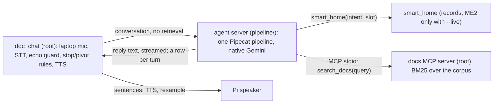

# The agent in the live voice loop: smart_home + docs MCP, spoken test (2026-10-23)

**Bottom line.** `doc_chat --llm agent` runs the live loop (laptop mic, echo guard, Pi speaker at 80%) with a Pipecat agent behind it: native Gemini 3.1 flash-lite, the `smart_home` tool (open slots, JSON phonebook for CALL and MESSAGE) and a docs MCP server (fastmcp) for the McCarthy corpus. Tool routing was right on every quiet turn, judged against what the recogniser heard, and pivots after an interruption were acted on correctly (6 of 6). Two things are not good enough yet: **latency** (home commands 3.3 s from your last word to the first answer sound, against 2.3-2.6 s before tools) and **echo** (the Pi speaker's voice reaches the transcript ahead of your words, which broke plain "Stop." and made the assistant act on its own voice once). The cross-device echo canceller in `docs/AEC-REMOTE-SPEAKER.md` is the proposed fix. One speaker, one room, one session each; small counts.

## What was built (by agy from level-3 tickets, in two waves, inside the bubblewrap fence)

| Piece | Where |
|---|---|
| `smart_home` with open slots and `pipeline/config/phonebook.json` (Anna, Ben, Mom, Dr. Reyes, Carlo; names are in the tool description, others are refused) | `pipeline/src/voice_pipeline/tools/smart_home.py` |
| Docs MCP server (fastmcp 2.14.7): `search_docs(query, top_k)` | `src/voice_agent/mcp_servers/docs.py` |
| `doc_chat --llm agent --agent-url ws://127.0.0.1:8781`: a chat model streaming from the agent server; hanging up cancels the turn | `src/doc_chat/agent_client.py` |
| The agent: one long-lived pipeline, `ask` / `cancel`, per-turn timings, `idle_timeout_secs=None` | `pipeline/src/voice_pipeline/agent.py`, `agent_tools.py` |
| Stress dry run (72 prompts, 77 turns, native Gemini only) | `pipeline/src/voice_pipeline/dryrun.py`, `config/eval/agent_prompts.jsonl`, `system_agent.txt`; `make agent-dryrun` |
| The agent server (ws://127.0.0.1:8781, one row per turn in `pipeline/out/agent_server/`) | `pipeline/src/voice_pipeline/agent_server.py`; `make agent-server` |

Both waves came back byte-identical to the tickets with no deviations (a network drop ended agy's run on ticket 03 before its Proof; I ran it and logged the result); the one defect found afterwards was mine (the ticket's reference code left Pipecat's 5-minute idle timeout on, which cancelled the pipeline during a pause in the live test; every request then timed out after 20 s). Details: `.scratch/live-agent/`.

## Stress dry run on the integrated code (77 turns, native Gemini)

75 of 77 exactly right (no leaks, no failed turns): docs 9/9, free values 9/9, canonical 17/17, multi-turn 10/10, mixed home+docs 3/3. The two misses: "I'm cold" still gets a guessed temperature (the earlier shared failure), and "Call Gary" (not in the phonebook): the model tried `CALL Gary`, the tool refused it from the phonebook and the model said so, which is the right behaviour but counts as a miss for the scorer, since the prompt expects no call. Spoken reply 1.82 s p50 after a tool turn, 0.85 s on a plain turn (from the LLM's input; no STT or TTS).

## Spoken session 1: quiet (`out/sessions/agent-quiet-1`)

20 lines read; 19 recorded (line 11 "Wake me up at six thirty tomorrow" is missing from the records).

| Turn type | n | Stop to first answer audio p50 (range) | LLM first text p50 | STT final p50 |
|---|---|---|---|---|
| Home command | 13 | **3.33 s** (2.79-3.98) | 2.06 s | 0.94 s |
| Docs question | 3 | 2.86 s (2.68-3.53) | 1.64 s | 0.79 s |
| No tool | 3 | 2.30 s (2.05-4.97) | 1.07 s | 0.90 s |

- Routing was right on every turn, judged against what Parakeet heard: `search_docs` for the three document questions, then `COLOR purple`, `TEMPERATURE 24 degrees`, `TIMER 45 minutes`, `CREATE_REMINDER "call the dentist"`, `CALL Anna` (for "my sister"), `MESSAGE Anna`, `ALARM 7:15 AM` (after "Set an alarm" was answered with a question), `TIME`, `LIST_REMINDERS`. The model asked instead of guessing when the time was missing.
- **One wrong action, caused by recognition:** "Turn off the lights and pause the music" was heard as "The lights and pause the music", so it turned the lights **on** and paused. "The Pulitzer Prize", "The Road About." and "Timer for forty five minutes" also lost their opening words but still routed correctly. This is ticket 26 (first words), and the first time it caused a wrong action.
- **Slower than before tools:** the last validated run (Gemini answering with passages in its prompt) was 2.26-2.57 s. A home command now costs two LLM requests (the call at 1.03 s p50, the confirmation at 1.98 s p50), about 0.8-1 s more.
- **Echo guard: 2 false triggers** (0 of 14 in the last validated run): a long answer cut at 9.1 s and the opening check at 2.3 s; the text guard recognised the bot's own words and ignored them, but playback had already stopped. The reminders answer stopped 0.27 s in (echo or you; unknown).

## Spoken session 2: interruptions (`out/sessions/agent-interrupt-2`)

The first attempt was discarded (my script mixed plain stops and questions and was run unevenly); the redo had 8 scripted interruptions, each starting with "Stop.". `scripts/cue_report.py`: 17 cued replies, 12 stopped after the beep, 4 played to the end, 1 stopped before the beep; **beep to stop p50 0.41 s, p95 0.49 s (n=12)**; playback cut within 0-12 ms of each decision.

| # | Said at the beep | Heard | Result |
|---|---|---|---|
| 1 | Stop. | "Five novels at Bobby." (echo; the stop was lost) | not stopped cleanly; junk turns followed |
| 2 | Stop. Turn on the lights. | "Turn on the lights." | `LIGHT_ON`, answer after 3.0 s |
| 3 | Stop. What year was it published? | "First book in the Border Trilogy. Stop! What year..." | correct, 1992, after 3.3 s |
| 4 | Stop. Set a timer for ten minutes. | "2005 border. Stop. Set a timer..." | timer set, plus a spurious music `STOP`; then it heard its own confirmation and **set a second, 1-minute timer** |
| 5 | Stop. | "Novel published in 2007." (echo) | answered the echo as a question |
| 6 | Stop. Play some music. | "Play some music" | `PLAY_MUSIC` (3.9 s); the Passenger answer was never spoken |
| 7 | Stop. When did he die? | "Joseph McCartney Chief Stop, when did he die?" | correct answer plus a spurious music `STOP` |
| 8 | Stop. Pause the music. | "Second, novel stop pause the music." | paused, plus a spurious `STOP` |

**Cause, one for all of it:** the microphone hears the Pi speaker, and the words spoken just before the cut come into the transcript ahead of yours. A bare "Stop." is drowned; "Stop" that is not at the start of the transcript is not stripped, so Gemini reads it as the music command (3 times); and the bot acted on its own voice once. Pivots to a tool or a new question were acted on correctly 6 of 6.

## Spoken session 3: the same interruptions with `--aec --duck-db -15`, speaker in front (`out/sessions/agent-interrupt-aec-1`)

The code is `src/doc_chat/aec.py` (WebRTC canceller, reference = what is sent to the Pi, 50 ms lead) and the duck (`Ducker`, `pi_speaker.py` gain message), written by agy from level-3 tickets (byte-identical, no deviations; `.scratch/echo-fix/`). The Pi ran the updated `playback.py` and `pi_speaker.py`. Same script as session 2, speaker 80%, now placed in front of the laptop. The agent server had stopped (its background job's time limit), so the first question was answered "couldn't reach the language model" and re-asked.

| # | Said at the beep | Heard | Result | Session 2 (no cancelling, speaker behind) |
|---|---|---|---|---|
| 1 | Stop. | "Stop!" | stopped, clean | lost in echo, junk turns |
| 2 | Stop. Turn on the lights. | "Turn on the lights." | `LIGHT_ON`, 2.8 s | correct |
| 3 | Stop. What year was it published? | "Come on. Want you what is published?" | **garbled**, irrelevant answer | correct, with echo text in front |
| 4 | Stop. Set a timer for ten minutes. | "Set a timer for ten minutes." | `TIMER`; **no second timer, no spurious `STOP`** | timer + spurious `STOP`, then a second timer from its own voice |
| 5 | Stop. | (nothing) | **missed**: the model took 6 s to start, the reply played on | answered the echo as a question |
| 6 | Stop. Play some music. | "Please come to sit." | **garbled** | correct (3.9 s) |
| 7 | Stop. When did he die? | "When did it die?" | correct answer, no spurious `STOP` | correct plus a spurious `STOP` |
| 8 | Stop. Pause the music. | "Pause the music." | paused, no spurious `STOP` | paused plus a spurious `STOP` |

**What improved:** no transcript began with the bot's own words (0 of 7; session 2 had them in 5 of 8); 0 spurious `STOP` commands (3 before); no action on its own voice (1 before); no turn needed the text guard (0 ignored-echo records, 1 before); a bare "Stop!" was heard cleanly once.

**What got worse or is unproven:**
- 5 of 8 scripted interruptions ended in the right action (session 2: 6 of 8, but 5 of those with side effects). Two were **garbled at the start** ("Stop. What year..." became "Come on. Want you what..."): the canceller's suppression is hardest on the first words of a voice over a playing reply, which is also where the duck acts. This session cannot separate the canceller from the duck.
- **False ducks on quiet replies:** the reply ducked on 3 of 7 replies nobody talked over (the voice detector plus the level bar fired on residual echo or the beep); it restored 0.6 s later. One quiet reply was stopped outright ("causal" heard from the "natural causes" in the bot's own answer, which then drew a "could you clarify" reply).
- Beep to stop p50 **1.34 s** (session 2: 0.41 s; n = 9). This includes the owner's reaction time, which varied, so it does not show a slower detector by itself.
- Stop to first answer audio p50 3.04 s (n = 7), unchanged; one answer took 6.5 s because the first token took 6 s.
- One speaker, one room, one session each, 8 scripted interruptions: nothing here is a rate.

**Reading:** cancelling the echo removes the failures the echo caused (junk transcripts, commands from the bot's own voice) without a better speaker position, but it costs the opening words of an interruption in some cases. The next step is an A/B on the same script, `--aec` alone against `--duck-db -15` alone, to see which one damages the first words, then tune (a later duck, a higher `--duck-k`, or feeding the recogniser the pre-cancellation audio for the first second).

## The A/B: which part does what (`agent-interrupt-ab-aec`, `agent-interrupt-ab-duck`)

Two more runs of the same 8 scripted interruptions, speaker in front, 80%: `--aec` alone (arm 1) and `--duck-db -15` alone (arm 2). In arm 1 the owner also said some unscripted apologies, so its counts are rough. One session per condition, 8 interruptions each: a comparison, not rates.

| | Session 2: none, speaker behind | Arm 1: `--aec` only | Arm 2: `--duck-db -15` only | Session 3: both |
|---|---|---|---|---|
| Replies cut off before the beep by the bot's own voice | 1 | **7 of 20** | **0 of 14** | **0 of 16** |
| Beep to stop p50 | 0.41 s | 0.36 s (n=4) | 0.39 s (n=12) | 1.34 s (n=9) |
| Transcripts starting with its own words | 5 of 8 | about 2 | 5 of 8 | **0 of 7** |
| Junk turns (its own words answered) | about 4 | 6 | 1 answered, 2 ignored by the text guard | 1 |
| Wrong or spurious actions | 3 `STOP`, a second timer | 1 `STOP`, 1 contact lookup | 1 (played music instead of pausing) | 0 |
| Opening words garbled or lost | 0 of 6 | 2 of 6 | 1 of 6, 1 lost | 2 of 6 |
| Scripted interruptions ending right | 6 of 8 | 3-4 of 8 | 6 of 8 | 5 of 8 |

- **Cancelling works as an echo canceller**: the microphone level during replies fell from -29.3 dBFS (session 2) to -43.7 (arm 1), almost the room floor (-44), and the echo-to-played ratio from 0.33 to 0.07 at the median. It did **not** stop the guard firing on residual bursts in the first 0.4-1.2 s of a reply: 7 of 20 replies were cut off with no voice and no beep (high level, Silero confidence 0.7-0.9).
- **The duck is what stops those**: the guard needs about 0.22 s of speech to fire, the duck acts after two windows and turns the Pi down 15 dB, which removes the bot's own echo before the guard completes; a real voice is not removed, so the guard still fires. With the duck there were no early fires, with or without cancelling, and the stop stayed fast (0.39 s).
- **The canceller is what cleans the transcript**; without it the echo is in the text as in session 2 (5 of 8 started with the bot's words), and arm 2's one wrong action ("Stop. Pause the music." heard as "Second novel Stop, Play S...", so it played music) came from that.
- **The canceller also costs the opening words** (2 of 6 garbled in each run that had it, 0-1 of 6 without), and the slow stop in session 3 (1.34 s) appeared only in the run with both (it includes the owner's reaction time).

**Next:** (1) text-level guards (drop leading words that match what the bot was just saying; an interruption that is only echo counts as a stop; never run a home command whose words match the bot's recent speech), which would fix arm 2's failures without the canceller's cost; (2) try the canceller for the guard only and give the recogniser the uncancelled audio, then compare the opening words; (3) keep the duck on.

## What comes next

1. ~~Cross-device echo cancellation (`--aec`) and duck-then-stop (`--duck-db`)~~: built and tried in session 3 above; the A/B to separate their effects on the first words is next.
3. Text-level guards: drop leading words that match what the bot was just saying; an interruption that is only echo counts as a stop; never run a home command whose words match the bot's recent speech.
4. For latency: speak an acknowledgement (or the tool's result from a template) when the tool call arrives, instead of waiting for the second request; roughly 3.3 s to 2.3 s on home commands.
5. Ticket 26 (first words), because a dropped "Turn off" now means a wrong action.
