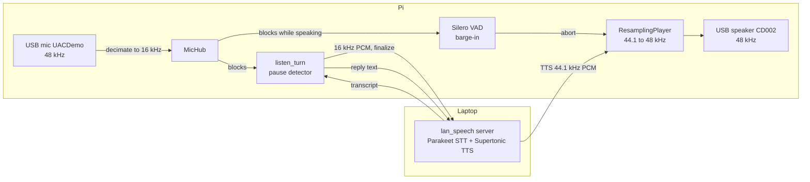

# Pi bridge: Pi microphone and speaker, laptop speech models

`scripts/pi_bridge.py` runs on the Raspberry Pi. It listens through the Pi's microphone, sends the audio over the LAN to the laptop's `lan_speech` server (Parakeet STT), says the reply through the Pi's speaker using the laptop's TTS (Supertonic), and stops talking if the user talks over it. The Pi runs **no speech model**; the only model on it is the Silero VAD (barge-in), as the professor's rule allows.

The setup the project is moving to instead, with the laptop owning the microphone and the Pi only the loudspeaker, is in `docs/PI-REMOTE-SPEAKER.md`; this bridge keeps the Pi-microphone path working.

There is no language model: the reply is `You said: <transcript>`, so the loop measures only STT and TTS. Measured 2026-10-23, one speaker, one room, 10 turns per run.



## Run it

**Network.** The Pi and laptop are joined by an Ethernet cable (link-local `169.254.x.x`). The laptop's firewall must let the Pi reach the server port (it rejects it by default on the `public` zone); a runtime-only rule is enough: `sudo firewall-cmd --zone=trusted --change-interface=<cable interface>`.

**Laptop** (bind to the cable address; off loopback a token is mandatory):

```bash
export LAN_SPEECH_TOKEN=$(python3 -c "import secrets;print(secrets.token_urlsafe(24))")   # never print it
uv run --group laptop python -W ignore -m lan_speech --host <laptop cable ip> --port 8770 \
    --stt-model parakeet --entities config/entities-docs.json
```

Put the same token on the Pi in a file only you can read (`umask 077; cat > ~/.config/lan_speech_token`).

**Pi** (inside the repository, with the venv from `docs/PI-TEST-PLAN.md`):

```bash
uv pip install --python .venv/bin/python "websockets>=17.2"          # once; not in the pi group
export LD_LIBRARY_PATH=$HOME/.local/portaudio/usr/lib/aarch64-linux-gnu   # if PortAudio is unpacked in ~/.local
export LAN_SPEECH_TOKEN=$(cat ~/.config/lan_speech_token)
.venv/bin/python -u scripts/pi_bridge.py --server ws://<laptop cable ip>:8770 --pause 1.2 \
    --latency-log out/pi_bridge/latency.jsonl
```

Say "goodbye" to stop. `kill -USR1 <pid>` prints where every asyncio task is waiting, and the status line every 2 s shows the phase and the microphone peak.

## Pi setup in one command

For the laptop-microphone / Pi-loudspeaker stack (`docs/PI-REMOTE-SPEAKER.md`). Nothing about the Pi is hard-coded: `make pi-detect` finds it and writes `config/pi.env` (gitignored; `config/pi.env.example` shows the keys).

| Command | Where | What |
|---|---|---|
| `make pi-detect` | laptop | cable interface and `169.254.x.x` address; finds the Pi (`ip neigh`, `ping -6 ff02::1%IF`, last known addresses); ssh with the key; compares 12-character token hash prefixes (never the token); reads the speaker's sound-card name (`CD002-AUDIO`, not a card number); checks the repo and `.venv` on the Pi. Read-only on the Pi. A failure names the step, gives a fix, exits non-zero and writes nothing. |
| `make up` | laptop | detects the Pi first if `config/pi.env` is missing or older than `PI_ENV_MAX_AGE_MIN` (120); starts router, speech server, Pi speaker and device tools (ssh), then the agent server. Stops at the first problem. Parts: `up-laptop`, `up-pi`, `restart-agent`. |
| `make talk` | laptop | the live loop in the foreground (needs the microphone) |
| `make status` | laptop | read-only; `PI_LOGS=1` adds the Pi logs and temperature |
| `make down` | laptop | stops what `up` started: laptop services by PID file (`out/stack/pids`), Pi services by their PID files |
| `make pi-env` | laptop | copies `config/pi.env` to the Pi's repo |
| `make pi-clips` | laptop | regenerates `tests/fixtures/pi_echo` (deterministic) and rsyncs it to the Pi; the clips are small and tracked, so `git pull` on the Pi also works |
| `make pi-check` | **on the Pi** | `config/pi.env` loads, venv, token file mode 600, speaker present, the six clips; lists everything missing |

`DRY=1` prints the commands and runs nothing (`make up DRY=1`). Settings are overridable like `make up ROUTER_MODEL=router-350m-kd-s0 ENTITIES=config/entities-docs.json KITTEN_VOICE=Jasper`; see the top of the `Makefile`. Logs are in `out/stack/logs/`.

First time on a fresh Pi: get the repo and `scripts/stack/` there (git pull), then `make pi-detect pi-env` on the laptop and `make pi-check` on the Pi. Optional, so the Pi services start at boot: `deploy/install-pi.sh` on the Pi installs the user units `deploy/systemd/pi-speaker.service` and `pi-device-mcp.service` (they read `config/pi.env` through `EnvironmentFile` and the token from `~/.config/lan_speech_token`); start them with `make up PI_START=systemd`. The ssh host key is pinned in `config/pi_known_hosts` on first contact (delete it if the Pi is reinstalled).

## Things that would otherwise cost an hour

| Symptom | Cause | What the bridge does |
|---|---|---|
| No sound, no error | The ALSA `default` device on this Pi is HDMI, not the USB speaker (pipewire-alsa is only unpacked under `~/.local`) | Plays straight to `CD002` |
| `Invalid sample rate` on the speaker | The USB speaker opens only at 48 kHz; the TTS is 44.1 kHz | `ResamplingPlayer` resamples each chunk (polyphase) |
| `No input device matching 'default'` | ALSA default has no input; the USB mic opens only at 48 kHz | `DecimatingMicHub` opens 48 kHz and decimates to 16 kHz with a filter that keeps state across blocks |
| Server unreachable, `No route to host`, ping works | Laptop `firewalld` rejects the port on the cable interface | Open the port or move the interface to `trusted` (runtime) |
| Long phrases arrive as fragments, each with its own reply | The pause detector counts dips between words as a pause: speech peaks only about 11-15 dB above the room on this mic (-26 to -41 dBFS over a -48 dBFS floor) | `--pause 1.2` (default 0.6); a proper fix is a smarter end-of-turn rule |
| 200 ms lost before every reply | A new Silero session was built per reply (slow on the Pi) | One loaded model, `SileroOnset.reset()` between replies |

## Latency

From the moment the user stops speaking (last sample above the client's loudness threshold) to the first audio handed to the speaker, plus the device's reported 32 ms buffer. 10 turns each (5 short, 5 of 13-15 words), `--pause 1.2`, one speaker, no interruptions. The sound time is an estimate: it was not measured acoustically.

| Stage | Before caching Silero, p50 | After, p50 | After, p95 |
|---|---|---|---|
| Pause hold (client waits for quiet) | 1202 ms | 1202 ms | 1203 ms |
| Server final transcript | 433 ms | 436 ms | 586 ms |
| Bridge overhead before TTS is requested | 203 ms | 2 ms | 5 ms |
| TTS first audio | 375 ms | 317 ms | 338 ms |
| **To first audio chunk** | **2242 ms** | **1953 ms** | **2122 ms** |
| To sound (adds the 32 ms buffer) | 2274 ms | 1985 ms | 2154 ms |

The server stage grows with length: 310-410 ms for 2-4 words, 460-590 ms for 13-15 words. The TTS drop of about 58 ms came with the Silero change but nothing on that path was touched; the cause is unverified.

## What this does not show

- Barge-in was not tested on purpose in these runs (the interrupt path ran in earlier exploratory runs only); no barge-in numbers.
- Latency is not measured acoustically (microphone hearing the speaker), and the "end of speech" is the client's loudness detector, which on this weak microphone can be earlier than the true end.
- Accuracy was not scored. Visible errors: the first words dropped in 3 of 10 turns in one run ("What time is it?" heard as "Is it?"), and "tomorrow" heard as "to morrow".
- One speaker, one room, one run of 10 turns per row.
- The firewall change is runtime-only and the server token was generated for the session; neither is persisted.
