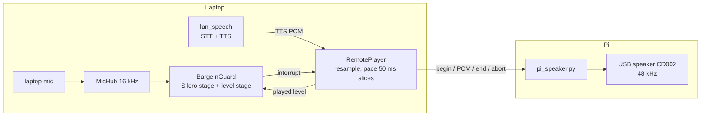

# Laptop microphone, Pi speaker: the echo guard

The production setup being tested: the **laptop** owns the microphone, speech recognition and speech synthesis (`doc_chat` + `lan_speech`); the **Pi is only the loudspeaker**, receiving audio over the LAN. The Pi's own USB microphone is not used (it gave speech only 5-15 dB above its noise, see `docs/PI-RESULTS.md`; its end-of-turn behaviour is in `docs/PI-BRIDGE.md`).

This moves the echo problem, it does not remove it: the laptop microphone hears the Pi speaker across the room. Measured 2026-10-23, one speaker, one room.



## Run it

```bash
# Pi (token in a mode-600 file, never in the shell history)
LAN_SPEECH_TOKEN=$(cat ~/.config/lan_speech_token) .venv/bin/python -u scripts/pi_speaker.py --device CD002 --rate 48000

# laptop (server as in docs/PI-BRIDGE.md); the guard settings below are the measured ones
LAN_SPEECH_TOKEN=... uv run --group laptop python -W ignore -m doc_chat --mic --docs corpus/harry-potter \
    --llm gemini --stream --play-remote ws://<pi>:8780 \
    --vad both --vad-confidence 0.5 --silero-kofn 7/10 --level-kofn 3/8 \
    --barge-echo-quantile 0.95 --barge-echo-window 60 --barge-echo-margin 1.2 --barge-echo-prior 0.8
```

The last four flags matter in the real conversation loop (see "In the real doc_chat loop" below); without them the assistant interrupted itself on every reply.

Protocol (`doc_chat.playback.RemoteSpeaker`): the Pi sends `{"type":"hello","rate":48000}`; the laptop sends `begin`, 16-bit mono PCM frames at that rate, then `end` (finish playing) or `abort` (go silent now; the Pi drops what it holds). The laptop resamples each sentence and sends it in 50 ms slices paced at playing speed, never more than 0.25 s ahead, so an abort stops within the lead plus the device buffer. The bearer token is the speech server's.

## The echo is loud, and Silero cannot tell it from you

`scripts/remote_echo_check.py` plays the six standard reply clips through the Pi while the laptop mic records and the user is silent. Silero (confidence 0.5 or 0.7, 150 or 250 ms) fired on **6 of 6 clips at every volume**:

| Pi volume | Echo above the room at the laptop mic (median / p95 dB) |
|---|---|
| 90% | 18-26 / 26-32 |
| 80% | 12-19 / 20-26 |
| 60% | 2-8 / 9-14 |
| 40% | -2 to 2 / 4-10 |

A speaker-silent control period before the 90, 80, 60 and 40% runs had no Silero windows at 0.5 (a first 40% run in which someone spoke was discarded). The echo trips Silero even when it sits at the room noise, because the laptop microphone is far more sensitive than the Pi's USB one.

## The guard

`BargeInGuard` (`src/doc_chat/bargein.py`) says "the user" only when **both** stages agree:

* **Silero stage**: 7 of the last 10 32 ms windows are speech at confidence 0.5 (the Pi pilot's rule; unbroken-speech counts reset on every dip inside an utterance).
* **Level stage**: 3 of the last 8 100 ms blocks are above `max(4 x room noise, 1.8 x coupling x played level)`, where `played level` is the loudness of what the laptop just sent to the speaker and `coupling` is the speaker-to-mic ratio, learned from blocks that were not above the bar (prior 0.5, cautious).

The two stages share no state and run on separate threads in `remote_echo_check.py`. That buys no speed: per 100 ms block the Silero stage takes 1.3-1.5 ms (p99 4-7 ms), the level stage 0.2 ms, both together on two threads 1.6-1.8 ms.

### Result (held-out; settings fixed before the run)

Pi speaker at 80%, the user talking close to the laptop microphone, room floor -35 dBFS, 12 clips: the first 6 interrupted ("wait, stop, I have a question") on a beep mixed into the Pi's audio, the last 6 echo-only.

| | Silero stage alone | Echo guard |
|---|---|---|
| Echo-only clips that fired | 6 of 6 | **0 of 6** |
| Interruptions detected | 6 of 6 (but it fires on the echo too) | **6 of 6** |
| Median time from the beep to the fire | - | 0.35 s (0.31-0.91 s) |

Levels in the same windows: the user at -17 dBFS median (p90 -12), the echo alone at -30 (p90 -24). Replaying the recording offline with the same code gives the same decisions on every block (`scripts/guard_replay.py`, `tests/doc_chat/test_guard_replay.py`).

Earlier, weaker conditions (Pi speaker 70%, further away, the user further from the microphone, room -34 dBFS): the older strict rules detected **0 of 3** interruptions; the k-of-n rules detect 3 of 3 with 0 of 3 false (this one is not held out: the rules were chosen after seeing it). The guard was also run on 60% echo-only: 0 of 6 false fires.

## In the real doc_chat loop (2026-10-23, later)

The harness result above did not carry over to a real conversation at first. The history, so the numbers are read correctly:

1. **First live sessions were invalid.** Replies were interrupted constantly and the "questions" it then answered were its own sentences. Two causes were bugs, not tuning: `close()` of the player returned after 2 s although a 12 s reply was still playing, so the assistant started listening to its own tail (fixed: it now waits for the reply's length; covered by tests that fail on the 2 s cutoff); and "wait, stop" was answered as a question (fixed: short utterances made of stop words silence the assistant, also when its own words are attached before them).
2. **Echo-only soak, original guard settings: 7 of 7 replies interrupted** by the assistant hearing itself, 2.5-9.9 s in. The per-block trace (`--trace-guard`) showed why: the bar was 1.8 times the *median* mic-to-speaker level ratio (0.34), but the echo is spiky (p90 0.62, p99 0.79), and the harness room had been noisier (-35 dBFS against -40 dBFS in the live session), which had raised the "4 times the room" floor and hidden it. The user's own voice over a reply has a median ratio of 0.64 and p90 of 1.7, so it separates from the echo only in its upper half.
3. **The fix** follows the echo's peaks: the coupling is the 95th percentile of the last 60 blocks (about 6 s), margin 1.2, a cautious starting value of 0.8, and one echo model kept for the whole session (it used to start blind on every reply). It was chosen on three earlier recordings (the live soak plus two harness runs) by an offline simulator that reproduced the live failure exactly.
4. **Held-out live results with the new settings** (Pi speaker at 80%, laptop mic, model-free random-sentence replies of 4 sentences about 10 s long over the McCarthy corpus, one speaker, one room):

| | Result |
|---|---|
| Echo-only soak: replies interrupted by the assistant hearing itself | **0 of 6** |
| Cue test, quiet replies (nobody talks): interrupted / played to the end | **0 of 8** / 8 of 8 |
| Cue test, cued replies (a beep 2.5 s in; say "wait, stop"): stopped after the beep | **7 of 7**; 0.76 s median from the beep (min 0.41, max 1.45) |
| Cued replies interrupted before the beep | 0 of 7 |
| Its own words heard back as speech (`ignored_echo`) | 0 |
| Stop phrases that only silenced the assistant | 4 of 7 at the time. The other 3 were answered as questions, so it talked again: `A young pilot. Wait, stop!` and `Mr. Ballard. Wait, stop.` (its own words came back in the same turn) and `Quick, stop!` ("wait" misheard). All three are stop commands now, covered by a test that replays them through the conversation loop |

The 0.76 s includes your reaction and the beep's own trip through the speaker (about 0.2 s); the beep is always at 2.5 s, so the cue is predictable and real interruptions will be slower to detect.

**Latency in the loop** (8 completed replies of the cue test, plus 6 of the soak, all with the speech server and the Pi speaker): from the moment you stop to the first answer audio leaving the server, p50 1.69 s (p95 1.75 s): your pause 0.64 s, speech server 0.30 s, the model's fixed 0.30 s, TTS first audio 0.27 s, retrieval 0.7 ms (15 ms the first time; 562 chunks). This excludes the trip to the Pi speaker (about 0.1-0.3 s). Recognition: 11 of 18 scripted questions came back exactly right; 4 of the 7 errors are the first one or two words ( "What prize did The Road win?" came back as "Price did the road win", "Who played Anton Chigurh?" as "Anton Chigurh"), and the others are single words ("Suttree" as "Saturday", "quotation" as "rotation", "papers kept" as "paper steps"). The recorded audio shows the opening words reach the server (a loud onset after seconds of silence), so this is recognition, not transport.

## What this does not show

* **One speaker, one room, 9 interruptions and 15 echo-only clips in total.** The speaker-to-microphone distance and the user-to-microphone distance were not recorded.
* **The cue is predictable** (the beep is always 2.5 s in), so the 0.35 s median after the beep is optimistic for a real, unexpected interruption. It also includes about 0.2 s for the beep to reach the room.
* **A level guard has a ceiling**: it works only when the user is clearly louder than the echo. At 90% volume the echo is 18-32 dB above the room, as loud as speech; that setting was not tried with the guard. Real echo cancellation with the sent audio as the reference would lift the echo ceiling but not the noise ceiling, and was not built.
* The room was 10 dB noisier (-34 to -35 dBFS) in the guard runs than in the first echo runs (-41 to -44); something in the room changed and its cause is unknown.
* The model-free random-sentence replies were used, so the numbers measure interruption, echo and latency but not answer quality; a spoken conversation with a real language model reading the corpus has not been run.
* The echo-only soak had 6 replies and the cue test 15 (7 cued, 8 quiet); the settings were chosen on earlier recordings and these two sessions were run afterwards, but they are small and from one speaker in one room. A louder room moves every threshold.
* The laptop's own speaker output was muted, so an early talk-over run with a beep from the laptop was silent; the cue now comes from the Pi.

## Mistakes found on the way (so they are not repeated)

* The combined guard checked only the current block against the echo bar, so one loud syllable of the assistant's own voice fired it; it now needs sustained evidence (`test_guard_one_loud_block_of_echo_does_not_fire_with_the_model`).
* The offline replay stored beep times relative to the first push but scored them relative to each clip's push, which made every clip but the first look missed: it briefly produced "1 of 3, and no setting can do better" for a run where the k-of-n rules detect 3 of 3. Fixed and covered by `tests/doc_chat/test_guard_replay.py`.
* The replay also reset the guard whenever the played level rose after a pause inside a clip, instead of once per reply.
* The assistant started listening when TTS synthesis was done, not when the speaker was: `Player.close()` joined for 2 s only, and TTS is far faster than playback. It then heard its own tail as the user's next question.
* The echo allowance was built on the median ratio of the echo while the echo is spiky; it also had its learning reset on every reply. A harness run in a noisier room had hidden both.
* A free-running spoken protocol has no ground truth: an interruption of a quiet reply could be a false trigger or the user speaking early. The cue-beep mode (`--cue-beep`, `scripts/cue_report.py`) settles it.
